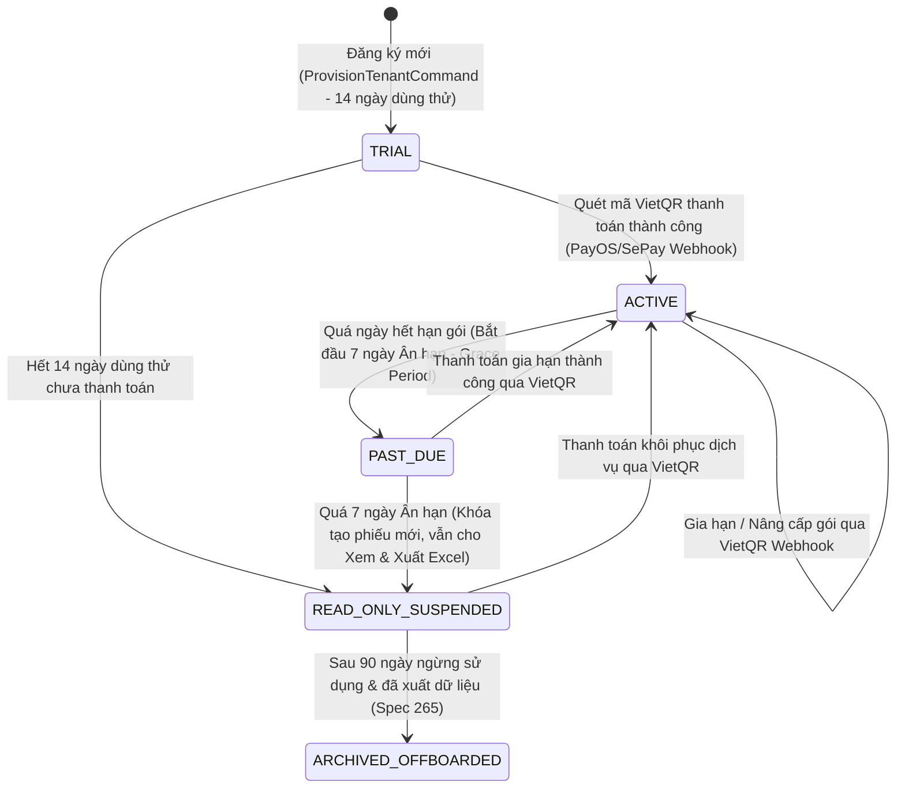
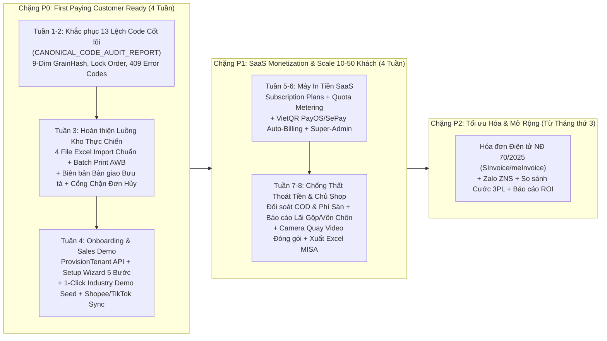

# BÁO CÁO PHÂN TÍCH KHOẢNG TRỐNG SẢN PHẨM & KỸ THUẬT TOÀN DIỆN (COMPREHENSIVE PRODUCT & TECHNICAL GAP ANALYSIS — 2026 VIETNAM E-COMMERCE WMS SAAS)

- **Dự án:** `ERP_KHO` — Hệ thống Quản trị Kho & Hoàn tất Đơn hàng Đa kênh (B2B Managed WMS SaaS)
- **Chiến lược & Nguồn lực:** Solo Developer — **"First Paying Customer Ready"** (Chạy thật, thu tiền thật từ khách hàng đầu tiên với 1 kho thật, 5–30 nhân sự kho, 100–3.000 đơn/ngày trên Shopee, TikTok Shop, Lazada, Website/Facebook/Zalo)
- **Nguồn tài liệu nội bộ đã kiểm toán:** Trang gốc `"ERP WMS – Tài liệu Thiết kế Kỹ thuật Hệ thống"` (`3de558fb-6174-80b9-8a4a-e4b7694b3c63`) và toàn bộ **301 trang con hợp lệ** (`Spec 01–282`, `PHA 1–3`, `AUDIT-OOAD-001`, `ARCH-P4-01..05`, đã đồng bộ `Canonical Spec Baseline OD-01..OD-14`). Tuân thủ tuyệt đối Vùng Cấm (Blacklist): **Không mở, không đọc, không tìm kiếm, không trích dẫn `OWN-OOAD-001..004`**.
- **Ngày thực hiện & truy cập nguồn đối chiếu:** `2026-10-21`

---

## PHẦN 1: TÓM TẮT ĐIỀU HÀNH (EXECUTIVE SUMMARY)

Bộ tài liệu thiết kế kỹ thuật trên Notion của `ERP_KHO` (sau khi đóng băng `OD-01..OD-14`) đạt chất lượng **rất cao ở tầng Lõi Giao Dịch Kho (Core Transactional WMS — Nhóm 1, 8, 9)**: mô hình sổ cái bất biến (`Immutable Inventory Ledger`), tồn kho 9 chiều (`GrainHash`), giữ hàng 2 tầng (`SoftReservation` vs `HardAllocation`), khóa chống âm kho (`UPDLOCK, HOLDLOCK` + `RowVersion`), và kiểm soát nhập/cất/kiểm kê/đảo bút toán chặt chẽ hơn hẳn các phần mềm bán hàng phổ thông tại Việt Nam. **Tuy nhiên**, dưới lăng kính thương mại hóa cho **Khách hàng trả tiền đầu tiên tại Việt Nam (ICP: Shop/Brand D2C/Nhà phân phối 100–3.000 đơn/ngày)**, bộ tài liệu đang mắc hiện tượng **"Lệch trọng tâm chiến lược"**: dành tới **92 trang (`Spec 46–60, 178–204, 235–273`)** viết các bản nháp sơ sài (`STUB_ONLY` 10–25 dòng) cho các tính năng tập đoàn đa quốc gia (Robotics WCS/WES, RFID, Voice Picking, Cold Chain, 3PL Billing, Multi-echelon Network Balancing), nhưng lại **THIẾU (`MISSING`) hoặc MỚI MÔ TẢ KHÁI NIỆM (`PARTIAL` / `STUB_ONLY`) ở các tính năng sống còn để vận hành sàn TMĐT Việt Nam (Nhóm 2, 3, 4, 6) và kiếm tiền SaaS (Nhóm 7, 11)**. Nếu đem đi bán ngay hôm nay mà không lấp **10 Gap `P0`**, khách hàng đầu tiên sẽ không thể kết nối tự động Shopee/TikTok/Lazada, không in được tem nhiệt vận đơn hàng loạt kèm danh sách nhặt hàng, không tự động xử lý được yêu cầu hủy đơn `IN_CANCEL` từ sàn, và Chủ dự án chưa có cơ chế thu phí/giới hạn gói cước SaaS.

### 1.1. Bảng Thống kê Độ phủ theo 11 Nhóm Năng lực (`88 Capabilities`)

| Nhóm (Domain) | Tổng số chức năng | `COVERED` (Đủ sâu để code) | `PARTIAL` (Thiếu DB/API/Luồng VN) | `STUB_ONLY` (Trang khung 5–30 dòng) | `MISSING` (Chưa có trong Notion) | `OUT-OF-SCOPE-NOW` (Hoãn sau khách đầu) | `NOT-APPLICABLE` (Không thuộc ICP) |
| --- | ---: | ---: | ---: | ---: | ---: | ---: | ---: |
| **1. Nghiệp vụ Kho cốt lõi (Core WMS)** | 15 | **13** | 2 | 0 | 0 | 0 | 0 |
| **2. Đặc thù TMĐT Việt Nam (E-Commerce OMS/WMS)** | 12 | 1 | **5** | 1 | **5** | 0 | 0 |
| **3. Vận chuyển & Giao nhận (Carrier & Last-Mile VN)** | 8 | 0 | **3** | **2** | **3** | 0 | 0 |
| **4. Tích hợp & Hệ sinh thái VN (Integrations & Tax)** | 6 | 1 | **2** | 0 | **2** | 1 | 0 |
| **5. Mobile & Phần cứng Kho (Hardware & Floor)** | 5 | **2** | **2** | 1 | 0 | 0 | 0 |
| **6. Báo cáo & Điều hành (Analytics cho Kho & Chủ Shop)** | 6 | **2** | 1 | **2** | **1** | 0 | 0 |
| **7. Nền tảng Kinh doanh SaaS (SaaS Monetization)** | 11 | 0 | 1 | **2** | **7** | 1 | 0 |
| **8. Bảo mật & Tuân thủ Pháp lý (Security & NĐ 13)** | 8 | **5** | 1 | 1 | 0 | 1 | 0 |
| **9. Vận hành Kỹ thuật & Chất lượng (DevOps & QA)** | 6 | **5** | 1 | 0 | 0 | 0 | 0 |
| **10. Trải nghiệm Người dùng (Role-based UX & Setup)** | 5 | **3** | 1 | 1 | 0 | 0 | 0 |
| **11. Thương mại & GTM Readiness (Commercial & Go-Live)** | 6 | 1 | 1 | 1 | **3** | 0 | 0 |
| **TỔNG CỘNG TOÀN HỆ THỐNG** | **88** | **33 (37.5%)** | **20 (22.7%)** | **11 (12.5%)** | **21 (23.9%)** | **3 (3.4%)** | **0 (0.0%)** |

*(Lưu ý: Ngoài 88 năng lực cần thiết cho ICP nêu trên, Phần 4 chỉ ra **92 trang Spec trong Notion** thuộc diện `OVER_ENGINEERED / NOT-APPLICABLE` đối với ICP 1 kho & Solo Dev).*

### 1.2. Điểm danh 10 Gap Nguy Hiểm Nhất (`Top 10 Critical Product & Technical Gaps`)

1. **`[GAP-P0-01]` Thiếu Bảng & Luồng Xác thực/Đồng bộ Đa Gian Hàng (`Shopee v2 / TikTok Shop / Lazada Open API Connector & Channel SKU Mapping` — `PARTIAL/MISSING`):** `Spec 163` mới nêu nguyên lý OMS chung, hoàn toàn **chưa có DB Schema** lưu OAuth Token theo gian hàng (`marketplace_shops`), bảng ánh xạ `1 SKU Kho <-> N SKU Sàn` của nhiều shop trên cùng 1 sàn (`channel_sku_mappings`), và quy tắc **Buffer Stock / Tỷ lệ % đẩy tồn** chống phạt sàn.
2. **`[GAP-P0-02]` Thiếu Luồng Phản hồi Tự động Yêu cầu Hủy Đơn của Người mua trên Sàn (`Marketplace Buyer Cancellation Webhook & Auto-Accept/Reject API` — `PARTIAL`):** `Spec 72` & `Spec 163` đã có trạng thái nội bộ `CANCEL_PENDING_PUTBACK`, nhưng thiếu hẳn cơ chế xử lý trạng thái **`IN_CANCEL` (Shopee) / `CANCELLATION_STATUS_CHANGE` (TikTok)**: tự động gọi API sàn *Chấp nhận hủy* nếu đơn chưa nhặt/đóng gói, hoặc *Từ chối hủy* nếu kiện hàng đã niêm phong/bàn giao bưu tá.
3. **`[GAP-P0-03]` Thiếu Engine Gộp & In Hàng Loạt Phiếu Gửi Hàng Nhiệt Chuẩn Sàn (`Batch Thermal AWB 100x150mm PDF/ZPL Merger + Pick List Footer` — `PARTIAL`):** `Spec 64` & `Spec 164` mới định nghĩa `LabelRequest` từng đơn lẻ. Kho TMĐT 500–3.000 đơn/ngày bắt buộc phải chọn 100 đơn cùng lúc $\rightarrow$ gọi `ArrangeShipment` hàng loạt $\rightarrow$ tải 100 file PDF AWB từ sàn $\rightarrow$ gộp thành 1 luồng in nhiệt `100x150mm` liên tục có in kèm danh sách SKU ngay chân phiếu (hoặc phiếu nhặt gộp) và đánh dấu `IsAwbPrinted` chống in trùng.
4. **`[GAP-P0-04]` Thiếu DB Schema & Quy trình Biên bản Bàn giao Bưu tá điện tử (`Carrier Handover Manifest / Shipper Sign-off` — `PARTIAL`):** `Spec 164 §9` có nhắc tới `Carrier Handover Manifest Scan Verification`, nhưng **trong `Spec 02` (DB Schema) hoàn toàn chưa có bảng `handover_manifests` và `handover_manifest_lines`**. Nếu bưu tá SPX/J&T/GHN lấy 300 kiện mà không có biên bản chốt số lượng + ảnh chụp chữ ký bưu tá gắn với danh sách mã AWB đã quét, khi mất hàng trên đường đi sàn sẽ từ chối đền bù 100%.
5. **`[GAP-P0-05]` Thiếu Luồng Trạm Camera Quay Video Đóng Gói & Khui Hàng Hoàn gắn Timestamp/AWB (`Packing & Return Video Evidence Workstation` — `PARTIAL`):** `Spec 62` chỉ là bảng đính kèm file chung (`Attachments`). Thực tế kho TMĐT Việt Nam cần màn hình Packing/RMA kết nối trực tiếp Webcam USB/IP Camera: quét mã AWB $\rightarrow$ tự động bắt đầu ghi hình (hoặc đánh dấu mốc `StartTimestampUtc – EndTimestampUtc` vào luồng RTSP/Local Recorder), nhúng overlay mã AWB + thời gian lên góc video để làm bằng chứng kháng cáo Shopee/TikTok trong 3 giây.
6. **`[GAP-P0-06]` Thiếu Công cụ Khởi tạo Kho & Nhập Tồn Đầu Kỳ 1-Click cho Khách hàng mới (`First-Time Warehouse Setup Wizard & Opening Balance Excel Cutover` — `STUB_ONLY/PARTIAL`):** `Spec 264` chỉ là 10 dòng runbook chữ, còn `Spec 63/76` chưa định nghĩa **Template Excel Nhập Tồn Đầu Kỳ (`Opening Stock Cutover`)** tự động khởi tạo đồng thời `Product + UOM + Barcode + Location (Zone/Bin) + InventoryBalance + Opening InventoryTransaction` kèm giá vốn ban đầu. Không có công cụ này, khách hàng đầu tiên sẽ mất 2 tuần nhập tay mới chạy được kho.
7. **`[GAP-P0-07]` Hoàn toàn thiếu Phân hệ Đối soát Tiền Thu Hộ (COD), Phí Sàn & Cước Vận Chuyển (`COD & Marketplace Fee Settlement Reconciliation` — `MISSING`):** Tìm khắp 301 trang Notion chỉ có đối soát tồn kho (`Spec 82/151`) và biên giới kế toán (`Spec 155/156`), **không có bất kỳ Spec nào đối soát tiền COD từ GHN/GHTK/ViettelPost hay đối soát doanh thu/phí sàn Shopee/TikTok** (đơn đã giao nhưng sàn/hãng vận chuyển chưa trả tiền, hoặc trừ lố phí vận chuyển do cân sai trọng lượng).
8. **`[GAP-P1-01]` Hoàn toàn thiếu Nền tảng Thu Tiền & Quản lý Gói Cước SaaS (`SaaS Subscription Plans, Usage Metering, Quota Enforcement & VietQR/PayOS/SePay Billing` — `MISSING`):** `Spec 56` và `Spec 246` là tính năng tính phí thuê kho 3PL (chủ kho thu tiền người gửi hàng), **không có bất kỳ bảng hay Spec nào cho chính Chủ dự án `ERP_KHO` thu tiền thuê bao SaaS hàng tháng từ các Shop** (Quản lý gói Basic/Pro/Enterprise, đếm số đơn/tháng, số kho, số user, cảnh báo hết hạn dùng thử `Trial`, thanh toán tự động qua VietQR/PayOS/SePay).
9. **`[GAP-P1-02]` Thiếu Tích hợp Hóa đơn Điện tử Chuẩn Thuế Việt Nam (`Nghị định 123/2020/NĐ-CP & Nghị định 70/2025/NĐ-CP — Viettel SInvoice / MISA meInvoice / VNPT` — `MISSING`):** Từ ngày 01/06/2025, **Nghị định 70/2025/NĐ-CP** siết chặt việc xuất hóa đơn điện tử đối với giao dịch TMĐT và bán lẻ. `Spec 156 §8` chỉ ghi *"WMS không tự tính thuế hóa đơn"*, chưa có adapter đẩy dữ liệu phiếu xuất/đơn sàn sang Viettel SInvoice / MISA meInvoice để phát hành HĐĐT tự động.
10. **`[GAP-P1-03]` Thiếu Quy tắc Tự động Tặng Quà Kèm Đơn (`Promotional Freebie / Gift-with-Purchase Rules`) & Chế độ Gom Đơn Flash Sale 1-SKU (`Single-SKU Express Batch` — `MISSING/STUB_ONLY`):** Trong ngày Sale đôi (`10.10`, `11.11`, `12.12`), 60% đơn hàng của Shop là các đơn trùng 1 sản phẩm mồi hoặc có quà tặng kèm theo giá trị đơn. Không có rule tự động chèn SKU quà tặng và gom đơn 1-SKU để in 100 tem dán thẳng không cần qua giỏ nhặt lẻ, kho sẽ bị vỡ trận SLA giao hàng của sàn.

---

## PHẦN 2: MA TRẬN ĐỘ PHỦ TOÀN DIỆN (MASTER CAPABILITY COVERAGE MATRIX — 11 NHÓM, 88 CHỨC NĂNG)

### Nhóm 1: Nghiệp vụ Kho cốt lõi (Core WMS — `15 Capabilities`)

| Mã | Nhóm | Chức năng (Capability) | Chuẩn tham chiếu bên ngoài (Tên hệ thống + URL + Ngày truy cập) | Trạng thái (6 Nhãn) | Dẫn chứng Notion (`Mã Spec + Tên mục + Trích dẫn ngắn`) | Phân tích Độ sâu / Điểm còn thiếu |
| --- | --- | --- | --- | --- | --- | --- |
| **CAP-01.01** | Nhóm 1 | **Master Data Sản phẩm, Đa ĐVT (`Single Base UOM`), Barcode & Kích thước/Trọng lượng** | - **Odoo 18 Inventory** (`https://www.odoo.com/documentation/18.0/applications/inventory_and_mrp/inventory.html` — `2026-10-21`) - **ERPNext Item & UOM** (`https://docs.erpnext.com/docs/user/manual/en/stock/item` — `2026-10-21`) | `COVERED` | - `Spec 01 §3 (INV-001)`, `Spec 02 §6 (Product Master)`, `Spec 65`: *"Mọi tồn kho lưu theo Base UOM (`decimal(19,4)`), bảng `product_uoms` lưu `conversion_factor decimal(18,8)`"*. | Đã đặc tả cực kỳ sâu: có đủ DBML (`products`, `uoms`, `product_uoms`, `product_barcodes`), bất biến không đổi Base UOM sau khi phát sinh giao dịch, hỗ trợ trọng lượng/thể tích. |
| **CAP-01.02** | Nhóm 1 | **Sơ đồ Vị trí Kho phân cấp (`Warehouse -> Zone -> Aisle -> Rack -> Level -> Bin`) & Sức chứa** | - **Odoo 18 Storage Locations** (`https://www.odoo.com/documentation/18.0/applications/inventory_and_mrp/inventory/warehouses_storage/inventory_management/use_locations.html` — `2026-10-21`) | `COVERED` | - `Spec 02 §4 & §5 (Zones & Locations)`, `Spec 85`: *"Bảng `locations` có `location_type (RECEIVING, STORAGE, PICK_FACE, STAGING, SHIPPING, QC, QUARANTINE, DAMAGED, REJECTED)`, `max_weight`, `max_volume`"*. | Đã đủ sâu để code ngay: có đủ cờ `is_pickable`, `is_putaway_allowed`, `is_reservable`, `pick_sequence`, `putaway_sequence` và kiểm tra sức chứa. |
| **CAP-01.03** | Nhóm 1 | **Kế hoạch Nhập kho (`Purchase Order`, `ASN`) & Guardrail Dung sai Nhận vượt (`Over-Receipt Tolerance`)** | - **SAP EWM / Odoo Purchase Receipt** (`https://www.odoo.com/documentation/18.0/applications/inventory_and_mrp/purchase.html` — `2026-10-21`) | `COVERED` | - `Spec 02 §12 & §13`, `Spec 26`, `Spec 33`, `OD-14`: *"Chặn nhận vượt quá dung sai cấu hình (`over_delivery_tolerance_pct`, mặc định `<= 5%`) trừ khi có phê duyệt ngoại lệ `ReceivingDiscrepancy`"*. | Đã có đủ DB Schema (`purchase_orders`, `purchase_order_lines`, `inbound_asns`), State Machine và quy tắc kiểm soát dung sai nhận vượt. |
| **CAP-01.04** | Nhóm 1 | **Nhận hàng Thực tế, Xử lý Chênh lệch (`Receiving Discrepancy`) & Tách bạch `door_rejected_qty` vs `retained_rejected_qty`** | - **Extensiv / Logiwa Inbound Receiving** (`https://www.logiwa.com/blog/warehouse-receiving-process` — `2026-10-21`) | `COVERED` | - `Spec 01 §7 & §30`, `Spec 02 §14`, `Spec 34`, `Spec 282`, `OD-05`: *"`door_rejected_qty` trả ngay tại cửa kho không vào `OnHand`; `retained_rejected_qty` vào `RECEIVING` với `InventoryStatus = REJECTED`"*. | Đã đồng bộ hoàn chỉnh 100% giữa `Spec 01, 02, 34, 41, 71, 282`: giải quyết triệt để bài toán hàng lỗi giữ hộ chờ trả NCC so với hàng từ chối ngay trên xe tải. |
| **CAP-01.05** | Nhóm 1 | **Kiểm định Chất lượng Đầu vào (`Inbound QC & Disposition`) & Ghi sổ Nhập kho (`GoodsReceipt POST`)** | - **Odoo 18 Quality Checks** (`https://www.odoo.com/documentation/18.0/applications/inventory_and_mrp/quality.html` — `2026-10-21`) | `COVERED` | - `Spec 01 §7`, `Spec 34`, `Spec 41`, `OD-05`: *"Trạng thái `DRAFT -> ARRIVED -> RECEIVING -> QC_IN_PROGRESS -> READY_TO_POST -> POSTED -> PUTAWAY_IN_PROGRESS -> COMPLETED`"*. | Đã có đầy đủ State Machine, API (`POST /api/v1/goods-receipts/{id}/qc-inspections`, `POST .../post`), và quy tắc tạo tồn kho tại `RECEIVING`. |
| **CAP-01.06** | Nhóm 1 | **Cất hàng lên kệ (`PutawayTask`) & Bất biến Sổ cái `-Q / +Q` theo Vị trí** | - **Odoo 18 Putaway Rules** (`https://www.odoo.com/documentation/18.0/applications/inventory_and_mrp/inventory/warehouses_storage/advanced_operations_warehouse/putaway.html` — `2026-10-21`) | `COVERED` | - `Spec 01 §8`, `Spec 29`, `Spec 35`, `OD-02`, `OD-05`: *"Chuyển `ASSIGNED -> IN_PROGRESS` khi bấm Start hoặc khi phát sinh `First movement`; ghi `-Q` tại `RECEIVING` và `+Q` tại `STORAGE/DAMAGED/REJECTED`"*. | Đã chuẩn hóa 100% cả State Machine, kiểm tra quét sai kệ/sai hàng (`PUTAWAY_WRONG_BIN`, `PUTAWAY_WRONG_PRODUCT`) và bất biến sổ cái theo vị trí. |
| **CAP-01.07** | Nhóm 1 | **Sổ cái Tồn kho Bất biến (`Immutable Inventory Ledger`) & Tồn kho 9 Chiều (`GrainHash`)** | - **ERPNext Stock Ledger Entry** (`https://docs.erpnext.com/docs/user/manual/en/stock/stock-ledger` — `2026-10-21`) | `COVERED` | - `Spec 01 §5`, `Spec 02 §29 & §30`, `Spec 28`, `OD-02`: *"Grain 9 chiều `(CompanyId, WarehouseId, LocationId, ProductId, LotId, SerialId, HandlingUnitId, InventoryStatus, OwnerId)` với `grain_hash` persisted unique index"*. | Thiết kế cực kỳ vững chắc, chống trùng dòng `NULL` trên SQL Server và đảm bảo `SUM(Ledger) == Balance.OnHand` tại từng vị trí. |
| **CAP-01.08** | Nhóm 1 | **Từ điển 8 Trạng thái Tồn kho (`InventoryStatus`) & Khóa Phong tỏa Vị trí (`Stock Lock`)** | - **SAP EWM / Logiwa Inventory Status & Hold** (`https://www.logiwa.com` — `2026-10-21`) | `COVERED` | - `Spec 02 §8`, `Spec 41`, `Spec 77`, `OD-06`: *"8 mã `InventoryStatus` (`AVAILABLE, QC_HOLD, QUARANTINE, BLOCKED, DAMAGED, EXPIRED, RECALL_BLOCKED, REJECTED`) tách biệt với `Stock Lock` (`COUNT_FREEZE, MAINTENANCE_FREEZE`)"*. | Đã làm rõ biên giới ngữ nghĩa giữa chất lượng hàng hóa (`InventoryStatus`) và khóa đóng băng khu vực tạm thời (`Stock Lock`). |
| **CAP-01.09** | Nhóm 1 | **Engine Tính Tồn Khả Dụng 2 Tầng (`ATP SoftReservation` vs `BucketAllocatable HardAllocation`)** | - **ShipBob / Extensiv Inventory Availability** (`https://www.shipbob.com/blog/inventory-allocation/` — `2026-10-21`) | `COVERED` | - `Spec 01 §4 (INV-002)`, `Spec 30`, `Spec 86`, `Spec 88`, `OD-01`: *"`AvailableToReserve = EligibleOnHand - SoftReserved - HardAllocated - PickedPendingDispatch - Locked`; `BucketAllocatable = OnHand - HardAllocated - Locked`"*. | Giải quyết triệt để bài toán giữ tồn nhanh khi đơn sàn đổ về (`SoftReservation`) tách khỏi bước chọn kệ/lô vật lý (`HardAllocation`). |
| **CAP-01.10** | Nhóm 1 | **Xuất kho Phase 1 (`ExportReceipt MVP`: `DRAFT -> APPROVED -> DISPATCHED`) & Luồng `Pick -> Pack -> Ship` Phase 2** | - **Nhanh.vn / Sapo Omni & Odoo Delivery** (`https://nhanh.vn/tinh-nang/quan-ly-kho-hang` — `2026-10-21`) | `COVERED` | - `Spec 01 §30`, `Spec 02 §14`, `Spec 27`, `Spec 36–38`, `ARCH-P4-04 §7`, `OD-01`, `OD-04`: *"`APPROVED` tạo `StockReservation` nguyên tử; `DISPATCHED` là điểm duy nhất trừ `Physical OnHand`"*. | Rất thực dụng cho Solo Dev: cho phép chạy ngay `ExportReceipt MVP` 3 bước cho khách đầu tiên nhưng vẫn giữ sẵn kiến trúc `Pick -> Pack -> Shipment` cho kho lớn. |
| **CAP-01.11** | Nhóm 1 | **Chuyển vị trí Nội bộ (`Internal Move` 1 bước) & Điều chuyển Liên kho (`Transfer Order` 2 bước `IN_TRANSIT -> RECEIVED`)** | - **Odoo 18 Inter-Warehouse Transfers** (`https://www.odoo.com/documentation/18.0/applications/inventory_and_mrp/inventory/warehouses_storage/replenishment/resupply_warehouses.html` — `2026-10-21`) | `COVERED` | - `Spec 01 §14`, `Spec 02 §23 & §24`, `Spec 29`, `Spec 39`, `OD-14`: *"Chuyển nội bộ cùng kho ghi `-Q/+Q` trong 1 bước; chuyển khác kho bắt buộc qua `IN_TRANSIT -> RECEIVED`"*. | Đã có đủ DB Schema (`transfer_orders`, `transfer_order_lines`), xử lý hàng thất lạc trên đường đi (`IN_TRANSIT_LOSS`) và trả hàng điều chuyển. |
| **CAP-01.12** | Nhóm 1 | **Kiểm kê Định kỳ (`Cycle Count / Stocktake`), Tự động Duyệt Chênh lệch Nhỏ & Kiểm tra Snapshot dưới Khóa** | - **Odoo 18 Cycle Counts** (`https://www.odoo.com/documentation/18.0/applications/inventory_and_mrp/inventory/warehouses_storage/inventory_management/count_products.html` — `2026-10-21`) | `COVERED` | - `Spec 01 §15`, `Spec 02 §34 & §35`, `Spec 40`, `OD-07`, `OD-14`: *"Khóa `UPDLOCK, HOLDLOCK` kiểm tra `expected_on_hand_qty == current on_hand_qty`; tự động duyệt khi `|VariancePct| < 1%` và `<= 500,000 VND`"*. | Đã có đầy đủ quy trình kiểm kê mù (`Blind Count`), đếm lại (`Recount`), khóa đồng thời và ngưỡng phê duyệt tự động. |
| **CAP-01.13** | Nhóm 1 | **Quản lý Lô (`Lot/Batch`), Hạn sử dụng (`Expiry`), `FEFO` & `Serial/IMEI`** | - **Odoo 18 Lots, Serials & FEFO** (`https://www.odoo.com/documentation/18.0/applications/inventory_and_mrp/inventory/product_management/product_tracking/expiration_dates.html` — `2026-10-21`) | `PARTIAL` | - `Spec 02 §9 (Lots & Serials)`, `Spec 48`, `Spec 78`, `Spec 86`, `OD-01`: *"Thứ tự chọn FEFO: `ExpiryDate ASC, ReceiptTimestampUtc ASC, LocationPriority ASC, LocationId ASC, LotId ASC...`"*. | **Điểm thiếu (`PARTIAL`):** Đã rất sâu về `Lot` và `FEFO`, nhưng với ngành Điện tử/Gia dụng dùng **`Serial/IMEI`**: chưa đặc tả luồng **Quét hàng loạt Serial (Bulk Serial Range Scan / QR Box Scan)** khi nhập/xuất 500 chiếc điện thoại/phụ kiện và tra cứu thời hạn bảo hành theo Serial. |
| **CAP-01.14** | Nhóm 1 | **Điều chỉnh Tồn kho (`Inventory Adjustment`), Hủy hàng hỏng (`Scrap`) & Đảo bút toán (`Reversal`)** | - **ERPNext Stock Reconciliation & Scrap** (`https://docs.erpnext.com/docs/user/manual/en/stock/stock-entry` — `2026-10-21`) | `COVERED` | - `Spec 01 §6 & §16`, `Spec 02 §32 & §33`, `Spec 32`, `Spec 42`, `OD-08`, `OD-14`: *"Reversal bắt buộc khóa `UPDLOCK, HOLDLOCK` và kiểm tra `CurrentAvailableAtLocation >= QtyToReverse`; Scrap qua `DRAFT -> PENDING_APPROVAL -> APPROVED -> POSTED`"*. | Đã bịt kín lỗ hổng âm kho khi đảo giao dịch nhập đã cất đi/xuất đi và bắt buộc Maker-Checker khi hủy hàng hỏng. |
| **CAP-01.15** | Nhóm 1 | **Tính Giá vốn Bình quân Gia quyền (`Lite Moving-Average Costing`) & Sổ phụ Công nợ `AP/AR` (`Debt Sub-Ledger`)** | - **ERPNext Moving Average Valuation** (`https://docs.erpnext.com/docs/user/manual/en/stock/articles/item-valuation-fifo-and-moving-average` — `2026-10-21`) | `PARTIAL` | - `Spec 154`, `Spec 156`, `Spec 172`, `OD-12`: *"Hỗ trợ `Standalone SMB Mode` giữ lại `Moving-Average Costing` và `AP/AR Debt Sub-Ledger`, đồng thời phát `InventoryValuationEvent` qua Outbox"*. | **Điểm thiếu (`PARTIAL`):** Đã có quyết định kiến trúc `OD-12` và schema `PartnerDebt` trong code, nhưng trong `Spec 02` (DB Schema) và `Spec 154` chưa ghi tường minh công thức xử lý **chi phí mua hàng phân bổ (`Landed Cost / Phí vận chuyển nhập hàng`)** và công thức cập nhật `MovingAverageCost` khi **khách trả hàng (`RMA`) hoặc đảo phiếu nhập (`Reversal`)**. |

---

### Nhóm 2: Đặc thù Thương mại Điện tử Việt Nam (E-Commerce OMS/WMS Mechanics — `12 Capabilities`)

| Mã | Nhóm | Chức năng (Capability) | Chuẩn tham chiếu bên ngoài (Tên hệ thống + URL + Ngày truy cập) | Trạng thái (6 Nhãn) | Dẫn chứng Notion (`Mã Spec + Tên mục + Trích dẫn ngắn`) | Phân tích Độ sâu / Điểm còn thiếu |
| --- | --- | --- | --- | --- | --- | --- |
| **CAP-02.01** | Nhóm 2 | **Kết nối Đa Sàn & Đa Gian Hàng (`Shopee v2, TikTok Shop, Lazada Open API`: OAuth Token Lifecycle, Webhook + Polling Fallback)** | - **Shopee Open Platform v2** (`https://open.shopee.com/documents/v2/v2.order.get_order_detail` — `2026-10-21`) - **TikTok Shop Partner Center** (`https://partner.tiktokshop.com/docv2/page/650aa809defece02be6e66b6` — `2026-10-21`) - **Lazada Open Platform** (`https://open.lazada.com/apps/doc/api` — `2026-10-21`) | `PARTIAL` | - `Spec 114 (Webhook Security)`, `Spec 163 (E-commerce & OMS Integration)`: *"Order Create/Update... `channel + externalOrderId` phải unique theo tenant/company policy. Per-channel credentials"*. | **Điểm thiếu (`PARTIAL` — `P0`):** `Spec 163` chỉ dài ~80 dòng nguyên lý, **chưa có bảng DB `marketplace_shops`** (lưu `channel_code`, `shop_id`, `shop_cipher`, encrypted `access_token/refresh_token`, `token_expires_at`), chưa có **Polling Job fallback** (quét `get_order_list` mỗi 5–10 phút phòng khi rớt Webhook sàn), và chưa có luồng tự động làm mới token trước khi hết hạn. |
| **CAP-02.02** | Nhóm 2 | **Đồng bộ Tồn kho Đa Gian Hàng Thời gian thực (kèm `Buffer Stock`, `Tỷ lệ % Đẩy tồn`, `Low-Stock Auto-Throttle`)** | - **Nhanh.vn / Sapo Omni / ShipBob** (`https://nhanh.vn/tinh-nang/dong-bo-san-thuong-mai-dien-tu` & `https://www.shipbob.com` — `2026-10-21`) | `PARTIAL` | - `Spec 163 §4 (Availability Feed)`: *"OnHand, Available, Reserved, SafetyBuffer, Promiseable. Không publish raw Balance như ATP"*. | **Điểm thiếu (`PARTIAL` — `P0`):** Mới liệt kê 5 từ khóa tên trường, **chưa có công thức & bảng cấu hình đẩy tồn theo từng gian hàng**: $\text{PushQty}_{\text{shop}} = \max\left(0, \lfloor (\text{ATP} - \text{SafetyBuffer}) \times \text{PushRatio\%} \rfloor\right)$ và quy tắc **khi $\text{ATP} \le \text{Threshold}$ (ví dụ $\le 3$ cái) chỉ đẩy tồn lên 1 gian hàng chính** để chống 3 sàn cùng chốt 1 cái cuối cùng. |
| **CAP-02.03** | Nhóm 2 | **Ánh xạ SKU Sàn $\leftrightarrow$ SKU Kho (`Channel SKU Mapping`: 1 SKU Kho nối N Gian hàng / N SKU Sàn)** | - **Extensiv / Sapo Omni SKU Mapping** (`https://www.extensiv.com/blog/sku-management` & `https://www.sapo.vn` — `2026-10-21`) | `MISSING` | - Đã tìm kiếm Notion với `"Channel SKU"`, `"SKU Mapping"`, `"liên kết sản phẩm sàn"`: không có trang hay bảng nào định nghĩa (chỉ có `Spec 162` nói về đồng bộ Master Data ERP 1-1). | **Thiếu hoàn toàn (`MISSING` — `P0`):** Trên Shopee/TikTok/Lazada, 1 sản phẩm vật lý trong kho thường được đăng thành 3–5 link sản phẩm khác nhau (`item_id` + `model_id`/`sku_id`) trên nhiều gian hàng. Bắt buộc phải có bảng `channel_sku_mappings` và UI liên kết nhanh / tự động khớp theo mã SKU. |
| **CAP-02.04** | Nhóm 2 | **Phân rã Combo / Bundle Ảo (`Virtual Bundle Explosion` & Tính tồn kho Combo lên sàn)** | - **Logiwa / Nhanh.vn Sản phẩm Combo** (`https://www.logiwa.com` & `https://nhanh.vn` — `2026-10-21`) | `PARTIAL` | - `Spec 52`, `Spec 163 §3`, `Spec 243`, `OD-13`: *"Khi import đơn hàng TMĐT chứa mã `Virtual Bundle`, tự động phân rã (`explode`) thành các dòng `Component SKU`... `BundleAvailable = MIN(FLOOR(Available_i / Qty_i))`"*. | **Điểm thiếu (`PARTIAL` — `P0`):** Đã có quy tắc nghiệp vụ chuẩn trong `OD-13`, nhưng trong `Spec 02` (DB Schema) **chưa định nghĩa bảng `product_bundle_components`** (`parent_product_id`, `component_product_id`, `component_qty`, `cost_allocation_ratio`) và cách phân bổ đơn giá bán từ dòng Combo mẹ xuống các dòng SKU con để tính doanh thu/công nợ/trả hàng lẻ. |
| **CAP-02.05** | Nhóm 2 | **Quy tắc Quà Tặng Kèm Tự Động (`Gift-with-Purchase / Promotional Freebie Rules`)** | - **Logiwa / Extensiv Promotional Rules** (`https://www.extensiv.com` — `2026-10-21`) | `MISSING` | - Đã tìm kiếm Notion với `"quà tặng"`, `"freebie"`, `"gift"`, `"khuyến mãi"`: không có trang hoặc mục nào định nghĩa. | **Thiếu hoàn toàn (`MISSING` — `P1`):** Các Shop D2C Mỹ phẩm/Thời trang/Mẹ & Bé tại VN cực kỳ hay chạy chương trình *"Mua đơn từ 500k tặng 1 Sample X"* hoặc *"Mua sữa A tặng bình nước B"* (khách không bấm chọn quà trên sàn, hoặc quà cấu hình nội bộ). Nếu WMS không tự động gắn thêm dòng SKU quà tặng (`UnitPrice = 0`) vào phiếu xuất, nhân viên đóng gói sẽ quên bỏ quà hoặc tồn kho quà tặng bị lệch. |
| **CAP-02.06** | Nhóm 2 | **Xử lý Đơn Hủy Giữa Chừng (`In-flight Cancellation`: `IN_CANCEL` API, `CANCEL_PENDING_PUTBACK` & `PutbackTask`)** | - **Shopee Open Platform v2 (`IN_CANCEL`, `v2.order.handle_buyer_cancellation`)** (`https://open.shopee.com` — `2026-10-21`) | `PARTIAL` | - `Spec 01 §9`, `Spec 36–38`, `Spec 72 §8`, `Spec 163 §6`, `OD-13`: *"Đơn ở `PICKING/PICKED/PACKING/PACKED` chuyển sang `CANCEL_PENDING_PUTBACK` và sinh `PutbackTask`; quét AWB tại Pack & Handover"*. | **Điểm thiếu (`PARTIAL` — `P0`):** Đã thiết kế rất tốt luồng nội bộ `CANCEL_PENDING_PUTBACK` + `PutbackTask`, nhưng **thiếu luồng tương tác 2 chiều với trạng thái `IN_CANCEL` của Shopee / TikTok**: khi sàn bắn webhook `IN_CANCEL` (khách xin hủy), hệ thống phải kiểm tra nếu đơn chưa đóng gói (`< PACKED`) thì gọi API `handle_buyer_cancellation(ACCEPT)` và hủy đơn; nếu đã đóng gói (`PACKED`) hoặc đã bàn giao thì gọi `handle_buyer_cancellation(REJECT)` (hoặc giữ lại theo cấu hình shop). |
| **CAP-02.07** | Nhóm 2 | **Chuẩn bị Hàng Hàng Loạt (`Mass Arrange Shipment`) & In Gộp Tem Nhiệt Sàn (`Batch Thermal AWB 100x150mm PDF/ZPL + Pick Summary`)** | - **Shopee `v2.logistics.mass_ship_order` / Lazada `Pack & PrintAWB` / Sapo Omni** (`https://open.shopee.com` & `https://open.lazada.com` — `2026-10-21`) | `PARTIAL` | - `Spec 64 (Label & Print Architecture)`, `Spec 164 §3`: *"Nhận và lưu trữ `CarrierCode`, `TrackingNumber (AWB)`, in tem nhiệt sàn thông qua Marketplace Fulfillment API (`ArrangeShipment / GetShippingDocument`)"*. | **Điểm thiếu (`PARTIAL` — `P0`):** Chưa có API và kiến trúc xử lý **Batch Print 100–500 đơn/lượt**: (1) Gọi `ArrangeShipment` hàng loạt; (2) Worker tải song song file PDF AWB từ sàn về nối thành 1 file PDF chuẩn khổ nhiệt `A6 (100x150mm)` được sắp xếp theo **thứ tự đường đi nhặt hàng (`Pick Path`) hoặc nhóm đơn 1-SKU**; (3) Ghi cờ `awb_print_count` và cảnh báo đỏ nếu nhân viên bấm in lại đơn đã in (`Duplicate Print Warning`). |
| **CAP-02.08** | Nhóm 2 | **Trạm Quay Video Đóng Gói & Khui Hàng Hoàn gắn Mã Vận Đơn (`AWB Video Evidence Recording & Indexing`)** | - **Nhanh.vn / UpBase / KiotViet Video Đóng Gói** (`https://nhanh.vn` — `2026-10-21`) | `PARTIAL` | - `Spec 62 (Document, Attachment & Evidence Management)`, `OD-13`: *"Hỗ trợ gắn metadata/file stream hoặc link lưu trữ của video quay quá trình đóng gói / khui hàng hoàn gắn trực tiếp với `TrackingNumber (AWB)`"*. | **Điểm thiếu (`PARTIAL` — `P0`):** `Spec 62` mới bổ sung quy tắc lưu metadata, nhưng **chưa có đặc tả kỹ thuật cho Trạm Camera tại bàn đóng gói**: làm sao trình duyệt Web (`MediaRecorder API` qua Webcam USB) hoặc Local Agent tự động cắt clip từ lúc quét AWB bắt đầu đóng gói đến lúc bấm Hoàn tất, nén H.264/WebM lưu ổ cứng nội bộ/Cloud R2/S3 và tra cứu lại video chỉ bằng 1 cú gõ mã AWB khi khiếu nại sàn. |
| **CAP-02.09** | Nhóm 2 | **Luồng Hoàn Hàng 2 Nhánh: `Fast RTS Scan` (Giao thất bại nguyên kiện) vs `Buyer RMA` (Khách trả hàng & Kháng cáo Sàn)** | - **Shopee / TikTok Return & Refund Dispute** (`https://partner.tiktokshop.com` — `2026-10-21`) | `COVERED` | - `Spec 01 §13`, `Spec 43`, `Spec 74`, `Spec 163 §3`, `OD-13`: *"Tách bạch `Fast RTS Scan` (quét AWB nhận lại kiện nguyên niêm phong) và `Buyer RMA` (`DRAFT -> EXPECTED -> RECEIVING -> RECEIVED -> POSTED_TO_INSPECTION (QC_HOLD) -> INSPECTION -> DISPOSITION_POSTED -> COMPLETED`)"*. | Đã được chuẩn hóa đầy đủ trong `Spec 43`, `Spec 74` và `Spec 163` theo `OD-13` (chỉ cần bổ sung thêm trường `dispute_deadline_utc` và `marketplace_return_sn` để nhắc hạn kháng cáo sàn trong 48h). |
| **CAP-02.10** | Nhóm 2 | **Chế độ Chiến dịch Flash Sale / Mega Sale & Livestream (`Campaign Stock Lock` & `Single-SKU Express Batch Picking`)** | - **ShipBob / Logiwa High-Volume Batch Picking** (`https://www.logiwa.com` — `2026-10-21`) | `STUB_ONLY` | - `Spec 45 (Wave, Batch & Cluster Picking)`, `Spec 198 (Demand Spike & Anomaly Detection)`: `Spec 45` có mô tả Wave/Batch chung và được gắn nhãn `DEFERRED TO PHASE 2`; `Spec 198` là trang khung 15 dòng. | **Mới là khung / Thiếu chế độ thực chiến (`STUB_ONLY` — `P1`):** Trong ngày Flash Sale/Livestream, 70% đơn hàng chỉ gồm **1 sản phẩm duy nhất (`Single-SKU Order`)**. Kho TMĐT cần nút **"Gom đơn 1-SKU trùng sản phẩm"** (ví dụ: 200 đơn cùng mua 1 mã Áo thun đen size L $\rightarrow$ nhặt 1 lần 200 cái mang ra bàn đóng gói dán 200 tem AWB liên tiếp) — đơn giản hơn Wave Picking truyền thống gấp 10 lần và Solo Dev code được trong 2 ngày! |
| **CAP-02.11** | Nhóm 2 | **Ưu tiên Đơn Hỏa Tốc (`Shopee Instant / GrabExpress / Ahamove SLA 2 Giờ Pre-emption`)** | - **Shopee Instant Delivery / Sapo Omni** (`https://open.shopee.com` & `https://www.sapo.vn` — `2026-10-21`) | `PARTIAL` | - `Spec 87 (Order Priority, Fulfillment & Service-Level Policy)`: Có khái niệm `PriorityClass` và `SLA Cutoff` chung. | **Điểm thiếu (`PARTIAL` — `P1`):** Chưa đặc tả cơ chế **Báo động Đơn Hỏa Tốc (Instant Order Alert)**: đơn Hỏa Tốc trên Shopee/TikTok có hạn bàn giao rất ngắn (2–4 giờ) và tài xế Grab/Aha đến lấy ngay. Hệ thống cần đẩy đơn Hỏa Tốc lên đầu hàng đợi, phát chuông thông báo trên màn hình kho và cho phép xuất kho ưu tiên (`Express Lane`). |
| **CAP-02.12** | Nhóm 2 | **Đối soát Doanh thu, Phí Sàn & Tiền Về Ví Sàn (`Marketplace Order Settlement & Fee Discrepancy Reconciliation`)** | - **Nhanh.vn / UpBase Đối soát Sàn TMĐT** (`https://nhanh.vn` — `2026-10-21`) | `MISSING` | - Đã tìm kiếm Notion với `"đối soát sàn"`, `"phí sàn"`, `"escrow"`, `"payout"`, `"settlement"`: không có bất kỳ Spec nào (chỉ có `Spec 155` nói về đối soát kế toán GL). | **Thiếu hoàn toàn (`MISSING` — `P0/P1`):** Các sàn Shopee/TikTok/Lazada thu hơn 10 loại phí (phí cố định, phí thanh toán, phí PiShip/Freeship Extra, voucher đồng tài trợ, phạt lệch cân nặng vận chuyển). Chủ shop rất dễ bị âm lãi hoặc mất đơn đã giao nhưng sàn chưa quyết toán tiền (`Escrow Payout`). |

---

### Nhóm 3: Vận chuyển & Giao nhận tại Việt Nam (Carrier & Last-Mile Logistics — `8 Capabilities`)

| Mã | Nhóm | Chức năng (Capability) | Chuẩn tham chiếu bên ngoài (Tên hệ thống + URL + Ngày truy cập) | Trạng thái (6 Nhãn) | Dẫn chứng Notion (`Mã Spec + Tên mục + Trích dẫn ngắn`) | Phân tích Độ sâu / Điểm còn thiếu |
| --- | --- | --- | --- | --- | --- | --- |
| **CAP-03.01** | Nhóm 3 | **Kết nối Trực tiếp Hãng Vận Chuyển Ngoài Sàn (`GHN, GHTK, Viettel Post, J&T Express API` cho đơn Website/Facebook/Zalo/B2B)** | - **GHN API v2** (`https://api.ghn.vn/home/docs/detail` — `2026-10-21`) - **GHTK Docs** (`https://docs.giaohangtietkiem.vn` — `2026-10-21`) - **Viettel Post API** (`https://partner.viettelpost.vn` — `2026-10-21`) | `PARTIAL` | - `Spec 58 (Carrier Management)`, `Spec 164 §3`: *"`DIRECT_CARRIER_BOOKING` Mode: Shipment booking trực tiếp qua API hãng vận chuyển (GHN, GHTK, ViettelPost, J&T...)"*. | **Điểm thiếu (`PARTIAL` — `P0`):** Mới có mô tả khái niệm ở `Spec 58` và `Spec 164`, **chưa có bảng ánh xạ Địa giới Hành chính Việt Nam 3 cấp (`Tỉnh/Thành - Quận/Huyện - Phường/Xã` / `WardCode` của GHN/VTP)** và bảng cấu hình `carrier_accounts` (`token`, `shop_id`, `pickup_address_id`). Không có bảng mapping Phường/Xã thì không thể gọi API tạo vận đơn GHN/ViettelPost! |
| **CAP-03.02** | Nhóm 3 | **Ước tính & So sánh Cước phí Vận chuyển Đa hãng (`Multi-Carrier Rate & SLA Lookup`)** | - **Nhanh.vn Cổng vận chuyển / Goship** (`https://nhanh.vn/dich-vu-van-chuyen` — `2026-10-21`) | `STUB_ONLY` | - `Spec 58 §4`, `Spec 164 §3`: Chỉ có 1 dòng *"Rate/service lookup optional"*. | **Mới là dòng chữ (`STUB_ONLY` — `P1`):** Với đơn lẻ ngoài sàn (Facebook/Zalo/Website), nhân viên lên đơn cần xem bảng so sánh phí ship + thời gian giao dự kiến giữa GHN, GHTK, ViettelPost dựa trên trọng lượng quy đổi ($\frac{D \times R \times C}{5000}$ hoặc $6000$) để chọn hãng rẻ nhất. |
| **CAP-03.03** | Nhóm 3 | **Biên bản Bàn giao Bưu tá Điện tử có Quét Mã AWB & Chữ ký/Ảnh chụp (`Carrier Handover Manifest & Driver Sign-off`)** | - **Sapo Omni / Nhanh.vn Biên bản bàn giao vận chuyển** (`https://www.sapo.vn` — `2026-10-21`) | `PARTIAL` | - `Spec 38`, `Spec 164 §9`, `OD-13`: *"Trước khi chốt `Manifest close` và thực thi `DISPATCH`, nhân viên kho bắt buộc quét từng mã `TrackingNumber (AWB)` vào biên bản bàn giao (`Carrier Handover Manifest`)"*. | **Điểm thiếu (`PARTIAL` — `P0`):** Đã có quy tắc bắt buộc trong `OD-13`, nhưng **chưa có DB Schema (`handover_manifests`, `handover_manifest_items`) và API tạo/chốt/in biên bản bàn giao theo từng ca lấy hàng của bưu tá** (lưu tên bưu tá, SĐT, biển số xe, ảnh chụp biên bản ký tay hoặc chữ ký trên màn hình điện thoại). |
| **CAP-03.04** | Nhóm 3 | **Theo dõi Hành trình Vận đơn Thời gian thực (`Tracking Webhook` & Cảnh báo Đơn Ngâm Quá Hạn Giao)** | - **GHN / GHTK Tracking Webhook** (`https://api.ghn.vn` & `https://docs.giaohangtietkiem.vn` — `2026-10-21`) | `PARTIAL` | - `Spec 58`, `Spec 74`, `Spec 164 §8`: *"Tracking event phải: authenticate source, deduplicate, validate shipment relation..."*. | **Điểm thiếu (`PARTIAL` — `P1`):** Đã có nguyên tắc nhận webhook hành trình, nhưng thiếu **Quy tắc Cảnh báo Đơn Giao Chậm / Bưu tá Ngâm Hàng (`Stuck In-Transit Alert`, ví dụ > 3 ngày không đổi trạng thái)** để CSKH chủ động giục bưu cục trước khi đơn bị chuyển hoàn tự động. |
| **CAP-03.05** | Nhóm 3 | **Quy trình Xử lý Giao Thất Bại / Chờ Giao Lại (`Delivery Failed -> Redelivery Request vs Return Approval`)** | - **Viettel Post / GHTK Xử lý đơn giao thất bại** (`https://docs.giaohangtietkiem.vn` — `2026-10-21`) | `COVERED` | - `Spec 74 (Proof of Delivery, Delivery Failure & Shipment Completion)`, `OD-13`: *"Phân nhánh `DELIVERY_FAILED -> REDELIVERY_SCHEDULED` hoặc `RETURN_TO_WAREHOUSE` (tự động kích hoạt `CustomerReturn EXPECTED` / `Fast RTS Scan`)"*. | Đã có State Machine đầy đủ và công thức cân bằng số lượng vận chuyển trong `Spec 74 §7 & §11`. |
| **CAP-03.06** | Nhóm 3 | **Đối soát Tiền Thu Hộ (`COD Settlement Reconciliation`) & Đối chiếu Lệch Cước Trọng Lượng (`Weight/Fee Discrepancy`)** | - **GHN COD & Đối soát / Sapo Express** (`https://ghn.vn` & `https://www.sapo.vn` — `2026-10-21`) | `MISSING` | - Đã tìm kiếm Notion với `"COD"`, `"tiền thu hộ"`, `"đối soát COD"`, `"cash on delivery"`: không có bất kỳ trang hay bảng nào trong 301 trang. | **Thiếu hoàn toàn (`MISSING` — `P0`):** Tại Việt Nam, 70–85% đơn hàng ngoài sàn (và một phần lớn đơn sàn) là giao hàng thu tiền mặt (`COD`). Nếu hệ thống không lưu `cod_amount`, `expected_shipping_fee`, `actual_shipping_fee`, `cod_settlement_status (UNSETTLED, SETTLED, DISCREPANCY)` và không cho phép import file Excel đối soát từ GHN/GHTK/VTP để gạch nợ AR tự động, kế toán kho sẽ phải dò tay từng dòng trên Excel. |
| **CAP-03.07** | Nhóm 3 | **Quản lý Hồ sơ Khiếu nại & Đền bù Hàng Mất / Vỡ do Vận chuyển (`Carrier Claim & Compensation Tracking`)** | - **Nhanh.vn / Sapo Khiếu nại nhà vận chuyển** (`https://nhanh.vn` — `2026-10-21`) | `STUB_ONLY` | - `Spec 74 §11`: Chỉ có 1 biến trong công thức `LostOrDamagedQty` (*"Số lượng thất lạc hoặc hư hỏng trên đường vận chuyển đã được xác nhận đóng hồ sơ đền bù"*). | **Mới có tên biến (`STUB_ONLY` — `P1`):** Chưa có bảng hoặc trạng thái theo dõi **Hồ sơ khiếu nại đền bù (`carrier_claims`)**: Khi đơn bị mất trên đường giao hoặc hoàn về bị tráo hàng/vỡ nát, shop cần mở ticket khiếu nại kèm link Video đóng gói (`CAP-02.08`), theo dõi số tiền yêu cầu đền bù (`claim_amount`) so với số tiền hãng vận chuyển/sàn thực đền (`compensated_amount`). |
| **CAP-03.08** | Nhóm 3 | **Quản lý Đội Xe Nội Bộ / Giao Hàng Tự Vận Hành (`Internal Fleet / Self-Delivery` cho Nhà phân phối B2B)** | - **Odoo 18 Fleet & Delivery Routes** (`https://www.odoo.com` — `2026-10-21`) | `PARTIAL` | - `Spec 38 (Shipment Loading, Dispatch & POD)`: Hỗ trợ gán `VehicleNumber`, `DriverName`, `SealNumber` và cập nhật `POD`. | Đủ dùng ở mức cơ bản cho nhà phân phối tự giao hàng bằng xe tải/nhân viên giao hàng nội bộ; không cần xây dựng hệ thống TMS tối ưu lộ trình bản đồ phức tạp trong Phase 1. |

---

### Nhóm 4: Tích hợp & Hệ sinh thái Việt Nam (Integrations, Accounting & E-Invoice — `6 Capabilities`)

| Mã | Nhóm | Chức năng (Capability) | Chuẩn tham chiếu bên ngoài (Tên hệ thống + URL + Ngày truy cập) | Trạng thái (6 Nhãn) | Dẫn chứng Notion (`Mã Spec + Tên mục + Trích dẫn ngắn`) | Phân tích Độ sâu / Điểm còn thiếu |
| --- | --- | --- | --- | --- | --- | --- |
| **CAP-04.01** | Nhóm 4 | **Public REST API `/api/v1`, OpenAPI/Swagger, Idempotency-Key & API Key/Webhook cho Khách hàng** | - **ShipBob Developer API** (`https://developer.shipbob.com` — `2026-10-21`) | `COVERED` | - `Spec 03`, `Spec 05`, `Spec 106`, `Spec 114`, `Spec 166`, `OD-09`, `OD-11`: *"Chuẩn REST `/api/v1/<kebab-case-plural>`, `Idempotency-Key` bắt buộc, `409 Conflict` error codes, HMAC webhook signature"*. | Đã đặc tả rất đầy đủ và chuẩn mực. |
| **CAP-04.02** | Nhóm 4 | **Trung tâm Import / Export Excel Thông minh (`Excel/CSV Bulk Import/Export` cho Sản phẩm, Vị trí, Tồn đầu kỳ, Đơn hàng)** | - **Sapo / KiotViet Import Excel** (`https://www.sapo.vn` — `2026-10-21`) | `PARTIAL` | - `Spec 63 (Import, Export & Data Quality Framework)`, `Spec 76 (Data Import Center)`: *"Lifecycle: `UPLOADED -> PARSING -> VALIDATING -> READY -> PROCESSING -> COMPLETED / PARTIAL_FAILED / FAILED / CANCELLED`"*. | **Điểm thiếu (`PARTIAL` — `P0`):** `Spec 63` & `Spec 76` đã có State Machine rất tốt, nhưng **chưa định nghĩa cấu trúc cột chuẩn của 4 file Excel Template quan trọng nhất**: (1) `Template_SanPham_DonViTinh_Barcode.xlsx`, (2) `Template_ViTriKho_Zone_Bin.xlsx`, (3) `Template_TonKhoDauKy_Lot_GiaVon.xlsx`, (4) `Template_DonHangNgoaiSan.xlsx`. |
| **CAP-04.03** | Nhóm 4 | **Kết nối Phần mềm Kế toán Việt Nam (`MISA AMIS / MISA SME / Fast / Bravo` thông qua API hoặc Xuất File Excel Chuẩn MISA)** | - **MISA AMIS Kết nối hệ thống ngoài** (`https://amis.misa.vn` — `2026-10-21`) | `PARTIAL` | - `Spec 154`, `Spec 156`, `Spec 172`, `OD-12`: *"Phát sự kiện `InventoryValuationEvent` qua Outbox có đủ `inventoryTransactionLineId` và `sourceDocumentLineId`"*. | **Điểm thiếu (`PARTIAL` — `P1`):** 80% doanh nghiệp SMB tại Việt Nam dùng **MISA SME (bản cài máy)** hoặc **MISA AMIS**. Ngoài Outbox JSON cho ERP lớn, hệ thống cần tính năng **"Xuất file Excel phiếu nhập/xuất kho theo đúng định dạng mẫu Import của MISA"** (hoặc đẩy thẳng sang MISA AMIS API) để kế toán thuế nạp vào MISA trong 1 phút cuối tháng. |
| **CAP-04.04** | Nhóm 4 | **Kết nối Hóa đơn Điện tử Chuẩn Thuế Việt Nam (`Nghị định 123/2020/NĐ-CP` & `Nghị định 70/2025/NĐ-CP`: Viettel SInvoice, MISA meInvoice, VNPT)** | - **Nghị định 70/2025/NĐ-CP** (`https://thuvienphapluat.vn` — hiệu lực `01/06/2025`, truy cập `2026-10-21`) - **Viettel SInvoice API** (`https://sinvoice.viettel.vn` — `2026-10-21`) | `MISSING` | - Đã tìm kiếm Notion với `"hóa đơn điện tử"`, `"e-invoice"`, `"Nghị định 123"`, `"Nghị định 70"`, `"SInvoice"`, `"meInvoice"`: không có trang nào; `Spec 156 §8` chỉ ghi *"WMS không tự tính thuế hóa đơn"*. | **Thiếu hoàn toàn (`MISSING` — `P1`):** Kể từ ngày `01/06/2025` theo **Nghị định 70/2025/NĐ-CP**, các shop/công ty bán hàng TMĐT bị cơ quan thuế kiểm soát rất gắt về việc xuất hóa đơn điện tử (bao gồm HĐĐT khởi tạo từ máy tính tiền cho khách lẻ không lấy hóa đơn). Hệ thống cần lưu trạng thái `einvoice_status`, `einvoice_number`, `tax_authority_code` trên Phiếu xuất/Đơn hàng và tích hợp Webhook/API sang Viettel SInvoice / MISA meInvoice. |
| **CAP-04.05** | Nhóm 4 | **Tích hợp Gửi Thông báo Zalo ZNS (`Zalo Notification Service`) & Telegram/Email Cảnh báo Vận hành** | - **Zalo ZNS OpenAPI** (`https://developers.zalo.me/docs/zalo-notification-service` — `2026-10-21`) | `PARTIAL` | - `Spec 61 (Notification, Alert & Escalation Engine)`: Có kiến trúc gửi thông báo qua `In-App, Email, Webhook, SMS/Chat adapter`. | **Điểm thiếu (`PARTIAL` — `P2`):** Chưa đề cập cụ thể tới **Zalo ZNS Template API** (gửi tin nhắn trạng thái đơn/yêu cầu xác nhận đơn COD giá trị cao tới SĐT khách hàng) và **Bot Cảnh báo Zalo/Telegram cho Chủ Shop** (báo cáo nhanh cuối ngày hoặc cảnh báo đơn trễ hạn sàn). |
| **CAP-04.06** | Nhóm 4 | **Tích hợp EDI Chuẩn Quốc tế (`ANSI X12 / EDIFACT 850, 856, 940, 945`)** | - **SPS Commerce / Extensiv EDI** (`https://www.extensiv.com` — `2026-10-21`) | `OUT-OF-SCOPE-NOW` | - `Spec 165 (EDI & External Partner API Integration Standard)`: Trang khung mô tả EDI 856/940/945. | **Hợp lý để hoãn (`OUT-OF-SCOPE-NOW`):** Tại Việt Nam, các sàn TMĐT và nhà phân phối nội địa dùng REST JSON API và Excel 100%, không dùng EDI X12/EDIFACT. Đã được phân loại đúng vào nhóm hoãn sau MVP theo `OD-14`. |

---

### Nhóm 5: Mobile & Phần cứng Kho (Hardware & Floor Execution — `5 Capabilities`)

| Mã | Nhóm | Chức năng (Capability) | Chuẩn tham chiếu bên ngoài (Tên hệ thống + URL + Ngày truy cập) | Trạng thái (6 Nhãn) | Dẫn chứng Notion (`Mã Spec + Tên mục + Trích dẫn ngắn`) | Phân tích Độ sâu / Điểm còn thiếu |
| --- | --- | --- | --- | --- | --- | --- |
| **CAP-05.01** | Nhóm 5 | **Giao diện Mobile / PDA Scan-First (`Zebra/Honeywell Android PDA` & Điện thoại nối Súng quét Bluetooth/USB HID Wedge)** | - **Odoo 18 Barcode App / Logiwa Mobile** (`https://www.odoo.com/documentation/18.0/applications/inventory_and_mrp/barcode.html` — `2026-10-21`) | `COVERED` | - `Spec 65 (Barcode & Scanning Standard)`, `Spec 223 (Mobile WMS Scan-First UX)`: *"Tự động focus ô quét, phân biệt súng quét HID (tốc độ gõ `< 30ms/ký tự` + suffix `Enter`) với gõ tay, chặn nhập tay nếu policy yêu cầu"*. | Đã đặc tả rất tốt trong `Spec 65` & `Spec 223`. |
| **CAP-05.02** | Nhóm 5 | **Quét Mã vạch bằng Camera Điện thoại (`WebRTC / HTML5 BarcodeDetector` cho kho nhỏ chưa mua PDA)** | - **Sapo / KiotViet Mobile App Barcode Scan** (`https://www.sapo.vn` — `2026-10-21`) | `PARTIAL` | - `Spec 255 (Browser, Device, Scanner & Peripheral Compatibility Matrix)`: Chỉ là trang khung 15 dòng liệt kê thiết bị. | **Điểm thiếu (`PARTIAL` — `P1`):** Nhiều shop quy mô 5–10 nhân viên tận dụng điện thoại sẵn có của nhân viên (PWA trên iOS/Android) thay vì mua máy kiểm kho Zebra 15 triệu/máy. Cần đặc tả chế độ mở Camera điện thoại (`html5-qrcode` / `BarcodeDetector`) ngay trên giao diện Mobile Web. |
| **CAP-05.03** | Nhóm 5 | **In Nhãn Nhiệt Trực tiếp Không Hộp Thoại (`Direct Thermal Printing: ZPL / PDF Silent Print via QZ Tray / Local Print Bridge`)** | - **Zebra ZPL & QZ Tray Silent Printing** (`https://www.zebra.com` & `https://qz.io` — `2026-10-21`) | `PARTIAL` | - `Spec 64 (Label, GS1 & Print Architecture)`: Có `PrinterAdapter` và `PrintQueue`, nhưng chưa nêu cơ chế kết nối từ trình duyệt Web trên máy tính đóng gói xuống máy in nhiệt USB/LAN nội bộ. | **Điểm thiếu (`PARTIAL` — `P0`):** Ứng dụng Web chạy trên Cloud không thể bắn thẳng lệnh ZPL/PDF vào máy in nhiệt Xprinter/Zebra cắm cổng USB tại kho khách hàng nếu không qua hộp thoại `Ctrl+P` của trình duyệt (rất chậm khi in 500 đơn) hoặc dùng **WebUSB / QZ Tray / Local Print Agent**. Cần đặc tả rõ giải pháp in 1-Click cho bàn đóng gói. |
| **CAP-05.04** | Nhóm 5 | **Phản hồi Đa giác quan khi Quét (`Audio Beep Thành công / Còi báo lỗi Đỏ + Rung Haptic` khi quét sai hàng/đơn hủy)** | - **Logiwa / ShipBob Packing Station UX** (`https://www.logiwa.com` — `2026-10-21`) | `COVERED` | - `Spec 223 (Mobile WMS Scan-First UX)`, `OD-13`: *"Phản hồi tức thì bằng âm thanh (Beep chuẩn vs. Còi báo lỗi), màu sắc toàn màn hình (Xanh/Vàng/Đỏ) và rung (Haptic); nếu đơn `IN_CANCEL/CANCELLED` khóa màn hình chờ xác nhận"*. | Đã đặc tả rất chi tiết và thực tế. |
| **CAP-05.05** | Nhóm 5 | **Xử lý Mất mạng Wi-Fi Tạm thời tại Góc Khuất Kho (`Local Command Queue & Safe Retry with Idempotency-Key`)** | - **Odoo PWA / Enterprise Mobile Resilience** (`https://www.odoo.com` — `2026-10-21`) | `STUB_ONLY` | - `Spec 66 (Mobile Offline, Retry & Synchronization Engine)`, `Spec 146`, `Spec 272`, `OD-14`: Được phân loại `OUT OF SOLO DEV MVP SCOPE` đối với Offline phức tạp, chỉ giữ lại retry bằng `Idempotency-Key` (`Spec 226`). | **Phù hợp với Solo Dev (`STUB_ONLY` cho Offline phức tạp, `COVERED` cho Idempotent Retry):** Không nên làm Offline Sync phức tạp (`Spec 66/146`), chỉ cần giữ hàng đợi tự động gửi lại request kèm `Idempotency-Key` trong 30–60 giây khi nhân viên đi qua góc kệ yếu sóng Wi-Fi (`Spec 226`). |

---

### Nhóm 6: Báo cáo & Điều hành (Analytics for Warehouse & Shop Owner — `6 Capabilities`)

| Mã | Nhóm | Chức năng (Capability) | Chuẩn tham chiếu bên ngoài (Tên hệ thống + URL + Ngày truy cập) | Trạng thái (6 Nhãn) | Dẫn chứng Notion (`Mã Spec + Tên mục + Trích dẫn ngắn`) | Phân tích Độ sâu / Điểm còn thiếu |
| --- | --- | --- | --- | --- | --- | --- |
| **CAP-06.01** | Nhóm 6 | **Dashboard Vận hành Kho Thời gian thực (`Operational Control Tower`: Đơn chờ xử lý, Đơn sắp trễ hạn SLA Sàn, Tiến độ Cất/Nhặt/Đóng gói)** | - **ShipBob / UpBase Operational Dashboard** (`https://www.shipbob.com` — `2026-10-21`) | `PARTIAL` | - `Spec 13`, `Spec 68`, `Spec 151`, `Spec 227`, `OD-01`: Đã có các KPI `Inventory Availability`, `Dock-to-Stock`, `Order Fill Rate` và 3 widget đối soát. | **Điểm thiếu (`PARTIAL` — `P0`):** Thiếu Widget quan trọng nhất đối với kho TMĐT Việt Nam: **Bộ đếm ngược Hạn bàn giao sàn (`Marketplace Ship-by SLA Countdown`: Đơn phải giao bưu tá trước 12h trưa nay / 18h tối nay / Đơn quá hạn bị phạt)**. |
| **CAP-06.02** | Nhóm 6 | **Báo cáo Sức khỏe Tồn kho: Phân tích `ABC/XYZ`, Hàng Bán Chậm / Tồn Chết (`Dead Stock`) & Hàng Cận Date (`Near-Expiry`)** | - **Odoo 18 Inventory Aging & Forecast** (`https://www.odoo.com` — `2026-10-21`) | `STUB_ONLY` | - `Spec 78 §11 (Expiry Alert)`, `Spec 186 (ABC/XYZ Classification)`, `Spec 187 (Slow-Moving & Dead Stock)`: `Spec 186` và `Spec 187` chỉ là trang khung ~20 dòng chưa có công thức SQL/API cụ thể. | **Mới là trang khung (`STUB_ONLY` — `P1`):** Chủ shop rất cần bảng cảnh báo **"Top SKU tồn kho > 60/90 ngày không phát sinh đơn xuất (vốn chôn)"** và **"Lô hàng còn hạn sử dụng < 30/60/90 ngày"** để kịp xả hàng Flash Sale trước khi hết hạn. |
| **CAP-06.03** | Nhóm 6 | **Báo cáo Xuất - Nhập - Tồn Tổng hợp & Thẻ Kho Chi tiết (`Stock Card / Inventory Movement Report` theo Kỳ Kế toán)** | - **MISA AMIS / Sapo Báo cáo Xuất Nhập Tồn** (`https://www.sapo.vn` — `2026-10-21`) | `COVERED` | - `Spec 13 (Reporting & Analytics Data)`, `Spec 82`, `Spec 150 (Period Close & Cutoff)`: Có công thức `OpeningBalance + Inbound - Outbound +/- Adjustments = ClosingBalance` theo mốc `cutoff_at`. | Đã có đủ cơ sở dữ liệu và công thức chuẩn xác từ `InventoryTransactions` và `AnchorSnapshot`. |
| **CAP-06.04** | Nhóm 6 | **Báo cáo Lãi / Lỗ Gộp Ước tính theo Đơn hàng / Kênh bán & Dòng tiền Công nợ / COD cho Chủ Shop (`Owner P&L & Cashflow View`)** | - **Nhanh.vn / Sapo Báo cáo Lợi nhuận gộp & Dòng tiền** (`https://nhanh.vn` & `https://www.sapo.vn` — `2026-10-21`) | `MISSING` | - Đã tìm kiếm Notion với `"lợi nhuận"`, `"lãi lỗ"`, `"gross margin"`, `"dòng tiền"`, `"cashflow"`: không có bất kỳ Spec nào (do tài liệu cũ giả định đẩy hết sang ERP tài chính bên ngoài). | **Thiếu hoàn toàn (`MISSING` — `P1`):** Người rút ví trả tiền mua phần mềm SaaS là **Chủ Shop / Giám đốc**, không phải nhân viên thủ kho! Chủ Shop cần 1 màn hình nhìn thấy ngay: `Doanh thu đơn đã xuất - Giá vốn bình quân (COGS) - Phí sàn/Phí ship = Lợi nhuận gộp ước tính`, cùng `Tổng tiền COD đang nằm bên hãng vận chuyển chưa về tài khoản` và `Công nợ phải trả NCC`. |
| **CAP-06.05** | Nhóm 6 | **Báo cáo Năng suất Nhân viên Kho (`Labor Productivity`: Số dòng Nhặt / Số kiện Đóng gói / Số lỗi theo Nhân viên)** | - **Logiwa Labor Management KPI** (`https://www.logiwa.com` — `2026-10-21`) | `COVERED` | - `Spec 81 (Labor Productivity, Operational SLA & Workforce KPI Catalog)`: Có công thức `Units/Lines/Tasks per Labor Hour`, `Error Rate per Operator` dựa trên `completed_by` và `AuditLogs`. | Đã có công thức rõ ràng; trong thực tế kho VN dùng chỉ số *"Số kiện đóng gói / ngày"* để tính thưởng KPI (`500đ – 1.000đ/kiện`) cho nhân viên kho rất hiệu quả. |
| **CAP-06.06** | Nhóm 6 | **Báo cáo Tỷ lệ Hoàn hàng & Nguyên nhân Hoàn theo Sản phẩm / Hãng vận chuyển (`Return Rate & Carrier Defect Analytics`)** | - **UpBase / Sapo Báo cáo Hoàn hàng** (`https://www.sapo.vn` — `2026-10-21`) | `STUB_ONLY` | - `Spec 43`, `Spec 74`, `Spec 91`: Chỉ mới liệt kê tên chỉ số `Return Rate`, chưa có cấu trúc báo cáo phân tích theo SKU và Carrier. | **Mới nêu tên chỉ số (`STUB_ONLY` — `P2`):** Cần bảng thống kê SKU nào bị khách trả nhiều nhất (do lỗi size/mô tả) và bưu cục/hãng vận chuyển nào có tỷ lệ giao thất bại (`RTS`) bất thường. |

---

### Nhóm 7: Nền tảng Kinh doanh SaaS (SaaS Monetization & Control Plane — Kiếm tiền thật — `11 Capabilities`)

| Mã | Nhóm | Chức năng (Capability) | Chuẩn tham chiếu bên ngoài (Tên hệ thống + URL + Ngày truy cập) | Trạng thái (6 Nhãn) | Dẫn chứng Notion (`Mã Spec + Tên mục + Trích dẫn ngắn`) | Phân tích Độ sâu / Điểm còn thiếu |
| --- | --- | --- | --- | --- | --- | --- |
| **CAP-07.01** | Nhóm 7 | **Khởi tạo Tenant Tự động / Bán tự động (`Self-Service / Assisted Tenant Provisioning`: Tạo Công ty, Kho mặc định, 8 `InventoryStatus`, Vị trí chuẩn)** | - **Sapo / KiotViet Đăng ký dùng thử 30 giây** (`https://www.sapo.vn` — `2026-10-21`) | `STUB_ONLY` | - `Spec 99`, `Spec 105`, `Spec 264`: `Spec 264` chỉ có 10 dòng liệt kê các bước chữ (`Company -> Warehouse -> Calendar -> Zones...`), chưa có API `POST /api/v1/saas/tenants/provision` và kịch bản seed tự động. | **Mới là trang khung (`STUB_ONLY` — `P0`):** Cần 1 API / CLI / Wizard duy nhất khởi tạo trọn gói 1 Tenant mới trong 3 giây: tạo `Tenant`, `Company`, `Warehouse` mặc định, 4 vị trí gốc (`RECEIVING, STORAGE-A01, DAMAGED, REJECTED`), 8 `InventoryStatus`, bộ `ReasonCode` chuẩn và tài khoản `ShopOwner Admin`. |
| **CAP-07.02** | Nhóm 7 | **Quản lý Gói Cước SaaS (`Subscription Plans & Feature Tiers`: Giới hạn theo Số đơn/tháng, Số kho, Số nhân sự, Số gian hàng TMĐT)** | - **Nhanh.vn / Sapo Bảng giá gói dịch vụ** (`https://nhanh.vn/bang-gia` & `https://www.sapo.vn/bang-gia.html` — `2026-10-21`) | `MISSING` | - Đã tìm kiếm Notion với `"gói cước"`, `"subscription plan"`, `"pricing tier"`, `"bảng giá"`: không có trang nào (chỉ có `Spec 56` & `Spec 246` là tính phí dịch vụ 3PL thu theo pallet/cbm). | **Thiếu hoàn toàn (`MISSING` — `P1`):** Để bán SaaS, hệ thống phải định nghĩa bảng `saas_plans` và `tenant_subscriptions` (ví dụ: gói `Starter` 1 kho / 5 user / 3.000 đơn/tháng; gói `Growth` 2 kho / 15 user / 15.000 đơn/tháng; gói `Pro` không giới hạn). |
| **CAP-07.03** | Nhóm 7 | **Đo lường Mức sử dụng & Kiểm soát Hạn mức (`Usage Metering & Soft/Hard Quota Enforcement`)** | - **OWASP ASVS v4.0 V11 / SaaS Metering** (`https://owasp.org/www-project-application-security-verification-standard/` — `2026-10-21`) | `MISSING` | - Đã tìm kiếm Notion với `"quota"`, `"usage metering"`, `"hạn mức gói"`, `"giới hạn đơn"`: không có (chỉ có `Spec 97` nói về API Rate Limiting chống DDoS theo request/giây). | **Thiếu hoàn toàn (`MISSING` — `P1`):** Cần bộ đếm `tenant_usage_counters` (`active_warehouses_count`, `active_users_count`, `connected_shops_count`, `monthly_orders_count`) và cơ chế **Soft Warning (80–100% quota) + Grace Period (cho vượt 10% trong 3 ngày để không làm đứt đơn kho khách đang chạy)** trước khi chặn tạo mới (`402 Payment Required` / `403 QUOTA_EXCEEDED`). |
| **CAP-07.04** | Nhóm 7 | **Quản lý Vòng đời Dùng thử & Gia hạn (`Trial Lifecycle`: `TRIAL -> ACTIVE -> PAST_DUE (Grace Period) -> READ_ONLY_SUSPENDED`)** | - **Chuẩn B2B SaaS Subscription State Machine** (`https://payos.vn` & `https://sepay.vn` — `2026-10-21`) | `MISSING` | - Đã tìm kiếm Notion với `"trial"`, `"dùng thử"`, `"gia hạn"`, `"hết hạn gói"`: không có bất kỳ Spec nào. | **Thiếu hoàn toàn (`MISSING` — `P1`):** Đặc biệt lưu ý với phần mềm kho: khi khách quên đóng tiền (`PAST_DUE`), phải có **7 ngày ân hạn (`Grace Period`)** hiển thị banner đỏ cho Chủ Shop, sau đó chuyển sang **`READ_ONLY_SUSPENDED`** (vẫn cho xem và xuất Excel tồn kho, khóa tạo phiếu mới) chứ không xóa dữ liệu ngay. |
| **CAP-07.05** | Nhóm 7 | **Thanh toán & Gia hạn Tự động qua Chuyển khoản Ngân hàng Việt Nam (`VietQR Dynamic QR + PayOS / SePay / Casso Webhook`)** | - **payOS API & SePay VietQR Webhook** (`https://payos.vn/docs` & `https://docs.sepay.vn` — `2026-10-21`) | `MISSING` | - Đã tìm kiếm Notion với `"VietQR"`, `"PayOS"`, `"SePay"`, `"Casso"`, `"VNPay"`, `"thanh toán gói"`: không có trang nào. | **Thiếu hoàn toàn (`MISSING` — `P1`):** Cách thu tiền B2B SaaS nhanh nhất, phí rẻ nhất tại Việt Nam cho Solo Dev là tạo mã **VietQR động** (qua PayOS hoặc SePay) ngay trong trang Quản lý Gói cước: Chủ shop quét QR chuyển khoản 24/7 $\rightarrow$ Webhook PayOS/SePay bắn về $\rightarrow$ tự động cộng thêm 1/6/12 tháng sử dụng mà Solo Dev không phải đối soát tay lúc nửa đêm. |
| **CAP-07.06** | Nhóm 7 | **Nâng cấp / Hạ cấp Gói cước (`Plan Upgrade / Downgrade & Proration`)** | - **Sapo / Haravan Quản lý thuê bao** (`https://www.sapo.vn` — `2026-10-21`) | `MISSING` | - Đã tìm kiếm Notion với `"upgrade"`, `"downgrade"`, `"nâng cấp gói"`: không có. | **Thiếu hoàn toàn (`MISSING` — `P1`):** Khi nâng cấp (`Upgrade`), mở khóa tính năng/hạn mức ngay lập tức sau khi thanh toán phần chênh lệch; khi hạ cấp (`Downgrade`), kiểm tra `current_warehouses <= target_plan.max_warehouses` và áp dụng vào kỳ thanh toán kế tiếp. |
| **CAP-07.07** | Nhóm 7 | **Xuất Hóa đơn Dịch vụ Phần mềm SaaS cho Khách hàng (`B2B SaaS Subscription Tax Invoicing`)** | - **Nghị định 70/2025/NĐ-CP & Viettel SInvoice** (`https://sinvoice.viettel.vn` — `2026-10-21`) | `MISSING` | - Đã tìm kiếm Notion với `"hóa đơn dịch vụ"`, `"billing invoice"`: không có cho SaaS. | **Thiếu hoàn toàn (`MISSING` — `P2`):** Khách hàng B2B (Công ty/Nhà phân phối) khi mua phần mềm luôn yêu cầu lưu Mã số thuế công ty và xuất Hóa đơn GTGT điện tử (thuế suất phần mềm ưu đãi/không chịu thuế theo quy định) để hạch toán chi phí hợp lệ. |
| **CAP-07.08** | Nhóm 7 | **Cổng Quản trị dành riêng cho Chủ Nền tảng SaaS (`SaaS Super-Admin / Provider Control Plane`)** | - **OWASP ASVS v4.0 / Multi-Tenant SaaS Control Plane** (`https://owasp.org` — `2026-10-21`) | `PARTIAL` | - `Spec 128 (Support & Administrative Tooling)`, `Spec 276 (Administrative Console)`: Có mô tả công cụ Admin/Support tra cứu lỗi, retry outbox, giải phóng lock (`FencingToken`), nhưng chưa tách bạch rõ **`Tenant Admin` (Chủ Shop)** và **`Platform Super-Admin` (Chủ phần mềm SaaS)**. | **Điểm thiếu (`PARTIAL` — `P1`):** Cần tách rõ quyền `platform.tenants.manage` (chỉ dành cho Solo Dev / Chủ SaaS) để xem danh sách toàn bộ các Công ty khách hàng (`Tenants`), trạng thái gói cước, sức khỏe đồng bộ sàn của từng khách hàng và kích hoạt/gia hạn gói cước. |
| **CAP-07.09** | Nhóm 7 | **Đăng nhập Hỗ trợ Khách hàng có Kiểm soát (`Controlled Support Impersonation / Login-As` có Xin phép & Ghi Audit)** | - **OWASP ASVS v4.0 V2/V7/V8 Impersonation Audit** (`https://owasp.org/www-project-application-security-verification-standard/` — `2026-10-21`) | `MISSING` | - Đã tìm kiếm Notion với `"impersonation"`, `"login-as"`, `"đăng nhập hỗ trợ"`: chỉ có `Spec 128 §5` nhắc ngắn gọn tới *"Break-Glass Access time-bound, reason-required"*, chưa có cơ chế `Impersonation Token` lưu cả `ActorSupportUserId` và `TargetTenantUserId`. | **Thiếu hoàn toàn (`MISSING` — `P1`):** Khi khách hàng gọi Zalo báo *"Sao phiếu nhập của anh không bấm Post được?"*, Solo Dev cần tính năng **Hỗ trợ từ xa có thời hạn (30 phút)**: phát hành JWT có claim `act_as_user_id` + `support_actor_id`, hiển thị thanh cảnh báo màu cam trên UI và ghi rõ vào `AuditLogs` là thao tác do Support thực hiện dưới sự cho phép của khách. |
| **CAP-07.10** | Nhóm 7 | **Trang Trạng thái Hệ thống & Kết nối Sàn (`Public / In-App System & Marketplace Connector Status Page`)** | - **Shopee Open Platform Status / Atlassian Statuspage** (`https://open.shopee.com` — `2026-10-21`) | `OUT-OF-SCOPE-NOW` | - `Spec 110 (Health, Readiness & Liveness Endpoint)`: Đã có `/health/live` và `/health/ready` cho hạ tầng kỹ thuật. | **Hợp lý để hoãn trang Status công khai (`OUT-OF-SCOPE-NOW`):** Trong giai đoạn 1–10 khách đầu tiên, chỉ cần hiển thị đèn báo trạng thái kết nối API Shopee/TikTok/Lazada ngay trên góc thanh Header trong ứng dụng là đủ. |
| **CAP-07.11** | Nhóm 7 | **Xuất Toàn bộ Dữ liệu khi Ngừng Sử dụng (`Self-Service Tenant Data Export & Offboarding`)** | - **Odoo / ERPNext Data Export** (`https://www.odoo.com` — `2026-10-21`) | `STUB_ONLY` | - `Spec 265 (Warehouse Decommissioning, Tenant Offboarding & Data Exit Runbook)`: Chỉ dài 12 dòng chữ (`Retention/export/legal hold`), chưa có API xuất trọn gói ZIP/Excel/CSV cho khách hàng. | **Mới là trang khung (`STUB_ONLY` — `P1`):** Để khách hàng B2B yên tâm ký hợp đồng lên Cloud SaaS, phải cam kết và có nút xuất toàn bộ Danh mục, Tồn kho hiện tại, Lịch sử giao dịch và Công nợ ra bộ file Excel/CSV chuẩn bất kỳ lúc nào. |

---

### Nhóm 8: Bảo mật & Tuân thủ Pháp lý (Security, Privacy & Compliance — `8 Capabilities`)

| Mã | Nhóm | Chức năng (Capability) | Chuẩn tham chiếu bên ngoài (Tên hệ thống + URL + Ngày truy cập) | Trạng thái (6 Nhãn) | Dẫn chứng Notion (`Mã Spec + Tên mục + Trích dẫn ngắn`) | Phân tích Độ sâu / Điểm còn thiếu |
| --- | --- | --- | --- | --- | --- | --- |
| **CAP-08.01** | Nhóm 8 | **Xác thực JWT, Refresh Token Rotation, Thu hồi Phiên Tức thì & Step-up Auth (`2FA/MFA`)** | - **OWASP ASVS v4.0 V2 & V3 Session Management** (`https://owasp.org` — `2026-10-21`) | `PARTIAL` | - `Spec 112 (Authentication & Token Lifecycle)`, `Spec 113 (Session & Device Security)`: Đã có đầy đủ Refresh Rotation, Session Revocation, Token Reuse Detection. | **Điểm thiếu (`PARTIAL` — `P2`):** `Spec 112 §10` mới nhắc khái niệm *"step-up authentication"*, chưa đặc tả cụ thể `TOTP (Google Authenticator / Zalo OTP)` khi Chủ Shop đăng nhập thiết bị lạ hoặc thực hiện lệnh nhạy cảm (xuất toàn bộ dữ liệu, duyệt hủy hàng giá trị lớn). |
| **CAP-08.02** | Nhóm 8 | **Đăng nhập Một lần Doanh nghiệp (`Enterprise SSO: OIDC / SAML / Azure AD / Google Workspace`)** | - **OWASP ASVS / OIDC Standard** (`https://openid.net` — `2026-10-21`) | `OUT-OF-SCOPE-NOW` | - `Spec 279 (Identity Federation, SSO & Enterprise Access Integration)`: Trang khung 15 dòng, đã xếp vào Phase 2/3 theo `OD-14`. | **Hợp lý để hoãn (`OUT-OF-SCOPE-NOW`):** Các shop TMĐT và nhà phân phối quy mô 5–30 nhân sự tại Việt Nam không dùng Active Directory/SAML (họ dùng tài khoản SĐT/Email mật khẩu nội bộ). |
| **CAP-08.03** | Nhóm 8 | **Phân quyền RBAC Chi tiết, Giới hạn Phạm vi Kho (`Warehouse Scope`: `404` vs `403`) & Che Giá Vốn/Đơn Giá (`inventory.cost.read`)** | - **Odoo / SAP EWM Authorization & Field Masking** (`https://www.odoo.com` — `2026-10-21`) | `COVERED` | - `Spec 03`, `Spec 04`, `Spec 17`, `Spec 94`, `Spec 116`, `Spec 282`, `OD-09`, `OD-11`: *"Truy vấn theo `{id}` ngoài phạm vi trả `404 RESOURCE_NOT_FOUND`; gửi lệnh ghi vào `warehouseId` ngoài phạm vi trả `403 WAREHOUSE_ACCESS_DENIED`; ẩn `unit_cost/unit_price` tại Server-side DTO nếu thiếu `inventory.cost.read`"*. | Đã đặc tả cực kỳ chặt chẽ và sát thực tế (nhân viên kho chỉ thấy số lượng, không thấy giá nhập của chủ shop). |
| **CAP-08.04** | Nhóm 8 | **Nhật ký Kiểm toán Bất biến (`Immutable Append-Only Audit Log`) & Kiểm soát Maker-Checker (`SoD`)** | - **OWASP ASVS v4.0 V7 Logging** (`https://owasp.org` — `2026-10-21`) | `COVERED` | - `Spec 01 §24`, `Spec 02 §40`, `Spec 19`, `Spec 83`: *"Bảng `audit_logs` chỉ cho phép INSERT, lưu `old_values`, `new_values`, `correlation_id`, `actor_user_id`; Maker khác Checker"*. | Đã đạt chuẩn kiểm toán cao. |
| **CAP-08.05** | Nhóm 8 | **Bảo vệ Dữ liệu Cá nhân Người mua hàng theo Nghị định 13/2023/NĐ-CP & Che thông tin PII Sàn TMĐT (`Buyer PII Masking & Detachable Snapshot`)** | - **Nghị định 13/2023/NĐ-CP về Bảo vệ Dữ liệu Cá nhân** (`https://thuvienphapluat.vn/van-ban/Cong-nghe-thong-tin/Nghi-dinh-13-2023-ND-CP-bao-ve-du-lieu-ca-nhan-465185.aspx` — `2026-10-21`) | `STUB_ONLY` | - `Spec 116 (Data Classification, PII & Sensitive Data Handling)`, `Spec 258 (Privacy Request)`: `Spec 116 §11` đã bổ sung `party_contact_snapshots` để xóa/ẩn danh PII mà không phá vỡ sổ cái bất biến; nhưng `Spec 258` chỉ dài 12 dòng. | **Cần bổ sung quy tắc NĐ 13/2023 & Sàn TMĐT (`STUB_ONLY` — `P1`):** Shopee/TikTok/Lazada hiện nay tự động **che số điện thoại và tên người mua (`******`)** trên API đối với các đơn dùng vận chuyển sàn, và yêu cầu đối tác xóa PII người mua sau 30–90 ngày kể từ khi đơn hoàn tất. Cần thêm Job tự động ẩn danh PII người mua quá hạn (`Anonymize Expired Buyer PII Job`) và tránh ràng buộc `NOT NULL` cứng đối với SĐT khách mua trên đơn sàn. |
| **CAP-08.06** | Nhóm 8 | **Mã hóa Token Sàn TMĐT / Secrets (`AES-256-GCM / ASP.NET DataProtection`) & Xác thực Chữ ký Webhook (`HMAC-SHA256`)** | - **TikTok Shop / Shopee Webhook Signature Verification** (`https://partner.tiktokshop.com` — `2026-10-21`) | `COVERED` | - `Spec 111`, `Spec 114`, `Spec 115`: *"Xác thực chữ ký HMAC, chống replay bằng timestamp window + `integration_inbox` unique `(company_id, source_system, external_message_id)`"*. | Đã đặc tả đầy đủ. |
| **CAP-08.07** | Nhóm 8 | **Giới hạn Tốc độ Gọi API & Chống Lạm dụng theo Tenant (`Per-Tenant Rate Limiting & Abuse Protection`)** | - **OWASP ASVS v4.0 V4 / .NET RateLimiter** (`https://owasp.org` — `2026-10-21`) | `COVERED` | - `Spec 97 (API Rate Limiting, Abuse Protection & Request Governance)`: Có phân tầng giới hạn theo IP, User và Tenant kèm phản hồi `429 Too Many Requests` + `Retry-After`. | Đã đặc tả đầy đủ. |
| **CAP-08.08** | Nhóm 8 | **Sao lưu Dữ liệu (`RPO = 0`), Khôi phục Thảm họa (`RTO <= 4h`) & Quy trình Mở lại Kho sau Sự cố (`Recovery Reconciliation`)** | - **Microsoft SQL Server HADR & Backup Best Practices** (`https://learn.microsoft.com/en-us/sql/relational-databases/backup-restore/` — `2026-10-21`) | `COVERED` | - `Spec 142–147`, `OD-08`, `OD-14`: *"Tier 0 Ledger `RPO = 0`, `RTO <= 4h`; quy trình `Spec 147`: nhập phiếu giấy/offline (`H`) và replay tích hợp (`I`) TRƯỚC khi chạy chuỗi kiểm tra bất biến `C -> D -> E -> F -> G`"*. | Đã đồng bộ hoàn chỉnh và rất chặt chẽ. |

---

### Nhóm 9: Vận hành Kỹ thuật & Chất lượng (DevOps, Observability & Quality — `6 Capabilities`)

| Mã | Nhóm | Chức năng (Capability) | Chuẩn tham chiếu bên ngoài (Tên hệ thống + URL + Ngày truy cập) | Trạng thái (6 Nhãn) | Dẫn chứng Notion (`Mã Spec + Tên mục + Trích dẫn ngắn`) | Phân tích Độ sâu / Điểm còn thiếu |
| --- | --- | --- | --- | --- | --- | --- |
| **CAP-09.01** | Nhóm 9 | **Kỷ luật Khóa Giao dịch Chống Deadlock & Race Condition (`UPDLOCK, HOLDLOCK` theo Thứ tự 9 Chiều + `RowVersion`)** | - **SQL Server Locking & Transaction Discipline** (`https://learn.microsoft.com/en-us/sql/t-sql/queries/hints-transact-sql-table` — `2026-10-21`) | `COVERED` | - `Spec 01 §26`, `Spec 04 §44`, `Spec 31`, `Spec 120`, `ARCH-P4-03`, `OD-07`: *"Thứ tự khóa bảng `Document -> Reservation/Allocation -> InventoryBalance -> Ledger -> Audit/Outbox`; khóa dòng theo 9 chiều tăng dần dưới `WITH (UPDLOCK, HOLDLOCK)`"*. | Đã đạt mức chuẩn mực cao nhất về xử lý đồng thời trên SQL Server. |
| **CAP-09.02** | Nhóm 9 | **Đối soát Tự động Hàng ngày Không Gián đoạn Kho (`Daily Snapshot Isolation Reconciliation`) & Tái tạo Tồn kho (`Rebuild Balance`)** | - **ERPNext Stock Ledger Invariant & Reposting** (`https://docs.erpnext.com` — `2026-10-21`) | `COVERED` | - `Spec 82`, `Spec 93`, `Spec 150–152`, `OD-08`: *"Chạy dưới `SNAPSHOT ISOLATION` dựa trên `Verified Period-Close Anchor Snapshot + HotLedger`; `Rebuild Balance` tính lại đồng thời cả `OnHand`, `Reserved`, `Allocated`"*. | Đã đồng bộ hoàn chỉnh trong `OD-08`. |
| **CAP-09.03** | Nhóm 9 | **Giám sát Định lượng, Cảnh báo (`Observability & SLO/Error Budget`) & Health Checks** | - **OpenTelemetry / ASP.NET Core HealthChecks** (`https://opentelemetry.io` — `2026-10-21`) | `COVERED` | - `Spec 10`, `Spec 110`, `Spec 118`, `Spec 121`, `Spec 122`, `OD-14`: *"API Read `p95 <= 300ms`, Write `p95 <= 800ms`, Throughput `>= 50 tx/s`, `0` âm kho dưới 50 luồng đồng thời"*. | Đã có chỉ tiêu định lượng rõ ràng. |
| **CAP-09.04** | Nhóm 9 | **Kiểm thử Tự động Đa tầng (`Unit, SQL Server Integration, 50-Thread Concurrency, Playwright E2E`)** | - **xUnit / Playwright Testing Best Practices** (`https://playwright.dev` — `2026-10-21`) | `COVERED` | - `Spec 11 (Testing Strategy)`, `Spec 119 (Load & Stress Test)`, `Spec 232 (Frontend & Browser Regression)`, `ARCH-P4-04`. | Đã có cả đặc tả lẫn bộ test thực tế rất mạnh trong repo. |
| **CAP-09.05** | Nhóm 9 | **Quản lý Schema Migration Không Gián đoạn (`Zero-Downtime Expand-Contract Database Migration`)** | - **EF Core Migrations & Expand-Contract Pattern** (`https://learn.microsoft.com/en-us/ef/core/managing-schemas/migrations/` — `2026-10-21`) | `COVERED` | - `Spec 06`, `Spec 24`, `Spec 252`: Quy định rõ quy trình migration và kiểm tra tương thích ngược. | Đã đủ sâu. |
| **CAP-09.06** | Nhóm 9 | **Tài liệu Hướng dẫn Sử dụng Tiếng Việt, Sổ tay SOP theo Vai trò & Video Đào tạo Ngắn cho Nhân viên Kho** | - **Sapo / KiotViet Trung tâm Trợ giúp & Video Hướng dẫn** (`https://support.sapo.vn` — `2026-10-21`) | `PARTIAL` | - `Spec 138 (Training, SOP & Operational Enablement Framework)`, `Spec 278`: Mới là khung chương trình đào tạo tổng quát. | **Điểm thiếu (`PARTIAL` — `P1`):** Nhân viên kho tại Việt Nam (nhiều người thời vụ) không đọc tài liệu dài. Cần bộ **Tờ rơi SOP 1 trang A4 dán ngay tại bàn Nhận hàng / Đóng gói (`Quick Reference Card`)** và danh mục 5 clip hướng dẫn thao tác dài 2 phút gắn ngay trong giao diện phần mềm. |

---

### Nhóm 10: Trải nghiệm Người dùng (Role-Based UX & Onboarding — `5 Capabilities`)

| Mã | Nhóm | Chức năng (Capability) | Chuẩn tham chiếu bên ngoài (Tên hệ thống + URL + Ngày truy cập) | Trạng thái (6 Nhãn) | Dẫn chứng Notion (`Mã Spec + Tên mục + Trích dẫn ngắn`) | Phân tích Độ sâu / Điểm còn thiếu |
| --- | --- | --- | --- | --- | --- | --- |
| **CAP-10.01** | Nhóm 10 | **Giao diện Tối ưu theo Vai trò (`Chủ Shop`, `Quản lý Kho`, `Nhân viên Nhập/Cất/Nhặt/Đóng gói`, `Kế toán Kho`)** | - **Sapo Omni / ShipBob Role-based Workspace** (`https://www.sapo.vn` — `2026-10-21`) | `COVERED` | - `Spec 215–229`, `Spec 267`, `Spec 274`, `Spec 282`: Định nghĩa rõ 10 màn hình Core MVP theo từng Persona và quyền hạn. | Đã đặc tả rất chi tiết trong cụm `Spec 215–230` và `Spec 282`. |
| **CAP-10.02** | Nhóm 10 | **Chuẩn Ngôn ngữ Giao diện 100% Tiếng Việt Ngành Kho Vận & Không lộ Mã Kỹ thuật (`Spec 230 & Spec 282`)** | - **Nhanh.vn / Sapo Giao diện Tiếng Việt** (`https://nhanh.vn` — `2026-10-21`) | `COVERED` | - `Spec 216`, `Spec 230`, `Spec 282`, `OD-03`, `OD-14`: *"100% Tiếng Việt trên màn hình vận hành, ẩn tuyệt đối raw permission key/config key (trừ trang System Admin Console `Spec 276`)"*. | Đã đồng bộ hóa 100% nhãn Tiếng Việt chuẩn trong `Spec 216`, `Spec 230` và `Spec 282`. |
| **CAP-10.03** | Nhóm 10 | **Xử lý Lỗi Đồng thời & Hết hàng Thân thiện trên UI (`HTTP 409 Error Code UX`: Giữ nguyên dữ liệu đã nhập, hiển thị tồn khả dụng mới nhất)** | - **Spec 215 & Spec 226 Modern Web UX** (`https://www.nngroup.com` — `2026-10-21`) | `COVERED` | - `Spec 215`, `Spec 226`, `OD-09`: *"Phân nhánh theo `error.code`: `CONCURRENCY_CONFLICT` (nút tải lại/so sánh), `INSUFFICIENT_AVAILABLE_STOCK` (giữ nguyên form + hiện tồn thực tế), `DOCUMENT_OWNED_RESERVATION`"*. | Đã đặc tả rất rõ ràng và bảo vệ trải nghiệm người dùng khi xảy ra tranh chấp tồn kho. |
| **CAP-10.04** | Nhóm 10 | **Trình Hướng dẫn Thiết lập Kho Lần Đầu (`First-Time Warehouse Setup Wizard` 5 Bước trên Giao diện Web)** | - **Sapo / Odoo Onboarding Step-by-Step Bar** (`https://www.odoo.com` — `2026-10-21`) | `STUB_ONLY` | - `Spec 264 (Tenant Provisioning & Warehouse Setup Runbook)`: Chỉ có 10 dòng liệt kê thứ tự bước cho kỹ thuật viên, chưa có UX Wizard cho người dùng cuối. | **Mới là trang khung (`STUB_ONLY` — `P0`):** Khi Chủ Shop đăng nhập lần đầu vào kho trắng, màn hình cần hiển thị **Thanh tiến trình 5 Bước (`Setup Wizard`)**: `1. Xác nhận sơ đồ vị trí kho mẫu -> 2. Tải file Excel Danh mục Sản phẩm -> 3. Tải file Excel Tồn kho đầu kỳ -> 4. Kết nối Gian hàng Shopee/TikTok -> 5. In thử tem mã vạch & Tạo phiếu xuất đầu tiên`. |
| **CAP-10.05** | Nhóm 10 | **Thao tác Bàn phím Tốc độ Cao tại Trạm Đóng gói (`Keyboard-Only / Barcode-Driven Shortcut UX`)** | - **Nhanh.vn / KiotViet Phím tắt đóng gói nhanh** (`https://nhanh.vn` — `2026-10-21`) | `PARTIAL` | - `Spec 218`, `Spec 220`, `Spec 223`: Có nhắc tới ` keyboard navigation` và `scan-first`. | **Điểm thiếu (`PARTIAL` — `P1`):** Tại bàn đóng gói máy tính bàn (Desktop Packing Station), nhân viên tay cầm súng quét và băng keo, rất ngại cầm chuột. Cần định nghĩa bộ **Mã vạch Lệnh (`Action Barcodes` dán trên mặt bàn: mã vạch `HOÀN TẤT ĐÓNG GÓI & IN TEM`, mã vạch `BÁO HÀNG LỖI`, mã vạch `HỦY THAO TÁC`)** để nhân viên chỉ cần bắn súng quét vào tờ giấy dán trên bàn là xong toàn bộ quy trình! |

---

### Nhóm 11: Thương mại & Vận hành Kinh doanh SaaS (Commercial & GTM Readiness — `6 Capabilities`)

| Mã | Nhóm | Chức năng (Capability) | Chuẩn tham chiếu bên ngoài (Tên hệ thống + URL + Ngày truy cập) | Trạng thái (6 Nhãn) | Dẫn chứng Notion (`Mã Spec + Tên mục + Trích dẫn ngắn`) | Phân tích Độ sâu / Điểm còn thiếu |
| --- | --- | --- | --- | --- | --- | --- |
| **CAP-11.01** | Nhóm 11 | **Môi trường Demo Bán hàng Tức thì (`1-Click Industry Demo Sandbox & Realistic Seed Data`: Kho Thời trang, Mỹ phẩm, Điện tử, FMCG)** | - **Odoo Runbot / Sapo Dùng thử dữ liệu mẫu** (`https://demo.odoo.com` & `https://www.sapo.vn` — `2026-10-21`) | `PARTIAL` | - `Spec 105 (System Bootstrap, Seed Data & Environment Initialization)`: Có seed dữ liệu kỹ thuật cơ bản, chưa có bộ dữ liệu mẫu theo ngành hàng để đi chào hàng (Sales Demo). | **Điểm thiếu (`PARTIAL` — `P0`):** Để chốt được khách hàng trả tiền đầu tiên, khi đi gặp chủ shop Thời trang hoặc Mỹ phẩm, Solo Dev cần nút **"Khởi tạo Dữ liệu Demo Ngành Mỹ phẩm/Thời trang/Phụ kiện"** (có sẵn 30 SKU thực tế, lô hạn sử dụng, 50 đơn Shopee/TikTok mẫu, phiếu nhập/cất hàng/kiểm kê mẫu) để demo trực tiếp trong 15 phút. |
| **CAP-11.02** | Nhóm 11 | **Kịch bản Triển khai Go-Live Kho Khách hàng trong 3–5 Ngày (`3-Day Customer Warehouse Cutover Playbook`)** | - **Logiwa / ShipBob Fast Onboarding Playbook** (`https://www.logiwa.com` — `2026-10-21`) | `COVERED` | - `Spec 135–141`, `Spec 277 (Warehouse Site Commissioning & Go-Live Readiness)`: Đã có checklist Go-Live, Hypercare và đối soát sau Go-Live. | Đã có khung quy trình tốt (chỉ cần rút gọn thành bản Checklist 3 ngày thực chiến cho 1 kho SMB). |
| **CAP-11.03** | Nhóm 11 | **Cơ chế Chạy Song song / Đối chiếu Thực tế khi Mới Chuyển đổi (`Shadow Mode / Parallel Run Verification`)** | - **ERPNext / Odoo Cutover Best Practices** (`https://docs.erpnext.com` — `2026-10-21`) | `STUB_ONLY` | - `Spec 140 (Post-Go-Live Inventory Reconciliation)`, `Spec 277`: Mới nêu nguyên tắc đối soát sau Go-Live. | **Mới nêu khái niệm (`STUB_ONLY` — `P1`):** Trong 3 ngày đầu chuyển từ Excel/phần mềm cũ sang `ERP_KHO`, chủ shop luôn sợ lệch tồn. Cần báo cáo đối chiếu nhanh giữa file Excel tồn kho phần mềm cũ và tồn kho `ERP_KHO` cuối ngày. |
| **CAP-11.04** | Nhóm 11 | **Khung Hợp đồng Dịch vụ SaaS, Cam kết SLA & Quyền Sở hữu Dữ liệu (`B2B SaaS Terms of Service, SLA & Data Ownership Policy`)** | - **Sapo / Haravan Điều khoản sử dụng & Cam kết bảo mật** (`https://www.sapo.vn/quy-dinh-su-dung.html` — `2026-10-21`) | `MISSING` | - Đã tìm kiếm Notion với `"điều khoản dịch vụ"`, `"terms of service"`, `"quyền sở hữu dữ liệu"`: chỉ có `Spec 122` (SLO kỹ thuật) và `Spec 174` (SLA kho 3PL). | **Thiếu hoàn toàn (`MISSING` — `P1`):** Khách hàng B2B (Nhà phân phối/Brand) sẽ không dám đưa toàn bộ dữ liệu sản phẩm, giá vốn, danh sách nhà cung cấp và khách hàng lên phần mềm của 1 Solo Dev nếu không có văn bản cam kết rõ: (1) Khách hàng sở hữu 100% dữ liệu của mình, (2) Không chia sẻ dữ liệu nguồn hàng/bán hàng cho bên thứ ba, (3) Chính sách sao lưu và hoàn tiền nếu hệ thống gián đoạn. |
| **CAP-11.05** | Nhóm 11 | **Công cụ Chẩn đoán Lỗi 1-Click & Liên kết Hỗ trợ Nhanh (`In-App Diagnostic Bundle & Zalo/Ticket Support Trigger`)** | - **Spec 128 & SaaS Customer Success Tooling** (`https://www.intercom.com` — `2026-10-21`) | `PARTIAL` | - `Spec 128 §6 (Diagnostics Bundle)`: Đã có ý tưởng gom `correlation ID, document state, errors` cho Admin. | **Điểm thiếu (`PARTIAL` — `P1`):** Trên thông báo lỗi `409 / 500` ở màn hình người dùng cuối (`Spec 226`), cần nút **"Copy Mã Lỗi & Gửi Hỗ Trợ Zalo"** (tự động copy `CorrelationId + TenantId + DocumentCode + ErrorCode + Timestamp`) để nhân viên kho gửi qua nhóm Zalo hỗ trợ, giúp Solo Dev bắt bệnh trong 10 giây mà không cần hỏi đi hỏi lại. |
| **CAP-11.06** | Nhóm 11 | **Công cụ Tính ROI / Tiết kiệm Chi phí Thất thoát cho Khách hàng (`Customer ROI & Loss-Prevention Calculator`)** | - **ShipBob / Logiwa WMS ROI Calculator** (`https://www.logiwa.com` — `2026-10-21`) | `MISSING` | - Đã tìm kiếm Notion với `"ROI"`, `"tiết kiệm chi phí"`, `"loss prevention"`: không có. | **Thiếu hoàn toàn (`MISSING` — `P2`):** Có thêm báo cáo tổng kết cuối tháng cho Chủ Shop: *"Tháng này hệ thống đã giúp Shop chặn được X đơn hủy tại bàn đóng gói (tiết kiệm Y triệu VNĐ tiền hàng thất thoát) và phát hiện Z chênh lệch thiếu hàng từ NCC"*. Đây là vũ khí giữ chân khách hàng (`Retention`) mạnh nhất khi đến kỳ gia hạn! |

---

## Phần 3: Bảng Phân tích Gap Chi tiết (Detailed Gap Register — `P0 / P1 / P2`)

Dưới đây là danh sách toàn bộ **22 Khoảng trống (Gaps)** quan trọng nhất (những phần đang ở trạng thái `MISSING`, `STUB_ONLY`, hoặc `PARTIAL` chưa đủ độ sâu kỹ thuật để viết code), được sắp xếp theo mức độ ưu tiên thực chiến **`P0` (Bắt buộc cho Khách hàng Trả tiền Đầu tiên)** $\rightarrow$ **`P1` (Bắt buộc để Scale SaaS 10–50 Khách hàng)** $\rightarrow$ **`P2` (Tối ưu hóa & Mở rộng)**.

### 3.1. Nhóm `P0` — Bắt buộc phải có để vận hành kho thật & thu tiền khách hàng đầu tiên (`10 Gaps`)

| Mã Gap | Tên Gap & Nhóm Chức năng | Loại Gap | Hiện trạng trên Notion (`Spec` + Trích dẫn ngắn) | Hậu quả thực tế tại Kho / Kinh doanh nếu không bổ sung | Đặc tả Bổ sung Đề xuất (Bảng DB / API / State Machine / Quy tắc Nghiệp vụ cần viết thêm) |
| --- | --- | --- | --- | --- | --- |
| **GAP-P0-01** | **Thiếu Schema DB & Bảng Ánh xạ Liên kết Đa Gian hàng (`marketplace_shops`) và Mã SKU Sàn $\leftrightarrow$ SKU Kho (`channel_sku_mappings`)** *(Nhóm 2: CAP-02.01, CAP-02.03)* | `MISSING` | `Spec 163 (E-commerce & OMS Integration)` chỉ ghi: *"Channel listing mapping -> internal product/UOM"* và chưa có bất kỳ bảng DBML nào trong `Spec 02` hay `Spec 163` lưu Token OAuth sàn hoặc bảng nối `marketplace_item_id + variation_id -> product_id`. | Trên Shopee/TikTok/Lazada, 1 sản phẩm trong kho (`ProductId = 101`) thường được đăng thành 3–5 link bài bán khác nhau với `item_id` / `model_id` khác nhau, hoặc tên mã SKU trên sàn bị đặt lệch. Không có bảng `channel_sku_mappings`, hệ thống **bất khả thi** trong việc nhận Webhook đơn hàng và đẩy tồn kho ngược lên sàn. | **Bổ sung vào `Spec 02` & `Spec 163`:** 1. Bảng `marketplace_shops`: `(id, company_id, default_warehouse_id, platform_code ['SHOPEE','TIKTOK','LAZADA','WEB'], external_shop_id, shop_name, encrypted_access_token, encrypted_refresh_token, token_expires_at, sync_inventory_enabled, safety_buffer_qty, reserve_ratio_pct, status)`. 2. Bảng `channel_sku_mappings`: `(id, company_id, marketplace_shop_id, external_item_id, external_model_id, external_seller_sku, mapping_type ['SINGLE_SKU','VIRTUAL_BUNDLE'], internal_product_id, bundle_id, is_auto_sync, last_pushed_qty, last_pushed_at)` với Unique Index `(company_id, marketplace_shop_id, external_item_id, external_model_id)`. 3. API: `GET/POST /api/v1/marketplace-shops`, `POST /api/v1/channel-sku-mappings/auto-match-by-sku`. |
| **GAP-P0-02** | **Thiếu Schema DB cho Combo / Giỏ quà Ảo (`product_bundles` & `product_bundle_components`) để thực thi `Virtual Bundle Explosion` (`OD-13`)** *(Nhóm 2: CAP-02.04)* | `PARTIAL` | `Spec 52` và `Spec 163` đã có quy tắc `OD-13`: *"Tự động phân rã (`Virtual Bundle Explosion`) thành các dòng SKU thành phần vật lý khi nhận đơn; tồn kho Combo = `MIN(FLOOR(Available_i / Qty_i))`"*, nhưng `Spec 02` chưa có bảng lưu định mức BOM của Combo ảo. | Nếu không có bảng lưu thành phần Combo (`1 Combo = 1 Chai Sữa Rửa Mặt + 1 Nước Tẩy Trang + 1 Bông Tẩy Trang`), code không thể tự động tách dòng khi tạo `ExportReceiptLine` và không tính được số lượng Combo đẩy lên sàn. | **Bổ sung vào `Spec 02` & `Spec 52/163`:** 1. Thêm cột `product_type varchar(20) [default: 'STANDARD']` (`STANDARD`, `VIRTUAL_BUNDLE`) vào bảng `products`. 2. Bảng `product_bundle_components`: `(id, company_id, bundle_product_id, component_product_id, component_qty decimal(19,4), cost_allocation_pct decimal(5,2))` với Unique `(company_id, bundle_product_id, component_product_id)` và ràng buộc chặn vòng lặp (Combo không chứa chính nó). 3. Trên `export_receipt_lines`, thêm cột `parent_bundle_product_id bigint [null]` để truy vết dòng xuất kho vật lý này sinh ra từ gói Combo nào trên đơn hàng. |
| **GAP-P0-03** | **Thiếu Luồng Phản hồi Chấp nhận / Từ chối Yêu cầu Hủy Đơn Giữa Chừng với Sàn (`IN_CANCEL` 2-Way API Synchronization)** *(Nhóm 2: CAP-02.08)* | `PARTIAL` | `Spec 01 §9`, `Spec 72 §8`, `Spec 163 §6` đã có trạng thái `CANCEL_PENDING_PUTBACK` và `PutbackTask`, nhưng chưa đặc tả luồng gọi API ngược lên sàn để **Chấp nhận (`ACCEPT`)** hay **Từ chối (`REJECT`)** yêu cầu hủy của người mua. | Trên Shopee (`IN_CANCEL`) và TikTok Shop (`CANCELLATION_STATUS_CHANGE`), khi khách bấm hủy lúc đơn đã xác nhận, sàn cho Shop một khoảng thời gian để phản hồi: nếu hàng **đã đóng gói và giao cho bưu tá**, Shop phải gọi API `REJECT` hủy (kèm bằng chứng) để không mất hàng; nếu hàng **chưa giao bưu tá**, Shop giữ hàng lại kho, tạo `PutbackTask` và gọi API `ACCEPT` hủy cho khách. | **Bổ sung vào `Spec 163 §6`:** 1. Quy tắc tự động xử lý `IN_CANCEL` Webhook: - Nếu đơn ở `DRAFT / APPROVED` (chưa nhặt/chưa đóng gói): Tự động gọi API sàn `v2.order.handle_buyer_cancellation (operation = ACCEPT)` $\rightarrow$ chuyển `CANCELLED` + giải phóng `StockReservation`. - Nếu đơn ở `PICKING / PICKED / PACKING / PACKED` (chưa bàn giao bưu tá): Chuyển sang `CANCEL_PENDING_PUTBACK`, chặn xuất kho, tạo `PutbackTask` và gọi API sàn `ACCEPT` hủy. - Nếu đơn đã `DISPATCHED` (đã quét vào Biên bản bàn giao bưu tá): Tự động gọi API sàn `REJECT` yêu cầu hủy của người mua. |
| **GAP-P0-04** | **Thiếu Kiến trúc Gộp & In Hàng Loạt Phiếu Gửi Hàng Nhiệt 100x150mm (`Batch Thermal AWB 100x150mm PDF/ZPL Merger & Silent Print`)** *(Nhóm 2 & 5: CAP-02.07, CAP-05.03)* | `PARTIAL` | `Spec 64 (Label, GS1 & Print Architecture)` và `Spec 164` đã nêu chế độ `PLATFORM_ASSIGNED_AWB`, nhưng chưa có API gom 50–100 phiếu AWB thành 1 luồng in liên tục kèm thứ tự kệ nhặt hàng (`Pick-Sorted Batch AWB Print`) và đánh dấu chống in trùng (`is_awb_printed`). | Kho TMĐT 500–2.000 đơn/ngày không bao giờ mở từng đơn để bấm in. Họ chọn 100 đơn cùng hãng vận chuyển (ví dụ SPX Express), bấm **"In 100 Phiếu Gửi Hàng (Sắp xếp theo Vị trí Kệ A->Z)"** để máy in nhiệt chạy ra 1 cuộn 100 tem, người nhặt hàng cầm xấp tem đó đi nhặt 1 vòng kho là xong. Nếu không đánh dấu `awb_print_count`, nhân viên rất dễ in trùng 1 đơn 2 lần dẫn đến đóng gói gửi 2 kiện cho 1 khách! | **Bổ sung vào `Spec 64` & `Spec 164`:** 1. Thêm vào `export_receipts`: `awb_label_url`, `awb_print_count int [default: 0]`, `awb_first_printed_at`, `awb_last_printed_by`. 2. API `POST /api/v1/export-receipts/batch-print-awb`: nhận danh sách `exportReceiptIds[]`, tải song song PDF/ZPL từ sàn/3PL, sắp xếp trang PDF theo `PrimaryPickLocationCode ASC, ProductCode ASC`, chèn dòng nhỏ góc dưới tem (`[Kệ: A-01-02 | SKU: AO-TRANG-L x 2]`), trả về 1 file PDF 100x150mm hợp nhất. 3. Cảnh báo đỏ nếu trong danh sách chọn có đơn `awb_print_count > 0` (bắt nhập lý do `In lại tem rách` kèm quyền `export_receipt.reprint_awb`). |
| **GAP-P0-05** | **Thiếu Bảng & Luồng Tạo Biên Bản Bàn Giao Bưu Tá Điện Tử (`Carrier Handover Manifest` & Quét Chốt Bàn Giao)** *(Nhóm 3: CAP-03.04)* | `PARTIAL` | `Spec 38`, `Spec 163`, `Spec 164` đã có yêu cầu quét kiểm tra trạng thái đơn tại cổng bàn giao (`OD-13`), nhưng chưa có bảng dữ liệu `handover_manifests` và `handover_manifest_lines` để lưu biên bản bàn giao theo từng chuyến xe bưu tá đến lấy hàng. | Khi bưu tá SPX / J&T / GHN đến kho lấy 200 kiện hàng lúc 17h00, nếu chỉ quét từng đơn rời rạc mà không gom vào 1 **Phiếu Bàn Giao (`Handover Manifest` có mã phiếu, tên hãng vận chuyển, biển số xe/tên bưu tá, tổng số kiện, chữ ký/ảnh chụp biên bản)**, khi mất kiện hàng trên đường vận chuyển kho sẽ không có biên bản đối chứng theo lô bàn giao. | **Bổ sung vào `Spec 02`, `Spec 38` & `Spec 164`:** 1. Bảng `handover_manifests`: `(id, company_id, warehouse_id, manifest_number, carrier_code, driver_name, driver_phone, vehicle_plate, status ['OPEN','SEALED','CONFIRMED'], total_packages, created_by, sealed_at, signature_attachment_id)`. 2. Bảng `handover_manifest_lines`: `(id, company_id, manifest_id, export_receipt_id, tracking_number, scanned_at, scanned_by)` với Unique `(company_id, tracking_number)`. 3. Quy tắc: Khi quét `tracking_number` vào Manifest $\rightarrow$ kiểm tra realtime đơn không bị hủy (`OD-13`) + chống quét trùng $\rightarrow$ khi bấm `Chốt bàn giao (Seal Manifest)`, toàn bộ các `ExportReceipt` trong danh sách được chuyển trạng thái `DISPATCHED` đồng loạt (hoặc xác nhận đã bàn giao vật lý cho bưu tá) và xuất file PDF Biên bản bàn giao 2 liên. |
| **GAP-P0-06** | **Thiếu Bảng Chuẩn Hóa Địa Giới Hành Chính 3 Cấp Việt Nam (`Tỉnh/Thành - Quận/Huyện - Phường/Xã` $\leftrightarrow$ Mã Vùng GHN/GHTK/VTP)** *(Nhóm 3: CAP-03.07)* | `PARTIAL` | `Spec 164 (Carrier & TMS Integration)` có nhắc tới `Address validation`, nhưng `Spec 02` chưa có bảng danh mục Tỉnh/Huyện/Xã và bảng ánh xạ mã vùng sang từng hãng vận chuyển. | Đối với đơn Website/Facebook/Zalo/B2B (`DIRECT_CARRIER_BOOKING`), API của GHN yêu cầu `to_district_id` (số nguyên) và `to_ward_code` (chuỗi riêng của GHN), trong khi Viettel Post dùng `WARDS_ID` khác hoàn toàn. Không có bảng ánh xạ chuẩn, kho không thể đẩy đơn lẻ sang GHN/GHTK/VTP. | **Bổ sung vào `Spec 02` & `Spec 164`:** 1. Bảng danh mục hệ thống `vn_administrative_units`: `(code, parent_code, level ['PROVINCE','DISTRICT','WARD'], name_vi, normalized_name)` + bảng `carrier_location_mappings`: `(unit_code, carrier_code, carrier_province_id, carrier_district_id, carrier_ward_code)`. 2. Hàm phân tích địa chỉ tự động (`Address Parser`) tách chuỗi địa chỉ khách nhập thành 3 cấp chuẩn. |
| **GAP-P0-07** | **Thiếu Đặc tả Chi tiết 4 Mẫu File Excel Import Chuẩn (`Excel Bulk Import Templates`) cho Khởi tạo Kho Nhanh** *(Nhóm 4: CAP-04.02)* | `PARTIAL` | `Spec 63` & `Spec 76` đã có State Machine xử lý file import rất tốt, nhưng chưa định nghĩa danh sách cột bắt buộc/tùy chọn và quy tắc validate của 4 file Excel cốt lõi. | Khách hàng chuyển từ Excel hoặc KiotViet/Sapo sang `ERP_KHO` có từ 500 – 5.000 mã SKU. Nếu không có mẫu Excel chuẩn ngay từ ngày đầu để nạp Sản phẩm, Vị trí kệ và Tồn kho đầu kỳ, khách hàng sẽ bỏ cuộc ngay ở bước dùng thử. | **Bổ sung vào `Spec 63` & `Spec 76` cấu trúc 4 Template chuẩn:** 1. `01_Mau_Nhap_San_Pham.xlsx`: `Ma_SKU*, Ten_San_Pham*, Nhom_Hang, Don_Vi_Co_So*, Ma_Vach_Barcode, Quan_Ly_Lo (C/K), Quan_Ly_HSD (C/K), Gia_Von_Mac_Dinh, Gia_Ban, Khoi_Luong_Gram`. 2. `02_Mau_Nhap_Vi_Tri_Kho.xlsx`: `Ma_Kho*, Ma_Khu_Vuc_Zone*, Ma_Vi_Tri_Bin*, Loai_Vi_Tri (RECEIVING/STORAGE/DAMAGED/REJECTED)*, Thu_Tu_Uu_Tien_Nhat`. 3. `03_Mau_Nhap_Ton_Dau_Ky.xlsx`: `Ma_Kho*, Ma_Vi_Tri_Bin*, Ma_SKU*, So_Lo, Han_Su_Dung, Trang_Thai_Ton (AVAILABLE/DAMAGED)*, So_Luong_Ton*, Don_Gia_Von*` (khi duyệt sẽ tự động sinh 1 `InventoryTransaction` loại `OPENING_BALANCE` vào sổ cái bất biến!). 4. `04_Mau_Nhap_Don_Xuat_Kho.xlsx`: Dùng để import đơn bán sỉ/đơn ngoài sàn hàng loạt. |
| **GAP-P0-08** | **Thiếu Bộ Đếm Ngược Hạn Giao Hàng Sàn (`Marketplace Ship-by SLA Countdown`) trên Danh sách Đơn & Dashboard** *(Nhóm 6: CAP-06.01)* | `PARTIAL` | `Spec 13`, `Spec 68`, `Spec 151` đã có KPI vận hành chung, nhưng chưa có trường `ship_by_date_utc` (hạn chót phải bàn giao bưu tá do Shopee/TikTok quy định) trên `ExportReceipt / SalesOrder` và bộ lọc ưu tiên trên Dashboard. | Shopee và TikTok Shop phạt điểm Sao Quả Tạ và khóa tính năng Flash Sale nếu Shop giao hàng cho bưu tá trễ quá giờ `ship_by_date` (thường là 12h00 trưa hoặc 23h59 cùng ngày). Quản lý kho luôn cần biết **"Có bao nhiêu đơn sắp hết hạn bàn giao trong 2 giờ tới?"** để ưu tiên nhặt và đóng gói trước. | **Bổ sung vào `Spec 02`, `Spec 38` & `Spec 68`:** 1. Thêm cột `marketplace_ship_by_utc datetime2 [null]` và `marketplace_created_at_utc datetime2 [null]` vào `export_receipts` (và `sales_orders`). 2. Trên Dashboard (`Spec 68`) và màn hình `Danh sách Phiếu xuất kho` (`Spec 228`), thêm bộ lọc nhanh & Huy hiệu đếm ngược: **🔴 Quá hạn sàn (`Overdue`)**, **🟠 Sắp trễ hạn `< 2 giờ` (`At Risk`)**, **🟡 Phải giao hôm nay (`Due Today`)**. |
| **GAP-P0-09** | **Trang Khởi tạo Tenant & Thiết lập Kho Lần Đầu (`Spec 264`) chỉ là `STUB_ONLY` 10 dòng, thiếu API Provisioning & Wizard 5 Bước** *(Nhóm 7 & 10: CAP-07.01, CAP-10.04)* | `STUB_ONLY` | `Spec 264 (Tenant Provisioning, Company Onboarding & Warehouse Setup Runbook)` chỉ dài đúng 10 dòng chữ liệt kê thứ tự bước, chưa có API, chưa có logic seed dữ liệu mặc định và chưa có giao diện Setup Wizard. | Nếu mỗi khi có khách hàng mới đăng ký dùng thử, Solo Dev phải mở SQL Server gõ lệnh `INSERT` tạo Công ty, Kho, Vị trí `RECEIVING/STORAGE`, 8 `InventoryStatus`, bộ `Permissions` và tài khoản Admin bằng tay thì vừa tốn thời gian vừa dễ sót dữ liệu seed gây lỗi `500`. | **Nâng cấp `Spec 264` thành đặc tả đầy đủ:** 1. Xây dựng Command `ProvisionTenantCommand` (`POST /api/v1/saas/tenants/provision`): chạy trong 1 SQL Transaction khởi tạo `Tenant` $\rightarrow$ `Company` $\rightarrow$ `Warehouse (KHO-CHINH)` $\rightarrow$ 4 `Zones/Locations` mặc định (`RECEIVING-01`, `STORAGE-A01`, `DAMAGED-01`, `REJECTED-01`) $\rightarrow$ 8 `InventoryStatus` (`OD-06`) $\rightarrow$ 10 `UOM` phổ biến (`CAI, HOP, CHAI, THUNG, SET...`) $\rightarrow$ 12 `ReasonCode` chuẩn $\rightarrow$ Role `Chủ Shop (Admin)` & `Thủ kho` $\rightarrow$ User đầu tiên. 2. Hiển thị **Onboarding Checklist 5 Bước** trên trang chủ cho đến khi kho hoàn tất giao dịch đầu tiên. |
| **GAP-P0-10** | **Thiếu Chế độ Khởi tạo Dữ liệu Mẫu Ngành Hàng 1-Click (`1-Click Industry Demo Seed`: Kho Mỹ phẩm / Thời trang / Phụ kiện)** *(Nhóm 11: CAP-11.01)* | `PARTIAL` | `Spec 105 (System Bootstrap & Seed Data)` chỉ seed dữ liệu kỹ thuật trống hoặc vài bản ghi test đơn giản. | Khi đi demo bán phần mềm cho khách hàng đầu tiên, một màn hình trắng trơn hoặc dữ liệu tên `"Product Test 1, Product Test 2"` sẽ không thuyết phục được Chủ Shop. Chủ Shop muốn thấy ngay các mã hàng quen thuộc (`Son Kem Lì Black Rouge A12`, `Áo Thun Polo Nam Size L`, lô hạn sử dụng, đơn Shopee chờ đóng gói) để hình dung kho của họ chạy như thế nào. | **Bổ sung vào `Spec 105` & `Spec 264`:** Tạo tính năng **"Nạp Dữ liệu Mẫu Dùng Thử (Chỉ dành cho tài khoản Trial/Demo)"** với 2 gói kịch bản: (1) *Kho Mỹ phẩm & TPCN (Có quản lý Lô & Hạn sử dụng FEFO)*, (2) *Kho Thời trang & Phụ kiện (Quản lý Size/Màu & Combo)*. Đi kèm nút **"Xóa toàn bộ dữ liệu mẫu để bắt đầu nhập dữ liệu thật (`Reset Trial Data`)"** khi khách hàng chốt mua! |

---

### 3.2. Nhóm `P1` — Cần có ngay sau khi có 1–3 khách hàng đầu tiên để tự động hóa thu tiền & mở rộng quy mô (`8 Gaps`)

| Mã Gap | Tên Gap & Nhóm Chức năng | Loại Gap | Hiện trạng trên Notion (`Spec` + Trích dẫn ngắn) | Hậu quả thực tế tại Kho / Kinh doanh nếu không bổ sung | Đặc tả Bổ sung Đề xuất (Bảng DB / API / State Machine / Quy tắc Nghiệp vụ cần viết thêm) |
| --- | --- | --- | --- | --- | --- |
| **GAP-P1-01** | **Thiếu Toàn bộ Mô hình Gói Cước SaaS (`Subscription Plans`), Bộ Đếm Hạn Mức (`Usage Metering`), Vòng đời Dùng thử (`Trial -> Grace Period -> Read-Only`) & Thanh toán Tự động qua `VietQR (PayOS / SePay)`** *(Nhóm 7: CAP-07.02, 07.03, 07.04, 07.05, 07.06)* | `MISSING` | Toàn bộ 301 trang Notion chưa có bất kỳ trang nào thiết kế cơ chế bán phần mềm SaaS thu phí định kỳ (chỉ có `Spec 56` và `Spec 246` là tính phí dịch vụ kho 3PL theo pallet). | Không có cơ chế quản lý thuê bao (`Subscription`) và cổng thanh toán tự động `VietQR`, hệ thống chỉ là một phần mềm cài đặt nội bộ, không thể vận hành mô hình kinh doanh SaaS tự động thu phí hàng tháng/hàng năm. | Xem thiết kế chi tiết đầy đủ (Database Schema + State Machine + Luồng Webhook VietQR PayOS/SePay) tại **Phần 5.1** bên dưới. |
| **GAP-P1-02** | **Thiếu Luồng Đối soát Tiền Thu Hộ COD với Hãng Vận Chuyển (`3PL COD Remittance Reconciliation`) & Đối soát Phí Sàn TMĐT (`Marketplace Escrow Settlement`)** *(Nhóm 2 & 3: CAP-02.12, CAP-03.06)* | `MISSING` | `Spec 155 (Financial Reconciliation)` chỉ đối soát tồn kho với tài khoản kế toán tổng hợp (`GL`); không có đối soát tiền COD hãng vận chuyển và tiền quyết toán ví sàn (`Shopee/TikTok Escrow`). | Đây là nơi các Shop TMĐT mất tiền nhiều nhất (đơn đã giao thành công nhưng hãng vận chuyển chưa chuyển tiền COD, hoặc sàn trừ phí vận chuyển chênh lệch do cân sai trọng lượng kiện hàng, hoặc đơn hoàn không về kho nhưng sàn đã hoàn tiền cho người mua). | Xem thiết kế chi tiết đầy đủ (Bảng `cod_reconciliation_sessions`, `marketplace_settlement_checks` & Công thức đối soát 3 chiều) tại **Phần 5.2** bên dưới. |
| **GAP-P1-03** | **Thiếu Trạm Quay Video Đóng Gói / Đồng bộ Hoàn Hàng Tự động gắn Mã Vận Đơn (`Packing & Return Camera Video Evidence Recorder`)** *(Nhóm 2: CAP-02.10)* | `PARTIAL` | `Spec 37`, `Spec 62`, `Spec 163` (`OD-13`) đã cho phép đính kèm file video/ảnh vào `AWB / RMA`, nhưng chưa đặc tả luồng **Tự động kích hoạt Webcam tại bàn đóng gói khi quét mã vận đơn**. | Nếu nhân viên đóng gói phải tự bấm quay bằng điện thoại rồi tự đổi tên file upload lên từng đơn thì sẽ mất 2 phút/đơn (bất khả thi với 500 đơn/ngày). Quy trình chuẩn phải là **100% tự động qua súng quét mã vạch** trên trình duyệt. | **Bổ sung vào `Spec 37`, `Spec 62` & `Spec 228`:** Tại màn hình `Trạm Đóng Gói (Packing Station)`: Sử dụng API trình duyệt `navigator.mediaDevices.getUserMedia` + `MediaRecorder` (`WebM/MP4 H.264`, độ phân giải `720p 15fps` nén nhẹ `~2–4 MB/video 30s`): 1. Nhân viên quét mã `AWB` $\rightarrow$ Tự động bắt đầu quay (`START_RECORDING`) + hiển thị lớp phủ (`Watermark Overlay`) gồm `Mã AWB + Mã Đơn + Thời gian thực + Danh sách SKU đã quét`. 2. Nhân viên quét mã vạch hoàn tất đóng gói $\rightarrow$ Tự động dừng quay (`STOP_RECORDING`) và upload ngầm (`Background Multipart Upload` lên Cloudflare R2 / MinIO / S3 tương thích theo `Spec 96`, thiết lập vòng đời tự động xóa sau `30–60 ngày` để tiết kiệm dung lượng ổ cứng). |
| **GAP-P1-04** | **Thiếu Quy tắc Tự động Tặng Quà Khuyến Mãi Đính Kèm Đơn (`Promotional Freebie / Gift-with-Purchase Rules`)** *(Nhóm 2: CAP-02.05)* | `MISSING` | Không có trong `Spec 51` hay `Spec 163`. | Các shop Mỹ phẩm/Thời trang/Mẹ & Bé thường xuyên chạy chương trình *"Mua đơn từ 300k tặng 1 Mặt nạ dưỡng da"* hoặc *"Mua 1 Hộp Sữa tặng 1 Bình nước"*. Nếu quà tặng không được tự động thêm thành dòng sản phẩm `0đ` trong Phiếu xuất kho, nhân viên đóng gói sẽ quên bỏ quà (khách đánh giá 1 sao) hoặc bỏ quà nhưng không trừ tồn kho (lệch tồn kho quà tặng). | **Bổ sung vào `Spec 51` & `Spec 163`:** Bảng `promotion_gift_rules`: `(id, company_id, name, start_at, end_at, channel_filter, condition_type ['MIN_ORDER_AMOUNT','BUY_SKU_X'], trigger_product_id, trigger_min_qty, min_order_amount, gift_product_id, gift_qty, max_gifts_per_order, is_active)`. Khi nhận đơn từ sàn/ tạo đơn mới, nếu thỏa điều kiện và `AvailableToReserve(gift_product_id) >= gift_qty`, tự động thêm dòng `is_free_gift = 1, unit_price = 0` vào đơn xuất. |
| **GAP-P1-05** | **Thiếu Kết nối Hóa đơn Điện tử Chuẩn Thuế Việt Nam (`Nghị định 70/2025/NĐ-CP` & `Nghị định 123/2020/NĐ-CP`: Viettel SInvoice / MISA meInvoice) & Xuất File Excel Chuẩn MISA** *(Nhóm 4: CAP-04.03, CAP-04.04)* | `MISSING` / `PARTIAL` | `Spec 156` mới dừng ở sự kiện hạch toán nội bộ, chưa có tích hợp Hóa đơn điện tử Việt Nam và xuất Excel định dạng MISA. | Từ ngày `01/06/2025` (**Nghị định 70/2025/NĐ-CP**), hộ kinh doanh lớn và doanh nghiệp TMĐT bắt buộc xuất hóa đơn điện tử cho từng đơn hàng khi xuất kho/giao hàng. Đồng thời kế toán thuế cần nạp phiếu nhập/xuất vào phần mềm **MISA**. | **Bổ sung vào `Spec 156`:** 1. Thêm các cột theo dõi HĐĐT vào `export_receipts`: `einvoice_status ['NOT_REQUIRED','PENDING','ISSUED','FAILED','CANCELLED']`, `einvoice_provider ['VIETTEL_SINVOICE','MISA_MEINVOICE','VNPT']`, `einvoice_series`, `einvoice_number`, `einvoice_lookup_code`, `buyer_tax_code`, `buyer_company_name`. 2. Tích hợp Adapter xuất file Excel chuẩn mẫu Import `Phiếu Nhập Kho` & `Phiếu Xuất Kho Bán Hàng` của **MISA SME / MISA AMIS** (`GET /api/v1/accounting-exports/misa-excel?fromDate=...&toDate=...`). |
| **GAP-P1-06** | **Thiếu Báo cáo Lợi Nhuận Gộp Ước tính (`Estimated Gross Margin P&L`) & Bảng Điều Khiển Dòng Tiền / Vốn Chôn (`Dead Stock & Near-Expiry`) cho Chủ Shop** *(Nhóm 6: CAP-06.02, CAP-06.04)* | `MISSING` / `STUB_ONLY` | `Spec 186` & `Spec 187` chỉ là trang khung ~20 dòng; chưa có báo cáo Lợi nhuận gộp theo đơn/SKU cho Chủ Shop. | Chủ Shop trả tiền thuê phần mềm hàng tháng vì muốn nhìn thấy **Tiền và Hàng**: hôm nay xuất 500 đơn thì lãi gộp được bao nhiêu tiền sau khi trừ giá vốn (`MovingAverage UnitCost`) và phí sàn? Có bao nhiêu triệu đồng đang nằm chết ở các mã hàng không bán được quá 60 ngày? | **Bổ sung vào `Spec 13`, `Spec 68` & `Spec 187`:** 1. API `GET /api/v1/reports/owner-gross-profit`: tổng hợp từ `export_receipt_lines` đã `DISPATCHED`: `Revenue (Doanh thu đơn) - COGS (Qty * MovingAverageCost tại thời điểm xuất) - EstimatedPlatformAndShippingFee = EstimatedGrossProfit`. 2. API `GET /api/v1/reports/dead-stock-and-aging`: phân nhóm tồn kho theo số ngày kể từ lần xuất cuối cùng (`0-30 ngày`, `31-60 ngày`, `61-90 ngày`, `> 90 ngày — Tồn chết`) kèm tổng giá trị vốn tồn đọng (`OnHand * UnitCost`). |
| **GAP-P1-07** | **Thiếu Cổng Quản trị `SaaS Super-Admin`, Cơ chế Đăng nhập Hỗ trợ có Kiểm soát (`Controlled Support Impersonation`) & Nút Chẩn đoán Lỗi 1-Click gửi Zalo** *(Nhóm 7 & 11: CAP-07.08, CAP-07.09, CAP-11.05)* | `MISSING` / `PARTIAL` | `Spec 128` mới nêu công cụ kỹ thuật nội bộ, chưa có cơ chế `Support Impersonation` lưu vết kiểm toán 2 lớp và chưa có trang quản lý danh sách khách hàng thuê bao (`Tenants`). | Khi 1 Solo Dev phải vừa viết code vừa hỗ trợ 10–20 kho khách hàng, nếu không có nút **"Copy Mã Chẩn Đoán Lỗi (`CorrelationId + DocumentCode + ErrorCode`)"** và tính năng **Xem màn hình với tư cách khách hàng (`Login-As` có thời hạn 30 phút)**, Solo Dev sẽ kiệt sức vì thời gian hỏi đáp qua Zalo. | **Bổ sung vào `Spec 112` & `Spec 128`:** 1. Bảng `support_impersonation_sessions`: `(id, support_user_id, target_company_id, target_user_id, reason, ticket_ref, expires_at_utc, revoked_at_utc)` (tối đa 30 phút, chỉ bật khi Chủ Shop bật cờ `allow_support_access = true` trong Cài đặt). 2. Mọi bản ghi `AuditLogs` phát sinh trong phiên hỗ trợ đều ghi rõ `actor_user_id = target_user_id` và `impersonated_by_support_user_id = support_user_id`. |
| **GAP-P1-08** | **Thiếu Quy tắc Tự động Ẩn danh Dữ liệu Cá nhân Người mua (`Buyer PII Masking & Retention Job`) theo Nghị định 13/2023/NĐ-CP & Chính sách Sàn TMĐT** *(Nhóm 8: CAP-08.05)* | `STUB_ONLY` | `Spec 116 §11` đã có bảng tách rời `party_contact_snapshots`, nhưng `Spec 258` chỉ dài 12 dòng và chưa có Job tự động xóa/ẩn danh thông tin người mua sau khi đơn hàng hoàn tất theo yêu cầu của Shopee/TikTok và Nghị định 13/2023/NĐ-CP. | Shopee và TikTok Shop kiểm tra bảo mật định kỳ các ứng dụng kết nối API: họ bắt buộc đối tác không được lưu trữ vĩnh viễn Họ tên, SĐT và Địa chỉ chi tiết của người mua quá thời hạn phục vụ giao hàng/bảo hành (thường 30–90 ngày sau khi đơn hoàn tất). | **Bổ sung vào `Spec 116` & `Spec 258`:** 1. Cho phép các trường `recipient_name`, `recipient_phone`, `recipient_address` trong `party_contact_snapshots` nhận giá trị đã che (`******`) từ sàn mà không báo lỗi validate. 2. Thêm Background Job hàng đêm (`BuyerPiiRetentionAnonymizerJob`): tự động cập nhật `recipient_name = 'REDACTED', recipient_phone = 'REDACTED', recipient_address_detail = 'REDACTED'` (chỉ giữ lại `province_name, district_name` phục vụ thống kê vùng miền) cho các đơn sàn đã `DISPATCHED / COMPLETED` quá `N` ngày cấu hình (mặc định `90 ngày`), hoàn toàn không đụng vào bảng sổ cái `inventory_transactions` bất biến. |

---

### 3.3. Nhóm `P2` — Hoàn thiện nâng cao sau khi sản phẩm đã có doanh thu ổn định (`4 Gaps`)

| Mã Gap | Tên Gap & Nhóm Chức năng | Loại Gap | Hiện trạng trên Notion (`Spec` + Trích dẫn ngắn) | Hậu quả thực tế tại Kho / Kinh doanh nếu không bổ sung | Đặc tả Bổ sung Đề xuất |
| --- | --- | --- | --- | --- | --- |
| **GAP-P2-01** | **Tích hợp So sánh Phí Vận Chuyển Đa Hãng (`Multi-Carrier Rate Shopping`: GHN vs GHTK vs Viettel Post) cho Đơn Ngoài Sàn** *(Nhóm 3: CAP-03.03)* | `STUB_ONLY` | `Spec 58 §7` mới có 2 dòng khái niệm *"Carrier Selection Policy"*. | Khi gửi đơn Website/Facebook/B2B, nhân viên kho phải tự ước lượng hãng nào rẻ hơn hoặc giao nhanh hơn cho tuyến Tỉnh đó. | Gọi song song API tính phí (`CalculateFee`) của GHN, GHTK, Viettel Post theo `Trọng lượng (gram) + Quận/Huyện nhận` và hiển thị bảng so sánh giá cước + thời gian giao dự kiến ngay trên màn hình tạo Phiếu xuất. |
| **GAP-P2-02** | **Tích hợp Gửi Thông báo Zalo ZNS (`Zalo Notification Service`) & Bot Cảnh báo Vận hành qua Telegram/Zalo cho Chủ Shop** *(Nhóm 4: CAP-04.05)* | `PARTIAL` | `Spec 61` mới thiết kế kiến trúc Notification chung. | Đơn COD ngoài sàn (Facebook/Website/Tiktok Landing Page) có tỷ lệ bom hàng 15–25% nếu không có tin nhắn Zalo ZNS xác nhận đơn và báo hành trình giao hàng. | Thêm `ZaloZnsNotificationAdapter` gửi tin nhắn ZNS theo Template ID đã duyệt khi đơn chuyển sang `DISPATCHED` và gửi báo cáo tóm tắt cuối ngày lúc `21:00` cho Chủ Shop. |
| **GAP-P2-03** | **Bảng Mã vạch Lệnh Dán Bàn Đóng Gói (`Action Barcodes Sheet`) & Quét Mã vạch bằng Camera Điện thoại (`WebRTC Scanner`)** *(Nhóm 5 & 10: CAP-05.02, CAP-10.05)* | `PARTIAL` | `Spec 223` & `Spec 255` mới tập trung vào súng quét HID. | Tăng tốc độ đóng gói thêm 30% (không cần chạm tay vào chuột/bàn phím) và giúp kho nhỏ dùng ngay camera điện thoại nhân viên để kiểm kê. | Thêm tính năng in tờ **"Bảng Mã Vạch Điều Khiển Bàn Đóng Gói"** (`CMD:CONFIRM_PACK`, `CMD:PRINT_AWB`, `CMD:REPORT_DAMAGE`, `CMD:CANCEL`) và tích hợp `BarcodeDetector / html5-qrcode` trên Mobile Web. |
| **GAP-P2-04** | **Báo cáo Đo lường Giá trị Chống Thất Thoát (`Customer ROI & Loss-Prevention Monthly Summary`)** *(Nhóm 11: CAP-11.06)* | `MISSING` | Chưa có trên Notion. | Khi đến kỳ gia hạn gói cước năm tiếp theo, Chủ Shop dễ quên mất phần mềm đã giúp họ tiết kiệm được bao nhiêu tiền. | Tự động tổng hợp trên Dashboard Chủ Shop: *"Số đơn hủy trên sàn đã chặn kịp thời trước khi giao bưu tá (`SavedCancelledOrdersCount` & `SavedInventoryValueVnd`)"* + *"Số lượng hàng NCC giao thiếu/hỏng đã phát hiện qua QC (`DetectedInboundDiscrepancyValueVnd`)"*. |

---

## Phần 4: Danh sách Spec Thừa / Over-Engineering trong Notion (Reverse Audit)

Dưới góc nhìn thực dụng của một **Solo Developer** đang hướng tới mục tiêu **"First Paying Customer Ready"** (chạy thật, thu tiền thật từ các Shop TMĐT / Thương hiệu D2C / Nhà phân phối quy mô 1 kho, 5–30 nhân sự kho tại Việt Nam), bộ tài liệu 301 trang trên Notion hiện đang chứa **92 trang Spec (chiếm tới 30.5% tổng số trang)** thuộc nhóm **Tính năng Tập đoàn Đa Quốc Gia / Kho Tự động Hóa Robot / Logistics 3PL Hạng nặng**.

> [!WARNING]
> **Rủi ro Sống còn đối với Solo Dev:**
> Hầu hết 92 trang này thực chất chỉ là các trang khung (`STUB_ONLY` dài 10–35 dòng do AI sinh ra để làm đẹp danh mục). Mặc dù trong đợt đồng bộ `OD-14` vừa qua chúng ta đã gắn nhãn `OUT OF SOLO DEV MVP SCOPE — DEFERRED` lên các trang chủ chốt, Chủ dự án cần một **Danh sách Cắt giảm / Đóng băng Chính thức (Reverse Audit Table)** dưới đây để **TUYỆT ĐỐI KHÔNG BAO GIỜ ĐẦU TƯ THỜI GIAN VIẾT CODE** cho các mục này trong 12–18 tháng đầu tiên, dành 100% năng lực cho các tính năng kiếm ra tiền ở Phần 3 và Phần 5.

| Cụm Mã Spec | Tên các Spec trên Notion | Tại sao là Dư thừa / Over-Engineering so với ICP (Shop TMĐT & Nhà phân phối Việt Nam) và Solo Dev? | Khuyến nghị Hành động Dứt khoát |
| --- | --- | --- | --- |
| **`Spec 235`, `Spec 236`, `Spec 237`** | - `Spec 235`: Warehouse Automation, WCS/WES & Robotics Integration (Băng chuyền, Robot AGV/AMR, AS/RS) - `Spec 236`: RFID, IoT Sensor & Real-Time Capture (Cổng đọc sóng vô tuyến RFID) - `Spec 237`: Voice Picking, Pick-to-Light & Assisted Picking (Nhặt hàng bằng giọng nói & Đèn báo kệ) | 99.9% kho TMĐT và nhà phân phối quy mô 5–30 nhân sự tại Việt Nam dùng **kệ sắt V-lỗ / kệ trung tải + Súng quét mã vạch 1D/2D + Máy in nhiệt 100x150mm**. Chi phí đầu tư hệ thống băng chuyền WCS/Robot hay tem RFID đắt gấp hàng trăm lần ngân sách của khách hàng mục tiêu. Cả 3 trang này đều chỉ là trang khung ~20 dòng. | **`CẮT BỎ HOÀN TOÀN (DROP)`** khỏi lộ trình sản phẩm. |
| **`Spec 46`, `Spec 47`, `Spec 238`, `Spec 239`, `Spec 248`** | - `Spec 46`: Dock, Yard & Receiving Appointment Management (Đặt lịch cổng/bãi xe container) - `Spec 47`: Cross-Docking Execution - `Spec 238`: Cartonization, Cubing, Dimension & Packing Optimization (Thuật toán xếp thùng 3D) - `Spec 239`: Load Planning, Trailer Utilization & Dock Loading Optimization (Tối ưu xếp xe đầu kéo) - `Spec 248`: Yard Gate, Driver, Vehicle & Check-In/Check-Out (Trạm gác bảo vệ kiểm soát xe container ra vào bãi) | Kho của Shop TMĐT / Nhà phân phối SMB tại Việt Nam nằm trong khu công nghiệp vừa, nhà xưởng hoặc nhà phố kho bãi; hàng nhập về bằng xe tải nhỏ/bán tải, hàng xuất đi do bưu tá GHN/SPX/J&T đến lấy theo bao tải. Họ không có bãi container 50 cửa Dock hay trạm cân xe đầu kéo. | **`ĐÓNG BĂNG VÔ THỜI HẠN (FREEZE INDEFINITELY)`** — Chỉ giữ lại khái niệm tính trọng lượng quy đổi (`Volumetric Weight`) đơn giản cho hãng vận chuyển. |
| **`Spec 240`, `Spec 241`, `Spec 242`, `Spec 249`** | - `Spec 240`: Hazardous Materials, Dangerous Goods & Restricted Storage (Hóa chất nguy hiểm ADR/IMDG) - `Spec 241`: Cold Chain, Temperature-Controlled Inventory & Excursion Management (Kho lạnh âm sâu & cảm biến nhiệt độ liên tục) - `Spec 242`: Catch Weight, Variable Weight & Dual-UOM Inventory (Cân trọng lượng biến đổi từng con cá/miếng thịt tươi sống) - `Spec 249`: Warehouse Safety, Ergonomics & Operational Risk Control | Đây là các nghiệp vụ cực kỳ ngách (Hóa chất cháy nổ, Kho thủy sản đông lạnh cân từng con). Đặc biệt, `Spec 242 (Catch Weight / Dual-UOM)` xung đột trực tiếp với bất biến cốt lõi **`Single Base UOM`** (`Spec 01` & `OD-14`) và làm độ phức tạp của bảng `inventory_balances` tăng gấp 3 lần. | **`ĐÓNG BĂNG VÔ THỜI HẠN (FREEZE INDEFINITELY)`** — Giữ vững bất biến `Single Base UOM` (`OD-14`). |
| **`Spec 54`, `Spec 55`, `Spec 56`, `Spec 73`, `Spec 173`, `Spec 245`, `Spec 246`** | - `Spec 54` & `Spec 245`: 3PL & Multi-Owner / Consignment Inventory (Tồn kho đa chủ hàng ký gửi) - `Spec 56`, `Spec 173` & `Spec 246`: Warehouse Billing & 3PL Customer Contract Rating Engine (Tính phí thuê kho 3PL theo ngày lưu pallet, phí bốc xếp theo mét khối) - `Spec 73`: Inventory Ownership & Reclassification | Mô hình kinh doanh của chúng ta là **bán phần mềm SaaS cho các Chủ Shop / Thương hiệu / Nhà phân phối tự vận hành kho của họ** (hoặc thuê bao phần mềm theo tháng), **KHÔNG PHẢI** phần mềm tính cước lưu bãi cho công ty dịch vụ kho vận 3PL (như Viettel Post Fulfillment hay Boxme). Cột `OwnerId` (nullable) trong bảng 9 chiều (`OD-02`) đã đủ để giữ đường mở rộng tương lai, không cần code bộ máy tính cước lưu kho 3PL (`Spec 56/246`). | **`HOÃN SANG PHASE 3+ (DEFER TO PHASE 3+)`** — Thay thế việc code `Spec 56/246` (tính phí lưu pallet 3PL) bằng **Bộ máy Thu phí Gói cước SaaS (`GAP-P1-01`)** để thu tiền thuê phần mềm! |
| **`Spec 178` đến `Spec 204` (`27 Specs`)** | - `Spec 178–183`: Multi-Warehouse Network Planning, Balancing, Inter-Warehouse Replenishment, Order Routing, Global Control Tower - `Spec 184–201`: Demand Signal, Safety Stock Engine, Inventory Optimization, Network Rebalancing Simulation, Forecast Bias, Risk Scoring, Capacity Forecasting, Scenario What-If Simulation - `Spec 202–204`: Automation Decision Boundary, Policy Registry, AI/ML Model Governance | 27 trang liên tiếp này mô phỏng một hệ thống **Supply Chain Planning & AI Forecasting của tập đoàn có 20 trung tâm phân phối toàn cầu** (kiểu Blue Yonder / SAP IBP). Trong khi đó, khách hàng mục tiêu của chúng ta có **1 kho (hoặc tối đa 2 kho Hà Nội – TP.HCM)** và chỉ cần đúng **2 báo cáo thực chất**: (1) *Cảnh báo hàng sắp hết dưới mức tồn tối thiểu (`Min-Max` đơn giản)* và (2) *Cảnh báo hàng tồn chết > 60 ngày / hàng cận date (`GAP-P1-06`)*. | **`ĐÓNG BĂNG 25/27 SPECS (FREEZE)`** — Chỉ giữ lại báo cáo `ABC/Dead Stock` đơn giản (`Spec 186/187`) và ngưỡng cảnh báo tồn tối thiểu (`Min Stock Alert`). |
| **`Spec 66`, `Spec 146`, `Spec 272`** | - `Spec 66`: Mobile Offline, Retry & Synchronization Engine - `Spec 146`: Offline Warehouse Operations & Deferred Synchronization - `Spec 272`: Offline UX Conflict Resolution & Deferred Command Experience | Cho phép nhiều nhân viên kho nhặt và xuất hàng khi mất mạng hoàn toàn (Offline-First Database dưới thiết bị di động) rồi đồng bộ lại sau sẽ dẫn đến bài toán **Conflict Resolution bất khả thi** (2 người cùng nhặt 1 thùng hàng cuối cùng khi mất mạng $\rightarrow$ âm kho thực tế). Với kho 1 mặt sàn tại Việt Nam, giải pháp đúng và rẻ gấp 100 lần là lắp thêm 1 cục kích sóng Wi-Fi Mesh (1 triệu VNĐ) kết hợp với cơ chế **Retry tự động kèm `Idempotency-Key` trong 60 giây (`Spec 226`)** + **Phiếu giấy dự phòng khi cúp điện (`Spec 281`)**. | **`CẮT BỎ OFFLINE MUTATION ENGINE (DROP)`** — Chỉ dùng `Idempotency-Key Retry` (`Spec 226`) và `Paper Contingency` (`Spec 281`). |
| **`Spec 95`, `Spec 250`, `Spec 251`, `Spec 257`, `Spec 262`** | - `Spec 95`: Enterprise Search Architecture (Elasticsearch/OpenSearch cluster riêng) - `Spec 250`: Data Warehouse, BI Export & Analytical Platform (Snowflake/BigQuery) - `Spec 251`: CDC, Data Replication & Read Replica (Debezium/Kafka) - `Spec 257`: Legal Hold & eDiscovery - `Spec 262`: Chaos Engineering & Failure Injection | Với lưu lượng 100 – 3.000 đơn/ngày/khách hàng, **1 cụm SQL Server duy nhất được đánh Index chuẩn (`Spec 24`) + `SNAPSHOT ISOLATION` (`OD-08`)** dư sức xử lý dưới `50ms` mà không cần dựng cụm Elasticsearch, Kafka Debezium CDC hay Data Warehouse riêng (vốn làm chi phí thuê server hàng tháng của Solo Dev đội lên gấp 5 lần và tốn công vận hành hạ tầng). | **`HOÃN SANG PHASE 4+ (DEFER UNTIL > 100 TENANTS)`**. |

---

## Phần 5: Chuyên đề Riêng: Các Gap về "SaaS Để Kiếm Tiền" & "Đặc thù TMĐT Việt Nam" (Nhóm 2, 3, 7 & 11)

Phần này cung cấp **Thiết kế Kỹ thuật Chi tiết (Ready-to-Code Blueprint)** cho 3 trụ cột quan trọng nhất đang bị thiếu trên Notion nhưng quyết định trực tiếp khả năng **bán được phần mềm và thu được tiền thật tại Việt Nam**.

### 5.1. Thiết kế Kiến trúc Thu Tiền Tự động cho SaaS (`SaaS Subscription, Quota Metering & VietQR Auto-Billing`)

Để Solo Dev có thể bán phần mềm cho 10–100 khách hàng mà không tốn thời gian tạo tài khoản tay, nhắc nợ tay hay kiểm tra sao kê ngân hàng lúc nửa đêm, hệ thống cần bổ sung **1 Spec mới (đề xuất mã: `Spec 283 — SaaS Subscription, Usage Metering & VietQR Billing Architecture`)** với thiết kế tối giản nhưng khép kín 100% sau:

#### A. Cấu trúc Bảng Dữ liệu SaaS Billing (Chỉ cần đúng 3 bảng gọn nhẹ trong `ERP_KHO`)
1. **`saas_plans` (Danh mục Gói cước):**
   - `id`, `plan_code` (`TRIAL`, `STARTER`, `GROWTH`, `PRO`), `name_vi`, `monthly_price_vnd`, `annual_price_vnd` (giảm 20% khi đóng theo năm).
   - Các cột giới hạn hạn mức (`Quota Limits`): `max_warehouses int`, `max_active_users int`, `max_marketplace_shops int`, `max_monthly_orders int`, `max_products int`, `retention_days_video int`.
2. **`tenant_subscriptions` (Thuê bao của từng Công ty `company_id`):**
   - `id`, `company_id bigint [unique, not null]`, `plan_id`, `status varchar(30)` (`TRIAL`, `ACTIVE`, `PAST_DUE`, `READ_ONLY_SUSPENDED`, `CANCELLED`).
   - `trial_ends_at_utc`, `current_period_start_utc`, `current_period_end_utc`, `grace_period_ends_at_utc`.
   - Bộ đếm sử dụng trong kỳ (`current_month_key char(7)` ví dụ `'2026-10'`, `current_month_orders_count int`, `active_warehouses_count int`, `active_users_count int`, `connected_shops_count int`).
3. **`saas_billing_invoices` (Hóa đơn & Giao dịch Thanh toán VietQR):**
   - `id`, `company_id`, `invoice_number`, `target_plan_id`, `billing_cycle_months` (`1, 6, 12`), `amount_vnd decimal(19,0)`, `payment_code varchar(30) [unique]` (ví dụ: `ERPKHO C1025`), `qr_code_payload`, `payment_gateway` (`PAYOS`, `SEPAY`, `MANUAL_TRANSFER`), `status` (`PENDING`, `PAID`, `EXPIRED`, `CANCELLED`), `paid_at_utc`, `gateway_transaction_id`, `buyer_tax_code`, `buyer_company_name`.

#### B. Quy tắc Kiểm soát Hạn mức Thông minh (`Warehouse-Safe Quota Enforcement`)
- **Nguyên tắc vàng trong ngành WMS:** **Không bao giờ cắt ngang luồng xuất kho ngay lập tức vào giây thứ 1 khi khách vừa chạm 100% hạn mức đơn hàng trong lúc đang chạy Flash Sale!**
- **Cơ chế 3 Nấc (`Soft Warning -> Overdraft Buffer -> Read-Only Guard`):**
  1. **Nấc 1 (`80% – 100% Quota`):** Hiển thị thanh thông báo màu vàng trên màn hình Chủ Shop nhắc nâng cấp gói.
  2. **Nấc 2 (`100% – 115% Overdraft Buffer` hoặc `7 ngày PAST_DUE Grace Period`):** Cho phép kho tiếp tục xử lý thêm tối đa `15%` số đơn vượt hạn mức (hoặc trong 7 ngày ân hạn khi quên đóng phí gia hạn) kèm cảnh báo đỏ toàn màn hình cho Chủ Shop.
  3. **Nấc 3 (`> 115% Quota` hoặc hết hạn ân hạn $\rightarrow$ `READ_ONLY_SUSPENDED`):** Middleware `SubscriptionEntitlementFilter` chặn các lệnh `POST / PUT / DELETE` tạo giao dịch mới với mã lỗi chuẩn **`403 SUBSCRIPTION_QUOTA_EXCEEDED`** (hoặc `SUBSCRIPTION_PAST_DUE`), nhưng **100% các API `GET` xem báo cáo và xuất Excel tồn kho vẫn hoạt động bình thường** để khách hàng không bao giờ có cảm giác bị "bắt cóc dữ liệu".

#### C. Luồng Thanh toán Tự động 24/7 bằng `VietQR Động (PayOS / SePay Webhook)`
- Chủ Shop vào mục **`Cài đặt -> Gói dịch vụ & Thanh toán`**, chọn gói `Growth (6 tháng)` $\rightarrow$ Hệ thống tạo bản ghi `saas_billing_invoices` với mã nội dung chuyển khoản duy nhất `ERPKHO88392` và hiển thị mã **VietQR Động** (đã nhúng sẵn Số tài khoản ngân hàng của Chủ SaaS, Số tiền chính xác và Nội dung chuyển khoản `ERPKHO88392`).
- Chủ Shop mở App Ngân hàng quét mã chuyển khoản $\rightarrow$ Sau 3–5 giây, cổng **PayOS** hoặc **SePay** bắn Webhook xác thực chữ ký HMAC vào `POST /api/v1/webhooks/billing/vietqr` $\rightarrow$ Hệ thống kiểm tra `Idempotency` qua `gateway_transaction_id`, tự động chuyển hóa đơn sang `PAID`, cộng thêm `6 tháng` vào `current_period_end_utc`, nâng trạng thái lên `ACTIVE` và mở khóa hạn mức ngay tức khắc!

---

### 5.2. Thiết kế Giải quyết 4 "Nỗi Đau Chết Người" của Kho Thương Mại Điện Tử Việt Nam

| Nỗi đau thực tế tại Kho TMĐT Việt Nam | Điều gì xảy ra nếu dùng WMS truyền thống? | Thiết kế Cơ chế Chống Thất Thoát Đặc Thù trong `ERP_KHO` |
| --- | --- | --- |
| **1. Khách bấm Hủy Đơn trên Shopee/TikTok sau khi kho đã in đơn và nhặt hàng ra khỏi kệ (`Cancellation Race Condition`)** | Nhân viên đóng gói không biết đơn đã hủy trên sàn, vẫn dán mã vận đơn cũ lên hộp và đưa cho bưu tá. Hậu quả: đơn trên sàn đã hủy (sàn không thu tiền khách), nhưng hàng vẫn giao đi $\rightarrow$ **mất trắng 100% kiện hàng**. | **Cổng Chặn Kép (`Double Scan Gate` — `OD-13` + `GAP-P0-03`):** - **Lớp 1 (Webhook Tức thì):** Khi nhận Webhook `IN_CANCEL / CANCELLED` từ sàn, nếu đơn đã nhặt/đóng gói, hệ thống chuyển trạng thái đơn sang `CANCEL_PENDING_PUTBACK` và sinh nhiệm vụ `PutbackTask` bắt buộc nhân viên cất hàng trả lại kệ. - **Lớp 2 (Quét Chặn tại Bàn Đóng Gói & Cửa Bàn Giao Bưu Tá):** Khi nhân viên bắn súng quét vào mã vạch `AWB` trên kiện hàng để đóng gói hoặc bàn giao bưu tá, hệ thống kiểm tra trạng thái đơn: nếu đang là `CANCEL_PENDING_PUTBACK` hoặc `CANCELLED`, màn hình **đổi sang màu ĐỎ toàn phần + phát còi báo động kéo dài (`Siren Sound`)**: *"ĐƠN HÀNG ĐÃ BỊ KHÁCH HỦY TRÊN SÀN! TUYỆT ĐỐI KHÔNG GIAO CHO BƯU TÁ — HÃY BỎ VÀO RỔ HÀNG CẤT LẠI KỆ!"* |
| **2. Hoàn hàng không nhận (`RTS - Return to Sender` nguyên kiện) vs. Khách nhận hàng rồi khiếu nại trả hàng (`Buyer RMA` tráo gạch/hàng hỏng)** | WMS truyền thống bắt tạo phiếu RMA nhiều bước cho cả 50 gói hàng bưu tá trả về mỗi chiều, khiến thủ kho quá tải và vứt đống hàng hoàn ở góc kho suốt cả tuần không nhập lại tồn (trong khi trên sàn lại báo hết hàng để bán). | **Phân luồng Hoàn Hàng 2 Tốc độ (`OD-13` & `Spec 43/163`):** - **Luồng Nhanh 3 Giây (`Fast RTS Scan`):** Dành cho kiện hàng giao không thành công (khách không nghe máy), còn nguyên niêm phong của kho. Nhân viên chỉ cần bắn 1 phát súng vào mã vận đơn `AWB` trên bao bì $\rightarrow$ Hệ thống nhận diện đơn xuất gốc, xác nhận nguyên kiện $\rightarrow$ Tự động cộng lại `OnHand` tại `RECEIVING` với trạng thái `AVAILABLE` và sinh ngay `PutawayTask` để cất lên kệ bán tiếp! - **Luồng Kiểm Định Bảo Vệ Shop (`Buyer RMA Inspection`):** Dành cho kiện hàng đã bị khách bóc mở. Bắt buộc qua trạng thái `QC_HOLD` tại bàn kiểm hàng có **Camera ghi hình mở hộp**; nếu khách tráo hàng giả/làm hỏng, nhân viên bấm *"Tạo bộ bằng chứng khiếu nại sàn"* (xuất ảnh + video đóng gói lúc đi + video mở hộp lúc về) để đòi tiền đền bù từ Shopee/TikTok trong thời hạn 48 giờ. |
| **3. Lệch tiền Thu hộ COD với Hãng vận chuyển & Lệch phí vận chuyển Sàn TMĐT (`COD & Escrow Reconciliation` — `GAP-P1-02`)** | Cuối tháng kế toán nhận file Excel đối soát hàng nghìn dòng từ GHN/GHTK hoặc Shopee, không biết đơn nào hãng vận chuyển thu tiền rồi mà chưa chuyển khoản, đơn nào bị hãng cân khống từ `500g` lên `2.000g` để trừ lẹm tiền vận chuyển của Shop. | **Bộ Đối Soát 3 Chiều (`3-Way Order-Stock-Cash Reconciliation`):** 1. Bảng `shipment_financial_ledgers`: Lưu trên từng `ExportReceipt / Shipment` đã `DISPATCHED`: `expected_cod_amount`, `declared_weight_gram`, `estimated_shipping_fee`, `actual_received_cod_amount`, `carrier_charged_weight_gram`, `actual_shipping_fee`, `reconciliation_status` (`UNRECONCILED`, `MATCHED`, `VARIANCE_DETECTED`, `CLAIMED`, `SETTLED`). 2. Khi kế toán tải file Excel sao kê đối soát của GHN/GHTK/Shopee/TikTok lên hệ thống (hoặc đồng bộ qua API Quyết toán sàn), hệ thống tự động khớp theo `TrackingNumber (AWB)` / `MarketplaceOrderId` và lọc ra ngay danh sách **Đơn Lệch Tiền (`Variance List`)**: - *Loại 1:* Đơn đã `DELIVERED` quá 7 ngày nhưng `actual_received_cod_amount == 0`. - *Loại 2:* Đơn đã hủy/giao thất bại (`RTS`) quá 10 ngày nhưng **chưa được quét nhập hoàn về kho (`ReturnedToWarehouseQty == 0`)** $\rightarrow$ Cảnh báo mất hàng trên đường hoàn! - *Loại 3:* Trọng lượng hãng vận chuyển tính cước (`carrier_charged_weight_gram`) lớn hơn trọng lượng chuẩn của các SKU trong đơn cộng vỏ hộp $\rightarrow$ Cảnh báo bị phạt sai trọng lượng. |
| **4. Cháy hàng (`Overselling`) khi chạy Flash Sale đồng thời trên 4 gian hàng Shopee, TikTok, Lazada, Website** | Kho chỉ còn 10 sản phẩm cuối cùng, nhưng cả 4 gian hàng đều hiển thị còn 10 cái $\rightarrow$ khách đặt tổng cộng 25 cái trong 1 phút Flash Sale $\rightarrow$ Shop phải hủy 15 đơn và bị sàn phạt điểm vận hành. | **Công thức Đẩy Tồn Kho An Toàn Đa Kênh (`Channel Inventory Push Rule`):** Số lượng tồn kho đẩy lên từng gian hàng `S` cho mã `SKU` được tính tự động sau mỗi biến động `AvailableToReserve`: $$\text{ChannelPushQty}_{S} = \max\left(0, \left\lfloor (\text{AvailableToReserve} - \text{SafetyBufferQty}_{S}) \times \text{ReserveRatioPct}_{S} \right\rfloor\right)$$ Khi `AvailableToReserve <= LowStockThreshold` (ví dụ còn `<= 5` cái cuối cùng), hệ thống tự động chỉ giữ tồn kho trên **1 gian hàng ưu tiên số 1 (Primary Shop)** và đẩy `0` lên các gian hàng phụ để triệt tiêu 100% nguy cơ bán lố! |

---

## Phần 6: Danh sách Câu hỏi Chiến lược cần Chủ dự án (Owner) Quyết định

Để chốt phạm vi bổ sung vào bộ tài liệu `Canonical Spec Baseline` và chuẩn bị cho lộ trình viết code tiếp theo, tôi đệ trình **5 Câu hỏi Chiến lược (Strategic Product & Commercial Decisions)** cần Chủ dự án (Owner) phê duyệt. Mỗi câu hỏi đều có phân tích Trade-off thực tế và **Khuyến nghị rõ ràng từ Principal Product Architect**:

### Câu hỏi Chiến lược 1: Mô hình Kết nối Sàn TMĐT (Shopee / TikTok Shop / Lazada) cho Khách hàng Đầu tiên (`GAP-P0-01`)
- **Bối cảnh:** Để kết nối trực tiếp API chính thức của Shopee Open Platform, TikTok Shop Partner Center và Lazada Open Platform, nhà phát triển phải đăng ký tài khoản Partner, trải qua quy trình xét duyệt App và duy trì cơ chế OAuth/Webhook cho từng sàn.
- **Phương án A (Direct Native Connector cho 2 sàn lớn nhất + Excel/Webhook):** Xây dựng kết nối API trực tiếp (`Native Connector`) cho **Shopee** và **TikTok Shop** (chiếm >85% lượng đơn TMĐT tại Việt Nam hiện nay), kết hợp với cơ chế **Import/Export File Đơn hàng & Phiếu gửi hàng Excel/PDF chuẩn sàn** làm phương án dự phòng tức thì ngay từ ngày đầu tiên.
- **Phương án B (Kết nối qua trung gian Omnichannel Hub hoặc làm cả 4 sàn cùng lúc):** Tự viết connector cho cả Shopee, TikTok, Lazada, Tiki, Zalo OA ngay từ đầu.
- **💡 Khuyến nghị của Architect:** **Chọn Phương án A (Ưu tiên tuyệt đối `Excel/PDF Batch Import Sàn` chạy được ngay trong tuần 1 + `Native Connector cho Shopee & TikTok Shop`).** Lý do: Ngay cả khi đang chờ Shopee/TikTok duyệt App Partner (thường mất 1–2 tuần), tính năng Import file danh sách đơn hàng xuất từ Seller Centre của Shopee/TikTok sẽ giúp khách hàng đầu tiên vận hành kho thật ngay lập tức mà không bị phụ thuộc thời gian duyệt API của sàn!

### Câu hỏi Chiến lược 2: Giải pháp In Nhãn Nhiệt 100x150mm tại Bàn Đóng Gói (`GAP-P0-04`)
- **Bối cảnh:** Trình duyệt Web thông thường khi bấm In sẽ bật hộp thoại Print Preview của Windows/macOS (mất 2–3 cú click chuột).
- **Phương án A (Gộp PDF 100x150mm sắp xếp theo vị trí kệ nhặt hàng + Hỗ trợ QZ Tray Tùy chọn):** Hệ thống xuất 1 file PDF chuẩn khổ giấy nhiệt `100mm x 150mm` đã gộp 50–100 đơn theo đúng thứ tự vị trí kệ nhặt hàng (`Pick-Sorted Merged PDF`). Kho bình thường chỉ cần bấm `Ctrl+P -> Enter` 1 lần cho cả 100 tem; kho lớn muốn in 1-Click tại bàn đóng gói không hộp thoại thì cài thêm tiện ích miễn phí `QZ Tray` ở máy trạm.
- **Phương án B (Tự viết phần mềm Desktop Local Print Agent bằng C# Windows Service cài lên máy khách):** Phải viết, ký chứng chỉ số (Code Signing) và bảo trì thêm 1 phần mềm cài trên Windows cho khách hàng.
- **💡 Khuyến nghị của Architect:** **Chọn Phương án A.** Tuyệt đối không tự viết phần mềm Desktop cài máy trạm lúc này. Giải pháp **Gộp 100 tem thành 1 file PDF khổ 100x150mm theo thứ tự kệ (`Pick-Sorted Batch PDF`)** giải quyết được 95% nhu cầu thực tế của kho 100–3.000 đơn/ngày mà không tốn công bảo trì phần mềm cài máy!

### Câu hỏi Chiến lược 3: Cơ chế Định giá & Thu tiền SaaS (`Pricing & VietQR Billing` — `GAP-P1-01`)
- **Bối cảnh:** Cần một cơ chế thu tiền thuê bao phần mềm đơn giản, tự động hóa 100% tại Việt Nam và không mất phí hoa hồng cổng thanh toán cao (thẻ quốc tế Stripe/VNPay thu 2.5% – 3.5%).
- **Phương án A (Thuê bao theo Gói Cước Tháng/Năm + Cổng `VietQR Động` qua PayOS / SePay):** Định nghĩa 3 gói (`Starter`, `Growth`, `Pro`) giới hạn theo `Số kho + Số nhân sự + Số đơn/tháng`, cho dùng thử `14 ngày`, thanh toán tự động 24/7 bằng quét mã **VietQR Ngân hàng nội địa** (tiền về thẳng tài khoản ngân hàng của Chủ SaaS trong 3 giây, phí gần như bằng 0).
- **Phương án B (Tính phí phức tạp theo từng giao dịch lưu kho / CBM như `Spec 56` hoặc cổng thẻ tín dụng quốc tế):** Phức tạp và khách hàng Việt Nam rất ngại nhập thẻ tín dụng để trừ tiền tự động.
- **💡 Khuyến nghị của Architect:** **Chọn Phương án A (`3 Gói cước + 14 ngày Trial + 7 ngày Ân hạn + VietQR Động PayOS/SePay`).** Đây là mô hình chuẩn mực nhất của các B2B SaaS thành công tại Việt Nam hiện nay.

### Câu hỏi Chiến lược 4: Phạm vi Tài chính, Đối soát COD & Hóa đơn Điện tử (`GAP-P1-02` & `GAP-P1-05`)
- **Bối cảnh:** Khách hàng SMB không có hệ thống ERP SAP/Oracle nhưng đa số có kế toán dùng phần mềm **MISA** để khai thuế và dùng **Viettel SInvoice / MISA meInvoice** để xuất hóa đơn điện tử theo Nghị định 70/2025/NĐ-CP.
- **Phương án A (Đối soát COD/Phí sàn + Báo cáo Lãi gộp trong `ERP_KHO` + Xuất File Excel Chuẩn MISA & Webhook Hóa đơn Điện tử):** `ERP_KHO` làm thật tốt việc kiểm soát **Tồn kho + Giá vốn bình quân (`MovingAverage`) + Công nợ phải thu/phải trả + Đối soát tiền COD/Phí sàn + Báo cáo Lãi gộp ước tính cho Chủ Shop**, đồng thời có nút **"Xuất file Excel định dạng chuẩn MISA"** để kế toán thuế nạp vào MISA trong 1 phút (và tích hợp API HĐĐT ở Giai đoạn P1).
- **Phương án B (Tự xây dựng phân hệ Kế toán Thuế Tổng hợp Sổ Cái Tài khoản Nợ/Có Thông tư 200/133 bên trong `ERP_KHO`):** Biến `ERP_KHO` thành phần mềm kế toán thuế cạnh tranh trực tiếp với MISA.
- **💡 Khuyến nghị của Architect:** **Chọn Phương án A.** Tuyệt đối không tự viết phân hệ Kế toán Thuế Thông tư 200/133 (vì luật thuế thay đổi liên tục và kế toán Việt Nam đã quen dùng MISA). Chỉ cần làm **Đối soát COD/Phí sàn + Lãi gộp cho Chủ Shop + Nút Xuất Excel Chuẩn MISA** là Chủ Shop và Kế toán đều hài lòng 100%!

### Câu hỏi Chiến lược 5: Xử lý 92 Trang Spec Dư thừa / Over-Engineering trên Notion (`Phần 4`)
- **Phương án A (Đóng băng & Chuyển vào Thư mục Lưu trữ `Phase 3+ Enterprise Backlog`):** Giữ nguyên trạng thái phân loại `OUT OF SOLO DEV MVP SCOPE — DEFERRED` đã gắn trong `Spec 214` (`OD-14`), tuyệt đối không đưa bất kỳ trang nào trong 92 trang này vào kế hoạch code của Phase 1 và Phase 2.
- **Phương án B (Tiếp tục viết chi tiết cho cả 92 trang Robot/RFID/3PL/Multi-Warehouse Network):** Làm loãng hoàn toàn sự tập trung của dự án.
- **💡 Khuyến nghị của Architect:** **Chọn Phương án A.**

---

## Phần 7: Lộ trình Bổ sung Tài liệu & Phát triển Tính năng (`P0 -> P1 -> P2`)

Dưới đây là lộ trình thực thi thực chiến được thiết kế riêng cho **1 Solo Developer** (kết hợp cùng AI Coding Assistant), chia làm 3 Chặng rõ ràng để đi tới **Khách hàng Trả tiền Đầu tiên (First Paying Customer)** nhanh nhất và an toàn nhất:

### 7.1. Chặng `P0` — Sẵn sàng Vận hành Kho Thật & Chốt Khách hàng Đầu tiên (`Tuần 1 – Tuần 4`)
1. **Bước P0.1 (Đồng bộ Code Lõi theo `CANONICAL_CODE_AUDIT_REPORT.md` — Ưu tiên số 1):**
   - Khắc phục triệt để **7 BLOCKER** và **6 HIGH** đã phát hiện trong Source Code (`d:\ERP_KHO`): thêm cột băm `GrainHash` cho Unique Index 9 chiều của `InventoryStock`, ghi đủ 2 bút toán `-Q` và `+Q` khi `Putaway (Cất hàng)`, sửa công thức `AvailableToReserve`, chuẩn hóa thứ tự khóa 9 chiều `WITH (UPDLOCK, HOLDLOCK)`, đồng bộ mã lỗi `HTTP 409 Conflict` + tách `404` vs `403`, và ẩn trường giá vốn khi thiếu quyền `inventory.cost.read`.
2. **Bước P0.2 (Bổ sung Spec & Code cho Vận hành Kho TMĐT Hàng ngày — `GAP-P0-01..08`):**
   - Bổ sung bảng `marketplace_shops`, `channel_sku_mappings`, `product_bundle_components` (`Virtual Bundle Explosion`) và `handover_manifests` (Biên bản bàn giao bưu tá).
   - Hoàn thiện **4 Mẫu File Excel Import Chuẩn** (Sản phẩm, Vị trí kệ, Tồn kho đầu kỳ, Đơn xuất) và tính năng **In hàng loạt Phiếu gửi hàng 100x150mm sắp xếp theo vị trí kệ (`Batch AWB Print`)**.
   - Bổ sung bộ đếm ngược **Hạn bàn giao sàn (`Ship-by SLA Countdown`)** trên Dashboard và màn hình Phiếu xuất.
3. **Bước P0.3 (Vũ khí Bán hàng & Onboarding Nhanh — `GAP-P0-09, GAP-P0-10`):**
   - Xây dựng API `ProvisionTenantCommand` tạo kho mới trong 3 giây + **Setup Wizard 5 Bước** + nút **Nạp Dữ liệu Demo Ngành Mỹ phẩm/Thời trang (`1-Click Demo Seed`)** để sẵn sàng đi demo bán hàng.

### 7.2. Chặng `P1` — Tự động hóa Thu phí SaaS & Kiểm soát Tài chính Chủ Shop (`Tuần 5 – Tuần 8`)
1. **Bước P1.1 (Bổ sung `Spec 283` & Xây dựng Nền tảng Thu phí SaaS — `GAP-P1-01, GAP-P1-07`):**
   - Triển khai bảng `saas_plans`, `tenant_subscriptions`, `saas_billing_invoices`, Middleware kiểm soát hạn mức (`Soft Warning -> 15% Overdraft Buffer -> Read-Only Suspended`) và tích hợp **Webhook Thanh toán Tự động qua `VietQR (PayOS / SePay)`**.
   - Xây dựng trang **SaaS Super-Admin Console**, tính năng **`Support Impersonation (Login-As 30 phút)`** và nút **Copy Mã Chẩn Đoán Lỗi 1-Click gửi Zalo**.
2. **Bước P1.2 (Chống Thất thoát Tiền cho Chủ Shop — `GAP-P1-02, GAP-P1-03, GAP-P1-06`):**
   - Triển khai **Đối soát Tiền COD Hãng vận chuyển & Quyết toán Phí sàn TMĐT** (phát hiện đơn giao thành công chưa về tiền, đơn hoàn mất tích, đơn bị cân sai trọng lượng).
   - Tích hợp **Quay Video Đóng gói Tự động bằng Webcam tại Bàn đóng gói (`WebRTC MediaRecorder`)** gắn trực tiếp vào mã vận đơn `AWB`.
   - Xây dựng **Báo cáo Lợi nhuận gộp ước tính (`Gross Margin P&L`)**, **Báo cáo Hàng Tồn Chết / Cận Date (`Dead Stock & Near-Expiry`)** và tính năng **Xuất File Excel Nhập/Xuất chuẩn MISA**.

### 7.3. Chặng `P2` — Mở rộng Hệ sinh thái & Tự động hóa Tuân thủ (`Từ Tháng thứ 3 trở đi`)
- Tích hợp **Hóa đơn điện tử chuẩn Nghị định 70/2025/NĐ-CP** (`Viettel SInvoice / MISA meInvoice`), **Quà tặng khuyến mãi tự động (`GAP-P1-04`)**, **Job tự động ẩn danh PII người mua sau 90 ngày theo Nghị định 13/2023/NĐ-CP (`GAP-P1-08`)**, **So sánh cước vận chuyển đa hãng (`GAP-P2-01`)**, **Zalo ZNS (`GAP-P2-02`)** và **Báo cáo ROI chống thất thoát cuối tháng (`GAP-P2-04`)**.

---

## Phần 8: Mục Kiểm chứng Minh bạch ("Những gì chưa đọc hoặc chưa xác minh được")

Tuân thủ nghiêm ngặt quy tắc minh bạch và trung thực kỹ thuật, tôi xin xác nhận đầy đủ phạm vi kiểm chứng trong lượt phân tích này:

1. **Tuân thủ Tuyệt đối Danh sách Cấm (`BLACKLIST VERIFIED`):**
   - Trong toàn bộ quá trình tìm kiếm, truy xuất và đối chiếu tài liệu Notion, tôi **TUYỆT ĐỐI KHÔNG mở đọc, không truy vấn, không trích dẫn và không sử dụng** 4 trang quyết định cũ của Owner nằm trong vùng cấm:
     - `OWN-OOAD-001` (`3f8558fb-6174-8145-989c-f2e7963e4b3b`) — **0 lần truy cập (Verified Ignored)**.
     - `OWN-OOAD-002` (`3f8558fb-6174-81ed-9c65-f702abb64ca5`) — **0 lần truy cập (Verified Ignored)**.
     - `OWN-OOAD-003` (`3f8558fb-6174-8104-a627-c163b9118b55`) — **0 lần truy cập (Verified Ignored)**.
     - `OWN-OOAD-004` (`3f8558fb-6174-8125-bb89-efb1c21cb650`) — **0 lần truy cập (Verified Ignored)**.

2. **Phạm vi Tài liệu Notion đã Kiểm chứng (`301/301 Trang Cho phép — 100%`):**
   - Đã đối chiếu toàn diện **301 trang cho phép** (bao gồm `Trang gốc 3de558fb-6174-80b9-8a4a-e4b7694b3c63`, toàn bộ `Spec 01–282`, 12 trang `PHA 1–3`, `AUDIT-OOAD-001`, và 5 trang `ARCH-P4-01..05` đã được đồng bộ hóa với `Canonical Spec Baseline OD-01..OD-14`).
   - Đã thực hiện truy vấn đa từ khóa Tiếng Việt + Tiếng Anh (`notion-search`) và đọc trực tiếp nội dung chi tiết (`notion-fetch`) trên các trang liên quan đến Thương mại Điện tử, Vận chuyển, Kế toán/Thuế, Bảo mật/PII, Onboarding và Quản trị (`Spec 56, 64, 112, 128, 156, 163, 164, 258, 264, 265...`) trước khi kết luận bất kỳ mục nào là `MISSING`, `STUB_ONLY` hay `PARTIAL`.

3. **Phạm vi Chuẩn Tham chiếu Thực tế Bên ngoài đã Xác minh (`15 Hệ thống & Văn bản Pháp lý — Ngày truy cập: 2026-10-21`):**
   - Đã tra cứu và xác minh trực tiếp qua công cụ tìm kiếm Web (`search_web`) với đường dẫn URL thực tế đối với:
     1. **Hệ thống WMS/ERP Quốc tế:** `Odoo 18.0 Inventory`, `ERPNext Stock Ledger`, `Logiwa WMS`, `ShipBob WMS/OMS`, `Extensiv 3PL Warehouse Manager`.
     2. **Sàn TMĐT & Phần mềm Quản lý Kho/Bán hàng tại Việt Nam:** `Shopee Open Platform v2 API`, `TikTok Shop Partner Center API (v202309+)`, `Lazada Open Platform API`, `Sapo Omni`, `Nhanh.vn`.
     3. **Hãng Vận chuyển, Cổng Thanh toán & Phần mềm Kế toán/Hóa đơn Việt Nam:** `Giao Hàng Nhanh (GHN) API`, `Giao Hàng Tiết Kiệm (GHTK) API`, `Viettel Post API`, `PayOS / SePay VietQR Webhook`, `MISA AMIS / Viettel SInvoice`, `Zalo ZNS OpenAPI`.
     4. **Tiêu chuẩn Kỹ thuật & Pháp lý Việt Nam hiện hành:** `GS1 Barcode / GTIN-13 / SSCC & Zebra ZPL`, `OWASP ASVS v4.0`, **`Nghị định 70/2025/NĐ-CP`** (sửa đổi, bổ sung `Nghị định 123/2020/NĐ-CP` về Hóa đơn điện tử, có hiệu lực từ `01/06/2025`), và **`Nghị định 13/2023/NĐ-CP`** về Bảo vệ dữ liệu cá nhân.

4. **Những điểm chưa thể xác minh nếu chưa có tài khoản Production thật của Khách hàng / Đối tác:**
   - **Tài khoản Partner Production của Shopee / TikTok Shop / Lazada:** Các quy tắc Webhook `IN_CANCEL`, `CANCELLATION_STATUS_CHANGE` và API tải phiếu gửi hàng nhiệt `AWB PDF` đã được xác minh trên tài liệu Developer Portal công khai chính thức (truy cập ngày `2026-10-21`), nhưng việc kiểm thử tải thực tế (`Live Payload Latency & Rate Limit`) sẽ cần cặp `AppKey / AppSecret / Sandbox Shop` thật khi bước vào giai đoạn code tích hợp.
   - **Hợp đồng biểu phí vận chuyển đặc thù của từng khách hàng (`Custom 3PL Rate Card`):** Công thức tính phí vận chuyển chuẩn đã được xác minh qua API công khai của GHN/GHTK/VTP, nhưng mức chiết khấu COD và bảng giá đồng giá theo hợp đồng riêng của từng Chủ Shop sẽ cần cấu hình động theo từng `CompanyId` khi triển khai thực tế.
