# ERD — ERP KHO (Canonical 52-Migration Schema)

```mermaid
erDiagram
    Roles {
        int Id PK
        nvarchar RoleName UK
        nvarchar Description
        varbinary RowVersion
    }

    Permissions {
        int Id PK
        nvarchar Code UK
        nvarchar Name
        nvarchar Module
    }

    RolePermissions {
        int RoleId PK,FK
        int PermissionId PK,FK
        varbinary RowVersion
    }

    Users {
        int Id PK
        nvarchar Username UK
        nvarchar PasswordHash
        nvarchar FullName
        nvarchar Email
        int RoleId FK
        bit IsActive
        datetime2 CreatedAt
        datetime2 UpdatedAt
    }

    Warehouses {
        int Id PK
        nvarchar Code UK
        nvarchar Name
        nvarchar Address
        bit IsActive
        datetime2 CreatedAt
        datetime2 UpdatedAt
    }

    WarehouseLocations {
        int Id PK
        int WarehouseId FK
        nvarchar Code
        nvarchar Name
        int LocationType
        nvarchar StructurePath
        bit IsActive
        bit IsBlocked
        bit IsPickable
        bit IsReceivable
        bit IsSystemManaged
        varbinary RowVersion
    }

    Units {
        int Id PK
        nvarchar Code UK
        nvarchar Name
        bit IsActive
    }

    Products {
        int Id PK
        nvarchar Code UK
        nvarchar Name
        int UnitId FK
        bit IsLotTracked
        bit IsSerialTracked
        bit IsExpiryTracked
        bit IsActive
    }

    InventoryLots {
        int Id PK
        int ProductId FK
        nvarchar LotNumber
        datetime2 ManufactureDate
        datetime2 ExpiryDate
    }

    InventorySerials {
        int Id PK
        int ProductId FK
        int LotId FK
        nvarchar SerialNumber UK
    }

    InventoryStocks {
        int Id PK
        int WarehouseId FK
        int ProductId FK
        int LocationId FK
        int Status
        int LotId FK
        int SerialId FK
        decimal Quantity
        decimal ReservedQuantity
        datetime2 LastUpdated
    }

    InventoryTransactions {
        int Id PK
        int WarehouseId FK
        int ProductId FK
        int LocationId FK
        int FromLocationId FK
        int ToLocationId FK
        int LotId FK
        int SerialId FK
        int InventoryStatus
        int FromInventoryStatus
        int ToInventoryStatus
        int TransactionType
        decimal Quantity
        int ReferenceId
        nvarchar ReferenceType
        int ReversalOfTransactionId FK
        int CorrectiveTransactionId FK
        nvarchar ReasonCode
        datetime2 TransactionDate
        int CreatedBy FK
        nvarchar Note
    }

    InventoryLocks {
        int Id PK
        int WarehouseId FK
        int ProductId FK
        int LocationId FK
        int LotId FK
        int SerialId FK
        int LockType
        int Status
        nvarchar Reason
        datetime2 CreatedAt
        datetime2 ReleasedAt
        varbinary RowVersion
    }

    StockReservations {
        int Id PK
        int WarehouseId FK
        int ProductId FK
        decimal Quantity
        int Status
        nvarchar SourceType
        int SourceId
        nvarchar ReferenceCode
        datetime2 ExpiresAt
        datetime2 CreatedAt
        datetime2 ReleasedAt
        datetime2 ConsumedAt
    }

    ImportReceipts {
        int Id PK
        nvarchar Code UK
        int WarehouseId FK
        int Status
        int CreatedBy FK
        int ApprovedBy FK
        datetime2 CreatedAt
        datetime2 ApprovedAt
    }

    ImportReceiptDetails {
        int Id PK
        int ImportReceiptId FK
        int ProductId FK
        decimal Quantity
        decimal ReceivedQuantity
        decimal AcceptedQuantity
        decimal RejectedQuantity
        decimal DoorRejectedQuantity
    }

    ExportReceipts {
        int Id PK
        nvarchar Code UK
        int WarehouseId FK
        int Status
        int CreatedBy FK
        int ApprovedBy FK
        datetime2 CreatedAt
        datetime2 ApprovedAt
    }

    ExportReceiptDetails {
        int Id PK
        int ExportReceiptId FK
        int ProductId FK
        decimal Quantity
        decimal UnitPrice
    }

    StockTransfers {
        int Id PK
        nvarchar Code UK
        int FromWarehouseId FK
        int ToWarehouseId FK
        int Status
        int CreatedBy FK
        int ApprovedBy FK
    }

    StockTransferDetails {
        int Id PK
        int StockTransferId FK
        int ProductId FK
        decimal Quantity
    }

    Stocktakes {
        int Id PK
        nvarchar Code UK
        int WarehouseId FK
        int Status
        int CreatedBy FK
        int ApprovedBy FK
        datetime2 CreatedAt
        datetime2 ApprovedAt
    }

    StocktakeDetails {
        int Id PK
        int StocktakeId FK
        int ProductId FK
        decimal SystemQuantity
        decimal ActualQuantity
        decimal DifferenceQuantity
        nvarchar Note
    }

    IdempotencyRecords {
        int Id PK
        nvarchar ScopeKey UK
        nvarchar RequestHash
        int StatusCode
        nvarchar ResponseBody
        datetime2 CreatedAt
        datetime2 ExpiresAt
    }

    AuditLogs {
        int Id PK
        int UserId FK
        int WarehouseId FK
        nvarchar Action
        nvarchar EntityName
        int EntityId
        nvarchar CorrelationId
        nvarchar Result
        datetime2 Timestamp
    }

    Roles ||--o{ Users : "has"
    Roles ||--o{ RolePermissions : "grants"
    Permissions ||--o{ RolePermissions : "assigned_to"
    Warehouses ||--o{ WarehouseLocations : "contains"
    Warehouses ||--o{ InventoryStocks : "stores"
    Warehouses ||--o{ InventoryTransactions : "records"
    Warehouses ||--o{ StockReservations : "holds"
    Warehouses ||--o{ InventoryLocks : "locks"
    Products ||--o{ InventoryStocks : "stocked"
    Products ||--o{ InventoryTransactions : "transacted"
    WarehouseLocations ||--o{ InventoryStocks : "locates"
    InventoryLots ||--o{ InventoryStocks : "batches"
    InventorySerials ||--o{ InventoryStocks : "identifies"
    ImportReceipts ||--o{ ImportReceiptDetails : "contains"
    ExportReceipts ||--o{ ExportReceiptDetails : "contains"
    StockTransfers ||--o{ StockTransferDetails : "contains"
    Stocktakes ||--o{ StocktakeDetails : "contains"
```

## Kiến trúc Bất biến Tồn kho & Đối chiếu Thiết kế (Canonical Invariants)

1. **Grain 6 chiều của `InventoryStocks` (`Spec 88` & `OWN-OOAD-001`):**
   - Mỗi dòng `InventoryStocks` đại diện cho một bucket nguyên tử theo khóa duy nhất `IX_InventoryStocks_CanonicalBucket`: `(ProductId, WarehouseId, Status, COALESCE(LocationId, 0), COALESCE(LotId, 0), COALESCE(SerialId, 0))` cùng ràng buộc `CK_InventoryStocks_Reservation` (`ReservedQuantity >= 0 AND Quantity >= ReservedQuantity`).
   - Công thức khả dụng chuẩn: `Available = EligibleOnHand - Reserved`, trong đó `EligibleOnHand` chỉ tính các bucket có `Status = Available (0)`, thuộc vị trí `IsActive && !IsBlocked && IsPickable`, lô chưa hết hạn (`Lot.ExpiryDate >= today`), và không bị khóa bởi `InventoryLocks` đang `Active` (`.UnlockedAt(now)`).

2. **Tương đương ngữ nghĩa `InventoryTransactions` với `Spec 29` (`P3-F03`) & Bảo vệ Append-Only (`Rule 2`):**
   - Thay vì tách bảng `LedgerHeader` + `LedgerLine` vật lý, `InventoryTransactions` lưu chuẩn hóa ở mức **dòng biến động bucket nguyên tử** chứa đầy đủ ngữ cảnh chứng từ (`ReferenceType`, `ReferenceId`, `TransactionDate`, `CreatedBy`, `ReasonCode`) và tọa độ bucket (`WarehouseId`, `ProductId`, `LocationId`/`FromLocationId`/`ToLocationId`, `InventoryStatus`/`FromInventoryStatus`/`ToInventoryStatus`, `LotId`, `SerialId`, `TransactionType`, `Quantity`). Thiết kế này tương đương ngữ nghĩa 1:1 với `Header + Line` của `Spec 29`, đồng thời cho phép SQL Server thực thi trực tiếp các unique index chống ghi trùng (`IX_InventoryTransactions_ExportReceiptReference`, `IX_InventoryTransactions_ReversalOfTransactionId`).
   - **Rule 2 Append-Only Guard:** `ErpKhoDbContext.SaveChanges` / `SaveChangesAsync` và `InventoryTransactionRepository` chặn toàn bộ thao tác `UPDATE` hoặc `DELETE` trên `InventoryTransactions` bằng `InvalidOperationException` (ngoại trừ duy nhất thao tác liên kết `CorrectiveTransactionId` một lần từ `null -> non-null` trên dòng marker `TransactionType.Reversal` trong cùng giao dịch `InventoryReversalService.ReverseAsync`).

3. **Cô lập vòng đời giữ hàng `StockReservations` (`OWN-OOAD-004`, `Spec 17 §35`, `Spec 30 §21`):**
   - `SourceType = 'Manual'`: Cho phép giải phóng thủ công qua `POST /api/stock-reservations/{id}/release` và quét hết hạn tự động qua `POST /api/stock-reservations/expire`.
   - `SourceType = 'ExportReceipt'`: Được cô lập trong vòng đời chứng từ xuất (`ExportReceipt`); chỉ được tiêu thụ khi `Dispatch` hoặc giải phóng khi `Cancel` phiếu xuất. Mọi lệnh gọi release/expire thủ công lên reservation của `ExportReceipt` đều bị từ chối (`409 Conflict`).

4. **Duyệt Kiểm kê theo Snapshot & Delta (`PHA 3 — SC-P3-09`, `Rule 1`, `Rule 2`):**
   - Khi tạo phiếu kiểm kê (`Draft`), `StocktakeDetails.SystemQuantity` chụp lại tồn kho hệ thống tại thời điểm tạo.
   - Khi duyệt (`ApproveStocktakeAsync`), hệ thống khóa dòng tồn kho mục tiêu trong transaction, kiểm tra `InventoryLock` (`409 Conflict` nếu đang bị khóa), và đối chiếu `currentStock.Quantity == detail.SystemQuantity`. Nếu tồn kho đã thay đổi sau thời điểm chụp snapshot, từ chối duyệt với lỗi `409 Conflict` (`CONCURRENCY_CONFLICT` / Stale Stocktake Snapshot). Khi hợp lệ, cập nhật theo delta `stock.Quantity += diff` và ghi `InventoryTransaction` (`AdjustmentIncrease` / `AdjustmentDecrease`) khớp tuyệt đối với `Math.Abs(diff)` để bảo toàn bất biến `SUM(Ledger) == Balance`.
