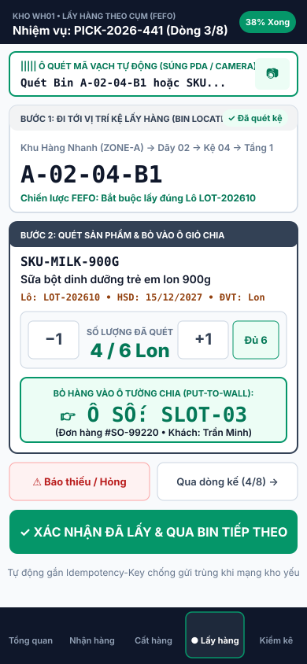
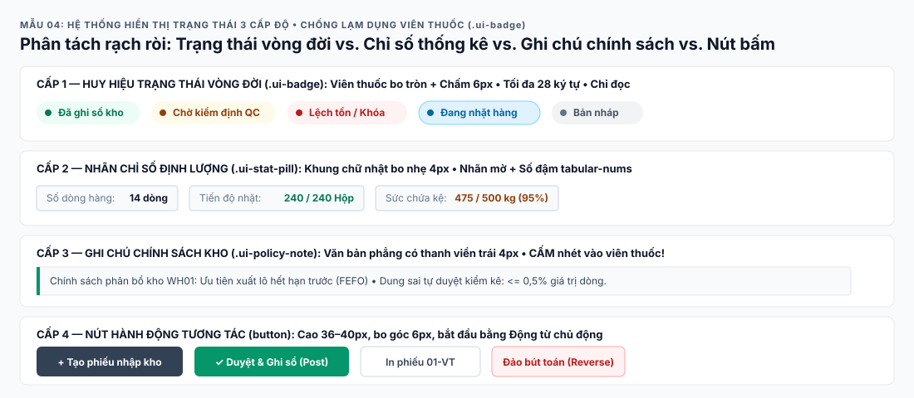

# CẨM NANG NỀN TẢNG KHI BẮT ĐẦU THIẾT KẾ & XÂY DỰNG UI/UX CHO HỆ THỐNG ERP WMS SAAS

> **Dự án:** `ERP_KHO v3.0` (Multi-tenant Commercial WMS SaaS)  
> **Ngày xuất bản:** `2026-10-25`  
> **Tài liệu liên kết:** [Báo cáo Nghiên cứu Chuyên sâu & Thư viện Mẫu Thiết kế (`UI_UX_SAAS_WMS_RESEARCH_REPORT.md`)](file:///d:/ERP_KHO/docs/ui-ux-research/UI_UX_SAAS_WMS_RESEARCH_REPORT.md)

---

## 1. Phân tách rõ 2 nhóm người dùng & môi trường thiết bị (`Dual-Persona UX`)
Một hệ thống WMS luôn phục vụ 2 nhóm đối tượng có hành vi trái ngược nhau:
* **Back-office / Điều phối / Kế toán kho (`Desktop 1440×900`):**
  * Cần **mật độ thông tin cao (High Density)**: Bảng dữ liệu nhiều cột, bộ lọc đa chiều, xuất/nhập file `.xlsx`, đối chiếu chứng từ, xem thẻ kho/sổ cái.
  * Ưu tiên giảm cuộn trang vô ích (`Above-the-fold Y <= 244px`), cố định thanh tiêu đề bảng (`sticky header`) và cột hành động cuối bảng (`.ui-sticky-action`).
  * Xem bản vẽ minh họa: [`svg/pattern-01-above-the-fold-index-shell.svg`](file:///d:/ERP_KHO/docs/ui-ux-research/svg/pattern-01-above-the-fold-index-shell.svg)
* **Nhân viên vận hành tại sàn kho (`Mobile / Handheld PDA 390×844`):**
  * Thao tác 1 tay, đeo găng tay, di chuyển liên tục giữa các dãy kệ (`Zone/Aisle/Rack/Level/Bin`).
  * **Nút bấm (`Touch Target`) tối thiểu `44×44px` – `48×48px`**, chữ to, độ tương phản cao (`>= 4.5:1`), chỉ hiển thị đúng 1 nhiệm vụ trên màn hình (*1-việc-1-màn*).
  * Cam kết **`0px` tràn ngang (`horizontal overflow`)** trên cả hai độ phân giải `1440×900` và `390×844`.
  * Xem bản vẽ minh họa: [`svg/pattern-06-pda-mobile-card-deck.svg`](file:///d:/ERP_KHO/docs/ui-ux-research/svg/pattern-06-pda-mobile-card-deck.svg)

---

## 2. Thiết kế "Keyboard-First & Barcode Scanner-First" (Tối ưu tốc độ thao tác)
Trong kho vận, **mỗi cú click chuột thừa là giảm năng suất**:
* **Auto-focus thông minh:** Khi mở màn hình Nhập kho (`Inbound`), Đóng gói (`Packing`) hoặc Kiểm kê (`Stocktake`), con trỏ phải tự động đặt vào ô quét mã vạch (`Barcode/QR Input`).
* **Luồng quét liên tục (`Scan-and-Go`):** Súng bắn mã vạch bản chất là thiết bị giả lập bàn phím gửi chuỗi ký tự kết thúc bằng phím `Enter`. UI phải bắt sự kiện `Enter` để tự động xác nhận mã SKU/Bin/Serial, cộng dồn số lượng và xóa trắng ô quét để đón mã tiếp theo mà không cần chạm chuột.
* **Phản hồi tức thì (`Audio / Visual Feedback`):** Nhân viên kho nhìn vào kiện hàng chứ không nhìn màn hình liên tục. Khi quét đúng cần hiệu ứng xanh + âm báo ngắn; khi quét sai Bin/SKU hoặc vượt số lượng (`422`) phải cảnh báo đỏ rõ ràng để dừng tay ngay.
* Xem bản vẽ Bàn Đóng gói 1 Màn hình: [`svg/pattern-05-single-screen-packing-workbench.svg`](file:///d:/ERP_KHO/docs/ui-ux-research/svg/pattern-05-single-screen-packing-workbench.svg)

---

## 3. Quy tắc Bảng biểu, Số liệu & Đa Đơn vị tính (`Data Tables & UOM`)
Sai lệch 1 con số hoặc nhầm đơn vị tính (Thùng vs. Cái) sẽ gây lệch kho nghiêm trọng:
* **Căn lề & Font chữ số (`tabular-nums`):**
  * Mọi cột số lượng (`OnHand`, `Available`, `Reserved`, `Allocated`), tiền tệ, trọng lượng bắt buộc dùng `font-variant-numeric: tabular-nums` và **căn phải (`.ui-cell-numeric`)** để các hàng đơn vị, hàng nghìn thẳng cột tuyệt đối.
  * Mã SKU, Mã Vận đơn (`AWB`), Số Lot/Serial, Mã Bin dùng font `monospace` để phân biệt rõ ký tự dễ nhầm (`0` và `O`, `1` và `I`).
* **Hiển thị rõ Đơn vị tính (`BaseUom` vs `TransactionUom`):** Cạnh mọi con số tồn kho hoặc số lượng nhập/xuất luôn phải đi kèm nhãn đơn vị tính (ví dụ: `10 Thùng (120 Hộp)`).
* **Phân trang bắt buộc (`Server-side Pagination`):** Luôn thiết kế thanh phân trang (`pageNumber`, `pageSize <= 100`) kèm tổng số bản ghi (`totalCount`).

---

## 4. Nguyên tắc "Thin Client" — Không tự tính toán nghiệp vụ ở Frontend
Theo quy tắc [`[FE-001]`](file:///d:/ERP_KHO/.agent/rules/rules-frontend.md#L4) và [`[API-001]`](file:///d:/ERP_KHO/.agent/rules/rules-api-concurrency.md#L4):
* **Cấm tính tồn kho cuối cùng ở UI:** Frontend chỉ kiểm tra định dạng đầu vào (bắt buộc nhập, số `> 0`, đúng định dạng ngày). Mọi phép tính `AvailableQty`, giữ hàng (`Reservation`), phân bổ `FEFO/FIFO` đều do Backend trả về.
* **Chuyển trạng thái bằng Hành động (`Command Action Buttons`), không dùng Dropdown `Status`:** Thiết kế các nút hành động tách biệt theo đúng State Machine của chứng từ: `Tạo nháp` → `Duyệt phiếu` → `Ghi sổ kho (Post)` / `Hủy phiếu (Cancel)` / `Đảo bút toán (Reverse)`.

---

## 5. Xử lý 5 Trạng thái Giao diện, Xung đột Đồng thời & Mạng yếu
Mọi màn hình thao tác phải có đủ 5 trạng thái theo [`[FE-004]`](file:///d:/ERP_KHO/.agent/rules/rules-frontend.md#L10) và [`[FE-005]`](file:///d:/ERP_KHO/.agent/rules/rules-frontend.md#L11):
1. **`Loading / Submitting` (Chống Double-Submit):** Khóa nút bấm ngay lập tức khi đang gửi request, gắn kèm `Idempotency-Key` (UUID v4). Nếu rớt mạng và người dùng bấm **"Thử lại"**, giữ nguyên `Idempotency-Key` cũ để Backend không nhân đôi phiếu nhập/xuất.
2. **`Empty State`:** Khi chưa có dữ liệu hoặc bộ lọc không khớp, hiển thị thông báo rõ ràng kèm nút hành động gợi ý.
3. **`422 Unprocessable Entity` (Lỗi nghiệp vụ):** Bắt theo `errorCode` máy đọc được, chỉ rõ dòng SKU/Bin nào bị thiếu tồn kho và thiếu bao nhiêu, kèm `correlationId`.
4. **`409 Conflict` (Xung đột `RowVersion`):** Hiển thị thông báo *"Dữ liệu vừa được cập nhật bởi nhân viên khác"* kèm nút **[Tải lại dữ liệu mới nhất]** thay vì ghi đè mù quáng.
5. **`403 Forbidden`:** Khi hết quyền hoặc chuyển sang kho không thuộc phạm vi quản lý.

---

## 6. Đặc thù SaaS Đa Tenant, Đa Kho & Phân quyền RBAC (Bảo mật Giá vốn)
* **Ngữ cảnh Kho & Chủ hàng (`Warehouse / Owner Context Switcher`):** Trên thanh Topbar luôn phải hiển thị rõ nhân viên đang thao tác tại **Kho nào (`WarehouseId`)** để tránh xuất nhầm kho.
* **Giao diện theo quyền (`Permission-Aware UI`):**
  * Ẩn/khóa các nút `Duyệt`, `Ghi sổ`, `Điều chỉnh kiểm kê` nếu tài khoản không có quyền tương ứng.
  * **Bảo mật Giá vốn (`inventory.cost.read`):** Toàn bộ các cột *Đơn giá nhập, Giá vốn bình quân MAC, Giá trị tồn kho, Lợi nhuận gộp, Đối soát COD* phải được ẩn hoàn toàn trên UI (và chặn ở DTO Backend) nếu không có quyền `inventory.cost.read`.
  * Xem bản vẽ Ma trận Phân quyền RBAC: [`svg/pattern-03-rbac-pivot-matrix.svg`](file:///d:/ERP_KHO/docs/ui-ux-research/svg/pattern-03-rbac-pivot-matrix.svg)

---

## 7. Hệ thống Design Tokens & Ngôn ngữ Tiếng Việt Chuẩn Kho vận
Dự án định nghĩa bộ CSS Variables chuẩn tại [`production-ui.css`](file:///d:/ERP_KHO/frontend/src/ui/production-ui.css#L1-L32):
* **Màu sắc ngữ nghĩa (`Semantic Tokens`):**
  * **Xanh lá (`--ui-success` `#047857`):** Đủ tồn / Đã ghi sổ (`POSTED`) / Đã hoàn tất.
  * **Vàng cam (`--ui-warning` `#92400E`):** Chờ duyệt / Tồn chạm ngưỡng tối thiểu (`ROP`) / Cận hạn sử dụng (`FEFO`).
  * **Đỏ (`--ui-danger` `#B91C1C`):** Thiếu tồn / Hàng lỗi (`DAMAGED`) / Hết hạn / Lệch kiểm kê / Đơn hủy sàn.
  * **Xám (`--ui-muted` `#475569`):** Bản nháp (`DRAFT`) / Đã hủy (`CANCELLED`).
* **Xem bản vẽ Hệ thống Trạng thái 3 Cấp độ:** [`svg/pattern-04-semantic-status-system.svg`](file:///d:/ERP_KHO/docs/ui-ux-research/svg/pattern-04-semantic-status-system.svg)

