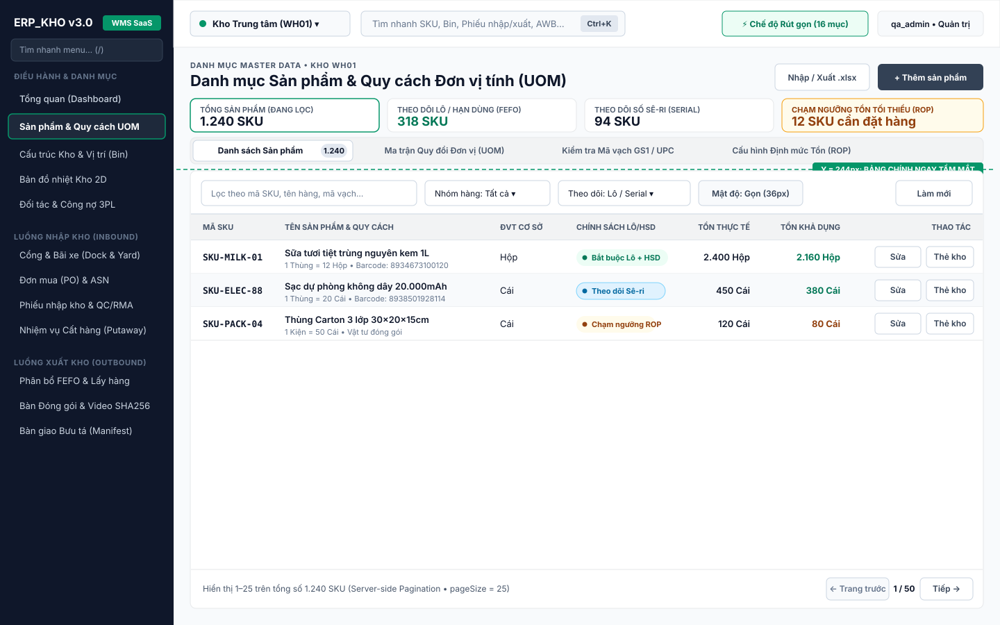
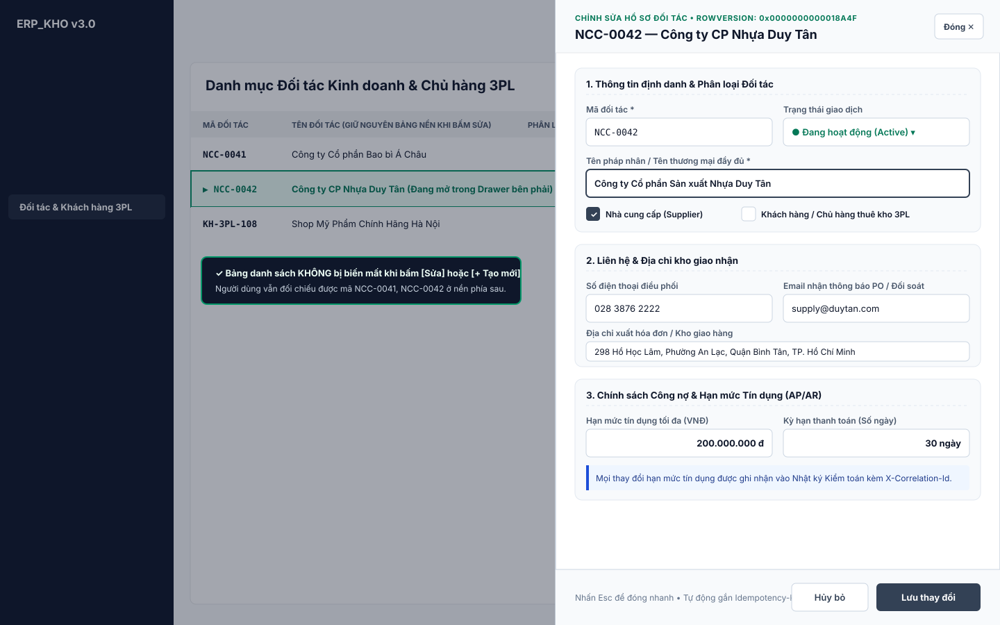
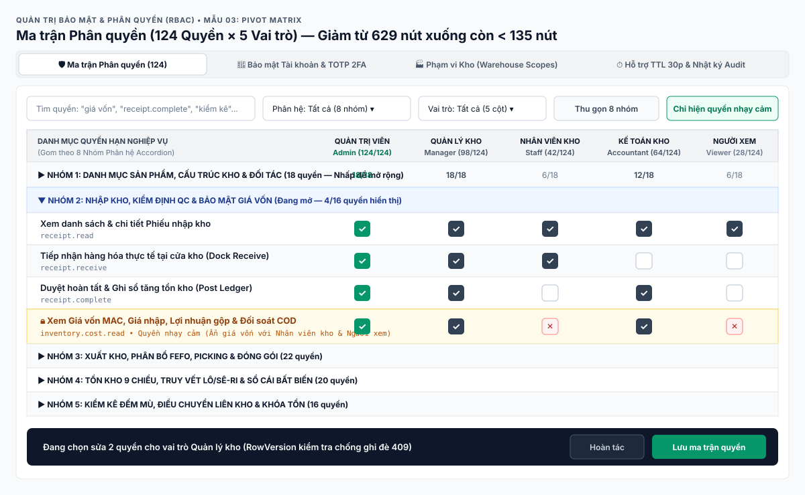
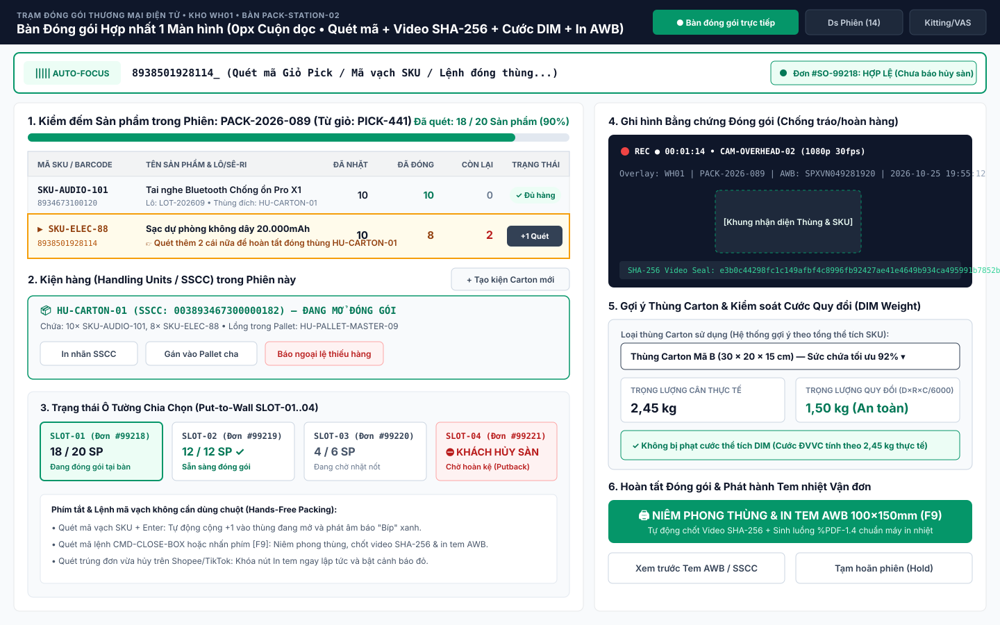
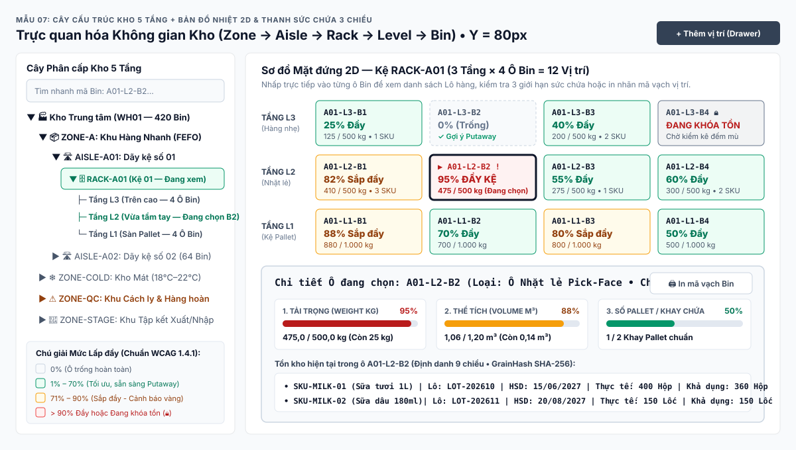
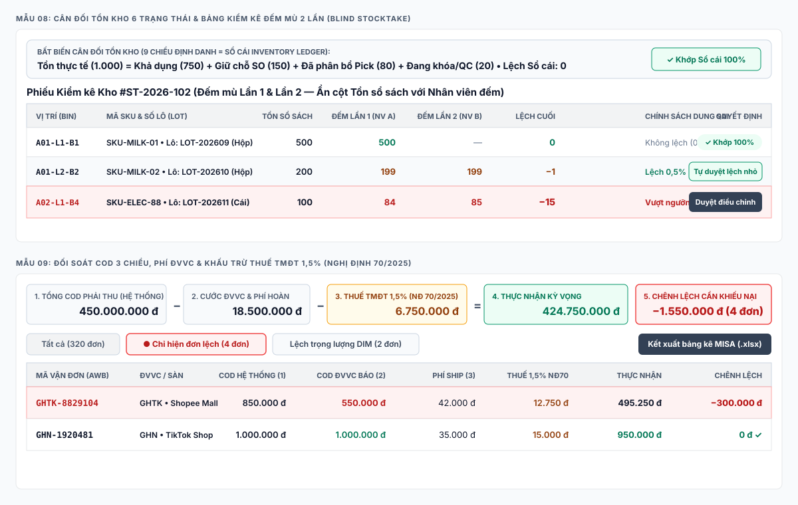
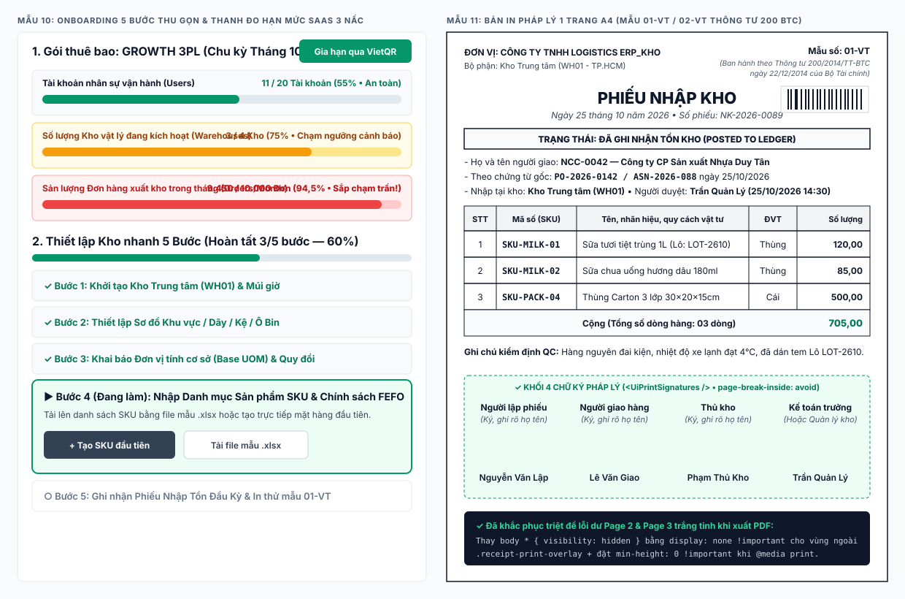

# BÁO CÁO NGHIÊN CỨU UX/UI & KIẾN TRÚC FRONTEND CHO HỆ THỐNG ERP WMS SAAS (`ERP_KHO v3.0`)

> **Vai trò:** Principal Product UX Researcher & Information/Frontend Architect  
> **Đối tượng cải thiện:** Hệ thống ERP WMS Đa khách thuê (`ERP_KHO v3.0` — React 19, Vite 8, TypeScript, CSS Custom Properties `production-ui.css`)  
> **Ngày hoàn thành báo cáo:** `2026-10-25`  
> **Thư mục chứa bản vẽ UI Vector (`.svg`):** [`docs/ui-ux-research/svg/`](file:///d:/ERP_KHO/docs/ui-ux-research/svg/)

---

## 1. TÓM TẮT ĐIỀU HÀNH (EXECUTIVE SUMMARY — 5 BƯỚC NHẢY VỌT LỚN NHẤT)

1. **Triệt tiêu "Xếp chồng thẻ dọc" (`Vertical Card Stacking` `2.700px–4.500px`) bằng mẫu `KPI Strip 1 Hàng + Workspace <UiTabs>`:** Gom các bàn làm việc phụ vào các tab ngang trên [`Dashboard.tsx`](file:///d:/ERP_KHO/frontend/src/pages/Dashboard.tsx), [`Products.tsx`](file:///d:/ERP_KHO/frontend/src/pages/Products.tsx), [`WarehouseLocations.tsx`](file:///d:/ERP_KHO/frontend/src/pages/WarehouseLocations.tsx) và [`PackingSessions.tsx`](file:///d:/ERP_KHO/frontend/src/pages/PackingSessions.tsx), kéo bảng dữ liệu chính từ tọa độ `Y = 820px–1.553px` lên **`Y <= 244px`** (ngay trong tầm mắt đầu tiên `Above-the-fold`).
2. **Thống nhất Tạo/Sửa/Xem chi tiết bằng `<UiDrawer>` (Slide-Over Drawer `560px–680px`):** Chấm dứt tình trạng mở sẵn form dài đầu trang hoặc ẩn mất bảng danh sách khi bấm `Sửa` trên [`BusinessPartners.tsx`](file:///d:/ERP_KHO/frontend/src/pages/BusinessPartners.tsx) và cắt chữ trong modal hẹp trên [`StockTransfers.tsx`](file:///d:/ERP_KHO/frontend/src/pages/StockTransfers.tsx).
3. **Thu gọn Ma trận Phân quyền [`Permissions.tsx`](file:///d:/ERP_KHO/frontend/src/pages/Permissions.tsx) từ `620 dòng / 629 nút` xuống `<= 124 dòng / <= 135 nút`:** Áp dụng mẫu **Pivot Role Matrix + Accordion 8 Nhóm Phân hệ** (hàng = quyền thu gọn theo phân hệ, cột = 5 vai trò với ô tích chọn `checkbox` thay vì lặp 5 bảng rời).
4. **Phân tách rạch ròi 4 cấp độ hiển thị trạng thái & hành động (`.ui-badge` vs `.ui-stat-pill` vs `.ui-policy-note` vs `<button>`):** Chấm dứt lạm dụng viên thuốc `.ui-badge` cho câu mô tả dài hoặc số thống kê đứng cạnh nút bấm thật trong [`production-ui.css`](file:///d:/ERP_KHO/frontend/src/ui/production-ui.css#L619-L648).
5. **Khắc phục dứt điểm lỗi in thừa 2 trang trắng A4 & hoàn thiện chuẩn Mẫu `01-VT / 02-VT`:** Thay `body * { visibility: hidden }` (vốn vẫn giữ chiều cao DOM ẩn `3.000px` dưới nền) trong [`ReceiptPrintPreview.css`](file:///d:/ERP_KHO/frontend/src/components/ReceiptPrintPreview.css#L7) bằng cơ chế `display: none !important` cho phần ngoài vùng in và gắn `<UiPrintSignatures />` sẵn có trong [`ProductionUi.tsx`](file:///d:/ERP_KHO/frontend/src/ui/ProductionUi.tsx#L178-L197) vào [`ReceiptPrintPreview.tsx`](file:///d:/ERP_KHO/frontend/src/components/ReceiptPrintPreview.tsx#L91-L93).

---

## 2. DANH SÁCH 11 NGUỒN THAM CHIẾU TINH HOA & KIỂM TOÁN GIẤY PHÉP

### 2.1. Bảng Kiểm toán Nguồn & Giấy phép (Truy cập ngày `2026-10-25`)

| # | Nguồn | Nhóm | URL / Tài liệu tham chiếu công khai | Loại truy cập | Giấy phép & Stack UI | Màn liên quan (1–10) | Giới hạn truy cập & Quy tắc sử dụng |
| :- | :--- | :---: | :--- | :--- | :--- | :---: | :--- |
| **1** | **InvenTree** (`inventree/InvenTree`) | **A** | `https://github.com/inventree/InvenTree` (`src/frontend/src/tables/`, `pages/stock/`) & `https://docs.inventree.org` | Repo OSS + Docs công khai (`FACT`) | **`MIT`** • React, TypeScript, Mantine UI, TanStack Query | **2, 3, 4, 6, 10** | Tự do tham khảo kiến trúc chia nhỏ component/table; giữ bản quyền MIT nếu dùng thư viện con. |
| **2** | **Medusa.js v2** (`medusajs/medusa`) | **A** | `https://github.com/medusajs/medusa` (`packages/admin/dashboard`) & `https://docs.medusajs.com/resources/commerce-modules/inventory` | Repo OSS + Docs công khai (`FACT`) | **`MIT`** • React, TypeScript, Radix UI, Tailwind | **4, 5, 6** | Tự do học cấu trúc Split-View, Drawer chỉnh sửa tồn/giữ chỗ (`ReservationItem`) và chia file module. |
| **3** | **Odoo 17/18 Inventory & Barcode** | **A** | `https://www.odoo.com/documentation/18.0/applications/inventory_and_mrp/barcode.html` & `inventory.html` | Tài liệu User Docs công khai (`FACT`) | **`LGPLv3` / Enterprise** • Owl JS | **3, 4, 5, 6** | **CẤM chép mã nguồn/CSS/icon.** Chỉ đọc tài liệu công khai để học luồng 1-việc-1-màn trên PDA & lệnh mã vạch. |
| **4** | **ERPNext / Frappe Stock** | **A** | `https://docs.erpnext.com/docs/user/manual/en/stock` (Warehouse Tree, Stock Ledger, Stock Reconciliation) | Tài liệu User Docs công khai (`FACT`) | **`GPLv3`** • Frappe JS / Vue | **3, 6, 7** | **CẤM chép mã nguồn (`GPLv3`).** Chỉ học nguyên lý cây kho (`Group vs Leaf Node`) & đối chiếu Sổ cái bất biến. |
| **5** | **Zoho Inventory** | **B** | `https://www.zoho.com/inventory/help/` (Purchase Orders, Composite Items, Batch/Serial Tracking, Warehouse Management) | Help Center & Product Tour công khai (`FACT`) | **Thương mại (Proprietary)** | **1, 4, 6, 8** | Không truy cập app nội bộ trả phí; học bố cục Master-Detail chứng từ và Onboarding từ ảnh chụp Help Docs. |
| **6** | **ShipHero & Packiyo WMS** | **B** | `https://help.shiphero.com` (Multi-Item Batch Picking, Put-to-Wall, Tote QA & Packing Station) | Knowledge Base & Video Tour công khai (`FACT`) | **Thương mại (Proprietary)** | **4, 5, 10** | Không vào môi trường khách hàng; rút nguyên lý bàn đóng gói 1 màn hình, cảnh báo cước DIM & Put-to-Wall. |
| **7** | **BigSeller** | **C** | `https://help.bigseller.com/vi/` (Quét đóng gói, Cài đặt ghi hình đơn hàng, Chặn đơn hủy sàn, In tem nhiệt) | Trung tâm trợ giúp Tiếng Việt công khai (`FACT`) | **Thương mại (Proprietary)** | **4, 5, 7, 10** | Học thuật ngữ kho TMĐT Việt Nam, luồng tự động kích hoạt camera khi quét AWB và cảnh báo đơn hủy phút chót. |
| **8** | **Sapo Omni / Nhanh.vn** | **C** | `https://support.sapo.vn` & `https://nhanh.vn/huong-dan` (Quản lý đóng gói, Biên bản bàn giao bưu tá, Đối soát COD) | Tài liệu hướng dẫn công khai (`FACT`) | **Thương mại (Proprietary)** | **1, 5, 7** | Học bố cục bảng đối soát COD 3 chiều (Tiền thu hộ - Phí ĐVVC - Thực nhận) và biên bản bàn giao bưu tá. |
| **9** | **MISA AMIS Kho / Kế toán** | **C** | `https://helpact.misa.vn` (Nghiệp vụ Kho, Mẫu 01-VT, 02-VT theo Thông tư 200/2014/TT-BTC & TT 133) | Tài liệu hướng dẫn & Biểu mẫu pháp lý (`FACT`) | **Thương mại + Biểu mẫu Nhà nước** | **6, 7, 10** | Biểu mẫu `01-VT` & `02-VT` là quy định pháp luật của Bộ Tài chính (không thuộc bản quyền riêng của hãng nào). |
| **10** | **Shopify Polaris** (`Shopify/polaris`) | **D** | `https://polaris.shopify.com/components` (`Page`, `IndexFilters`, `IndexTable`, `Badge`, `Banner`) & GitHub repo | Docs + Repo OSS công khai (`FACT`) | **`MIT`** • React, TypeScript, CSS Variables | **1, 2, 4, 5, 6, 8** | Chuẩn vàng về `IndexFilters + IndexTable` (gom tìm kiếm, bộ lọc và tab trạng thái vào 1 khối duy nhất). |
| **11** | **shadcn/ui + TanStack Table + IBM Carbon** | **D** | `https://ui.shadcn.com`, `https://tanstack.com/table/latest`, `https://carbondesignsystem.com/patterns/` | Docs + Repo OSS công khai (`FACT`) | **`MIT`** (`shadcn`, `TanStack`) & **`Apache-2.0`** (`Carbon`) | **2, 3, 6, 9** | Học mẫu Slide-Over `Sheet/Drawer`, `Command` (`Ctrl+K`), Data Grid mật độ cao và RBAC Role Matrix. |

### 2.2. Ma trận Ánh xạ Trọng tâm: 10 Nhóm Màn hình ↔ 3 Nguồn Xuất Sắc Nhất
* **Màn 1 (Dashboard theo vai trò):** `Shopify Polaris` + `Zoho Inventory` + `Sapo/BigSeller`.
* **Màn 2 (Điều hướng & IA):** `Shopify Polaris` + `shadcn/ui Command (Ctrl+K)` + `Odoo Barcode`.
* **Màn 3 (Cấu trúc kho 5 tầng & Heatmap 2D):** `InvenTree` + `ERPNext` + `IBM Carbon`.
* **Màn 4 (Luồng Nhập kho — PO, ASN, Nhận hàng, RMA/QC 48h, Putaway):** `Medusa.js v2` + `BigSeller` + `Odoo Barcode`.
* **Màn 5 (Luồng Xuất kho, Put-to-Wall, Bàn Đóng gói 1 màn hình & PDA):** `ShipHero` + `BigSeller` + `Odoo Barcode`.
* **Màn 6 (Kiểm soát Tồn kho, Kiểm kê đếm mù & Sổ cái bất biến):** `InvenTree` + `ERPNext` + `Medusa.js v2`.
* **Màn 7 (Tài chính Kho, COD 3 chiều, Thuế 1,5% NĐ 70/2025, Phí 3PL, Giá vốn MAC):** `Sapo/Nhanh.vn` + `MISA AMIS` + `Shopify Polaris`.
* **Màn 8 (Thuê bao SaaS, Onboarding 5 bước & Thanh đo hạn mức):** `Shopify Polaris` + `Zoho Inventory` + `IBM Carbon`.
* **Màn 9 (Phân quyền RBAC 124 quyền, Bảo mật 2FA, Hỗ trợ TTL 30p & Audit Log):** `IBM Carbon` + `shadcn/ui` + `ERPNext`.
* **Màn 10 (Chứng từ in 01-VT/02-VT A4 & Tem nhiệt AWB 100×150mm):** `MISA AMIS / Thông tư 200 BTC` + `BigSeller` + `InvenTree`.

---

## 3. THƯ VIỆN 11 MẪU THIẾT KẾ CỐT LÕI (`PATTERN LIBRARY` KÈM BẢN VẼ `.SVG`)

### Mẫu 01: `Above-the-Fold Index Shell` (KPI Strip 1 Hàng + Workspace `<UiTabs>` + Unified Filter Table)
* **File SVG minh họa:** [`svg/pattern-01-above-the-fold-index-shell.svg`](file:///d:/ERP_KHO/docs/ui-ux-research/svg/pattern-01-above-the-fold-index-shell.svg)

* **Vấn đề giải quyết dứt điểm:** Xóa bỏ hội chứng **"Xếp chồng thẻ dọc" (`Vertical Card Stacking`)** làm các trang [`Dashboard.tsx`](file:///d:/ERP_KHO/frontend/src/pages/Dashboard.tsx), [`Products.tsx`](file:///d:/ERP_KHO/frontend/src/pages/Products.tsx), [`WarehouseLocations.tsx`](file:///d:/ERP_KHO/frontend/src/pages/WarehouseLocations.tsx), [`PackingSessions.tsx`](file:///d:/ERP_KHO/frontend/src/pages/PackingSessions.tsx) dài `2.700px – 4.500px` và đẩy bảng chính xuống `Y = 820px – 1.553px`.
* **Nguồn bắt gặp:** `Shopify Polaris` (`<Page>` + `<IndexFilters>` + `<IndexTable>`), `InvenTree` (`StockDetail.tsx` dùng thanh Tab ngang), `Medusa.js v2` (`packages/admin/dashboard`).
* **Kiến trúc Component React 19 cho 1 Lập trình viên (Giữ mỗi file `< 350` dòng):**
  * File trang gốc (`Products.tsx` `~150` dòng) chỉ quản lý `activeTab`, bộ lọc và `<UiPageHeader>` + `<UiTabs>`.
  * Mỗi Tab là 1 component độc lập trong `src/components/products/`: `<ProductIndexTableTab />`, `<ProductUomMatrixTab />`, `<ProductUpcVerifierTab />`.
* **Khi nào dùng / KHÔNG dùng:** Dùng cho mọi màn hình danh mục, chứng từ, tồn kho trên Desktop/Tablet (`>= 768px`). Không dùng cho màn hình quét mã vạch cầm tay PDA (`390×844`).
* **Nguyên tắc UX:** Luật Fitts & Phân cấp thị giác (giảm quãng đường cuộn chuột từ `1.200px` về `0px`), Nielsen `N8`.
* **Độ phù hợp:** **Cao** | **Công sức:** **`S` (100% Frontend)**.

---

### Mẫu 02: `Contextual Slide-Over Drawer` (`<UiDrawer>` Tạo / Sửa / Xem Chi tiết Không Mất Ngữ cảnh Bảng)
* **File SVG minh họa:** [`svg/pattern-02-slide-over-drawer.svg`](file:///d:/ERP_KHO/docs/ui-ux-research/svg/pattern-02-slide-over-drawer.svg)

* **Vấn đề giải quyết dứt điểm:** Khắc phục lỗi (1) mở sẵn form tạo mới dài ở đầu/cuối trang (`showCreateForm = true`), (2) bấm `Sửa` trên [`BusinessPartners.tsx`](file:///d:/ERP_KHO/frontend/src/pages/BusinessPartners.tsx) làm ẩn mất toàn bộ bảng danh sách, và (3) modal hẹp bị cắt chữ placeholder trên [`StockTransfers.tsx`](file:///d:/ERP_KHO/frontend/src/pages/StockTransfers.tsx).
* **Nguồn bắt gặp:** `Medusa.js v2` (Radix `Sheet/Drawer` rộng `560px–680px`), `Zoho Inventory` (Master-Detail Slide-Over), `shadcn/ui` (`Sheet` + Sticky Footer).
* **Kiến trúc Component React 19 cho 1 Lập trình viên:**
  * Bổ sung `<UiDrawer open={boolean} title={string} subtitle?: string width?: 'md'|'lg' onClose={() => void} footer={ReactNode}>` (~70 dòng) vào [`ProductionUi.tsx`](file:///d:/ERP_KHO/frontend/src/ui/ProductionUi.tsx) (tự động bẫy focus `Tab`, đóng bằng `Escape`, khóa `body` overflow).
* **Khi nào dùng / KHÔNG dùng:** Dùng cho mọi biểu mẫu Tạo/Sửa có `4–15 trường`. Không dùng cho bàn đóng gói trực tiếp cần nhìn toàn màn hình.
* **Nguyên tắc UX:** Nielsen `N3` (Đóng bằng `Esc` quay lại đúng dòng đang nhìn), `N6` (Nhận diện hơn nhớ lại — vẫn nhìn thấy mã/số liệu ở bảng nền).
* **Độ phù hợp:** **Cao** | **Công sức:** **`S` (100% Frontend)**.

---

### Mẫu 03: `Role-Permission Pivot Matrix with Module Accordion` (Ma trận Phân quyền Thu gọn theo Phân hệ)
* **File SVG minh họa:** [`svg/pattern-03-rbac-pivot-matrix.svg`](file:///d:/ERP_KHO/docs/ui-ux-research/svg/pattern-03-rbac-pivot-matrix.svg)

* **Vấn đề giải quyết dứt điểm:** Xóa bỏ tình trạng trang [`Permissions.tsx`](file:///d:/ERP_KHO/frontend/src/pages/Permissions.tsx) khi chọn *"Tất cả vai trò (5)"* render lặp 5 bảng rời × 124 quyền = **620 dòng bảng và 629 nút bấm**, kéo dài trang tới `3.827px`.
* **Nguồn bắt gặp:** `IBM Carbon` (Access Management Pivot Matrix), `ERPNext` (`Role Permission Manager`), `shadcn/ui + TanStack Table` (Grouped Rows + Sticky Header).
* **Kiến trúc Component React 19 cho 1 Lập trình viên:**
  * Chia [`Permissions.tsx`](file:///d:/ERP_KHO/frontend/src/pages/Permissions.tsx) (`1.267` dòng) thành 4 file con theo `<UiTabs>` trong `src/components/permissions/`: `RolePermissionMatrixTab.tsx`, `UserSecurityGovernanceTab.tsx`, `WarehouseScopeAssignmentTab.tsx`, `SupportAccessAndAuditTab.tsx`.
* **Nguyên tắc UX:** Luật Miller (nhóm 124 quyền thành 8 cụm phân hệ), Luật Hick (giảm 80% số nút lặp), WCAG 2.2 AA.
* **Độ phù hợp:** **Cao** | **Công sức:** **`M` (100% Frontend)**.

---

### Mẫu 04: `3-Tier Semantic Status System` (Phân tách `Status Badge` vs `Metric Chip` vs `Policy Note` vs `Button`)
* **File SVG minh họa:** [`svg/pattern-04-semantic-status-system.svg`](file:///d:/ERP_KHO/docs/ui-ux-research/svg/pattern-04-semantic-status-system.svg)

* **Vấn đề giải quyết dứt điểm:** Khắc phục lỗi lạm dụng `.ui-badge` hình viên thuốc (`border-radius: 999px`) cho cả trạng thái chứng từ, con số thống kê lẫn câu mô tả cấu hình dài, đứng cạnh nút bấm làm người dùng tưởng nhầm là nút bấm.
* **Nguồn bắt gặp:** `Shopify Polaris` (`Badge` có chấm tròn màu trạng thái), `IBM Carbon` (`Tag` vs `Button`), `InvenTree`.
* **Kiến trúc Component React 19:** Thêm chấm tròn `6px` vào `<UiBadge>` và bổ sung `<UiStatChip />` (`.ui-stat-pill` bo góc `4px`) + `<UiPolicyNote />` (`.ui-policy-note` có viền trái `4px`) trong [`ProductionUi.tsx`](file:///d:/ERP_KHO/frontend/src/ui/ProductionUi.tsx).
* **Nguyên tắc UX:** Gestalt (Nguyên lý tương đồng — hình dáng khác nhau biểu thị chức năng khác nhau; chống *False Affordance*).
* **Độ phù hợp:** **Cao** | **Công sức:** **`S` (100% Frontend)**.

---

### Mẫu 05: `Single-Screen E-Commerce Packing Workbench` (Bàn Đóng gói Hợp nhất 1 Màn hình — `0px` Cuộn Dọc)
* **File SVG minh họa:** [`svg/pattern-05-single-screen-packing-workbench.svg`](file:///d:/ERP_KHO/docs/ui-ux-research/svg/pattern-05-single-screen-packing-workbench.svg)

* **Vấn đề giải quyết dứt điểm:** Trang [`PackingSessions.tsx`](file:///d:/ERP_KHO/frontend/src/pages/PackingSessions.tsx) (`1.052` dòng) hiện xếp chồng bảng danh sách phiên, bảng chi tiết dòng hàng, form tạo thùng Handling Unit, cây lồng kiện (Nested HU), kiểm tra cước DIM/VAS xuống độ cao `> 2.800px`, khiến nhân viên đóng gói vừa quét mã vừa phải cuộn chuột.
* **Nguồn bắt gặp:** `ShipHero` (`Packing Station / Tote QA` 2 cột), `BigSeller` (`Quét đóng gói + Ghi hình đơn hàng + Chặn đơn hủy sàn`), `Odoo 18 Barcode` (`Put in Pack`).
* **Kiến trúc Component React 19:** Chia [`PackingSessions.tsx`](file:///d:/ERP_KHO/frontend/src/pages/PackingSessions.tsx) thành `PackingStationWorkbench.tsx` (Split-Screen `7:5` vừa khít `1440×900`), `PackingVideoAndDimPanel.tsx`, `HandlingUnitTreeDrawer.tsx`, và `PackingSessionListTab.tsx`.
* **Nguyên tắc UX:** Luật Fitts & Hick (không rời tay khỏi súng quét mã vạch), Nielsen `N5` (Cảnh báo đỏ chặn ngay nếu đơn vừa bị hủy trên sàn).
* **Độ phù hợp:** **Cao** | **Công sức:** **`M` (100% Frontend)**.

---

### Mẫu 06: `One-Task-One-Screen PDA Card Deck` (Luồng Tác nghiệp Cầm tay `390×844` Điều khiển bằng Súng Quét)
* **File SVG minh họa:** [`svg/pattern-06-pda-mobile-card-deck.svg`](file:///d:/ERP_KHO/docs/ui-ux-research/svg/pattern-06-pda-mobile-card-deck.svg)

* **Vấn đề giải quyết dứt điểm:** Khi mở các màn hình hiện trường (`ImportReceipts`, `PutawayTasks`, `PickingTasks`, `Stocktakes`) trên màn hình PDA `390×844`, giao diện không còn bị tràn bởi bảng lớn nhiều cột mà tập trung vào đúng **1 thẻ nhiệm vụ hiện tại** với nút bấm `>= 48px`.
* **Nguồn bắt gặp:** `Odoo 17/18 Barcode App`, `ShipHero Mobile App`.
* **Kiến trúc Component React 19:** Tạo `<PdaTaskFocusedCard />` (`~120` dòng) kết hợp [`MobileBarcodeScannerBar.tsx`](file:///d:/ERP_KHO/frontend/src/components/MobileBarcodeScannerBar.tsx) và thanh `.app-bottom-nav` 5 nút trong [`MainLayout.tsx`](file:///d:/ERP_KHO/frontend/src/layouts/MainLayout.tsx#L88-L94).
* **Nguyên tắc UX:** Luật Miller & Tesler, WCAG 2.2 AA `2.5.8 Target Size` (`>= 48px`).
* **Độ phù hợp:** **Cao** | **Công sức:** **`M` (100% Frontend)**.

---

### Mẫu 07: `Spatial Tree + 2D Bin Heatmap Split-View` (Cây Phân cấp Kho 5 Tầng + Bản đồ Nhiệt 2D & Thanh Sức chứa)
* **File SVG minh họa:** [`svg/pattern-07-spatial-tree-2d-heatmap.svg`](file:///d:/ERP_KHO/docs/ui-ux-research/svg/pattern-07-spatial-tree-2d-heatmap.svg)

* **Vấn đề giải quyết dứt điểm:** Hợp nhất cây 5 tầng (`Khu vực → Dãy → Kệ → Tầng → Ô/Bin`), bản đồ nhiệt mặt đứng kệ 2D và 3 thanh đo sức chứa (`Trọng lượng kg`, `Thể tích m³`, `Số Pallet`) vào bố cục 2 cột trực quan trên [`WarehouseLocations.tsx`](file:///d:/ERP_KHO/frontend/src/pages/WarehouseLocations.tsx) và [`WarehouseMap.tsx`](file:///d:/ERP_KHO/frontend/src/pages/WarehouseMap.tsx).
* **Nguồn bắt gặp:** `ERPNext Stock` (`Warehouse Tree`), `InvenTree` (`Stock Location Tree`), `IBM Carbon` (Heatmap 4 mức).
* **Nguyên tắc UX:** Bản đồ tương đồng không gian (Spatial Mapping), WCAG `1.4.1 Use of Color` (kèm số `%` và biểu tượng `🔒 / !` ngoài màu nền).
* **Độ phù hợp:** **Cao** | **Công sức:** **`M` (100% Frontend)**.

---

### Mẫu 08 & Mẫu 09: `Immutable Ledger & Blind Stocktake Table` + `3-Way COD & Tax 1.5% (NĐ 70/2025) Reconciliation Grid`
* **File SVG minh họa:** [`svg/pattern-08-09-ledger-and-cod-reconciliation.svg`](file:///d:/ERP_KHO/docs/ui-ux-research/svg/pattern-08-09-ledger-and-cod-reconciliation.svg)

* **Vấn đề giải quyết dứt điểm:**
  * **Mẫu 08:** Hiển thị tường minh phương trình cân đối 6 nhóm tồn (`Thực tế = Khả dụng + Giữ chỗ + Đã phân bổ + Đang khóa/QC`) và ẩn cột `Tồn sổ sách` đối với nhân viên đếm mù trên [`Stocktakes.tsx`](file:///d:/ERP_KHO/frontend/src/pages/Stocktakes.tsx).
  * **Mẫu 09:** Hiển thị phương trình đối soát 3 chiều (`Tổng COD - Phí ĐVVC - Thuế TMĐT 1,5% NĐ 70/2025 = Thực nhận kỳ vọng vs Thực về`) kèm bộ lọc 1 chạm `[● Chỉ hiện đơn lệch]` trên [`CodReconciliation.tsx`](file:///d:/ERP_KHO/frontend/src/pages/CodReconciliation.tsx).
* **Nguồn bắt gặp:** `ERPNext` (`Stock Reconciliation`), `Sapo Omni / Nhanh.vn` (`Đối soát vận chuyển/COD`), `MISA AMIS`.
* **Độ phù hợp:** **Cao** | **Công sức:** **`S` (100% Frontend)**.

---

### Mẫu 10 & Mẫu 11: `Collapsible Onboarding & 3-Tier SaaS Quota Meter` + `Single-Page Statutory Print Sheet (Mẫu 01-VT / 02-VT)`
* **File SVG minh họa:** [`svg/pattern-10-11-saas-quota-and-print-01vt.svg`](file:///d:/ERP_KHO/docs/ui-ux-research/svg/pattern-10-11-saas-quota-and-print-01vt.svg)

* **Vấn đề giải quyết dứt điểm:**
  * **Mẫu 10:** Thu gọn 5 bước thiết lập kho trên [`OnboardingWizard.tsx`](file:///d:/ERP_KHO/frontend/src/pages/OnboardingWizard.tsx) và hiển thị thanh đo hạn mức 3 nấc màu (`<75%` Xanh, `75–90%` Cam, `>90%` Đỏ) kèm thanh toán VietQR trên [`SaasBilling.tsx`](file:///d:/ERP_KHO/frontend/src/pages/SaasBilling.tsx).
  * **Mẫu 11:** Khắc phục triệt để lỗi xuất PDF Phiếu nhập/xuất kho bị dư 2 trang trắng (Page 2 & Page 3 do `body * { visibility: hidden }` trong [`ReceiptPrintPreview.css`](file:///d:/ERP_KHO/frontend/src/components/ReceiptPrintPreview.css#L7)), căn phải cột `Số lượng` và hiển thị đủ 4 cột chữ ký pháp lý `<UiPrintSignatures />` theo Mẫu `01-VT / 02-VT` Thông tư 200/2014/TT-BTC trong [`ReceiptPrintPreview.tsx`](file:///d:/ERP_KHO/frontend/src/components/ReceiptPrintPreview.tsx).
* **Độ phù hợp:** **Cao** | **Công sức:** **`XS–S` (100% Frontend)**.

---

## 4. MA TRẬN SO SÁNH & THỰC HÀNH TỐT NHẤT THEO 16 CHIỀU PHÂN TÍCH

| # | Chiều phân tích | Nguồn Quốc tế (Nhóm A & B: InvenTree, Medusa, Odoo, ERPNext, Zoho, ShipHero) | Nguồn Việt Nam (Nhóm C: BigSeller, Sapo, Nhanh.vn, MISA AMIS) | Chuẩn Design System (Nhóm D: Shopify Polaris, shadcn/ui, TanStack, Carbon) | Thực hành chuẩn rút ra cho `ERP_KHO v3.0` |
| :- | :--- | :--- | :--- | :--- | :--- |
| **1** | **Điều hướng & IA (`Navigation`)** | `InvenTree` & `Zoho` gom menu theo quy trình; `Odoo` tách hẳn ứng dụng Barcode cho PDA. | `Sapo` & `BigSeller` gom menu theo luồng: *Sản phẩm → Đơn hàng/Xuất → Nhập/Tồn → Đối soát*. | `Polaris` giới hạn nhóm menu cấp 1 `<= 7 nhóm`, kèm `Command Palette (Ctrl+K)`. | Giữ cơ chế `Full WMS (34) ↔ Express (16)` trong [`MainLayout.tsx`](file:///d:/ERP_KHO/frontend/src/layouts/MainLayout.tsx#L109-L124), bổ sung hộp thoại lệnh nhanh `Ctrl+K` để nhảy tới mọi màn/mã phiếu trong `1 giây`. |
| **2** | **Bố cục trang (`Page Layout & Above-the-fold`)** | `Medusa` & `InvenTree` dùng Tab ngang để tách các khu vực phụ, giữ bảng chính ở đầu trang. | `BigSeller` dùng thanh tab trạng thái đơn hàng ngay trên bảng, không xếp chồng nhiều thẻ dọc. | `Polaris IndexTable` bắt đầu ngay ở `Y ~ 180px–220px`. | Áp dụng **Mẫu 01**: Mọi trang danh sách bắt buộc đưa bảng dữ liệu chính lên tọa độ **`Y <= 244px`** bằng cách gom công cụ phụ vào `<UiTabs>`. |
| **3** | **Phân cấp thị giác (`Visual Hierarchy & Badges`)** | `Medusa` & `Zoho` chỉ dùng Badge màu cho trạng thái chứng từ, văn bản mô tả để phẳng. | `MISA` & `Sapo` phân biệt rõ nút hành động chính (nền đậm) với nhãn trạng thái chỉ đọc. | `Polaris` & `Carbon` tách biệt `Badge` (trạng thái), `Tag` (bộ lọc) và `Button`. | Áp dụng **Mẫu 04**: `.ui-badge` có chấm tròn `6px` chỉ dùng cho trạng thái (`<= 28 ký tự`); tạo `.ui-stat-pill` và `.ui-policy-note` cho thống kê và mô tả. |
| **4** | **Bảng dữ liệu lớn (`Enterprise Data Grid`)** | `InvenTree` hỗ trợ lọc nhanh, cố định cột mã & cột hành động, chọn dòng hàng loạt. | `Nhanh.vn` & `MISA` luôn có dòng **Tổng cộng** cố định và xuất Excel đúng bộ lọc đang chọn. | `TanStack Table` + `Carbon` có chế độ mật độ dòng (`Compact 32px` vs `Default 42px`), ghim cột phải. | Hợp nhất `.ui-toolbar` vào làm Header của thẻ bảng; giữ `.ui-sticky-action` ở cột cuối và mặc định chế độ `.ui-table-compact` cho bảng `>= 8 cột`. |
| **5** | **Biểu mẫu & Chống lỗi Prefill (`Forms & Drawer`)** | `Medusa` mở Slide-Over Drawer bên phải, khởi tạo rỗng trung thực, không tự điền bừa bản ghi đầu. | `MISA` cho phép nhấn `Cất` hoặc `Cất & Thêm` ngay trong hộp thoại mà không mất bảng nền. | `shadcn Sheet` có Sticky Footer và thông báo lỗi gắn trực tiếp dưới từng `<label>`. | Áp dụng **Mẫu 02 (`<UiDrawer>`)** cho toàn bộ thao tác Tạo/Sửa danh mục & điều chuyển; tuyệt đối khởi tạo state trung thực (`0`, `""`, `[]`). |
| **6** | **Trực quan hóa kho 2D (`Spatial & Heatmap`)** | `InvenTree` & `ERPNext` dùng cây phân cấp bên trái + chi tiết sức chứa bên phải. | Ít phần mềm VN có sơ đồ nhiệt 2D trực quan (thường chỉ là danh sách mã vị trí phẳng). | `Carbon Heatmap` kết hợp màu nền 4 nấc với nhãn số `%` và icon trạng thái. | Áp dụng **Mẫu 07**: Kết hợp Cây 5 tầng (`Zone→Aisle→Rack→Level→Bin`) với lưới 2D CSS Grid và 3 thanh sức chứa (`kg / m³ / Pallet`). |
| **7** | **Luồng nhiều bước (`Multi-step Workflows`)** | `Odoo` & `Zoho` hiển thị thanh bước tiến trình (`Stepper: Nháp → Duyệt → Nhận/Kiểm → Ghi sổ`). | `BigSeller` chia tab theo đúng bước xử lý đơn (*Chờ xử lý → Đang nhặt → Đóng gói → Đã giao*). | `Carbon Progress Indicator` chỉ rõ bước hiện tại, bước đã qua và điều kiện mở khóa bước kế. | Thêm thanh `<DocumentLifecycleStepper />` ở đầu màn chi tiết chứng từ (`PO`, `ASN`, `ImportReceipts`, `ExportReceipts`) và chỉ hiện nút Command hợp lệ. |
| **8** | **Mobile / PDA 1-việc-1-màn (`Floor Execution`)** | `Odoo Barcode` & `ShipHero Mobile` hiển thị chữ cực to cho mã Bin/SKU, ẩn hết bảng phức tạp. | `Sapo Mobile` hỗ trợ quét camera điện thoại hoặc súng Bluetooth để kiểm hàng. | Chuẩn WCAG 2.2 Target Size `>= 44×44px` (`48px` cho môi trường đeo găng tay). | Áp dụng **Mẫu 06**: Khi màn hình `<= 768px`, tự động chuyển sang giao diện `<PdaTaskFocusedCard>` với ô quét dính đỉnh và nút xác nhận `48px` ở đáy. |
| **9** | **Trạng thái, Xung đột & Xác nhận (`422/409/Idempotency`)** | `Medusa` & `ERPNext` chặn xung đột phiên bản (`RowVersion`) và yêu cầu xác nhận khi hủy/đảo. | `BigSeller` bật cảnh báo đỏ + âm thanh khi quét trúng đơn vừa bị khách bấm hủy trên sàn. | `Polaris Banner` phân biệt lỗi nghiệp vụ `422` (hướng dẫn sửa) và xung đột `409` (nút Tải lại). | Giữ cơ chế `Idempotency-Key` hiện có; chuẩn hóa `<UiConflictBanner onReload={load} />` khi gặp HTTP `409` để người dùng bấm 1 nút nạp lại dữ liệu mới. |
| **10** | **Ma trận Phân quyền (`RBAC Matrix`)** | `ERPNext` dùng bảng quản lý quyền theo nhóm Module/DocType. | Phần mềm VN thường dùng cây checkbox thu gọn theo từng phân hệ nghiệp vụ. | `IBM Carbon` dùng bảng Pivot (Hàng = Quyền gom theo Accordion, Cột = Vai trò). | Áp dụng **Mẫu 03**: Thay 5 bảng rời trên [`Permissions.tsx`](file:///d:/ERP_KHO/frontend/src/pages/Permissions.tsx) bằng 1 bảng Pivot 5 cột vai trò + 8 nhóm Accordion, giảm nút từ `629` xuống `<= 135`. |
| **11** | **Thuê bao SaaS & Hạn mức (`SaaS Billing & Quota`)** | `Zoho` hiển thị thanh tiêu thụ gói cước ngay đầu trang Billing kèm cảnh báo nâng cấp. | Phần mềm SaaS VN tích hợp mã **VietQR động** (tự điền số tiền + nội dung chuyển khoản). | `Carbon Meter` 3 ngưỡng màu (`<75%`, `75–90%`, `>90%`). | Áp dụng **Mẫu 10**: Hiển thị 4 thanh `<QuotaProgressBar>` 3 nấc màu và Drawer thanh toán VietQR tự động điền mã hóa đơn. |
| **12** | **Thiết lập ban đầu (`Onboarding Wizard`)** | `Zoho` & `Odoo` có thanh tiến trình thiết lập kho đầu tiên (Tạo kho → Vị trí → ĐVT → SKU → Tồn đầu). | `Sapo` có danh sách việc cần làm cho chủ shop mới kèm dữ liệu mẫu dùng thử. | `Polaris Setup Guide` cho phép đóng/mở từng bước và nhảy thẳng tới màn hình cấu hình. | Giữ luồng 5 bước trên [`OnboardingWizard.tsx`](file:///d:/ERP_KHO/frontend/src/pages/OnboardingWizard.tsx), bổ sung thanh tiến độ `% hoàn tất` và thu gọn các bước đã hoàn thành. |
| **13** | **Chứng từ in & Tem nhiệt (`Print 01-VT/02-VT & AWB`)** | `InvenTree` & `ShipHero` tách riêng template in A4 và template tem nhiệt `100×150mm`. | `MISA AMIS` tuân thủ tuyệt đối Mẫu `01-VT`, `02-VT` (Thông tư 200 BTC) với 4 chữ ký pháp lý. | CSS `@media print` chuẩn dùng `display: none` cho vùng ngoài bản in, không dùng `visibility: hidden`. | Áp dụng **Mẫu 11**: Sửa [`ReceiptPrintPreview.css`](file:///d:/ERP_KHO/frontend/src/components/ReceiptPrintPreview.css) để in đúng **1 trang A4**, số lượng căn phải và hiển thị `<UiPrintSignatures />`. |
| **14** | **Từ ngữ nghiệp vụ Việt Nam (`Domain Copywriting`)** | Thuật ngữ tiếng Anh chuẩn (`Putaway`, `Picking`, `FEFO`, `ASN`, `Blind Count`, `MAC`). | `BigSeller/Sapo/MISA` Việt hóa sát thực tế kho: *Cất hàng lên kệ, Nhặt hàng, Phiếu nhập/xuất, Đối soát COD*. | Câu lệnh nút bấm dùng **Động từ chủ động** (*Ghi sổ nhập kho*, *Phát hành bảng kê*). | Dùng thuật ngữ Tiếng Việt chuẩn kèm mở ngoặc thuật ngữ quốc tế khi cần thiết (VD: *Tường chia hàng (Put-to-Wall)*, *Cất hàng lên kệ (Putaway)*). |
| **15** | **Hiệu năng cảm nhận (`Perceived Performance`)** | `InvenTree` & `Medusa` chỉ tải dữ liệu của Tab đang mở (`Lazy Tab Fetching`). | Tránh tải cùng lúc 4–5 API phụ khi người dùng chỉ vừa mở trang danh sách. | `Vite React` dùng `React.lazy()` theo route (đã có trong [`AppRoutes.tsx`](file:///d:/ERP_KHO/frontend/src/routes/AppRoutes.tsx#L8-L46)) + tách nhỏ component. | Chỉ gọi API của các tab phụ (như *Audit Log*, *UOM Matrix*, *3PL Statement*) khi người dùng bấm chọn tab đó. |
| **16** | **Khả năng truy cập (`Accessibility WCAG 2.2 AA`)** | Hỗ trợ điều hướng hoàn toàn bằng bàn phím (`Tab`, `Shift+Tab`, `Enter`, `Escape`). | Môi trường kho thiếu sáng hoặc chói đèn cao áp cần độ tương phản chữ và viền ô nhập cao. | `Radix/Polaris` đảm bảo `focus-visible` rõ nét, `<label>` bao ngoài `<input>`, `role="alert"`. | Giữ chuẩn `.production-ui :focus-visible` (`outline: 3px solid var(--ui-ring)`) và bổ sung phím tắt bàn đóng gói (`Enter`, `Esc`, `F9`). |

---

## 5. PHÂN TÍCH KHOẢNG CÁCH (`GAP ANALYSIS`) & THIẾT KẾ LẠI ĐỦ 10 NHÓM MÀN HÌNH

### Màn 1: Tổng quan / Dashboard theo Vai trò ([`Dashboard.tsx`](file:///d:/ERP_KHO/frontend/src/pages/Dashboard.tsx) — hiện `865` dòng)
* **Hiện trạng trên `ERP_KHO v3.0`:** Xếp chồng dọc 7 khối làm trang dài `~2.900px`. Quản lý kho và Chủ shop TMĐT đang phải nhìn chung một dải thẻ dài.
* **Mẫu thiết kế áp dụng:** **Mẫu 01 (`Above-the-Fold Index Shell` + Role View Switcher `<UiTabs>`)**.
* **Thay đổi cụ thể:** Đặt thanh `<UiTabs>` ngay dưới `UiPageHeader` với 3 chế độ góc nhìn: `(1) ⚡ Điều hành Kho & Hàng đợi Tác vụ`, `(2) 🏢 Tháp điều khiển Đa kho (Control Tower)`, `(3) 💰 Tài chính Chủ shop & Đối soát COD` (bảo vệ bởi quyền `inventory.cost.read`).
* **Tiêu chí nghiệm thu đo được:** Chiều cao trang giảm từ `~2.900px` xuống **`<= 1.150px`**; bảng *Hàng đợi tác vụ kho đang mở* bắt đầu ở **`Y <= 250px`**; file [`Dashboard.tsx`](file:///d:/ERP_KHO/frontend/src/pages/Dashboard.tsx) giảm xuống **`<= 320` dòng**.

### Màn 2: Điều hướng & Kiến trúc Thông tin ([`MainLayout.tsx`](file:///d:/ERP_KHO/frontend/src/layouts/MainLayout.tsx) & [`productionNavigation.ts`](file:///d:/ERP_KHO/frontend/src/config/productionNavigation.ts))
* **Hiện trạng trên `ERP_KHO v3.0`:** Đã có nút chuyển đổi `🏭 Chế độ Đầy đủ (34 mục)` ↔ `⚡ Chế độ Rút gọn (16 mục)` và `.app-bottom-nav` 5 nút cho PDA, nhưng Sidebar 34 mục còn dài và chưa có hộp thoại lệnh nhanh `Ctrl+K`.
* **Mẫu thiết kế áp dụng:** **Command Palette (`Ctrl+K`) + Collapsible Sidebar Sections + Active Warehouse Switcher**.
* **Tiêu chí nghiệm thu đo được:** Nhấn `Ctrl+K` mở hộp thoại tìm kiếm/nhảy trang trong **`<= 150ms`**; chiều cao Sidebar khi thu gọn các nhóm phụ giảm **`>= 50%`**.

### Màn 3: Cấu trúc Kho & Trực quan hóa Không gian ([`WarehouseLocations.tsx`](file:///d:/ERP_KHO/frontend/src/pages/WarehouseLocations.tsx), [`WarehouseMap.tsx`](file:///d:/ERP_KHO/frontend/src/pages/WarehouseMap.tsx))
* **Hiện trạng trên `ERP_KHO v3.0`:** Xếp chồng nhiều thẻ biểu mẫu tạo Khu vực, Dãy, Kệ, Tầng, Ô trước khi tới danh sách vị trí, làm trang dài `> 2.700px`.
* **Mẫu thiết kế áp dụng:** **Mẫu 07 (`Spatial Tree + 2D Bin Heatmap Split-View`)** & **Mẫu 02 (`<UiDrawer>`)**.
* **Tiêu chí nghiệm thu đo được:** Cây phân cấp 5 tầng và sơ đồ nhiệt 2D bắt đầu ở tọa độ **`Y <= 230px`**; nhấp vào ô Bin hiển thị đủ 3 thanh sức chứa (`kg / m³ / Pallet`).

### Màn 4: Luồng Nhập kho — Dock & Yard, PO, ASN, Nhận hàng, RMA/QC 48h & Putaway ([`ImportReceipts.tsx`](file:///d:/ERP_KHO/frontend/src/pages/ImportReceipts.tsx) — hiện `1.444` dòng)
* **Hiện trạng trên `ERP_KHO v3.0`:** Gộp chung danh sách phiếu nhập, form tạo phiếu, bảng nhận hàng tại cửa, xử lý chênh lệch 3 bên, kiểm định hàng hoàn RMA/QC (kèm đồng hồ đếm ngược 48h khiếu nại sàn) vào một file `1.444` dòng.
* **Mẫu thiết kế áp dụng:** **Mẫu 01 (`Workspace Tabs`) + Mẫu 02 (`<UiDrawer>`) + Stepper Vòng đời Chứng từ**.
* **Tiêu chí nghiệm thu đo được:** Bảng danh sách Phiếu nhập kho bắt đầu ở **`Y <= 230px`**; file [`ImportReceipts.tsx`](file:///d:/ERP_KHO/frontend/src/pages/ImportReceipts.tsx) giảm xuống **`<= 380` dòng**.

### Màn 5: Luồng Xuất kho, Put-to-Wall, Bàn Đóng gói 1 Màn hình & Bàn giao Bưu tá ([`PackingSessions.tsx`](file:///d:/ERP_KHO/frontend/src/pages/PackingSessions.tsx) — hiện `1.052` dòng)
* **Hiện trạng trên `ERP_KHO v3.0`:** Xếp chồng bảng danh sách phiên, bảng chi tiết dòng hàng, form tạo thùng Handling Unit, kiểm tra cước DIM/VAS xuống độ cao `> 2.800px`.
* **Mẫu thiết kế áp dụng:** **Mẫu 05 (`Single-Screen Packing Workbench`) + Mẫu 06 (`PDA Card Deck`)**.
* **Tiêu chí nghiệm thu đo được:** Tại tab *Bàn trạm đóng gói trực tiếp*, toàn bộ thao tác *(Quét mã → Xem gợi ý thùng/DIM → Ghi nhận video SHA-256 → Bấm In tem AWB)* nằm gọn trong **`900px` chiều cao màn hình đầu tiên (`0px` cuộn dọc)**.

### Màn 6: Kiểm soát Tồn kho, Kiểm kê Đếm mù & Sổ cái Bất biến ([`Inventory.tsx`](file:///d:/ERP_KHO/frontend/src/pages/Inventory.tsx), [`Stocktakes.tsx`](file:///d:/ERP_KHO/frontend/src/pages/Stocktakes.tsx), [`StockTransfers.tsx`](file:///d:/ERP_KHO/frontend/src/pages/StockTransfers.tsx))
* **Hiện trạng trên `ERP_KHO v3.0`:** [`StockTransfers.tsx`](file:///d:/ERP_KHO/frontend/src/pages/StockTransfers.tsx) dùng modal hẹp làm cắt chữ placeholder; các màn hình tồn kho đặt nhiều thẻ phụ phía trên bảng chính.
* **Mẫu thiết kế áp dụng:** **Mẫu 08 (`Immutable Ledger & Blind Stocktake Table`) + Mẫu 02 (`<UiDrawer>`)**.
* **Tiêu chí nghiệm thu đo được:** `0` trường input/select nào trong `<StockTransferFormDrawer />` bị cắt mất chữ placeholder; bảng tồn kho chính trên `/inventory` bắt đầu ở **`Y <= 230px`**.

### Màn 7: Tài chính Kho, Đối soát COD 3 Chiều, Thuế 1,5% NĐ 70/2025, Phí 3PL & Giá vốn MAC ([`CodReconciliation.tsx`](file:///d:/ERP_KHO/frontend/src/pages/CodReconciliation.tsx), [`BusinessPartners.tsx`](file:///d:/ERP_KHO/frontend/src/pages/BusinessPartners.tsx), [`CostValuation.tsx`](file:///d:/ERP_KHO/frontend/src/pages/CostValuation.tsx))
* **Hiện trạng trên `ERP_KHO v3.0`:** Khi bấm `[Sửa]` trên [`BusinessPartners.tsx`](file:///d:/ERP_KHO/frontend/src/pages/BusinessPartners.tsx), bảng danh sách đối tác bị ẩn đi hoàn toàn; thẻ tính phí 3PL đang đặt chung trên cùng một trang dài.
* **Mẫu thiết kế áp dụng:** **Mẫu 09 (`3-Way Financial Reconciliation Grid`) + Mẫu 02 (`<UiDrawer>`) + Mẫu 01 (`<UiTabs>`)**.
* **Tiêu chí nghiệm thu đo được:** Khi bấm `[Sửa]` trên `/business-partners`, bảng danh sách đối tác vẫn hiển thị 100% trong DOM; mọi cột tiền tệ và thuế `1,5%` căn phải tuyệt đối (`.ui-cell-numeric`).

### Màn 8: Thuê bao SaaS & Thiết lập Kho Nhanh ([`OnboardingWizard.tsx`](file:///d:/ERP_KHO/frontend/src/pages/OnboardingWizard.tsx) & [`SaasBilling.tsx`](file:///d:/ERP_KHO/frontend/src/pages/SaasBilling.tsx))
* **Hiện trạng trên `ERP_KHO v3.0`:** Các bước thiết lập kho và bảng so sánh gói cước/hạn mức đang trải dài theo chiều dọc.
* **Mẫu thiết kế áp dụng:** **Mẫu 10 (`Collapsible Onboarding Checklist & 3-Threshold SaaS Quota Meter`)**.
* **Tiêu chí nghiệm thu đo được:** Toàn bộ 5 bước của `/onboarding-wizard` hiển thị trọn vẹn trong `1 màn hình 1440×900`; thanh đo hạn mức tự động đổi màu ở ngưỡng `75%` và `90%`.

### Màn 9: Phân quyền RBAC, Bảo mật 2FA & Kiểm toán ([`Permissions.tsx`](file:///d:/ERP_KHO/frontend/src/pages/Permissions.tsx) — hiện `1.267` dòng)
* **Hiện trạng trên `ERP_KHO v3.0`:** Khi chọn *"Tất cả vai trò (5)"*, trang render lặp 5 bảng × 124 dòng = **620 dòng bảng và 629 nút bấm** trên trang dài `3.827px`.
* **Mẫu thiết kế áp dụng:** **Mẫu 03 (`Role-Permission Pivot Matrix with Module Accordion`) + Mẫu 01 (`<UiTabs>`)**.
* **Tiêu chí nghiệm thu đo được:** Số dòng bảng tối đa giảm từ `620` xuống **`<= 124 dòng`**; tổng số nút bấm giảm từ `629` xuống **`<= 135`**; chiều cao trang giảm xuống **`<= 1.250px`**.

### Màn 10: Chứng từ In (`01-VT / 02-VT`) & Nhãn Mã vạch (`AWB 100×150mm` / `SSCC GS1-128`) ([`ReceiptPrintPreview.tsx`](file:///d:/ERP_KHO/frontend/src/components/ReceiptPrintPreview.tsx) & [`ReceiptPrintPreview.css`](file:///d:/ERP_KHO/frontend/src/components/ReceiptPrintPreview.css))
* **Hiện trạng trên `ERP_KHO v3.0`:** Xuất PDF Phiếu nhập/xuất kho bị dư 2 trang trắng (Page 2 & Page 3 do `body * { visibility: hidden }`), cột số lượng căn trái và thiếu hàng 4 chữ ký pháp lý.
* **Mẫu thiết kế áp dụng:** **Mẫu 11 (`Single-Page Statutory Print Sheet`)**.
* **Tiêu chí nghiệm thu đo được:** Xuất PDF Phiếu nhập/xuất kho ra **đúng `1 trang A4` duy nhất**, cột `Số lượng` căn phải (`text-align: right`) và hiển thị đủ 4 cột chữ ký pháp lý `<UiPrintSignatures />`.

---

## 6. DANH MỤC 6 PHẢN MẪU (`ANTI-PATTERNS`) CẦN TUYỆT ĐỐI TRÁNH

1. **Phản mẫu 1 — "Trang Cuộn Bất Tận" (`Vertical Card Stacking`):** Đặt liên tiếp Form tạo mới + Bảng phụ + Thẻ kiểm tra + Bảng danh sách chính từ trên xuống dưới làm người vận hành phải cuộn `1.000px+` mỗi lần mở trang.
2. **Phản mẫu 2 — "Sửa Một Dòng, Biến Mất Cả Bảng" (`Table Disappearance on Edit`):** Dùng `if (editing) return <EditForm />` thay thế hoàn toàn bảng danh sách làm mất ngữ cảnh đối chiếu.
3. **Phản mẫu 3 — "Lạm dụng Viên thuốc `.ui-badge` cho Mọi Thứ" (`Badge Soup / False Affordance`):** Nhét cả câu giải thích dài hoặc số thống kê vào `.ui-badge` hình viên thuốc đặt cạnh `<button>`.
4. **Phản mẫu 4 — "Nhân Bản Bảng Theo Số Vai Trò" (`N-Table Multiplication`):** Dùng `roles.map(role => <Table rows={124} />)` nhân số nút DOM lên gấp 5 lần (`629 buttons`).
5. **Phản mẫu 5 — "Dùng `visibility: hidden` cho `@media print`":** Các khối DOM ẩn vẫn chiếm chiều cao hàng nghìn pixel, sinh ra các trang giấy trắng thừa khi in hoặc xuất PDF.
6. **Phản mẫu 6 — "Tự động Điền Bừa Bản Ghi Đầu Tiên (`items[0]?.id ?? 1`) hoặc Hardcode Số Tiền Khởi Tạo":** Vi phạm quy tắc Lớp 4 (`PROJECT_RULES.md`) về tính trung thực của state khởi tạo.

---

## 7. LỘ TRÌNH ƯU TIÊN TOP 10 THAY ĐỔI (`IMPACT VS. EFFORT MATRIX` CHO 1 LẬP TRÌNH VIÊN)

| Ưu tiên | Hạng mục nâng cấp | File mục tiêu trong `frontend/src/` | Tác động UX | Công sức | Phạm vi Kỹ thuật |
| :---: | :--- | :--- | :---: | :---: | :---: |
| **#1** | **Chuẩn hóa bản in 1 trang A4 Mẫu `01-VT / 02-VT` + 4 chữ ký + căn phải số lượng** (Mẫu 11) | [`ReceiptPrintPreview.tsx`](file:///d:/ERP_KHO/frontend/src/components/ReceiptPrintPreview.tsx), [`ReceiptPrintPreview.css`](file:///d:/ERP_KHO/frontend/src/components/ReceiptPrintPreview.css) | **Rất Cao** | **`XS` (30 phút)** | **100% Frontend** |
| **#2** | **Tạo primitive `<UiDrawer>` + chuẩn hóa 3 cấp `.ui-badge` / `.ui-stat-pill` / `.ui-policy-note`** (Mẫu 02 & 04) | [`ProductionUi.tsx`](file:///d:/ERP_KHO/frontend/src/ui/ProductionUi.tsx), [`production-ui.css`](file:///d:/ERP_KHO/frontend/src/ui/production-ui.css) | **Rất Cao** | **`S` (1–2 giờ)** | **100% Frontend** |
| **#3** | **Tái cấu trúc [`Permissions.tsx`](file:///d:/ERP_KHO/frontend/src/pages/Permissions.tsx) bằng `<UiTabs>` + Bảng Pivot Ma trận 5 vai trò & 8 nhóm Accordion** (Mẫu 03) | [`Permissions.tsx`](file:///d:/ERP_KHO/frontend/src/pages/Permissions.tsx) + tách `src/components/permissions/*` | **Rất Cao** (Giảm 629 → `<135` nút) | **`M` (3–4 giờ)** | **100% Frontend** |
| **#4** | **Chuyển Form Tạo/Sửa của [`BusinessPartners.tsx`](file:///d:/ERP_KHO/frontend/src/pages/BusinessPartners.tsx) và [`StockTransfers.tsx`](file:///d:/ERP_KHO/frontend/src/pages/StockTransfers.tsx) vào `<UiDrawer>`** + xóa bỏ state tiền giả lập (Mẫu 02) | [`BusinessPartners.tsx`](file:///d:/ERP_KHO/frontend/src/pages/BusinessPartners.tsx), [`StockTransfers.tsx`](file:///d:/ERP_KHO/frontend/src/pages/StockTransfers.tsx) | **Cao** (Không mất bảng khi Sửa, hết cắt chữ) | **`S` (2 giờ)** | **100% Frontend** |
| **#5** | **Nâng cấp [`Dashboard.tsx`](file:///d:/ERP_KHO/frontend/src/pages/Dashboard.tsx) với 3 Tab theo vai trò** (*Điều hành kho* / *Control Tower* / *Tài chính chủ shop*), kéo bảng tác vụ lên `Y <= 250px` (Mẫu 01) | [`Dashboard.tsx`](file:///d:/ERP_KHO/frontend/src/pages/Dashboard.tsx), [`Dashboard.css`](file:///d:/ERP_KHO/frontend/src/pages/Dashboard.css) | **Rất Cao** (Giảm chiều cao trang 60%) | **`S` (2 giờ)** | **100% Frontend** |
| **#6** | **Áp dụng `<UiTabs>` + `<UiDrawer>` cho [`Products.tsx`](file:///d:/ERP_KHO/frontend/src/pages/Products.tsx) và [`WarehouseLocations.tsx`](file:///d:/ERP_KHO/frontend/src/pages/WarehouseLocations.tsx)**, kéo bảng chính từ `Y > 900px` lên `Y <= 240px` (Mẫu 01 & 07) | [`Products.tsx`](file:///d:/ERP_KHO/frontend/src/pages/Products.tsx), [`WarehouseLocations.tsx`](file:///d:/ERP_KHO/frontend/src/pages/WarehouseLocations.tsx) | **Rất Cao** | **`M` (3 giờ)** | **100% Frontend** |
| **#7** | **Thiết kế lại [`PackingSessions.tsx`](file:///d:/ERP_KHO/frontend/src/pages/PackingSessions.tsx) thành Bàn Đóng gói 1 Màn hình (Split-View 7:5)** kèm khung Video SHA-256 & cảnh báo DIM (Mẫu 05) | [`PackingSessions.tsx`](file:///d:/ERP_KHO/frontend/src/pages/PackingSessions.tsx) + tách `src/components/packing/*` | **Rất Cao** (`0px` cuộn dọc khi đóng gói) | **`M` (3–4 giờ)** | **100% Frontend** |
| **#8** | **Tách [`ImportReceipts.tsx`](file:///d:/ERP_KHO/frontend/src/pages/ImportReceipts.tsx) (`1.444` dòng) thành 3 Tab** (*Danh sách* / *Nhận hàng & QC* / *Hàng hoàn RMA 48h*) (Mẫu 01) | [`ImportReceipts.tsx`](file:///d:/ERP_KHO/frontend/src/pages/ImportReceipts.tsx) + tách `src/components/inbound/*` | **Cao** (Xóa God Component lớn nhất) | **`M` (4 giờ)** | **100% Frontend** |
| **#9** | **Bổ sung hộp thoại lệnh nhanh `Ctrl+K` (`<GlobalCommandPalette />`) & thu gọn nhóm menu Sidebar** trên [`MainLayout.tsx`](file:///d:/ERP_KHO/frontend/src/layouts/MainLayout.tsx) | [`MainLayout.tsx`](file:///d:/ERP_KHO/frontend/src/layouts/MainLayout.tsx), [`MainLayout.css`](file:///d:/ERP_KHO/frontend/src/layouts/MainLayout.css) | **Cao** (Nhảy trang trong 1 giây) | **`S` (2 giờ)** | **100% Frontend** |
| **#10** | **Chuẩn hóa giao diện `<PdaTaskFocusedCard>` 1-việc-1-màn cho màn hình `<= 768px`** trên `PutawayTasks`, `PickingTasks`, `Stocktakes` (Mẫu 06) | [`PutawayTasks.tsx`](file:///d:/ERP_KHO/frontend/src/pages/PutawayTasks.tsx), [`PickingTasks.tsx`](file:///d:/ERP_KHO/frontend/src/pages/PickingTasks.tsx), [`Stocktakes.tsx`](file:///d:/ERP_KHO/frontend/src/pages/Stocktakes.tsx) | **Cao** (Tối ưu thao tác 1 tay trên PDA) | **`M` (3–4 giờ)** | **100% Frontend** |

---

## 8. RÀO CHẮN PHÁP LÝ & BẢN QUYỀN (`LEGAL & IP GUARDRAILS`)

1. **Tuân thủ tuyệt đối Giấy phép Nguồn mở:**
   * Đối với **`Odoo` (`LGPLv3`/Enterprise)** và **`ERPNext` (`GPLv3`)**: Toàn bộ phân tích chỉ đúc kết từ tài liệu hướng dẫn người dùng công khai. **Tuyệt đối không sao chép bất kỳ dòng mã nguồn, class CSS, biểu tượng hay câu chữ nào từ kho mã của Odoo/ERPNext.**
   * Đối với **`InvenTree` (`MIT`)**, **`Medusa.js` (`MIT`)**, **`Shopify Polaris` (`MIT`)**, **`shadcn/ui` (`MIT`)**, **`IBM Carbon` (`Apache-2.0`)**: Chỉ học nguyên lý tổ chức bố cục và cách chia nhỏ trách nhiệm component; toàn bộ mã thực thi và bản vẽ `.svg` của `ERP_KHO v3.0` được thiết kế riêng bằng hệ thống token Slate/Emerald của dự án.
2. **Biểu mẫu Kế toán Kho Việt Nam (`Mẫu 01-VT` & `Mẫu 02-VT`):**
   * Thuộc Phụ lục 3 Thông tư `200/2014/TT-BTC` và Thông tư `133/2016/TT-BTC` của Bộ Tài chính ban hành cho doanh nghiệp tại Việt Nam áp dụng (văn bản quy phạm pháp luật công cộng).
