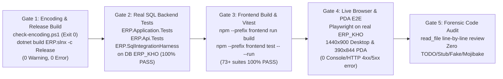

# ACCEPTANCE CRITERIA & REGRESSION VERIFICATION PLAN (DELIVERABLE Q)

**Project:** ERP_KHO — Cloud ERP & WMS SaaS  
**Document ID:** `DELIVERABLE-Q`  
**Audit Run:** `2026-11-01_REASSESSMENT_001`  
**Mode:** READ-ONLY SYSTEM AUDIT + TO-BE QA & VERIFICATION BLUEPRINT  
**Baseline Branch / SHA:** `feat/WMS-61-project-development` (`6e0a333390c1db6222e55ae3945b7ce33a56bef6`)

---

## 1. Executive Summary & 5 Quality Gates (`PROJECT_RULE Layer 5`)

Every change proposed in this reassessment (once approved by the Project Owner) must pass **all 5 Mandatory Quality Gates (`Gate 1 → Gate 5`)** with zero workarounds or test exclusions (`[TST-001]`, `[TST-002]`):



---

## 2. Current Automated Test Baseline (`FACT`)

1. **Backend Test Suites (`dotnet test ERP.slnx`):**
   - `ERP.Application.Tests` — Domain logic, UOM conversions, state transitions, allocation/putaway scoring, validator unit tests.
   - `ERP.Api.Tests` — Controller contract, authorization filter, idempotency, concurrency, and middleware integration tests.
   - `ERP.SqlIntegrationHarness` — Real SQL Server (`ERP_KHO`) transactional harness verifying `sp_getapplock`, `UPDLOCK/ROWLOCK/REPEATABLEREAD`, 9-dimension `GrainHash`, migration-snapshot parity (`MigrationSnapshotParityTests`), and ledger-balance reconciliation.
2. **Frontend Test Suites (`npm --prefix frontend test -- --run`):**
   - **73 Vitest test files** (`54` page tests, `9` service tests, `3` component tests, `1` UI design-system test, `1` mock integrity test, `1` route guard test, `1` layout test, plus cross-cutting Wave remediation tests).

---

## 3. Mandatory 4-Scenario Inventory Verification Matrix (`[TST-001]`)

Per `[TST-001]` and `[TST-002]`, **every** command that mutates inventory (`ImportReceipt.Post`, `PutawayTask.Execute`, `ExportReceipt.ApproveAndReserve`, `ExportReceipt.Dispatch`, `PickingTask.Pick`, `Shipment.Dispatch`, `StockTransfer.Dispatch/Receive`, `Stocktake.Approve`, `InventoryMovement.Create`, `InventoryStatusChange.Create`, `InventoryReversal.Create`, `CustomerReturn.PostDisposition`, `KitWorkOrder.Complete`) MUST have automated SQL Server tests covering all **4 canonical scenarios**:

| Scenario # | Scenario Name | Mandatory Database Assertions (`[TST-002]` — No Shallow Asserts!) |
|:----------:|---------------|-------------------------------------------------------------------|
| **Scenario A** | **Happy Path (6-Part Atomic Commit)** | Verify within `ERP_KHO` after commit:<br>1. Document `Status` & `RowVersion` updated.<br>2. `InventoryTransactions` (immutable ledger) row(s) inserted with exact `BaseQty`, `TransactionUom`, `ConversionRateSnapshot`, and `MovingAverageCost`.<br>3. `InventoryStock` 9-dimension bucket (`GrainHash`) updated (`Quantity`, `ReservedQuantity`, `AllocatedQuantity`, `PickedPendingDispatchQuantity`, `LockedQuantity` all `>= 0`).<br>4. `StockReservation` / `StockAllocation` / `PutawayTask` updated.<br>5. `AuditLogs` entry written with `BeforeStateJson`, `AfterStateJson`, `CorrelationId`.<br>6. `OutboxMessages` & `IdempotencyRecords` committed. |
| **Scenario B** | **Idempotent Replay & Conflict (`Idempotency-Key`)** | 1. Send `POST` twice with identical `Idempotency-Key` + identical payload → Both return `200 OK`, and `InventoryTransactions.Count()` is **strictly `1`** (zero double-posting).<br>2. Send `POST` with same `Idempotency-Key` + modified payload → Returns `409 IDEMPOTENCY_FINGERPRINT_MISMATCH`.<br>3. Send `POST` with `Idempotency-Key` as unauthorized user (`403`/`404`) → Grant permission → Retry with same `Idempotency-Key` → Succeeds `200 OK` (`FND-023`). |
| **Scenario C** | **High-Concurrency Race Condition (`sp_getapplock` + `UPDLOCK`)** | Launch 5–10 parallel threads (`Task.WhenAll`) attempting to reserve/allocate/pick/dispatch the same `(WarehouseId, ProductId, LocationId, LotId)` bucket where `AvailableQty = 10` and each thread requests `6` units:<br>1. Exactly **1** thread succeeds (`200 OK`).<br>2. Remaining threads fail cleanly with `409 CONCURRENCY_CONFLICT` or `422 INV_INSUFFICIENT_AVAILABLE_STOCK` (zero SQL Deadlock `1205` unhandled crashes).<br>3. Final `InventoryStock.Quantity >= 0` and equals `Opening + Sum(Ledger)`. |
| **Scenario D** | **Immutable Reversal (`Counter-Entry`)** | Execute reversal on a posted transaction:<br>1. Original `InventoryTransactions` row is untouched (never `UPDATE`d or `DELETE`d).<br>2. New `InventoryTransactions` row is inserted with `TransactionType = Reversal`, opposite sign, and reference to original document/entry.<br>3. Algebraic sum of original + reversal ledger deltas equals `0`, and `InventoryStock` balance is restored. |

---

## 4. Phase-by-Phase Acceptance Criteria & Test Cases

### 4.1 Phase 0 — Security, RBAC & API Integrity Acceptance Suite

| Test ID | Finding Ref | Test Case Description | Expected Outcome |
|---------|-------------|-----------------------|------------------|
| `TC-P0-01` | `FND-001` | Enroll TOTP 2FA for user → clear in-memory caches / restart host → call `POST /api/v1/account-security/{id}/totp/verify` with valid RFC 6238 code. | `200 OK` (`verified: true`); state loaded from SQL Server `Users` table. |
| `TC-P0-02` | `FND-001` | Call `POST /api/v1/account-security/{id}/totp/verify` passing an attacker-generated `base32Secret` in JSON body + matching 6-digit code. | `400 Bad Request` (`errorCode: "INVALID_TOTP_CODE"`). Client-supplied secret is ignored. |
| `TC-P0-03` | `FND-002` | Call `POST /api/v1/saas/tenants/provision` without `Authorization` Bearer header. | `401 Unauthorized` (`[AllowAnonymous]` removed from admin provisioning). |
| `TC-P0-04` | `FND-004` | Authenticate as custom role `"ReadOnlyStaff"` having `receipt.read` and `export_receipt.read` (role name != `"Viewer"`). Call `POST /rma-intake-check`, `POST /execute-rtv-refurbish`, `POST /handover-manifests/seal`, `POST /einvoice-nd70-draft`. | All 4 calls return `403 Forbidden` (protected by mutation permissions, not `!IsInRole("Viewer")`). |
| `TC-P0-05` | `FND-005` | Authenticate as `Accountant` with `inventory.read` and `inventory.cost.read`. Call `GET /api/v1/reports/inventory-in-out-stock` and `/export`. | `200 OK` with full quantity and WAC valuation columns; valid `.xlsx` binary (`PK\x03\x04` header) returned. |
| `TC-P0-06` | `FND-006` | Authenticate as `WarehouseStaff` with `inventory_movement.create` (for bin-to-bin moves) but without `inventory_opening_balance.import`. Call `POST /api/v1/inventory/opening-balances/import`. | `403 Forbidden`. |
| `TC-P0-07` | `FND-008` | Inspect all 42 controllers via reflection/grep for optional `= null!` services or `FallbackWhenNoOpsAsync`. | `0` occurrences; DI container validation (`ValidateOnBuild = true`, `ValidateScopes = true`) passes on startup. |
| `TC-P0-08` | `FND-016` | Login via `POST /api/v1/auth/login` → inspect `Set-Cookie: erp_refresh` header → call `POST /api/v1/auth/refresh`. | Cookie `Path=/` (or `/api`), `HttpOnly`, `SameSite=Strict`; refresh returns `200 OK` with new access token. |

---

### 4.2 Phase 1 — E-Commerce Floor Essentials Acceptance Suite

| Test ID | Finding Ref | Test Case Description | Expected Outcome |
|---------|-------------|-----------------------|------------------|
| `TC-P1-01` | `FND-003` | **Customer Return Full Lifecycle (SQL + UI):** Scan returned AWB on `/customer-returns` → auto-populate SKU/Lot from `ExportReceipt` → Receive 5 units into `Quarantine` (`Status = QUARANTINED`) → Inspect & split disposition: 3 units `RESTOCK_AVAILABLE` (Bin `A-01-01`), 2 units `SCRAP_DISPOSAL` → Post. | `CustomerReturn.Status == "COMPLETED"`; `InventoryStock` at `A-01-01` (`Available`) increases by `+3`; `Quarantine` net `0`; `InventoryTransactions` has immutable audit trail; `RowVersion` incremented. |
| `TC-P1-02` | `FND-013` | **Hardware HID Barcode Gun Wedge:** On `/picking-tasks` or `/putaway-tasks`, blur all `<input>` elements (`document.body.focus()`). Fire simulated HID burst `(01)08935001234567(10)LOT99(17)270630` + `Enter` within `180ms`. | `useHardwareScannerWedge` captures burst, parses GTIN `08935001234567`, Lot `LOT99`, Expiry `2027-06-30`, matches the active task line, and triggers audio feedback. |
| `TC-P1-03` | `FND-019` | **PDA Mobile Viewport (`390x844`):** Render app at `390x844` in Playwright. Verify Floor Launcher tiles and bottom navigation bar. | `document.documentElement.scrollWidth <= 390` (`0px` horizontal overflow); all 6 floor tasks reachable in 1 tap; touch targets `>= 48x48px`. |
| `TC-P1-04` | `FND-015` | **Statutory Stock Card (`Thẻ Kho S12-DN`):** Call `GET /api/v1/reports/stock-card/export?warehouseId=1&productId=10` and open in `ClosedXML`. | Valid `.xlsx` with S12-DN header, chronological ledger rows, accurate running balance column after each row, and closing balance equal to `InventoryStock.Quantity`. |

---

### 4.3 Phase 2 & Phase 3 — IA, Scalability & Optimization Acceptance Suite

| Test ID | Finding Ref | Test Case Description | Expected Outcome |
|---------|-------------|-----------------------|------------------|
| `TC-P2-01` | `FND-010` | Seed 1,000 `ImportReceipts` and 1,000 `ExportReceipts`. Call `GET /api/v1/import-receipts?pageNumber=2&pageSize=25` and `GET /api/v1/import-receipts/pipeline-summary`. | List returns 25 items + `totalCount: 1000`; `pipeline-summary` executes SQL `GROUP BY` in `< 50ms` without loading 1,000 entities into EF ChangeTracker. |
| `TC-P2-02` | `FND-011` | Run line-count check across `frontend/src/pages/**/*.tsx`. | Every component file is `<= 500` lines of code. |
| `TC-P2-03` | `FND-012` | Navigate through all 16 consolidated sidebar hubs and verify deep-linking to all 39 legacy URLs (`/inventory-locks`, `/stock-allocations`, `/handover-manifests`, etc.). | Every legacy URL opens the corresponding hub and selects the active sub-tab with `0` 404s. |
| `TC-P3-01` | `FND-018` | Set `MinBaseQty = 10, MaxBaseQty = 50` on Pick Bin `P-01` (current stock `6`). Bulk Bin `B-01` has `100` units across Lot 1 (exp `2026-12-01`) and Lot 2 (exp `2027-06-01`). Trigger replenishment generation. | Replenishment task generated for `44` units (`50 - 6`) from `B-01` selecting Lot 1 (`2026-12-01` FEFO first). |
| `TC-P3-02` | `FND-017` | Complete `KitWorkOrder` assembling 5 Combo Packs from Component X (Lot X1, Exp `2027-02-01`, Cost `10,000`) and Component Y (Lot Y1, Exp `2026-11-15`, Cost `15,000`). | Component buckets decrease by `5` each; Combo Pack bucket increases by `5` with `ExpiryDate = 2026-11-15` (earliest component expiry) and `MovingAverageCost = 25,000`. |

---

## 5. Mandatory 17-Step Development & Live Chrome DevTools Verification Lifecycle (`TASK-W2-00`)

Every Wave in `ERP_KHO` MUST execute the following **17-Step Engineering & Live Browser Lifecycle** without skipping any step:

| Step # | Lifecycle Stage | Owner | Mandatory Action & Deliverable |
|:------:|-----------------|:-----:|--------------------------------|
| **1** | Pre-Flight Baseline & Contradiction Audit | `AGENT MAIN` + `AGENT 3` | Verify `git status --short`, `git rev-parse HEAD`, SQL Server `ERP_KHO` connectivity, Chrome version, and resolve any doc/code contradictions with `File:Line` evidence. |
| **2** | Architecture & API Contract Lock | `AGENT MAIN` | Lock DTOs, HTTP Routes (`/api/v1/...`), RBAC permissions, 9-Dim lock order, and `Zero-File-Overlap` matrix before parallel coding. |
| **3** | Additive EF Core Migration & Schema Sync | `AGENT 1` | Create strictly additive EF Core migrations (with `Down()` rollback), update `ErpKhoDbContextModelSnapshot.cs`, and pass `MigrationSnapshotParityTests` (`3/3`). |
| **4** | Backend Domain, 9-Dim Engine & Controller Implementation | `AGENT 1` | Implement Domain/Application/Infrastructure/Api with `sp_getapplock` + `UPDLOCK, ROWLOCK, REPEATABLEREAD`, zero null-service fallbacks (`FND-008`), and RBAC enforcement. |
| **5** | Backend Unit, API & Real SQL Integration Testing (`Gate 2`) | `AGENT 1` | Write and pass 4-Scenario `[TST-001]` tests (`Happy Path`, `Idempotency`, `Concurrency`, `Reversal`) across `ERP.SqlIntegrationHarness`, `ERP.Application.Tests`, and `ERP.Api.Tests`. |
| **6** | Frontend Component & UX Implementation (`<= 400 LOC`) | `AGENT 2` | Build React 19 components (`<= 400 LOC/file`), wire real API contracts with `Idempotency-Key`, handle all 5 UI states (`Loading`, `Empty`, `422`, `409`, `403`), and enforce `inventory.cost.read` masking. |
| **7** | Frontend TypeScript Build & Vitest Suite (`Gate 3`) | `AGENT 2` | Pass `npm --prefix frontend run build` (`0` errors) and full `npm --prefix frontend test -- --run` (`100%` pass). |
| **8** | UTF-8 Encoding & Clean Release Build (`Gate 1`) | `AGENT 1` + `AGENT 2` | Run `scripts/check-encoding.ps1` (`Exit Code 0`) and `dotnet build ERP.slnx -c Release --nologo` (`0 Warning(s), 0 Error(s)`). |
| **9** | **Live Browser Testing via Real Google Chrome** | `AGENT 2` + `AGENT 3` | Launch live `ERP.Api` (connected to SQL Server `ERP_KHO`) + `frontend` and open **real Google Chrome** across all target routes and interactive workflows (including `F5` reload persistence verification). |
| **10** | **Google Chrome DevTools 6-Panel Inspection** | `AGENT 2` + `AGENT 3` | Inspect via Chrome DevTools Protocol (CDP):<br>1. **Console Panel:** `0` uncaught `Error` / `PageError` / React hydration or key warnings.<br>2. **Network Panel:** Verify real API payloads, `X-Correlation-Id`, `Idempotency-Key`, `.xlsx` binary `Content-Type`, and `0` unexpected `4xx/5xx`.<br>3. **Elements / Layout Panel:** Verify computed styles, `scrollWidth <= innerWidth` (`0px` horizontal overflow), touch target `boundingBox >= 48x48px`, and `tabular-nums`.<br>4. **Application Panel:** Verify `HttpOnly` refresh cookie (`Path=/`), `localStorage`/`sessionStorage` hygiene, and zero leaked secrets.<br>5. **Performance Panel:** Verify route transition & render responsiveness.<br>6. **Lighthouse / Accessibility Tree:** Verify ARIA roles, `<label>` associations, focus order, and contrast. |
| **11** | **Screenshot & Evidence Capture** | `AGENT 2` + `AGENT 3` | Capture real `.png` screenshots and structured audit logs into:<br>`artifacts/live-browser-audit/<RUN_ID>/<WAVE_ID>/screenshots/<ROUTE_ID>_<COMPONENT>_<STATE>_<VIEWPORT>.png` |
| **12** | Defect Triage & Root-Cause Classification | `AGENT MAIN` + `AGENT 3` | Classify any visual, console, network, or layout defect discovered during Steps 9–11 by severity (`S0..S3`) and root cause. |
| **13** | Targeted Remediation (If Any Defect Found) | `AGENT 1` / `AGENT 2` | Fix the root cause within exclusive file ownership without introducing regressions. |
| **14** | Live Browser Retest & Replacement Screenshot | `AGENT 2` + `AGENT 3` | Re-run Steps 8–11 in Google Chrome + DevTools to prove the fix and capture updated `.png` evidence. |
| **15** | Forensic Code Audit (`Gate 5`) | `AGENT MAIN` + `AGENT 3` | Inspect every modified file line-by-line via `read_file`; verify `Zero-File-Overlap`, `0` `TODO`/`FIXME`/`Stub`/`FallbackWhenNoOpsAsync`, and `<= 400 LOC` for new `.tsx` files. |
| **16** | Independent 5-Gate Sign-Off | `AGENT 3` | Issue independent QA verdict (`PASS` / `FAIL`) backed by terminal logs, CDP metrics, and verified screenshot paths on disk. |
| **17** | Single Master Project Report (`Sections 1 → 19`) | `AGENT MAIN` | Consolidate all wave progress, code diffs, migrations, automated test results, Chrome DevTools 6-Panel results, findings, screenshot evidence index, and change history directly into `docs/project/ERP_WMS_MASTER_PROJECT_REPORT.md` (`ONE PROJECT — ONE MASTER REPORT — CONTINUOUS UPDATE`). |

---

## 6. Mandatory 5-Tier Browser Testing Matrix (`Tier A → Tier E`) & Artifact Convention

### 6.1 Five Browser Testing Tiers (`Tier A → Tier E`)

| Tier | Tier Name | Scope & Purpose | Required Viewports | Mandatory Chrome DevTools & Visual Checks |
|:----:|-----------|-----------------|--------------------|-------------------------------------------|
| **Tier A** | **Smoke & Shell Integrity** | `/login` (`R001`), `/register` (`R002`), `/` (`R003`), Sidebar, Topbar, `WorkspaceErrorBoundary`, Auth session & cookie path | `1440x900`, `390x844` | `0` Console/PageError, `WorkspaceErrorBoundary` recovery card render & reset, `Set-Cookie` `Path=/`. |
| **Tier B** | **Component & Toggle State** | Collapsible ICP sections (`dashboard-advanced-enterprise-toggle`, `picking-advanced-wave-toggle`), Tabs (`/misa-exports`), Drawers, Modals | `1440x900`, `390x844` | Capture `before_action` and `after_action` screenshots; verify DOM attribute (`aria-expanded`) and computed CSS layout. |
| **Tier C** | **End-to-End Transactional Workflow & Persistence** | Full business workflows on live SQL (`ERP_KHO`): e.g., `/customer-returns` (`R046`) AWB intake → Quarantine → Inspect → 4-path Disposition → `F5` reload; `/inventory` (`R018`) Stock Card S12-DN view & `.xlsx` binary download | `1440x900`, `390x844` | Verify `POST`/`GET` Network status `200/201`, `Idempotency-Key` header, DB persistence after `F5` reload, and `.xlsx` binary response (`application/vnd.openxmlformats-officedocument.spreadsheetml.sheet`). |
| **Tier D** | **Industrial Hardware & Responsive Viewport Matrix** | Hardware Scanner HID Wedge (`<= 35ms` burst + `GS1-128 \x1d` FNC1 + Error Buzz + Undo) and `PDA Floor Launcher` 6-Tile Grid (`>= 48x48px`) | All **5 Viewports**:<br>`1440x900`, `1366x768`, `1280x720`, `768x1024`, `390x844` | Verify `document.documentElement.scrollWidth <= window.innerWidth` (`0px` horizontal overflow) across all 5 viewports and touch target `height >= 48px` on `390x844`. |
| **Tier E** | **Full Route Inventory Sweep** | Every route registered in `AppRoutes.tsx` (`R001`..`R046`) | `1440x900`, `390x844` | Verify every route renders without white-screen crash, `0` uncaught exceptions, and 100% Vietnamese diacritics integrity. |

### 6.2 Canonical Evidence & Screenshot Storage Structure (`Single Master Report Governance`)

All raw live browser screenshots and telemetry for a given `<RUN_ID>` and `<WAVE_ID>` MUST be saved on disk under:

```text
artifacts/live-browser-audit/<RUN_ID>/<WAVE_ID>/
├── telemetry-summary.json
└── screenshots/
    └── <ROUTE_ID>_<COMPONENT>_<STATE>_<VIEWPORT>.png
```

All markdown reporting, route inventory, findings, console/network/performance/accessibility reviews, and screenshot evidence catalogs MUST be consolidated directly into **Sections 10, 13, and 16** of **`docs/project/ERP_WMS_MASTER_PROJECT_REPORT.md`** (no separate `.md` report files per wave or agent).

Where:
- `<ROUTE_ID>`: Canonical route code (`R001` = `/login`, `R002` = `/register`, `R003` = `/`, `R009` = `/putaway-tasks`, `R013` = `/picking-tasks`, `R018` = `/inventory`, `R030` = `/onboarding-wizard`, `R035` = `/misa-exports`, `R046` = `/customer-returns`, etc.).
- `<COMPONENT>`: Snake-case component/feature slug (e.g., `rma_workbench`, `disposition_drawer`, `stock_card_s12dn`, `scanner_gs1_bar`, `pda_floor_launcher`, `workspace_error_boundary`).
- `<STATE>`: `initial`, `before_action`, `after_action`, `modal_open`, `error_state`, `success_persisted`.
- `<VIEWPORT>`: `1440x900`, `1366x768`, `1280x720`, `768x1024`, or `390x844`.

---

## 7. Regression Verification Commands Checklist

Before any implementation PR can be marked `DONE`, the executing agent must run and attach verbatim terminal outputs for:

```powershell
# Gate 1: UTF-8 Encoding & Clean Release Build
powershell -NoProfile -ExecutionPolicy Bypass -File scripts/check-encoding.ps1
dotnet build ERP.slnx -c Release --nologo

# Gate 2: Full Backend Unit, API & Real SQL Integration Tests on ERP_KHO
dotnet test ERP.slnx -c Release --no-build --logger "console;verbosity=normal"

# Gate 3: Frontend TypeScript Build & Full Vitest Suite
npm --prefix frontend run build
npm --prefix frontend test -- --run

# Gate 4: Verify Live Chrome Audit Reports & Screenshots Exist on Disk
Get-ChildItem -Recurse artifacts/live-browser-audit/<RUN_ID>/<WAVE_ID>
```
