# Deliverable F: AS-IS Business Process Map (`ERP_KHO`)

**Document ID:** `REASSESSMENT-2026-11-01-DOC-F`  
**Date:** 2026-11-01  
**Role:** Subagent 3 — Business Process Reengineering Specialist  
**Scope:** End-to-end forensic mapping of all 12 AS-IS business process areas in `ERP_KHO` (Domain, Application, API Controllers, SQL Persistence, and React 19 SPA Frontend).

---

## Executive Overview of AS-IS Process Architecture

`ERP_KHO` implements an audit-grade **9-Dimension Inventory Engine** ([`InventoryStock.cs`](file:///d:/ERP_KHO/ERP.Domain/Entities/InventoryStock.cs), [`InventoryTransaction.cs`](file:///d:/ERP_KHO/ERP.Domain/Entities/InventoryTransaction.cs)) backed by an immutable append-only ledger (`InventoryTransactions`), deterministic `SHA256` `GrainHash` row locking, and a dual-mode React 19 UI (`EXPRESS` vs `FULL` mode in [`MainLayout.tsx`](file:///d:/ERP_KHO/frontend/src/layouts/MainLayout.tsx)).

However, forensic inspection across the 12 business process areas reveals several structural frictions for the target Vietnamese SMB/e-commerce warehouse (1 warehouse, 5–30 staff, Shopee/Lazada/TikTok Shop + B2B distributor):
1. **State Machine Over-Complexity & Overlapping Transitions:** [`ReceiptStatus.cs`](file:///d:/ERP_KHO/ERP.Domain/Enums/ReceiptStatus.cs) mixes Inbound and Outbound states into a single 15-value enum (`Draft`, `Approved`, `Cancelled`, `Dispatched`, `Received`, `ReadyToPost`, `Posted`, `QcPending`, `QcCompleted`, `DiscrepancyPending`, `DiscrepancySubmitted`, `DiscrepancyPendingApproval`, `DiscrepancyResolved`, `DiscrepancyRejected`, `CancelPendingPutback`), while [`ImportReceipt.TransitionTo`](file:///d:/ERP_KHO/ERP.Domain/Entities/ImportReceipt.cs#L29-L99) allows 47 permissive transitions, blurring strict sequential gates.
2. **God Pages & Fragmented Sub-Flows:** [`ImportReceipts.tsx`](file:///d:/ERP_KHO/frontend/src/pages/ImportReceipts.tsx) (1,991 lines) and [`Permissions.tsx`](file:///d:/ERP_KHO/frontend/src/pages/Permissions.tsx) (2,280 lines) pack multiple distinct operational roles (Receiving clerk, QC inspector, Accounting poster, RMA handler) into single monolithic screens.
3. **Embedded Operations in Non-Canonical Controllers:** RMA (`customer-returns`, `rma-intake-check`, `execute-rtv-refurbish`) is embedded inside [`ImportReceiptsController.cs`](file:///d:/ERP_KHO/ERP.Api/Controllers/ImportReceiptsController.cs#L154-L222) instead of a dedicated `/api/v1/customer-returns` controller; Kitting/VAS (`execute-kitting-vas`) is embedded inside [`PackingSessionsController.cs`](file:///d:/ERP_KHO/ERP.Api/Controllers/PackingSessionsController.cs#L135-L147); Opening Balance import and MISA/E-Invoice exports are embedded inside [`ExportReceiptsController.cs`](file:///d:/ERP_KHO/ERP.Api/Controllers/ExportReceiptsController.cs#L296-L390).
4. **Mixed Route Conventions:** Controllers simultaneously expose legacy `/api/[controller]` (`/api/ImportReceipts`, `/api/Reports`) alongside `/api/v1/<kebab-case>`, and several operational endpoints use `[PermissionAuthorize(AppPermissions.*Read)]` with manual role checks (`if (User?.IsInRole(AppRoles.Viewer) == true) return Forbid();`) instead of granular command permissions.

---

## Process 1: Inbound Planning & Receiving (`PO → ASN → Dock/Yard → ImportReceipt → QC → Discrepancy → Post`)

### 1.1 Process Summary & Operational Scope
Covers upstream supplier purchase order tracking, pre-arrival shipment notification (ASN), yard/dock appointment check-in, physical receiving at the dock, lot/serial/expiry identity capture, quality inspection (QC), discrepancy resolution, and final ledger posting (`TransactionType.Import`) with Moving Average Cost (MAC) recalculation.

### 1.2 Actors, UI Screens, API Endpoints & Database Tables

| Dimension | AS-IS Implementation Details |
|-----------|------------------------------|
| **Actors & Roles** | Purchasing Staff (`purchase_order.*`, `asn.*`), Yard/Gate Security (`dock_appointment.*`), Receiving Clerk (`receipt.create`, `receipt.receive`, `discrepancy.create`), QC Inspector (`quality_inspection.execute`, `quality_disposition.submit`), Warehouse Manager (`receipt.approve`, `discrepancy.approve`), Inventory Accountant (`receipt.post`, `inventory.cost.read`) |
| **UI Screens** | [`PurchaseOrders.tsx`](file:///d:/ERP_KHO/frontend/src/pages/PurchaseOrders.tsx) (`/purchase-orders`), [`Asns.tsx`](file:///d:/ERP_KHO/frontend/src/pages/Asns.tsx) (`/asns`), [`DockYard.tsx`](file:///d:/ERP_KHO/frontend/src/pages/DockYard.tsx) (`/dock-yard`), [`ImportReceipts.tsx`](file:///d:/ERP_KHO/frontend/src/pages/ImportReceipts.tsx) (`/import-receipts`) |
| **API Controllers & Endpoints** | • [`PurchaseOrdersController.cs`](file:///d:/ERP_KHO/ERP.Api/Controllers/PurchaseOrdersController.cs): `GET/POST /api/v1/purchase-orders`, `PUT /{id}`, `POST /{id}/open`, `POST /{id}/close`, `POST /{id}/cancel`, `POST /expedite-overdue`, `POST /generate-procurement-recommendations`<br>• [`AsnsController.cs`](file:///d:/ERP_KHO/ERP.Api/Controllers/AsnsController.cs): `GET/POST /api/v1/asns`, `POST /{id}/confirm`, `POST /{id}/mark-in-transit`, `POST /{id}/arrive`, `POST /{id}/start-receiving`, `POST /{id}/complete`, `POST /{id}/cancel`, `POST /pre-allocate-staging`<br>• [`DockYardController.cs`](file:///d:/ERP_KHO/ERP.Api/Controllers/DockYardController.cs): `GET/POST /api/v1/dock-yard/appointments`, `POST /{id}/confirm`, `POST /{id}/arrive`, `POST /{id}/check-in`, `POST /{id}/assign-dock`, `POST /{id}/start-service`, `POST /{id}/complete`, `POST /{id}/check-out`<br>• [`ImportReceiptsController.cs`](file:///d:/ERP_KHO/ERP.Api/Controllers/ImportReceiptsController.cs): `GET/POST /api/v1/import-receipts`, `POST /{id}/receive`, `POST /{id}/qc-disposition`, `GET/POST /{id}/inventory-identities`, `GET /{id}/discrepancies`, `POST /{id}/discrepancies/observe`, `POST /{id}/discrepancies/{discrepancyId}/submit`, `POST /{id}/discrepancies/{discrepancyId}/approve`, `POST /{id}/discrepancies/{discrepancyId}/reject`, `POST /{id}/discrepancies/{discrepancyId}/recount`, `POST /{id}/approve`, `POST /{id}/post`, `PUT /{id}/cancel`, `GET /{id}/mac-preview` |
| **DB Tables & Ledgers** | `PurchaseOrders`, `PurchaseOrderLines`, `Asns`, `AsnLines`, `Docks`, `YardSlots`, `DockAppointments`, `ImportReceipts`, `ImportReceiptDetails`, `ImportReceiptInventoryIdentities`, `ReceivingDiscrepancies`, `InventoryLots`, `InventorySerials`, `InventoryStocks` (9-dim balance + `MovingAverageCost`), `InventoryTransactions` (`TransactionType.Import`), `PartnerDebtInvoices` / `PartnerDebtTransactions` (`AP`), `PutawayTasks`, `AuditLogs`, `OutboxMessages` |

### 1.3 End-to-End AS-IS Flowchart

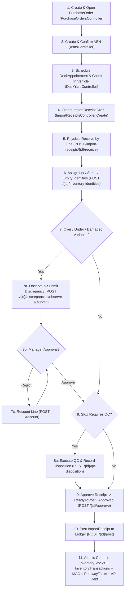

### 1.4 AS-IS State Machines (`PurchaseOrder`, `Asn`, `DockAppointment`, `ImportReceipt`)

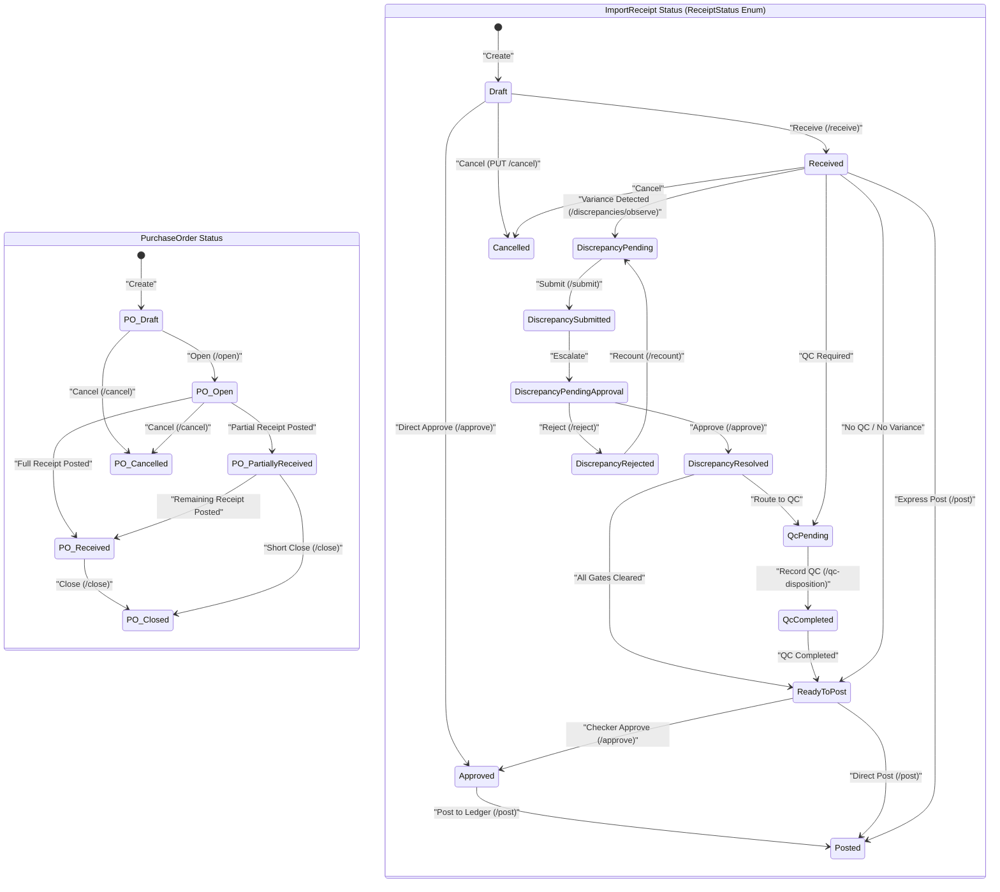

### 1.5 Current Pain Points & Friction
1. **Heavy 7-Stage Pipeline for Small Teams:** While `EXPRESS` mode hides PO, ASN, and Dock/Yard from the sidebar ([`productionNavigation.ts`](file:///d:/ERP_KHO/frontend/src/config/productionNavigation.ts)), the [`ImportReceipts.tsx`](file:///d:/ERP_KHO/frontend/src/pages/ImportReceipts.tsx) screen still exposes an overwhelming 1,991-line interface with receiving worksheets, discrepancy panels, QC dispositions, and identity editors all in one page.
2. **Permissive State Transitions in `ImportReceipt`:** [`ImportReceipt.TransitionTo`](file:///d:/ERP_KHO/ERP.Domain/Entities/ImportReceipt.cs#L29-L99) allows jumping from `Draft -> Approved -> Posted` or `Received -> Posted`, which can bypass `ReadyToPost` if service-layer checks are not uniformly invoked across all entry points.
3. **Inconsistent HTTP Verb for Cancel:** `PUT /api/v1/import-receipts/{id}/cancel` uses `PUT` instead of `POST` (violating `[API-001]` command verb convention used elsewhere).
4. **RMA Mixed into ImportReceipts:** Customer return endpoints (`rma-intake-check`, `customer-returns`, `execute-rtv-refurbish`) live inside [`ImportReceiptsController.cs`](file:///d:/ERP_KHO/ERP.Api/Controllers/ImportReceiptsController.cs#L154-L222) and are gated only by `AppPermissions.ReceiptRead` + non-Viewer role check.

---

## Process 2: Directed Putaway & Putback

### 2.1 Process Summary & Operational Scope
Covers moving posted inbound stock (from a Receiving/Staging bin) or cancelled outbound stock (`Putback`) into active storage bins (`WarehouseLocationType.Storage`). Includes a 5-factor directed putaway suggestion engine (SKU affinity, storage class, remaining capacity, pick-face proximity, FEFO lot consolidation), 3 hard constraints (Active bin, Unblocked bin, Weight/Volume/Pallet capacity), opportunistic Cross-Docking, and location barcode sheet printing (`%PDF-1.4`).

### 2.2 Actors, UI Screens, API Endpoints & Database Tables

| Dimension | AS-IS Implementation Details |
|-----------|------------------------------|
| **Actors & Roles** | Warehouse Supervisor (`putaway.assign`, `putaway.cancel`), Putaway Operator / Forklift Driver (`putaway.read`, `putaway.execute` on Mobile PDA or Desktop) |
| **UI Screens** | [`PutawayTasks.tsx`](file:///d:/ERP_KHO/frontend/src/pages/PutawayTasks.tsx) (`/putaway-tasks`), Mobile PDA Bottom Nav item "Cất hàng" ([`MainLayout.tsx:91`](file:///d:/ERP_KHO/frontend/src/layouts/MainLayout.tsx#L91)) |
| **API Controllers & Endpoints** | [`PutawayTasksController.cs`](file:///d:/ERP_KHO/ERP.Api/Controllers/PutawayTasksController.cs):<br>• `GET /api/v1/putaway-tasks`, `GET /{id}`, `GET /sla-summary`<br>• `GET /{id}/directed-suggestion`, `GET /directed-suggestions`, `GET /rule-engine-policy`, `POST /evaluate-slotting`<br>• `GET /{id}/items/{itemId}/destinations`<br>• `POST /{id}/assign`, `POST /{id}/start`, `POST /{id}/move`, `POST /{id}/exception`, `POST /{id}/resume`, `POST /{id}/cancel`, `POST /{id}/cross-dock`<br>• `GET/POST /api/v1/warehouses/locations/barcode-sheet` |
| **DB Tables & Ledgers** | `PutawayTasks`, `PutawayTaskItems`, `WarehouseLocations`, `InventoryStocks` (decrement source Receiving/Staging bin, increment target Storage bin on 9-dim grain), `InventoryTransactions` (`TransactionType.Move`), `InventoryLocks`, `AuditLogs` |

### 2.3 End-to-End AS-IS Flowchart

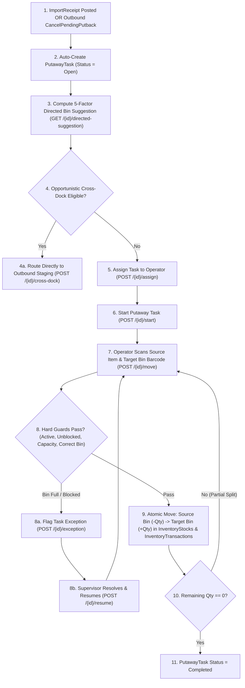

### 2.4 AS-IS State Machine (`PutawayTaskStatus`)

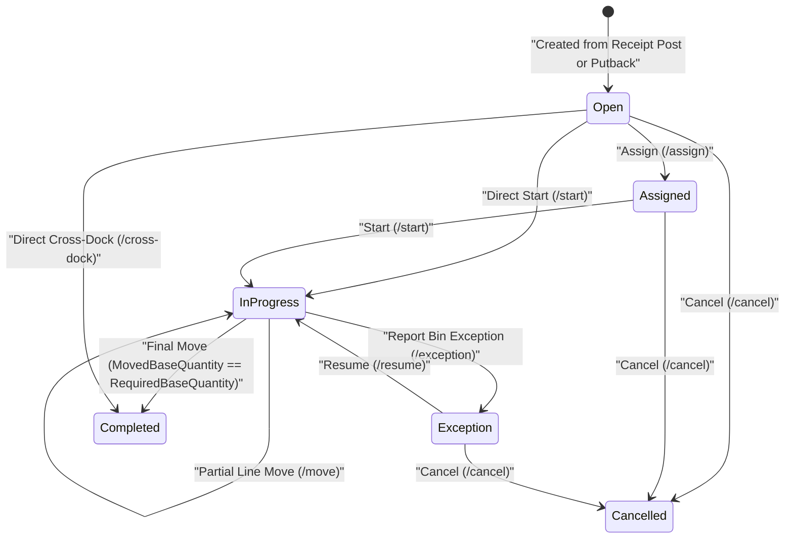

### 2.5 Current Pain Points & Friction
1. **Putaway Not Optional in Express Receiving:** When an `ImportReceipt` is posted into a `Receiving` staging bin, operators in a 5-person warehouse must still navigate to `/putaway-tasks` to move stock to a pickable `Storage` bin before it can be allocated for outbound orders—unless they manually selected a `Storage` bin during receiving.
2. **Location Master CRUD Coupled into `PutawayTasksController`:** [`PutawayTasksController.cs:16-23`](file:///d:/ERP_KHO/ERP.Api/Controllers/PutawayTasksController.cs#L16-L23) hosts `GET/POST/PUT /api/v1/putaway-tasks/locations` instead of keeping location management cleanly in a dedicated `WarehouseLocationsController`.
3. **PDF Generation Hardcoded in Controller:** `BuildLocationSheetPdf14Bytes` (lines 261–296) builds raw PDF 1.4 byte streams directly inside the API controller instead of an Application/Infrastructure service.

---

## Process 3: Outbound Order & Express `ExportReceipt` Flow (`2-Step Approve/Reserve → Dispatch`)

### 3.1 Process Summary & Operational Scope
Designed for high-velocity small teams (`EXPRESS` mode) and direct B2B/counter sales. A user creates an `ExportReceipt` (either standalone or linked to a `SalesOrder` / marketplace order), approves it to reserve stock (`ApproveAndReserve`) or immediately dispatches it in 1 click (`ApproveAndDispatch` when `ExportDispatchMode.DispatchOnApproval` is used), prints thermal 100×150mm AWB labels, and deducts physical inventory (`TransactionType.Export`).

### 3.2 Actors, UI Screens, API Endpoints & Database Tables

| Dimension | AS-IS Implementation Details |
|-----------|------------------------------|
| **Actors & Roles** | Order Clerk (`export_receipt.create`, `export_receipt.update`), Warehouse Supervisor / Checker (`export_receipt.approve`, `export_receipt.cancel`), Dispatch Clerk (`export_receipt.dispatch`, `export_receipt.reprint_awb`) |
| **UI Screens** | [`ExportReceipts.tsx`](file:///d:/ERP_KHO/frontend/src/pages/ExportReceipts.tsx) (`/export-receipts`), [`Approvals.tsx`](file:///d:/ERP_KHO/frontend/src/pages/Approvals.tsx) (`/approvals`) |
| **API Controllers & Endpoints** | [`ExportReceiptsController.cs`](file:///d:/ERP_KHO/ERP.Api/Controllers/ExportReceiptsController.cs):<br>• `GET/POST /api/v1/export-receipts`, `GET /{id}`, `GET /pipeline-summary`, `GET /sla-queue`<br>• `POST /{id}/approve`, `POST /{id}/approve-and-reserve`, `POST /{id}/approve-and-dispatch`, `POST /{id}/dispatch`, `POST /{id}/cancel`<br>• `PUT /{id}/customer`<br>• `POST /verify-dispatch-cutoff`, `POST /batch-print-awb` |
| **DB Tables & Ledgers** | `ExportReceipts`, `ExportReceiptDetails`, `StockReservations`, `InventoryStocks` (`ReservedQuantity` on Approve; `Quantity` decremented on Dispatch), `InventoryTransactions` (`TransactionType.Export`), `PartnerDebtInvoices` (`AR`), `TenantSubscriptions` (`CurrentMonthOrderCount` incremented on Create), `AuditLogs`, `OutboxMessages` |

### 3.3 End-to-End AS-IS Flowchart

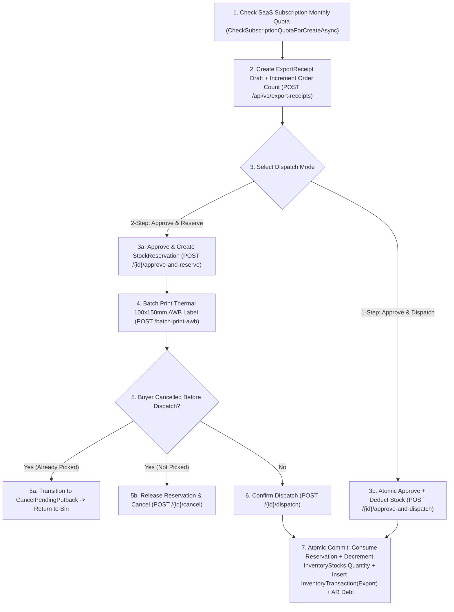

### 3.4 AS-IS State Machine (`ExportReceipt` using `ReceiptStatus`)

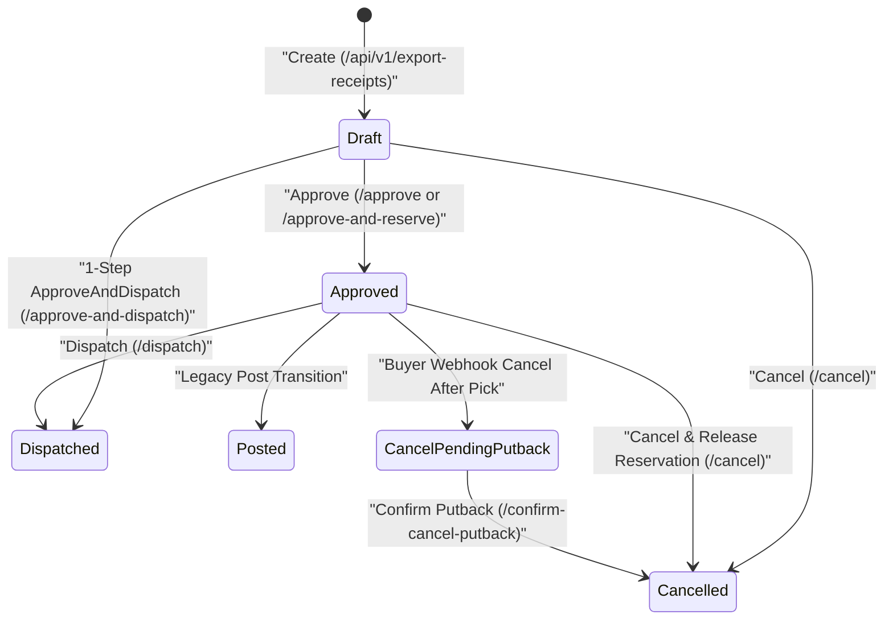

### 3.5 Current Pain Points & Friction
1. **Three Overlapping Approval Endpoints:** `ExportReceiptsController` exposes `/approve`, `/approve-and-reserve`, and `/approve-and-dispatch`. Having both `/approve` and `/approve-and-reserve` creates confusion over whether an `Approved` export receipt always guarantees a backing `StockReservation`.
2. **God Controller Pollution:** [`ExportReceiptsController.cs`](file:///d:/ERP_KHO/ERP.Api/Controllers/ExportReceiptsController.cs) is polluted with unrelated endpoints: `ImportOpeningBalance` (`data-imports/opening-balance`), `GetMisaExcelExport` (`misa-excel-export`), `IssueEinvoiceNd70Draft` (`einvoice-nd70-draft`), and `GetHandoverManifests`.
3. **SaaS Quota Incremented on Draft Creation, Not Dispatch:** `IncrementSubscriptionOrderCountAsync` is called inside `Create` ([`ExportReceiptsController.cs:146`](file:///d:/ERP_KHO/ERP.Api/Controllers/ExportReceiptsController.cs#L146)), meaning cancelled draft receipts still consume the tenant's monthly order quota unless manually reconciled.

---

## Process 4: Full Outbound Warehouse Execution (`SO → Reservation → Allocation → Wave/Picking → Packing/HU → Shipment → Handover Manifest`)

### 4.1 Process Summary & Operational Scope
The structured multi-stage fulfillment workflow (`FULL` mode) for warehouses with dedicated pickers, packers, and shipping dock staff. Covers omnichannel order ingestion (Shopee/TikTok/Lazada OAuth & Excel import, promotional gift rules, ATP multi-warehouse routing), soft reservation (`StockReservation`), hard bin/lot FEFO allocation (`StockAllocation`), wave/cluster picking with Put-to-Wall sortation and short-pick recovery (`PickingTask`), handling unit cartonization & video evidence capture (`PackingSession` / `HandlingUnit`), dock loading & last-mile carrier booking (`Shipment`), and courier AWB scan-out (`HandoverManifest`).

### 4.2 Actors, UI Screens, API Endpoints & Database Tables

| Dimension | AS-IS Implementation Details |
|-----------|------------------------------|
| **Actors & Roles** | Customer Service / OMS Clerk (`sales_order.*`, `backorder.*`), Inventory Planner (`allocation.*`), Picker (`picking.*`), Packer (`packing.*`, `handling_unit.*`), Shipping Clerk (`shipment.*`, `loading.execute`), Courier / Driver (co-signs `HandoverManifest`) |
| **UI Screens** | [`OutboundDemand.tsx`](file:///d:/ERP_KHO/frontend/src/pages/OutboundDemand.tsx) (`/backorders`), [`StockReservations.tsx`](file:///d:/ERP_KHO/frontend/src/pages/StockReservations.tsx) (`/stock-reservations`), [`StockAllocations.tsx`](file:///d:/ERP_KHO/frontend/src/pages/StockAllocations.tsx) (`/stock-allocations`), [`PickingTasks.tsx`](file:///d:/ERP_KHO/frontend/src/pages/PickingTasks.tsx) (`/picking-tasks`), [`PackingSessions.tsx`](file:///d:/ERP_KHO/frontend/src/pages/PackingSessions.tsx) (`/packing-sessions`), [`Shipments.tsx`](file:///d:/ERP_KHO/frontend/src/pages/Shipments.tsx) (`/shipments`), [`HandoverManifests.tsx`](file:///d:/ERP_KHO/frontend/src/pages/HandoverManifests.tsx) (`/handover-manifests`) |
| **API Controllers & Endpoints** | • [`SalesOrdersController.cs`](file:///d:/ERP_KHO/ERP.Api/Controllers/SalesOrdersController.cs): `GET/POST /api/v1/sales-orders`, `POST /{id}/hold`, `POST /{id}/release`, `POST /{id}/cancel`, `POST /{id}/confirm-cancel-putback`, `POST /evaluate-atp-routing`, `POST /webhook-buyer-cancellation`, `POST /import-marketplace-orders-excel`<br>• [`BackordersController.cs`](file:///d:/ERP_KHO/ERP.Api/Controllers/BackordersController.cs): `GET /api/v1/backorders`, `POST /{id}/reallocate`, `POST /{id}/cancel`<br>• [`StockReservationsController.cs`](file:///d:/ERP_KHO/ERP.Api/Controllers/StockReservationsController.cs): `GET/POST /api/v1/stock-reservations`, `POST /{id}/release`, `POST /expire`<br>• [`StockAllocationsController.cs`](file:///d:/ERP_KHO/ERP.Api/Controllers/StockAllocationsController.cs): `GET/POST /api/v1/stock-allocations`, `POST /auto`, `POST /{id}/release`, `POST /{id}/reallocate`, `GET /candidates`<br>• [`PickingTasksController.cs`](file:///d:/ERP_KHO/ERP.Api/Controllers/PickingTasksController.cs): `GET /api/v1/picking-tasks`, `POST /waves/release`, `POST /{id}/assign`, `POST /{id}/start`, `POST /{id}/lines/{lineId}/pick`, `POST /{id}/lines/{lineId}/short-pick`, `POST /{id}/short-picks/{exceptionId}/resolve`, `POST /{id}/complete`, `POST /{id}/put-to-wall-sort`<br>• [`PackingSessionsController.cs`](file:///d:/ERP_KHO/ERP.Api/Controllers/PackingSessionsController.cs): `GET/POST /api/v1/packing-sessions`, `POST /{id}/create-hu`, `POST /{id}/pack`, `POST /{id}/handling-units/{huId}/close`, `POST /{id}/handling-units/{huId}/nest`, `POST /{id}/complete`, `POST /{id}/close`, `POST /video-evidence`<br>• [`ShipmentsController.cs`](file:///d:/ERP_KHO/ERP.Api/Controllers/ShipmentsController.cs): `GET /api/v1/shipments`, `POST /{id}/stage`, `POST /{id}/start-loading`, `POST /{id}/load-hu`, `POST /{id}/complete-loading`, `POST /{id}/dispatch`, `POST /{id}/mark-in-transit`, `POST /{id}/delivery-confirm`, `POST /{id}/delivery-failed`, `POST /{id}/retry-delivery`, `POST /{id}/return-initiate`, `POST /{id}/complete-rts-return`<br>• [`HandoverManifestsController.cs`](file:///d:/ERP_KHO/ERP.Api/Controllers/HandoverManifestsController.cs): `GET /api/v1/handover-manifests`, `POST /scan-awb`, `POST /{id}/seal`, `POST /confirm-carrier-handover` |
| **DB Tables & Ledgers** | `SalesOrders`, `SalesOrderLines`, `Backorders`, `MarketplaceShops`, `PromotionGiftRules`, `StockReservations`, `StockAllocations`, `PickingWaves`, `PickingTasks`, `PickingTaskLines`, `ShortPickExceptions`, `PutToWallSlots`, `PackingSessions`, `PackingLines`, `HandlingUnits`, `HandlingUnitItems`, `PackingVideoEvidences`, `Shipments`, `ShipmentLines`, `ShipmentHandlingUnits`, `ShipmentTrackingEvents`, `HandoverManifests`, `HandoverManifestLines`, `InventoryStocks`, `InventoryTransactions` (`TransactionType.Ship`), `AuditLogs`, `OutboxMessages` |

### 4.3 End-to-End AS-IS Flowchart

```mermaid
flowchart TD
    SO["1. Create/Import SalesOrder & Evaluate Gift Rules (SalesOrdersController)"] --> REL["2. Release SalesOrder (POST /sales-orders/{id}/release)"]
    REL --> ATP{"3. Sufficient Available Stock?"}
    ATP -- "Partial / Zero Stock" --> BO["3a. Create Backorder for Unfulfilled Qty (BackordersController)"]
    ATP -- "Available" --> RES["4. Create Soft StockReservation (StockReservationsController)"]
    BO -- "Inbound Replenished" --> RES
    RES --> ALLOC["5. Auto-Allocate FEFO Bin/Lot -> StockAllocation (POST /stock-allocations/auto)"]
    ALLOC --> WAVE["6. Release Picking Wave / Create PickingTask (POST /picking-tasks/waves/release)"]
    WAVE --> PICK["7. Picker Scans Bin + Product + Lot (POST /picking-tasks/{id}/lines/{lineId}/pick)"]
    PICK --> SHORT{"8. Physical Bin Short?"}
    SHORT -- "Yes" --> SP_RES["8a. Report Short-Pick & Resolve: Alternate Bin / Backorder / Cancel (POST .../short-picks/{spId}/resolve)"]
    SP_RES --> PTW["9. Put-to-Wall Sortation for Multi-Order Batch (POST /put-to-wall-sort)"]
    SHORT -- "No" --> PTW
    PTW --> PACK["10. Create PackingSession & HandlingUnit + Record Video SHA256 (PackingSessionsController)"]
    PACK --> CLOSE_HU["11. Pack Items & Seal HandlingUnit (POST .../handling-units/{huId}/close)"]
    CLOSE_HU --> SHIP_STAGE["12. Stage & Load HUs onto Shipment (ShipmentsController: stage -> start-loading -> load-hu -> complete-loading)"]
    SHIP_STAGE --> MANIFEST["13. Scan AWB into HandoverManifest & Seal with Driver Plate (HandoverManifestsController)"]
    MANIFEST --> SHIP_DISP["14. Dispatch Shipment -> Deduct InventoryStocks & Write InventoryTransaction(Ship)"]
    SHIP_DISP --> LAST_MILE{"15. Carrier Last-Mile Outcome"}
    LAST_MILE -- "Delivered" --> POD["15a. Confirm POD -> Shipment Completed"]
    LAST_MILE -- "Failed 3x" --> RTS["15b. ReturnInitiate -> CompleteRtsReturn (Restock / Quarantine)"]
```

### 4.4 AS-IS Multi-Entity State Machine (`SalesOrder → Allocation → Picking → Packing → Shipment`)

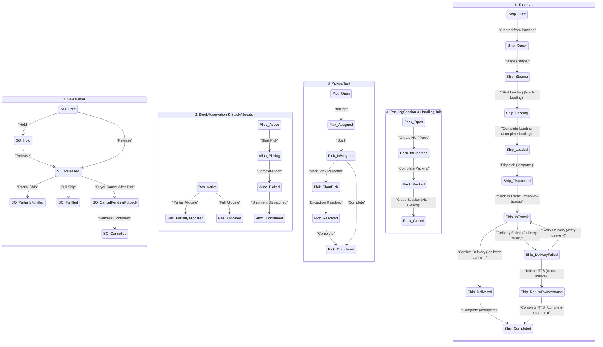

### 4.5 Current Pain Points & Friction
1. **7 Separate Screens Required for 1 Outbound Order in FULL Mode:** An order must traverse `/backorders` (`SalesOrder`) → `/stock-reservations` → `/stock-allocations` → `/picking-tasks` → `/packing-sessions` → `/shipments` → `/handover-manifests`. There is no unified "Outbound Workbench" that auto-chains `Release -> Reserve -> Auto-Allocate -> Create Pick Task` in a single background pipeline.
2. **Dual Outbound Paths (`ExportReceipt` vs `Shipment`) Without Clear Orchestration:** `ExportReceipt` dispatches stock via `TransactionType.Export`, while `Shipment` dispatches stock via `TransactionType.Ship`. Meanwhile, `HandoverManifest` scans `ExportReceipt.TrackingNumber`. If a team uses both `ExportReceipt` and `Shipment`, they risk confusion over which document owns the physical deduction unless `singleShipDeductionGuard` is strictly enforced.
3. **Shipment Loading Ceremony Too Heavy for Parcel E-Commerce:** Requiring `Stage -> StartLoading -> LoadHu -> CompleteLoading -> Dispatch` (5 API calls) makes sense for B2B palletized truckloads, but for Shopee/TikTok parcel fulfillment, scanning the AWB into a `HandoverManifest` and sealing the bag should automatically complete loading and dispatch.

---

## Process 5: Inventory Control (`9-Dimension Buckets, Status Change, Internal Movements, Locks`)

### 5.1 Process Summary & Operational Scope
Manages internal stock health across the 9 canonical identity dimensions (`TenantId, WarehouseId, LocationId, ProductId, LotId, SerialId, HandlingUnitId, Status, OwnerId`) hashed into `GrainHash` (`SHA256`). Covers bin-to-bin internal transfers (`Move`), 1-scan LPN/HandlingUnit pallet moves, auto break-bulk replenishment (Reserve Carton → Pick-Face Base UOM), 8-state inventory status transitions (`Available`, `QcHold`, `Quarantine`, `Damaged`, `Rejected`, `Blocked`, `Expired`, `RecallBlocked`), quality dispositions/scrap, recall blocking, and operational inventory locks (`CountFreeze`, `InvestigationHold`, `MaintenanceFreeze`, `ManualOperationalLock`).

### 5.2 Actors, UI Screens, API Endpoints & Database Tables

| Dimension | AS-IS Implementation Details |
|-----------|------------------------------|
| **Actors & Roles** | Inventory Controller / QA Manager (`inventory.read`, `inventory_status_change.create`, `inventory_lock.manage`), Replenishment / Forklift Operator (`inventory_movement.create`) |
| **UI Screens** | [`Inventory.tsx`](file:///d:/ERP_KHO/frontend/src/pages/Inventory.tsx) (`/inventory`), [`InventoryBuckets.tsx`](file:///d:/ERP_KHO/frontend/src/pages/InventoryBuckets.tsx) (embedded tab), [`InventoryMovements.tsx`](file:///d:/ERP_KHO/frontend/src/pages/InventoryMovements.tsx) (`/inventory-movements`), [`InventoryLocks.tsx`](file:///d:/ERP_KHO/frontend/src/pages/InventoryLocks.tsx) (`/inventory-locks`) |
| **API Controllers & Endpoints** | • [`InventoryStatusController.cs`](file:///d:/ERP_KHO/ERP.Api/Controllers/InventoryStatusController.cs): `GET /api/v1/inventory/statuses`, `GET /buckets`, `POST /status-changes`, `POST /disposition`, `POST /recall-block`, `POST /verify-bucket-invariants`, `POST /verify-lock-precedence`<br>• [`InventoryMovementsController.cs`](file:///d:/ERP_KHO/ERP.Api/Controllers/InventoryMovementsController.cs): `POST /api/v1/inventory-movements`, `POST /move-handling-unit`, `GET/POST /auto-break-bulk-replenish`<br>• [`InventoryControlController.cs`](file:///d:/ERP_KHO/ERP.Api/Controllers/InventoryControlController.cs): `GET/POST /api/v1/inventory/locks`, `POST /locks/{id}/release`, `GET /replenishment-suggestions`, `POST /execute-replenishment`, `POST /replenishment/break-bulk`, `GET/POST /slotting-interleaving/evaluate`, `GET /3pl-depositor-portal` |
| **DB Tables & Ledgers** | `InventoryStocks` (`Quantity`, `ReservedQuantity`, `AllocatedQuantity`, `LockedQuantity`, `GrainHash`), `InventoryTransactions` (`TransactionType.Move`, `TransactionType.StatusChange`, `TransactionType.AdjustmentDecrease`), `InventoryLocks`, `InventoryStatusDefinitions`, `HandlingUnits`, `AuditLogs`, `OutboxMessages` |

### 5.3 End-to-End AS-IS Flowchart

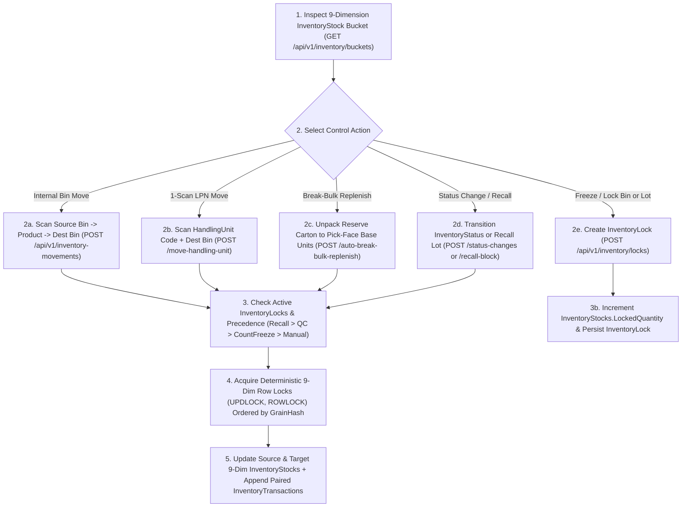

### 5.4 AS-IS State Machines (`InventoryStatus` & `InventoryLockStatus`)

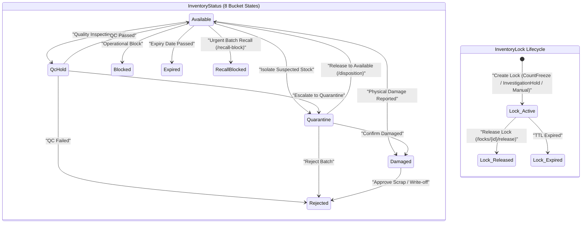

### 5.5 Current Pain Points & Friction
1. **Duplicate Replenishment & Movement Endpoints Across Two Controllers:** Both [`InventoryControlController.cs`](file:///d:/ERP_KHO/ERP.Api/Controllers/InventoryControlController.cs) (`POST /api/v1/inventory/movements`, `POST /replenishment/break-bulk`) and [`InventoryMovementsController.cs`](file:///d:/ERP_KHO/ERP.Api/Controllers/InventoryMovementsController.cs) (`POST /api/v1/inventory-movements`, `POST /auto-break-bulk-replenish`) expose overlapping movement and break-bulk replenishment endpoints.
2. **3PL Depositor Portal Hidden Inside `InventoryControlController`:** `GetThreePlDepositorPortal` and `GenerateThreePlBilling` are placed inside `InventoryControlController` (lines 280–339) instead of the Finance/Billing or Partner module.

---

## Process 6: Inventory Traceability, Reconciliation & Reversals

### 6.1 Process Summary & Operational Scope
Provides forensic auditability over the immutable ledger. Includes:
- **Traceability (`/inventory-traceability`):** Upstream/downstream genealogy by SKU, Lot, Serial, or Document Reference, plus 1-click Recall Tree Simulation (`simulate-recall-tree`).
- **Reconciliation (`/inventory-reconciliation`):** Compares materialized `InventoryStocks.Quantity` against `SUM(InventoryTransactions)` across all 9 dimensions, detects invalid reservations or negative buckets, inspects transactional outbox queues, and supports controlled balance rebuilds (`rebuild-stocks`).
- **Reversals (`/inventory-reversals`):** Compensates erroneous `Move` or `StatusChange` ledger entries by inserting an offsetting `TransactionType.Reversal` entry linked via `ReversalOfTransactionId` and `CorrectiveTransactionId` (never `UPDATE` or `DELETE` on `InventoryTransactions`).

### 6.2 Actors, UI Screens, API Endpoints & Database Tables

| Dimension | AS-IS Implementation Details |
|-----------|------------------------------|
| **Actors & Roles** | Inventory Auditor / QA Manager (`inventory_traceability.read`, `inventory_ledger.read`), Warehouse Manager (`inventory_reversal.create`) |
| **UI Screens** | [`InventoryTraceability.tsx`](file:///d:/ERP_KHO/frontend/src/pages/InventoryTraceability.tsx) (`/inventory-traceability`), [`InventoryReconciliation.tsx`](file:///d:/ERP_KHO/frontend/src/pages/InventoryReconciliation.tsx) (`/inventory-reconciliation`), [`InventoryReversals.tsx`](file:///d:/ERP_KHO/frontend/src/pages/InventoryReversals.tsx) (`/inventory-reversals`) |
| **API Controllers & Endpoints** | • [`InventoryReversalTraceabilityController.cs`](file:///d:/ERP_KHO/ERP.Api/Controllers/InventoryReversalTraceabilityController.cs): `GET /api/v1/inventory/reversal-reasons`, `GET /reversal-candidates`, `GET /reversal-summary`, `POST /reversals`, `POST /reversals/verify-chain-integrity`, `GET /traceability`, `GET /traceability-summary`, `POST /traceability/simulate-recall-tree`<br>• [`InventoryReconciliationController.cs`](file:///d:/ERP_KHO/ERP.Api/Controllers/InventoryReconciliationController.cs): `GET /api/v1/inventory-reconciliation`, `GET /summary`, `GET /investigation`, `GET /valuation`, `POST /rebuild-stocks`, `GET /integration-and-resilience-hub`, `GET /outbox-messages`, `POST /outbox-messages/dispatch-pending` |
| **DB Tables & Ledgers** | `InventoryTransactions` (`ReversalOfTransactionId`, `CorrectiveTransactionId`, `ReasonCode`), `InventoryStocks`, `StockReservations`, `StockAllocations`, `OutboxMessages`, `IdempotencyRecords`, `AuditLogs` |

### 6.3 End-to-End AS-IS Flowchart

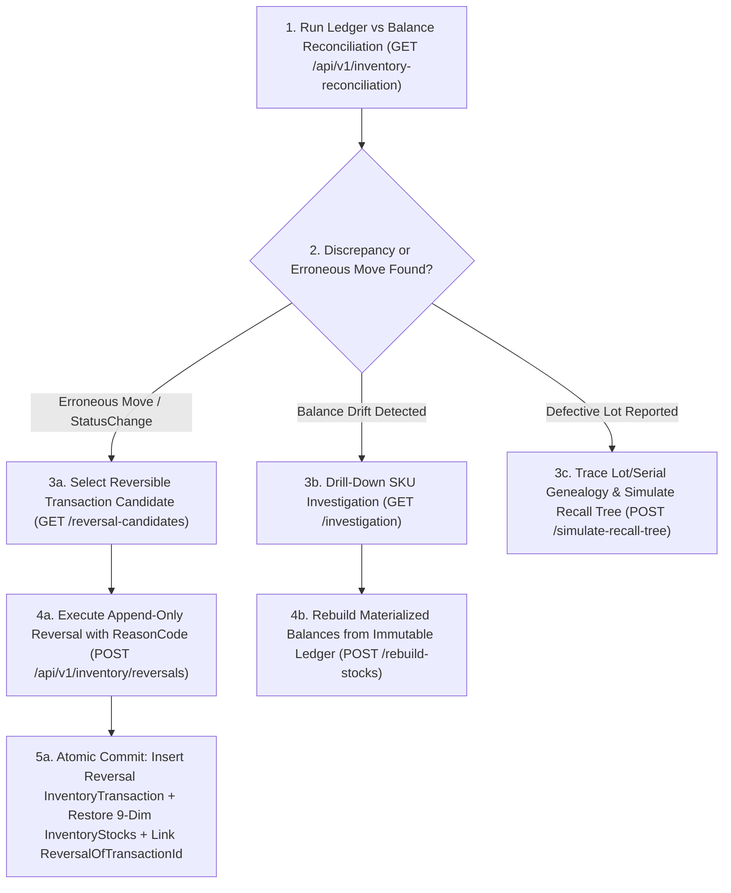

### 6.4 AS-IS State Machine (Ledger Entry Reversal Lifecycle)

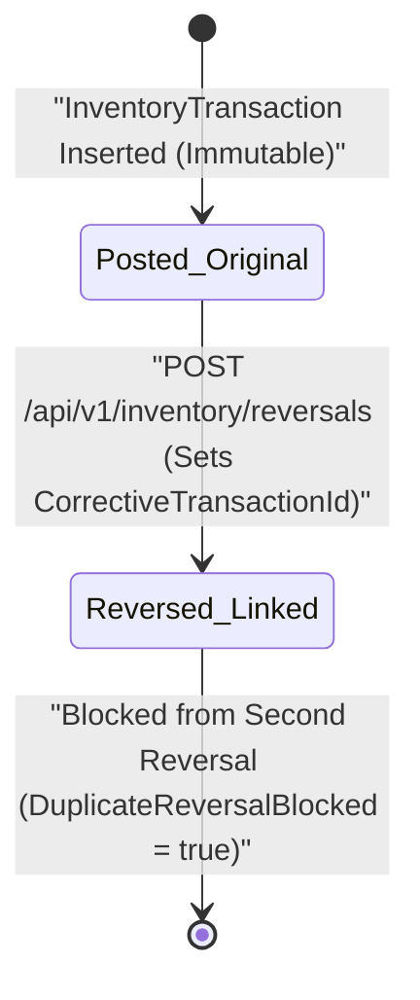

### 6.5 Current Pain Points & Friction
1. **Unbounded Pagination Fallback in `ReversalSummary`:** In [`InventoryReversalTraceabilityController.cs:65-77`](file:///d:/ERP_KHO/ERP.Api/Controllers/InventoryReversalTraceabilityController.cs#L65-L77), if `govOps` is null, `ReversalSummary` loops through all pages in memory (`while (items.Count < firstPage.TotalRecords)`), which risks high memory consumption on large ledgers.
2. **Three Separate Navigation Items for Audit Functions:** Splitting `Reversals`, `Traceability`, and `Reconciliation` into 3 separate sidebar links clutters the `Tồn kho` menu for daily operators, even though `EXPRESS` mode hides them.

---

## Process 7: Cycle Counting / Stocktake (`Blind/Non-Blind, Multi-Attempt, Auto-Approval, Adjustment Posting`)

### 7.1 Process Summary & Operational Scope
Manages physical inventory counts and ad-hoc stock adjustment proposals. Supports `CountFreeze` bin locks during counting, blind counting mode (hiding system expected quantities from floor counters), multi-attempt recounts (`Attempt 1` and `Attempt 2`), automated variance evaluation against dual thresholds (`<= 1.0%` AND `<= 500,000 VND`), Segregation of Duties (SoD) Checker approval (`ApprovalPolicies.Checker`), and atomic adjustment ledger posting (`TransactionType.AdjustmentIncrease` / `AdjustmentDecrease`).

### 7.2 Actors, UI Screens, API Endpoints & Database Tables

| Dimension | AS-IS Implementation Details |
|-----------|------------------------------|
| **Actors & Roles** | Inventory Planner / Maker (`Stocktake.Create`), Cycle Counter (`Stocktake.UpdateDetail` on Mobile PDA or Desktop), Warehouse Manager / Checker (`ApprovalPolicies.Checker` for `Stocktake.Approve`, `Stocktake.Recount`, `Stocktake.ApproveAdjustmentProposal`), Finance Viewer (`inventory.cost.read` to view VND variance valuation) |
| **UI Screens** | [`Stocktakes.tsx`](file:///d:/ERP_KHO/frontend/src/pages/Stocktakes.tsx) (`/stocktakes`), [`Approvals.tsx`](file:///d:/ERP_KHO/frontend/src/pages/Approvals.tsx) (`/approvals`), Mobile PDA Bottom Nav item "Kiểm kê" ([`MainLayout.tsx:93`](file:///d:/ERP_KHO/frontend/src/layouts/MainLayout.tsx#L93)) |
| **API Controllers & Endpoints** | [`StocktakesController.cs`](file:///d:/ERP_KHO/ERP.Api/Controllers/StocktakesController.cs):<br>• `GET/POST /api/v1/stocktakes`, `GET /{id}`<br>• `PUT /{id}/details/{detailId}` (submit counted qty)<br>• `POST /{id}/details/{detailId}/recount` (trigger recount)<br>• `GET /{id}/count-attempts-and-auto-approval`, `POST /{id}/evaluate-auto-approval`<br>• `POST /{id}/approve` (Checker approval + ledger adjustment)<br>• `GET /reason-codes-and-adjustments`, `POST /verify-freeze-policy`<br>• `POST /adjustment-proposals`, `POST /adjustment-proposals/{proposalAuditId}/approve` |
| **DB Tables & Ledgers** | `Stocktakes`, `StocktakeDetails`, `StocktakeAdjustmentProposals`, `InventoryLocks` (`InventoryLockType.CountFreeze`), `InventoryStocks` (`Quantity` adjusted to `CountedQuantity`), `InventoryTransactions` (`TransactionType.AdjustmentIncrease` / `AdjustmentDecrease`), `AuditLogs`, `OutboxMessages` |

### 7.3 End-to-End AS-IS Flowchart

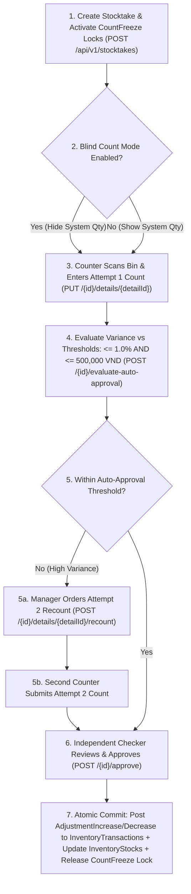

### 7.4 AS-IS State Machine (`StocktakeStatus`)

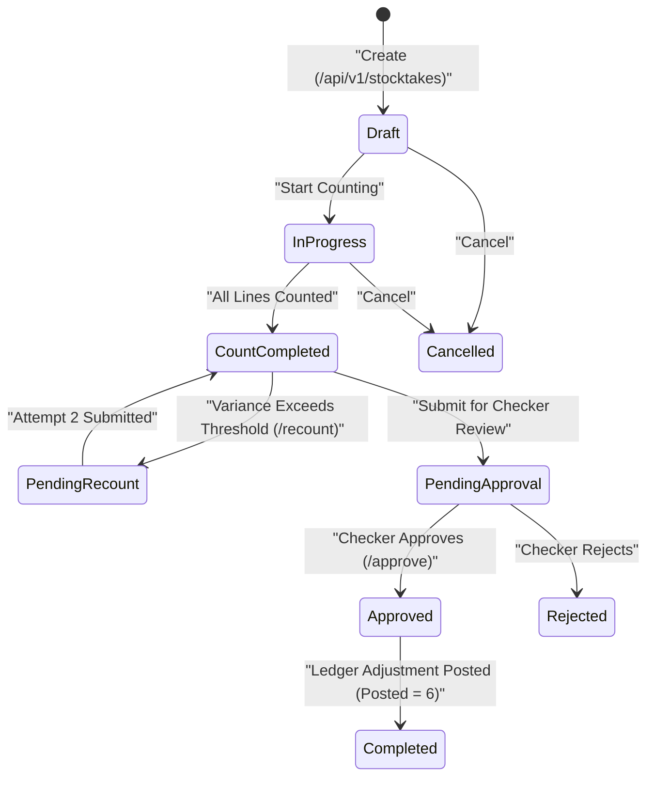

### 7.5 Current Pain Points & Friction
1. **Enum Value Aliasing (`Completed = 6, Posted = 6`):** In [`StocktakeStatus.cs:11-12`](file:///d:/ERP_KHO/ERP.Domain/Enums/StocktakeStatus.cs#L11-L12), `Completed` and `Posted` share the integer value `6`, which can cause inconsistent string serialization (`"Completed"` vs `"Posted"`) depending on which enum member name EF Core or `ToString()` resolves.
2. **Missing Cancel Endpoint on `StocktakesController`:** While [`FRONTEND_AUDIT.md`](file:///d:/ERP_KHO/product_reassessment/2026-11-01_REASSESSMENT_001/FRONTEND_AUDIT.md#L394) notes `POST /api/Stocktakes/{id}/cancel` in the UI, [`StocktakesController.cs`](file:///d:/ERP_KHO/ERP.Api/Controllers/StocktakesController.cs) does not expose a `[HttpPost("{id}/cancel")]` action (only `ApprovalsController.Reject` can reject a stocktake).
3. **Permissive State Transitions in `Stocktake.TransitionTo`:** [`Stocktake.cs:21-51`](file:///d:/ERP_KHO/ERP.Domain/Entities/Stocktake.cs#L21-L51) allows `Draft -> Approved` and `Draft -> Completed` directly without requiring `CountCompleted` at the entity level.

---

## Process 8: Inter-Warehouse Stock Transfers (`In-Transit, Discrepancy, Return`)

### 8.1 Process Summary & Operational Scope
Manages stock movements between two physical warehouses (`SourceWarehouseId` → `DestinationWarehouseId`). Enforces a strict two-step in-transit accounting model:
1. **Dispatch from Source Warehouse:** Deducts `InventoryStocks` at the source warehouse (`TransactionType.TransferOut`) and records in-transit quantity.
2. **Receive at Destination Warehouse:** Increments `InventoryStocks` at the destination warehouse (`TransactionType.TransferIn`), records any damaged or missing in-transit discrepancies (`TransactionType.TransferAdjustment`), or initiates a full/partial return (`StockTransferStatus.Returned`) or reverse transfer draft (`reverse-draft`).

### 8.2 Actors, UI Screens, API Endpoints & Database Tables

| Dimension | AS-IS Implementation Details |
|-----------|------------------------------|
| **Actors & Roles** | Transfer Planner / Maker (`StockTransfer.Create`, `StockTransfer.Update`), Source Warehouse Manager / Checker (`ApprovalPolicies.Checker` for `StockTransfer.Approve`), Source Dispatch Clerk (`StockTransfer.Dispatch`), Destination Receiving Clerk (`StockTransfer.Receive`, `StockTransfer.Complete`), Inventory Auditor (`inventory_reversal.create` for `StockTransfer.Return` & `ReverseDraft`) |
| **UI Screens** | [`StockTransfers.tsx`](file:///d:/ERP_KHO/frontend/src/pages/StockTransfers.tsx) (`/stock-transfers`), [`StockTransferDetailsDialog.tsx`](file:///d:/ERP_KHO/frontend/src/pages/StockTransferDetailsDialog.tsx) |
| **API Controllers & Endpoints** | [`StockTransfersController.cs`](file:///d:/ERP_KHO/ERP.Api/Controllers/StockTransfersController.cs):<br>• `GET/POST /api/v1/stock-transfers`, `GET /{id}`, `PUT /{id}`<br>• `GET /in-transit`, `GET /return-reasons`<br>• `POST /{id}/approve`, `POST /{id}/dispatch`, `POST /{id}/receive`, `POST /{id}/return`, `POST /{id}/reverse-draft`, `POST /{id}/complete`, `POST /{id}/cancel`<br>• `POST /simulate-network-rebalancing` |
| **DB Tables & Ledgers** | `StockTransfers`, `StockTransferDetails`, `InventoryStocks` (Source & Destination warehouses), `InventoryTransactions` (`TransferOut`, `TransferIn`, `TransferAdjustment`), `AuditLogs`, `OutboxMessages` |

### 8.3 End-to-End AS-IS Flowchart

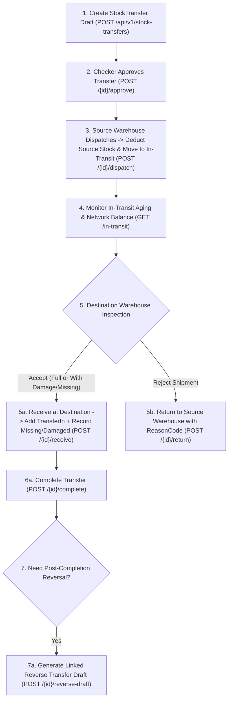

### 8.4 AS-IS State Machine (`StockTransferStatus`)

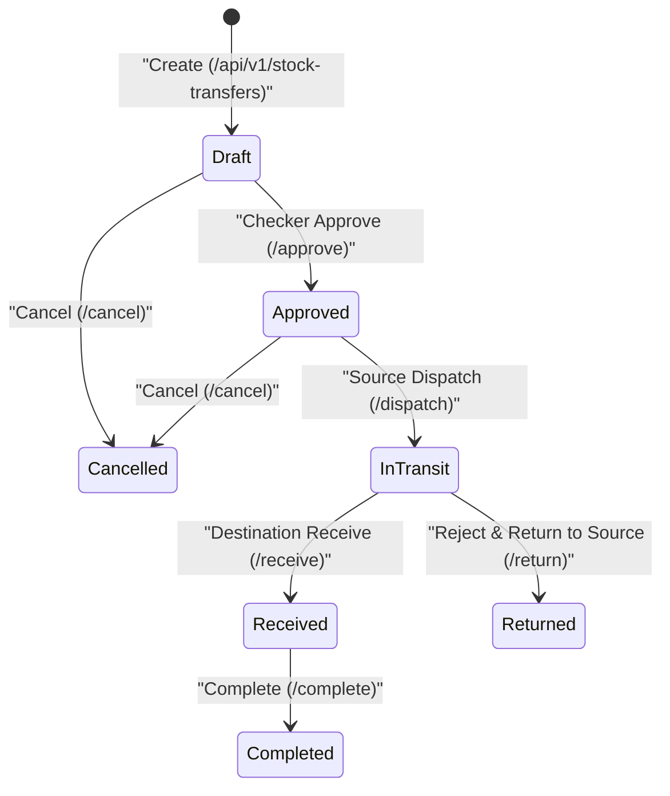

### 8.5 Current Pain Points & Friction
1. **Irrelevant for Single-Warehouse ICP in Express Mode:** For ERP_KHO's primary ICP (1 warehouse, 5–30 staff), inter-warehouse transfers are rarely used, though `EXPRESS` mode properly hides `/stock-transfers` from the sidebar.
2. **Role-String Authorization Instead of Granular Permissions:** [`StockTransfersController.cs`](file:///d:/ERP_KHO/ERP.Api/Controllers/StockTransfersController.cs) uses `[Authorize(Roles = "Admin,Manager,WarehouseStaff")]` on `Create`, `Update`, `Dispatch`, `Receive`, `Complete`, and `Cancel` instead of `[PermissionAuthorize(AppPermissions.StockTransfer*)]`, violating `[SEC-001]`.

---

## Process 9: Customer Returns / RMA & Kitting/VAS (`Quarantine → Inspection → Disposition & Bundle Assembly`)

### 9.1 Process Summary & Operational Scope
Covers two critical e-commerce fulfillment value-added workflows:
1. **Customer Returns / RMA (`CustomerReturn` & `CustomerReturnLine`):** Handles buyer-returned parcels or failed delivery RTS parcels (`15–30%` return rate in Vietnamese e-commerce). Places returned items into a `Quarantine` bin (`Status = QUARANTINED`), performs QC inspection (`GOOD`, `DAMAGED_BOX`, `DEFECTIVE`), and executes disposition (`RESTOCK_AVAILABLE`, `REFURBISH_REPACK`, `RTV_VENDOR`, `SCRAP_DISPOSAL`).
2. **Kitting / Bundling & VAS (`KitWorkOrder` & `KitWorkOrderComponentLine`):** Assembles component SKUs into a parent promotional bundle/kit SKU (`KitWorkOrderType.Assemble`) with rolled-up unit cost and earliest component FEFO expiry inheritance, or disassembles bundles back into components (`KitWorkOrderType.Disassemble`).

### 9.2 Actors, UI Screens, API Endpoints & Database Tables (With Coverage Gap Analysis)

| Dimension | AS-IS Implementation Details & Architectural Gaps |
|-----------|---------------------------------------------------|
| **Actors & Roles** | Returns Clerk / QC Inspector (`receipt.read` currently used as proxy), Packing / VAS Operator (`packing.read` / `packing.execute`) |
| **Domain Entities** | • [`CustomerReturnEntities.cs`](file:///d:/ERP_KHO/ERP.Domain/Entities/CustomerReturnEntities.cs): `CustomerReturn`, `CustomerReturnLine`<br>• [`KitWorkOrder.cs`](file:///d:/ERP_KHO/ERP.Domain/Entities/KitWorkOrder.cs): `KitWorkOrder`, `KitWorkOrderComponentLine` |
| **UI Screens (Gaps Identified)** | ❌ **No dedicated `/customer-returns` or `/kitting` route in [`AppRoutes.tsx`](file:///d:/ERP_KHO/frontend/src/routes/AppRoutes.tsx)!**<br>• RMA UI is buried as sub-panels inside [`ImportReceipts.tsx`](file:///d:/ERP_KHO/frontend/src/pages/ImportReceipts.tsx) and [`Shipments.tsx`](file:///d:/ERP_KHO/frontend/src/pages/Shipments.tsx) (`complete-rts-return`).<br>• Kitting/VAS UI is split between Tab 3 of [`PackingSessions.tsx`](file:///d:/ERP_KHO/frontend/src/pages/PackingSessions.tsx) ("Kitting/Video") and Tab 4 of [`Products.tsx`](file:///d:/ERP_KHO/frontend/src/pages/Products.tsx) ("Bundle & Gift"). |
| **API Endpoints (Gaps Identified)** | ❌ **No dedicated `CustomerReturnsController` or `KitWorkOrdersController`!**<br>• RMA endpoints are Piggybacked on [`ImportReceiptsController.cs:154-222`](file:///d:/ERP_KHO/ERP.Api/Controllers/ImportReceiptsController.cs#L154-L222): `POST /api/v1/import-receipts/rma-intake-check`, `GET /customer-returns`, `POST /execute-rtv-refurbish`, plus [`ShipmentsController.cs:210`](file:///d:/ERP_KHO/ERP.Api/Controllers/ShipmentsController.cs#L210): `POST /api/v1/shipments/{id}/complete-rts-return`.<br>• Kitting endpoint is piggybacked on [`PackingSessionsController.cs:135`](file:///d:/ERP_KHO/ERP.Api/Controllers/PackingSessionsController.cs#L135): `POST /api/v1/packing-sessions/execute-kitting-vas` and `ProductsController`. |
| **DB Tables & Ledgers** | `CustomerReturns`, `CustomerReturnLines`, `KitWorkOrders`, `KitWorkOrderComponentLines`, `InventoryStocks` (`Quarantine` ↔ `Available`), `InventoryTransactions` (`Import`, `StatusChange`, `AdjustmentIncrease`, `AdjustmentDecrease`), `AuditLogs` |

### 9.3 End-to-End AS-IS Flowchart (RMA & Kitting)

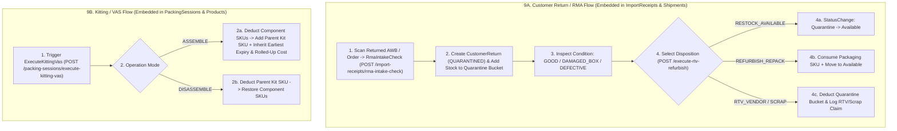

### 9.4 AS-IS State Machines (`CustomerReturn` & `KitWorkOrder`)

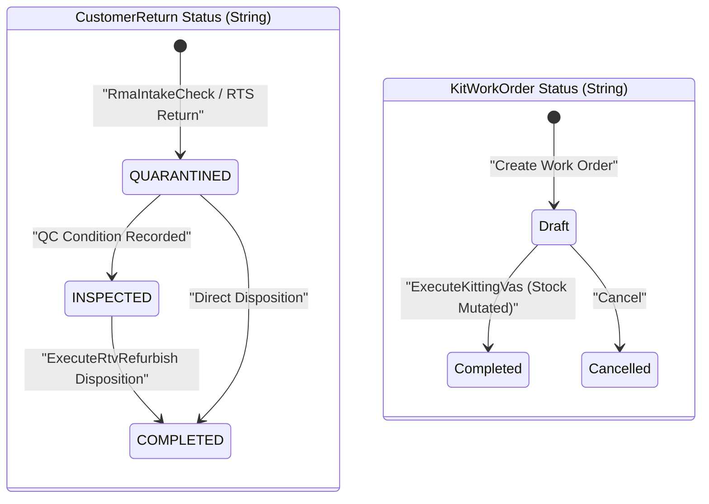

### 9.5 Current Pain Points & Friction
1. **Major Architectural & UX Gap for High-Volume E-Commerce Returns:** In Vietnam e-commerce (Shopee/TikTok Shop), return rates reach 15–30%. Hiding RMA intake and disposition inside `ImportReceiptsController` and `ImportReceipts.tsx` forces return clerks to dig through supplier PO receipt screens to process buyer returns.
2. **String-Based Statuses Without Domain Transition Guards:** Both `CustomerReturn.Status` (`"QUARANTINED" | "INSPECTED" | "COMPLETED"`) and `KitWorkOrder.Status` (`"Draft" | "Completed"`) use raw strings without strongly-typed enum state machines or `TransitionTo()` guards.
3. **Weak Permission Gating:** `RmaIntakeCheck` and `ExecuteRtvRefurbish` require only `AppPermissions.ReceiptRead` (plus not being `Viewer`), and `ExecuteKittingVas` requires only `AppPermissions.PackingRead`.

---

## Process 10: Financial & COD Reconciliation (`WAC Costing, 3-Way Carrier COD, Partner AP/AR Debts, MISA/E-Invoice`)

### 10.1 Process Summary & Operational Scope
Bridges physical warehouse movements with Vietnamese SME accounting and cash-flow control:
1. **Moving Average Cost (WAC / MAC) Valuation:** Every inbound receipt updates `InventoryStock.MovingAverageCost = (OldQty * OldMAC + IncomingQty * UnitCost) / (OldQty + IncomingQty)`. Cost and gross profit endpoints enforce strict server-side RBAC (`inventory.cost.read`).
2. **3-Way Carrier COD & Settlement Reconciliation:** Reconciles (1) Internal Order Expected COD vs (2) Dispatched Shipment / ExportReceipt vs (3) Uploaded Carrier Settlement Excel/CSV statement (GHN, GHTK, ViettelPost, J&T, Shopee Express), flagging COD variances and shipping fee overcharges in `ShipmentFinancialLedgers`.
3. **Partner AP/AR Debt Ledger:** Tracks supplier payables (`AP`) and B2B customer receivables (`AR`), credit limits, and partial/full invoice payments (`PartnerDebtInvoices`, `PartnerDebtTransactions`).
4. **MISA AMIS Excel Export & Decree 70/2025 E-Invoice Drafts:** Exports accounting journals in `.xlsx` format (`ClosedXML`) for MISA AMIS and issues draft electronic invoices compliant with Decree 70/2025/NĐ-CP & Circular 32/2025/TT-BTC.

### 10.2 Actors, UI Screens, API Endpoints & Database Tables

| Dimension | AS-IS Implementation Details |
|-----------|------------------------------|
| **Actors & Roles** | Chief Accountant / Finance Officer (`inventory.cost.read`, `partner.read`, `partner.update`), Business Owner (views Owner Gross Profit & P&L on Dashboard) |
| **UI Screens** | [`CodReconciliation.tsx`](file:///d:/ERP_KHO/frontend/src/pages/CodReconciliation.tsx) (`/cod-reconciliation`), [`CostValuation.tsx`](file:///d:/ERP_KHO/frontend/src/pages/CostValuation.tsx) (`/cost-valuation` and `/misa-exports`), [`PartnerDebts.tsx`](file:///d:/ERP_KHO/frontend/src/pages/PartnerDebts.tsx) (`/partner-debts`), [`BusinessPartners.tsx`](file:///d:/ERP_KHO/frontend/src/pages/BusinessPartners.tsx) (`/business-partners`) |
| **API Controllers & Endpoints** | • [`ReportsController.cs`](file:///d:/ERP_KHO/ERP.Api/Controllers/ReportsController.cs): `GET /api/v1/reports/cod-reconciliation`, `POST /cod-reconciliation/verify` (multipart Excel/CSV upload), `GET /owner-gross-profit`, `POST /export-gl-journal`, `GET/POST /3pl-storage-snapshot`<br>• [`ExportReceiptsController.cs`](file:///d:/ERP_KHO/ERP.Api/Controllers/ExportReceiptsController.cs): `GET /api/v1/accounting-exports/misa-excel`, `POST /api/v1/export-receipts/einvoice-nd70-draft`, `GET/POST /accounting-einvoice/sync`<br>• [`InventoryReconciliationController.cs`](file:///d:/ERP_KHO/ERP.Api/Controllers/InventoryReconciliationController.cs): `GET /api/v1/inventory-reconciliation/valuation`<br>• [`PartnerDebtsController.cs`](file:///d:/ERP_KHO/ERP.Api/Controllers/PartnerDebtsController.cs): `GET /api/v1/partner-debts/summary`, `GET /invoices`, `GET /invoices/{id}`, `POST /invoices/{id}/pay`, `GET /ledger` |
| **DB Tables & Ledgers** | `ShipmentFinancialLedgers`, `PartnerDebtInvoices`, `PartnerDebtTransactions`, `BusinessPartners`, `ThreePlStorageSnapshots`, `ThreePlBillingStatements`, `InventoryStocks` (`MovingAverageCost`), `OutboxMessages`, `AuditLogs` |

### 10.3 End-to-End AS-IS Flowchart

```mermaid
flowchart TD
    subgraph WAC_MISA ["10A. WAC Valuation, MISA Export & Decree 70 E-Invoice"]
        POST_IN["1. ImportReceipt Posted"] --> CALC_MAC["2. Update InventoryStock.MovingAverageCost"]
        POST_OUT["3. ExportReceipt / Shipment Dispatched"] --> COGS["4. Record COGS & Owner Gross Profit (GET /owner-gross-profit)"]
        COGS --> MISA["5. Export MISA AMIS Excel & Sync Decree 70 E-Invoice Outbox"]
    end

    subgraph COD_3WAY ["10B. 3-Way Carrier COD Reconciliation"]
        UPLOAD["1. Upload Carrier Settlement Excel/CSV (POST /reports/cod-reconciliation/verify)"] --> MATCH["2. Match by TrackingNumber against ShipmentFinancialLedger"]
        MATCH --> VAR{"3. COD or Shipping Fee Variance?"}
        VAR -- "Zero Variance" --> MATCHED["3a. Status = MATCHED & Record NetPayoutAmount"]
        VAR -- "Variance != 0" --> DISC["3b. Status = DISCREPANCY & Flag FeeOverchargeVariance / CodVariance"]
    end

    subgraph AP_AR ["10C. Partner AP/AR Debt Settlement"]
        INV_OPEN["1. AP/AR PartnerDebtInvoice Created on Receipt/Dispatch"] --> PAY["2. Record Partial or Full Payment (POST /partner-debts/invoices/{id}/pay)"]
        PAY --> DEBT_LEDGER["3. Append Immutable PartnerDebtTransaction & Update Invoice Status"]
    end
```

### 10.4 AS-IS State Machines (`ShipmentFinancialLedger` & `PartnerDebtInvoiceStatus`)

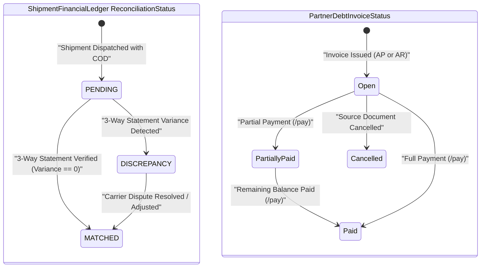

### 10.5 Current Pain Points & Friction
1. **Finance Endpoints Scattered Across 4 Unrelated Controllers:** Financial operations are split across `ReportsController`, `ExportReceiptsController`, `InventoryReconciliationController`, and `PartnerDebtsController` instead of a cohesive `FinanceController` / `AccountingIntegrationsController`.
2. **Duplicate Routes `/cost-valuation` and `/misa-exports`:** In [`AppRoutes.tsx:75-76`](file:///d:/ERP_KHO/frontend/src/routes/AppRoutes.tsx#L75-L76), both routes mount the exact same `CostValuation` component.

---

## Process 11: Approval Center & Operational Exceptions

### 11.1 Process Summary & Operational Scope
Provides a unified management queue for documents awaiting Checker approval (`ImportReceipt`, `ExportReceipt`, `Stocktake`, `StockTransfer`) and a real-time Operational Exception Alert Engine on the Dashboard. Tracks SLA waiting minutes (`Normal`, `Warning`, `Overdue > 30 mins`), supports 1-click SLA escalation (`escalate-overdue`), enforces Segregation of Duties (Maker cannot be Checker), and allows supervisors to acknowledge operational exceptions with resolution notes.

### 11.2 Actors, UI Screens, API Endpoints & Database Tables

| Dimension | AS-IS Implementation Details |
|-----------|------------------------------|
| **Actors & Roles** | Warehouse Manager / Checker (`ApprovalAuthorize`, `ApprovalPolicies.Checker`), Operations Supervisor (`operational-exceptions/acknowledge`) |
| **UI Screens** | [`Approvals.tsx`](file:///d:/ERP_KHO/frontend/src/pages/Approvals.tsx) (`/approvals`), [`Dashboard.tsx`](file:///d:/ERP_KHO/frontend/src/pages/Dashboard.tsx) + [`DashboardExceptionAlerts.tsx`](file:///d:/ERP_KHO/frontend/src/components/dashboard/DashboardExceptionAlerts.tsx) (`/`) |
| **API Controllers & Endpoints** | • [`ApprovalsController.cs`](file:///d:/ERP_KHO/ERP.Api/Controllers/ApprovalsController.cs): `GET /api/v1/approvals/queue`, `GET /sla-summary`, `POST /escalate-overdue`, `GET /history`, `GET /{documentType}/{id}`, `GET /{documentType}/{id}/history`, `POST /{documentType}/{id}/reject`<br>• [`ReportsController.cs`](file:///d:/ERP_KHO/ERP.Api/Controllers/ReportsController.cs): `GET /api/v1/reports/operational-exceptions`, `POST /operational-exceptions/acknowledge`, `POST /operational-dashboard/exceptions/{code}/acknowledge` |
| **DB Tables & Ledgers** | `ImportReceipts`, `ExportReceipts`, `Stocktakes`, `StockTransfers`, `ReceivingDiscrepancies`, `StocktakeAdjustmentProposals`, `AuditLogs` |

### 11.3 End-to-End AS-IS Flowchart

```mermaid
flowchart TD
    DOC["1. Maker Submits Document / Variance (ImportReceipt, ExportReceipt, Stocktake, StockTransfer)"] --> QUEUE["2. Document Appears in Unified Approval Queue (GET /api/v1/approvals/queue)"]
    QUEUE --> SLA{"3. Waiting Time > 30 Min SLA?"}
    SLA -- "Yes (Overdue)" --> ESC["3a. Trigger SLA Escalation Batch (POST /api/v1/approvals/escalate-overdue)"]
    SLA -- "No" --> REV["4. Checker Opens Focus-Trapped Detail Drawer (GET /approvals/{docType}/{id})"]
    ESC --> REV
    REV -->SOD{"5. SoD Check: ActorUserId != CreatedBy?"}
    SOD -- "Same User" --> BLOCK["5a. Block Self-Approval (403 / 422 SoD Violation)"]
    SOD -- "Different User" --> DEC{"6. Checker Decision"}
    DEC -- "Approve" --> APPR["6a. Call Domain Approve Endpoint (e.g. POST /import-receipts/{id}/approve)"]
    DEC -- "Reject" --> REJ["6b. Reject with Mandatory Reason (POST /approvals/{docType}/{id}/reject)"]
```

### 11.4 AS-IS State Machine (Approval Queue Item & SLA State)

```mermaid
stateDiagram-v2
    state "Approval SLA Lifecycle" as SLA {
        [*] --> Pending_Normal: "Submitted (Waiting < 15m)"
        Pending_Normal --> Pending_Warning: "Waiting 15m - 30m"
        Pending_Warning --> Pending_Overdue: "Waiting > 30m"
        Pending_Overdue --> Escalated: "POST /approvals/escalate-overdue"
        Pending_Normal --> Approved_Or_Rejected: "Checker Action"
        Pending_Warning --> Approved_Or_Rejected: "Checker Action"
        Pending_Overdue --> Approved_Or_Rejected: "Checker Action"
        Escalated --> Approved_Or_Rejected: "Manager Action"
    }
```

### 11.5 Current Pain Points & Friction
1. **Asymmetric Approve vs Reject API Design:** `ApprovalsController` has a unified `POST /api/v1/approvals/{documentType}/{id}/reject` endpoint, but **no unified `/approve` endpoint**—the frontend [`Approvals.tsx`](file:///d:/ERP_KHO/frontend/src/pages/Approvals.tsx) must switch on `documentType` and call 4 different controller URLs to approve.
2. **In-Memory Pagination Loop in `FetchAllQueueItemsAsync`:** [`ApprovalsController.cs:100-122`](file:///d:/ERP_KHO/ERP.Api/Controllers/ApprovalsController.cs#L100-L122) fetches all pending approval pages into memory in a `while` loop to calculate `SlaSummary`.

---

## Process 12: Tenant Onboarding, Master Data Setup & SaaS Billing

### 12.1 Process Summary & Operational Scope
Covers self-service B2B SaaS tenant registration, 5-step warehouse setup wizard, master data configuration (Warehouses, Zone/Aisle/Rack/Level/Bin hierarchy, Shift Calendars, UOM conversions, Products/Barcodes, Business Partners, RBAC Roles & Warehouse Scopes), Excel Opening Balance cutover import (`ClosedXML`), and SaaS subscription lifecycle (`FREE_TRIAL`, `STARTER`, `PRO`, `ENTERPRISE`) with 4-tier quota enforcement (`NORMAL <= 80%`, `WARNING 80-100%`, `SOFT_BURST 100-115%`, `READ_ONLY > 115%`) and VietQR HMAC-SHA256 webhook auto-activation.

### 12.2 Actors, UI Screens, API Endpoints & Database Tables

| Dimension | AS-IS Implementation Details |
|-----------|------------------------------|
| **Actors & Roles** | Tenant Owner / System Admin (`permission.read`, `permission.manage`, `warehouse.manage`, `location.manage`, `product.create`, `inventory.opening_balance.import`) |
| **UI Screens** | [`OnboardingWizard.tsx`](file:///d:/ERP_KHO/frontend/src/pages/OnboardingWizard.tsx) (`/register`, `/onboarding-wizard`), [`SaasBilling.tsx`](file:///d:/ERP_KHO/frontend/src/pages/SaasBilling.tsx) (`/saas-billing`), [`Permissions.tsx`](file:///d:/ERP_KHO/frontend/src/pages/Permissions.tsx) (`/permissions`), [`Warehouses.tsx`](file:///d:/ERP_KHO/frontend/src/pages/Warehouses.tsx) (`/warehouses`), [`WarehouseLocations.tsx`](file:///d:/ERP_KHO/frontend/src/pages/WarehouseLocations.tsx) (`/warehouse-structure`), [`WarehouseMap.tsx`](file:///d:/ERP_KHO/frontend/src/pages/WarehouseMap.tsx) (`/warehouse-map`), [`WarehouseCalendar.tsx`](file:///d:/ERP_KHO/frontend/src/pages/WarehouseCalendar.tsx) (`/warehouse-calendar`), [`Products.tsx`](file:///d:/ERP_KHO/frontend/src/pages/Products.tsx) (`/products`), [`Categories.tsx`](file:///d:/ERP_KHO/frontend/src/pages/Categories.tsx) (`/categories`), [`Units.tsx`](file:///d:/ERP_KHO/frontend/src/pages/Units.tsx) (`/units`), [`BusinessPartners.tsx`](file:///d:/ERP_KHO/frontend/src/pages/BusinessPartners.tsx) (`/business-partners`) |
| **API Controllers & Endpoints** | • [`AuthController.cs`](file:///d:/ERP_KHO/ERP.Api/Controllers/AuthController.cs): `POST /api/Auth/login`, `POST /refresh`, `POST /logout`, `GET /me`<br>• [`DataImportsController.cs`](file:///d:/ERP_KHO/ERP.Api/Controllers/DataImportsController.cs): `GET /api/v1/data-imports/templates`, `POST /opening-balance` (Excel upload)<br>• [`SaasBillingController.cs`](file:///d:/ERP_KHO/ERP.Api/Controllers/SaasBillingController.cs): `GET /api/v1/saas-billing/plans`, `GET /subscription`, `POST /enforce-quota`, `POST /vietqr-invoice`, `POST /vietqr-webhook`<br>• [`PermissionsController.cs`](file:///d:/ERP_KHO/ERP.Api/Controllers/PermissionsController.cs) & [`UserWarehouseAccessController.cs`](file:///d:/ERP_KHO/ERP.Api/Controllers/UserWarehouseAccessController.cs): RBAC roles, user security, warehouse scope grants<br>• Master Data Controllers: `WarehousesController`, `WarehouseCalendarsController`, `ProductsController`, `ProductCategoriesController`, `ProductBarcodesController`, `UnitsController`, `BusinessPartnersController` |
| **DB Tables & Ledgers** | `Users`, `Roles`, `Permissions`, `RolePermissions`, `UserWarehouses`, `UserSessions`, `Warehouses`, `WarehouseLocations`, `WarehouseCalendars`, `Units`, `ProductCategories`, `Products`, `ProductUoms`, `ProductBarcodes`, `BusinessPartners`, `SaasPlans`, `TenantSubscriptions`, `SaasBillingInvoices`, `InventoryStocks`, `InventoryTransactions` (`TransactionType.Import` for Opening Balance), `AuditLogs` |

### 12.3 End-to-End AS-IS Flowchart

```mermaid
flowchart TD
    SIGNUP["1. Tenant Self-Registration / Login (/register or /login)"] --> WIZ["2. 5-Step OnboardingWizard: Industry Template -> Warehouse & Bins -> UOM & SKUs"]
    WIZ --> EXCEL["3. Upload Opening Balance & MAC Excel (POST /api/v1/data-imports/opening-balance)"]
    EXCEL --> OB_LEDGER["4. Atomic Cutover Commit: Populate 9-Dim InventoryStocks + InventoryTransactions(Import)"]
    OB_LEDGER --> RBAC["5. Grant User Roles & Warehouse Scopes (/permissions)"]
    RBAC --> RUN["6. Daily Operations Increment TenantSubscription.CurrentMonthOrderCount"]
    RUN --> QUOTA{"7. Evaluate Quota Tier (EvaluateQuotaTier)"}
    QUOTA -- "<= 80%" --> NORM["7a. NORMAL: Full Operations"]
    QUOTA -- "80% - 100%" --> WARN["7b. WARNING_80_100: Alert Banner"]
    QUOTA -- "100% - 115%" --> BURST["7c. SOFT_BURST_100_115: Grace Buffer"]
    QUOTA -- "> 115%" --> RO["7d. READ_ONLY_OVER_115: Block New Order Creation"]
    WARN --> BILL["8. Generate VietQR Invoice (POST /api/v1/saas-billing/vietqr-invoice)"]
    BURST --> BILL
    RO --> BILL
    BILL --> WEBHOOK["9. Bank Webhook Verifies X-VietQR-Signature HMAC -> Auto-Upgrade & Unlock Quota"]
```

### 12.4 AS-IS State Machine (`TenantSubscription` Status & Quota Tier)

```mermaid
stateDiagram-v2
    [*] --> TRIAL: "Tenant Registered (14-Day Trial)"
    TRIAL --> ACTIVE: "VietQR Payment Webhook Verified"
    TRIAL --> PAST_DUE: "Trial Expired Unpaid"
    ACTIVE --> ACTIVE_WARNING: "Order Usage 80% - 100%"
    ACTIVE_WARNING --> ACTIVE_SOFT_BURST: "Order Usage 100% - 115%"
    ACTIVE_SOFT_BURST --> READ_ONLY: "Order Usage > 115% (Block Mutations)"
    PAST_DUE --> READ_ONLY: "Grace Period Expired"
    READ_ONLY --> ACTIVE: "VietQR Invoice Paid (/vietqr-webhook)"
    ACTIVE_SOFT_BURST --> ACTIVE: "Plan Upgraded / New Billing Cycle"
```

### 12.5 Current Pain Points & Friction
1. **Onboarding Wizard Does Not Persist Step-by-Step Server Progress Automatically:** While `GET /api/v1/reports/onboarding-wizard/status` exists, [`OnboardingWizard.tsx`](file:///d:/ERP_KHO/frontend/src/pages/OnboardingWizard.tsx) (500 lines) and `Permissions.tsx` (2,280 lines) require navigating across multiple heavy admin screens to finish full team setup.
2. **Duplicate Opening Balance Endpoints:** Opening balance Excel import is implemented in both [`DataImportsController.cs:46`](file:///d:/ERP_KHO/ERP.Api/Controllers/DataImportsController.cs#L46) and [`ExportReceiptsController.cs:296`](file:///d:/ERP_KHO/ERP.Api/Controllers/ExportReceiptsController.cs#L296).

---

## Consolidated AS-IS Process Friction Matrix

| # | Process Area | Primary Controller(s) | Primary UI Screen(s) | Core AS-IS Strength | Top Friction / Architectural Gap to Fix in TO-BE |
|---|--------------|-----------------------|----------------------|---------------------|--------------------------------------------------|
| **1** | Inbound Planning & Receiving | `PurchaseOrders`, `Asns`, `DockYard`, `ImportReceipts` | `ImportReceipts.tsx` (1,991L), `DockYard.tsx` (1,305L) | Full Lot/Serial/Expiry + QC + Discrepancy + MAC preview | 15-state shared `ReceiptStatus` enum; 1,991-line God component; `PUT /cancel` verb |
| **2** | Directed Putaway & Putback | `PutawayTasksController` | `PutawayTasks.tsx` | 5-factor bin scoring + 3 hard guards + PDF barcode sheets | Mandatory extra step for small Express teams; Location CRUD mixed into controller |
| **3** | Express Outbound (`ExportReceipt`) | `ExportReceiptsController` | `ExportReceipts.tsx` (1,417L) | 1-step (`ApproveAndDispatch`) & 2-step (`ApproveAndReserve`) + 100×150mm AWB | 3 overlapping approve endpoints; controller polluted with MISA & Opening Balance |
| **4** | Full Outbound Execution | `SalesOrders`, `StockReservations`, `StockAllocations`, `PickingTasks`, `PackingSessions`, `Shipments`, `HandoverManifests` | 7 separate screens | Complete FEFO allocation, wave/cluster pick, Put-to-Wall, HU video SHA256, Manifest | Too many manual screen hops (7 screens); heavy 5-step Shipment loading for parcels |
| **5** | Inventory Control (9-Dim) | `InventoryStatus`, `InventoryMovements`, `InventoryControl` | `Inventory.tsx`, `InventoryMovements.tsx`, `InventoryLocks.tsx` | True 9-dim `GrainHash`, 8 statuses, lock precedence, 1-scan LPN move | Duplicate movement/replenishment endpoints across 2 controllers |
| **6** | Traceability, Reconciliation & Reversals | `InventoryReversalTraceability`, `InventoryReconciliation` | `InventoryReconciliation.tsx` (1,307L), `InventoryTraceability.tsx` | Append-only ledger, linked reversals, recall tree simulation | 3 separate sidebar pages; unbounded in-memory pagination fallback |
| **7** | Cycle Counting / Stocktake | `StocktakesController` | `Stocktakes.tsx` (1,568L) | Blind count, `CountFreeze` lock, 2-attempt recount, dual threshold auto-approval | `Completed = 6, Posted = 6` enum collision; missing `POST /{id}/cancel` action |
| **8** | Inter-Warehouse Transfers | `StockTransfersController` | `StockTransfers.tsx` (1,018L) | Two-step `TransferOut`/`TransferIn` in-transit ledger, return & reverse draft | Role-string `[Authorize(Roles=...)]` instead of granular permission codes |
| **9** | Customer Returns (RMA) & Kitting/VAS | Piggybacked on `ImportReceipts` & `PackingSessions` | Buried in `ImportReceipts.tsx` & `PackingSessions.tsx` | Domain entities (`CustomerReturn`, `KitWorkOrder`) and stock mutations exist | **No dedicated Controller, Route, or Page** for RMA or Kitting; string statuses |
| **10** | Financial & COD Reconciliation | `Reports`, `ExportReceipts`, `PartnerDebts` | `CodReconciliation.tsx`, `CostValuation.tsx`, `PartnerDebts.tsx` | Real WAC/MAC, `inventory.cost.read` RBAC, 3-way COD Excel, MISA & Decree 70 | Financial endpoints scattered across 4 controllers; duplicate `/misa-exports` route |
| **11** | Approval Center & Exceptions | `ApprovalsController`, `ReportsController` | `Approvals.tsx`, `Dashboard.tsx` | Unified queue, 30-min SLA escalation, SoD enforcement | Unified `/reject` exists, but no unified `/approve` endpoint |
| **12** | Onboarding, Master Data & SaaS Billing | `DataImports`, `SaasBilling`, `Permissions` | `OnboardingWizard.tsx`, `SaasBilling.tsx`, `Permissions.tsx` (2,280L) | 4-tier quota guard (`115%` burst), VietQR HMAC webhook, Excel cutover import | Duplicate opening balance endpoints; 2,280-line `Permissions.tsx` God component |
