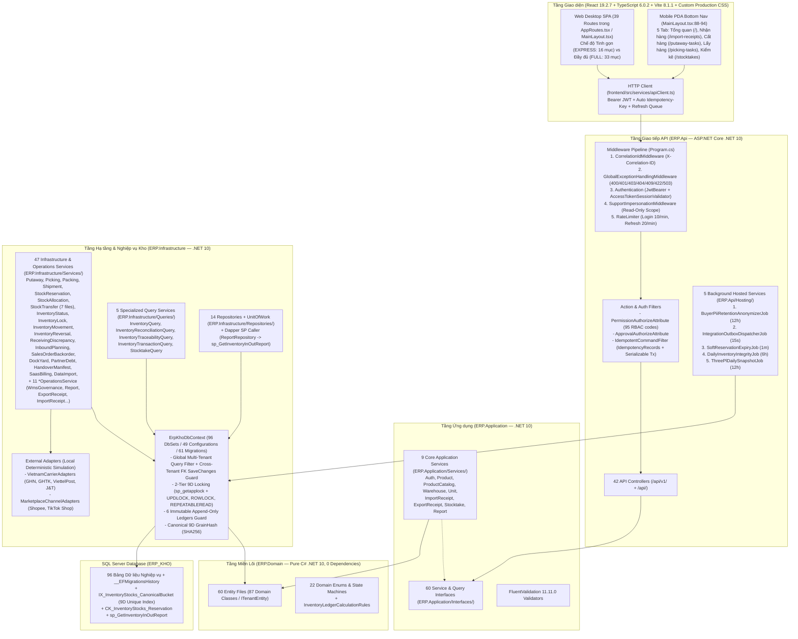

# BẢN ĐỒ HỆ THỐNG HIỆN TRẠNG TOÀN DIỆN (`CURRENT_STATE_SYSTEM_MAP.md`)

- **Tài liệu:** Deliverable B — Bản đồ Kiến trúc & Hiện trạng Hệ thống (`CURRENT_STATE_SYSTEM_MAP.md`)
- **Đợt đánh giá:** `2026-11-01_REASSESSMENT_001`
- **Cơ sở dữ liệu mục tiêu duy nhất:** `ERP_KHO` (SQL Server)
- **Phân loại Bằng chứng (`Evidence Classification`):**
  - **`FACT`**: Đã kiểm chứng trực tiếp bằng công cụ đọc file (`read_file`) trên mã nguồn `d:\ERP_KHO`.
  - **`INFERENCE`**: Suy luận kỹ thuật trực tiếp từ cấu trúc mã nguồn, ràng buộc khóa ngoại và luồng gọi hàm.
  - **`NOT VERIFIED`**: Chưa kiểm chứng kết nối mạng thật tới máy chủ bên thứ ba ngoài môi trường local (cổng API hãng vận chuyển GHN/GHTK/VTP/J&T, Shopee/TikTok Shop Open Platform, cơ quan thuế GDT).
- **Thang phân loại Trạng thái Triển khai (`Implementation Status Taxonomy`):**
  - `IMPLEMENTED_VERIFIED`: Có đầy đủ Database Schema + Backend Service/API + Frontend UI + Kiểm thử tự động.
  - `IMPLEMENTED_PARTIAL`: Đã có luồng chạy được từ UI xuống DB, nhưng một phần nghiệp vụ (ví dụ gọi HTTP ra bên thứ ba, hoặc khóa dòng trong background worker, hoặc lưu trữ TOTP) đang dùng cơ chế mô phỏng nội bộ (`Local Deterministic Simulation`) hoặc còn điểm khuyết kỹ thuật.
  - `UI_ONLY`: Chỉ có trên giao diện Frontend, không có API/DB thật phía sau.
  - `API_ONLY`: Đã có DB Schema và API Endpoint hoạt động ở Backend, nhưng chưa có màn hình hoặc lời gọi từ Frontend.
  - `DATA_MODEL_ONLY`: Đã có Entity/DbSet/Migration trong DB nhưng chưa có API hoặc luồng nghiệp vụ sử dụng.
  - `STUB_OR_PLACEHOLDER`: Nhánh code trả về dữ liệu tĩnh hoặc chỉ ghi `AuditLog` mà không biến đổi thực thể nghiệp vụ.
  - `MISSING`: Chưa được triển khai ở bất kỳ tầng nào.

---

## 1. Tổng quan Kiến trúc Hệ thống (`Executive System Architecture Overview`) (`FACT`)

### 1.1 Sơ đồ Kiến trúc Tổng thể (`Mermaid Architecture Diagram`)

### 1.2 Các Trụ cột Kỹ thuật Cốt lõi (`FACT`)
1. **Clean Architecture 4 Tầng (`ERP.Domain` -> `ERP.Application` -> `ERP.Infrastructure` -> `ERP.Api`):**
   - `ERP.Domain` hoàn toàn độc lập (`0` package/project references — [ERP.Domain.csproj](file:///d:/ERP_KHO/ERP.Domain/ERP.Domain.csproj#L1-L9)).
   - Toàn bộ 42 Controllers không tiêm trực tiếp `ErpKhoDbContext`, mà gọi qua 60 Interfaces trong `ERP.Application/Interfaces/`.
2. **Định danh Tồn kho 9 Chiều (`9D Canonical Inventory Grain`):**
   - Mỗi dòng `InventoryStock` ([InventoryStock.cs](file:///d:/ERP_KHO/ERP.Domain/Entities/InventoryStock.cs#L6-L172)) được định danh duy nhất bởi 9 chiều: `(TenantId, WarehouseId, LocationId, ProductId, LotId, SerialId, HandlingUnitId, Status, OwnerId)` kèm cột băm `GrainHash` (`SHA256` 32 bytes), 5 cột tính toán `Canonical*Id = COALESCE(..., 0)`, chỉ mục duy nhất `IX_InventoryStocks_CanonicalBucket`, và ràng buộc `CK_InventoryStocks_Reservation` ([InventoryStockConfiguration.cs](file:///d:/ERP_KHO/ERP.Infrastructure/Persistence/Configurations/InventoryStockConfiguration.cs#L20-L43)).
3. **Khóa Đồng thời 2 Tầng Chống Deadlock (`2-Tier 9D Deterministic Locking`):**
   - `ErpKhoDbContext.AcquireInventoryAllocationLocksAsync` ([ErpKhoDbContext.cs](file:///d:/ERP_KHO/ERP.Infrastructure/Persistence/ErpKhoDbContext.cs#L40-L115)) sắp xếp khóa theo `WarehouseId ASC, ProductId ASC`, gọi `sys.sp_getapplock` (`Exclusive`, `15000ms`) trước khi khóa dòng `dbo.InventoryStocks WITH (INDEX(IX_InventoryStocks_CanonicalBucket), UPDLOCK, ROWLOCK, REPEATABLEREAD)` theo thứ tự 9 chiều.
4. **Sáu Sổ cái Bất biến (`6 Immutable Append-Only Ledgers`):**
   - `ErpKhoDbContext` chặn tuyệt đối mọi thao tác `UPDATE`/`DELETE` trên 6 bảng: `AuditLogs`, `InventoryTransactions`, `InventoryLocationMovements`, `PartnerDebtLedgers`, `ShipmentTrackingEvents`, `DockAppointmentEvents` ([ErpKhoDbContext.cs](file:///d:/ERP_KHO/ERP.Infrastructure/Persistence/ErpKhoDbContext.cs#L635-L739)).
5. **Cô lập Đa Tenant Toàn diện (`Multi-Tenant Isolation`):**
   - Kết hợp `HasQueryFilter` tự động theo `CurrentTenantId` khi đọc ([ErpKhoDbContext.cs](file:///d:/ERP_KHO/ERP.Infrastructure/Persistence/ErpKhoDbContext.cs#L808)) và trình kiểm tra khóa ngoại liên tenant hàng loạt (`BatchLookupPrincipalTenantIdsAsync`, dòng `497–618`) khi ghi.

---

## 2. Danh mục Toàn bộ Phân hệ Nghiệp vụ (`Complete Module Inventory`)

| Phân hệ / Tính năng | Tầng DB (`Entities / DbSets`) | Tầng Backend (`Services / Controllers`) | Tầng Frontend (`Pages / Routes`) | Phân loại Trạng thái (`Status`) | Nhãn Bằng chứng & Ghi chú Kiểm toán |
|---|---|---|---|---|---|
| **1. INBOUND (NHẬP KHO)** | | | | | |
| 1.1 Đơn mua hàng (`Purchase Orders`) | `PurchaseOrder`, `PurchaseOrderLine` | `InboundPlanningService`, `PurchaseOrdersController` | `PurchaseOrders.tsx` (`/purchase-orders`) | `IMPLEMENTED_VERIFIED` | `FACT`: Tạo PO, phát hành (`release`), đóng (`close`), hủy (`cancel`), đôn đốc PO quá hạn (`expedite-overdue`), xuất `.xlsx`. |
| 1.2 Thông báo giao hàng trước (`ASN`) | `Asn`, `AsnLine` | `InboundPlanningService`, `AsnsController` | `Asns.tsx` (`/asns`) | `IMPLEMENTED_VERIFIED` | `FACT`: Tạo ASN, xác nhận (`confirm`), nhận hàng (`receive`), hủy (`cancel`), tạm phân bổ khu tập kết (`pre-allocate-staging`). |
| 1.3 Điều phối Bến bãi & Cửa kho (`Dock & Yard`) | `Dock`, `YardSlot`, `DockAppointment`, `DockAppointmentEvent` | `DockYardService`, `DockYardController` | `DockYard.tsx` (`/dock-yard`) | `IMPLEMENTED_VERIFIED` | `FACT`: Quản lý cửa kho, vị trí bãi, lịch hẹn, check-in, gán dock, hoàn tất, cross-dock (`crossdock-dispatch`), xuất `.xlsx`. |
| 1.4 Phiếu nhập kho, QC & Sai lệch nhận hàng (`Import Receipts, QC & Discrepancies`) | `ImportReceipt`, `ImportReceiptDetail`, `ImportReceiptInventoryIdentity`, `ReceivingDiscrepancy`, `ReceivingObservationVersion`, `ReceivingResolutionVersion`, `QcPolicy`, `ReceivingTolerancePolicy` | `ImportReceiptService`, `ReceivingDiscrepancyService`, `ImportReceiptOperationsService`, `ImportReceiptsController` | `ImportReceipts.tsx` (`/import-receipts`) | `IMPLEMENTED_VERIFIED` | `FACT`: Hỗ trợ đầy đủ luồng nhận hàng 1 bước (`Approve` trực tiếp) và nhiều bước (`Receive -> QcDisposition -> ResolveDiscrepancy -> CompleteReceiving -> Post`), xử lý trả hàng NCC (`rtv-refurbish`), tự động sinh công nợ AP và tác vụ Putaway. |
| 1.5 Tác vụ Cất hàng lên kệ (`Putaway Tasks`) | `PutawayTask`, `PutawayTaskItem`, `InventoryLocationMovement` | `PutawayService`, `PutawayTasksController` | `PutawayTasks.tsx` (`/putaway-tasks`) | `IMPLEMENTED_VERIFIED` | `FACT`: Giao việc (`assign`), cất hàng thực tế (`execute`) có kiểm tra sức chứa kệ (kg/m3/pallet), định tuyến hàng hỏng (`damaged-routing`), in phiếu hướng dẫn `.pdf` (`%PDF-1.4`) và `.html`. |
| 1.6 Hàng bán bị trả lại (`Customer Returns / RMA`) | `CustomerReturn`, `CustomerReturnLine` | `ImportReceiptOperationsService`, `ImportReceiptsController` (`POST/GET /customer-returns`) | *(Chưa có màn hình riêng trên Frontend)* | `API_ONLY` | `FACT`: Backend đã có bảng DB và 2 API `POST/GET /api/v1/import-receipts/customer-returns` ([ImportReceiptsController.cs](file:///d:/ERP_KHO/ERP.Api/Controllers/ImportReceiptsController.cs#L243-L266)), nhưng Frontend chưa có trang RMA gọi API này. |
| **2. OUTBOUND (XUẤT KHO & HOÀN TẤT ĐƠN HÀNG)** | | | | | |
| 2.1 Đơn bán hàng & Đơn nợ hàng (`Sales Orders & Backorders`) | `SalesOrder`, `SalesOrderLine`, `Backorder`, `PromotionGiftRule` | `SalesOrderBackorderService`, `SalesOrderOperationsService`, `SalesOrdersController`, `BackordersController` | `OutboundDemand.tsx` (`/backorders`, `/outbound-demand`) | `IMPLEMENTED_VERIFIED` | `FACT`: Tạo SO, giữ/mở/hủy/đóng SO, tách combo/quà tặng, định tuyến kho tối ưu (`evaluate-atp-routing`), tự động tạo & xử lý `Backorder`. |
| 2.2 Giữ chỗ & Phân bổ tồn kho (`Stock Reservations & Allocations`) | `StockReservation`, `StockAllocation` | `StockReservationService`, `StockAllocationService`, `StockReservationsController`, `StockAllocationsController` | `StockAllocations.tsx` (`/stock-allocations`), `StockReservations.tsx` (`/stock-reservations`) | `IMPLEMENTED_VERIFIED` | `FACT`: Giữ chỗ mềm có TTL (`StockReservation`) và phân bổ cứng theo FEFO/FIFO (`StockAllocation`) dưới khóa 9 chiều. |
| 2.3 Lấy hàng & Đợt lấy hàng (`Picking Tasks & Waves`) | `PickingTask`, `PickingTaskLine`, `ShortPickException`, `PickingWave`, `PickingWaveTemplate` | `PickingService`, `PickingTaskOperationsService`, `PickingTasksController` | `PickingTasks.tsx` (`/picking-tasks`) | `IMPLEMENTED_VERIFIED` | `FACT`: Phát hành đợt lấy hàng (`release-wave`), bắt đầu/xác nhận lấy hàng, báo thiếu hàng (`short-pick`) & xử lý ngoại lệ (`resolve`), điều phối xen kẽ (`interleaving`), tách lô cụm (`cluster-batch-split`). |
| 2.4 Đóng gói, Đơn vị xử lý (LPN/HU), Chia chọn & Video bằng chứng (`Packing, HU, Put-to-Wall & Video Evidence`) | `PackingSession`, `HandlingUnit`, `HandlingUnitContent`, `PutToWallSlot`, `KitWorkOrder`, `KitWorkOrderComponentLine`, `PackingVideoEvidence` | `PackingService`, `PackingSessionOperationsService`, `PackingSessionsController`, `HandlingUnitsController` | `PackingSessions.tsx` (`/packing-sessions`) | `IMPLEMENTED_VERIFIED` | `FACT`: Mở/đóng phiên đóng gói, tạo/tách/gộp/đóng lại kiện LPN (`HandlingUnits`), gợi ý vỏ thùng 3D (`recommend-carton`), chia chọn Put-to-Wall, Kitting/De-kitting, tải lên video bằng chứng thật qua `multipart/form-data`. |
| 2.5 Phiếu xuất kho, In tem nhiệt AWB `100x150mm` & Bàn giao vận chuyển (`Export Receipts, Thermal AWB & Handover Manifests`) | `ExportReceipt`, `ExportReceiptDetail`, `HandoverManifest`, `HandoverManifestLine` | `ExportReceiptService`, `ExportReceiptOperationsService`, `HandoverManifestService`, `ExportReceiptsController`, `HandoverManifestsController` | `ExportReceipts.tsx` (`/export-receipts`), `HandoverManifests.tsx` (`/handover-manifests`) | `IMPLEMENTED_VERIFIED` | `FACT`: Tạo/duyệt/xuất/hủy phiếu xuất, hoàn kệ (`putback`), theo dõi hàng đợi SLA (`sla-queue`), in lô tem nhiệt `100x150mm` (`%PDF-1.4` + chống in trùng `export_receipt.reprint_awb`), quét bàn giao bưu tá (`HandoverManifests`). |
| 2.6 Chuyến hàng xuất & Giao nhận (`Shipments & POD`) | `Shipment`, `ShipmentHandlingUnit`, `ShipmentTrackingEvent`, `ShipmentProofOfDelivery` | `ShipmentService`, `ShipmentOperationsService`, `ShipmentsController` | `Shipments.tsx` (`/shipments`) | `IMPLEMENTED_PARTIAL` | `FACT`: Tạo chuyến, tập kết (`stage`), chất hàng (`load`), xuất chuyến (`dispatch`), xác nhận giao hàng (`confirm-delivery`), tạo vận đơn 3PL (`book-carrier-waybill` — dùng adapter mô phỏng nội bộ). |
| **3. INVENTORY (QUẢN TRỊ TỒN KHO 9 CHIỀU & KIỂM KÊ)** | | | | | |
| 3.1 Tồn kho vật lý 9 chiều & Sổ cái giao dịch (`Inventory Stocks & Transactions`) | `InventoryStock`, `InventoryTransaction`, `InventoryLot`, `InventorySerial`, `InventoryStatusDefinition` | `InventoryQueryService`, `InventoryTransactionQueryService`, `InventoryStocksController`, `InventoryTransactionsController` | `Inventory.tsx` (`/inventory`), `InventoryBuckets.tsx` | `IMPLEMENTED_VERIFIED` | `FACT`: Truy vấn tồn kho 9 chiều và sổ cái giao dịch bất biến; tự động ẩn `MovingAverageCost` / `UnitCost` nếu thiếu quyền `inventory.cost.read`. |
| 3.2 Đổi trạng thái, Phong tỏa, Di chuyển nội bộ & Bổ sung kệ lẻ (`Status, Locks, Movements & Replenishment`) | `InventoryLock`, `InventoryLocationMovement` | `InventoryStatusService`, `InventoryLockService`, `InventoryMovementService`, `InventoryControlOperationsService`, `InventoryControlController`, `InventoryStatusController`, `InventoryMovementsController` | `InventoryLocks.tsx` (`/inventory-locks`), `InventoryMovements.tsx` (`/inventory-movements`) | `IMPLEMENTED_VERIFIED` | `FACT`: Chuyển trạng thái tồn kho (`Available <-> Quarantine/Damaged/...`), khóa/mở khóa tồn kho, di chuyển kệ/LPN, xả thùng chẵn bổ sung kệ lẻ (`replenishment/execute`), thu hồi lô khẩn cấp (`emergency-lot-recall`). |
| 3.3 Phiếu điều chuyển liên kho (`Stock Transfers`) | `StockTransfer`, `StockTransferDetail` | `StockTransferService` (7 partial files), `StockTransfersController` | `StockTransfers.tsx` (`/stock-transfers`) | `IMPLEMENTED_VERIFIED` | `FACT`: Tạo nháp, chỉnh sửa nháp, duyệt, xuất chuyển (`ship`), nhận hàng (`receive`), trả hàng điều chuyển (`return`), tạo nháp đảo (`reverse-draft`). |
| 3.4 Kiểm kê kho & Đề xuất điều chỉnh (`Stocktakes & Adjustment Proposals`) | `Stocktake`, `StocktakeDetail`, `StocktakeAdjustmentProposal` | `StocktakeService`, `StocktakeQueryService`, `StocktakeOperationsService`, `StocktakesController` | `Stocktakes.tsx` (`/stocktakes`) | `IMPLEMENTED_VERIFIED` | `FACT`: Kiểm kê mù (`Blind Count`), cập nhật số đếm thực tế, đánh giá ngưỡng tự động duyệt (`evaluate-auto-approval`), yêu cầu đếm lại (`recount-attempt`), phân loại lý do lệch và ghi sổ điều chỉnh tồn kho. |
| 3.5 Đối soát 3 chiều & Đảo bút toán sổ cái (`3-Way Reconciliation & Reversal Traceability`) | `InventoryStock`, `InventoryTransaction` | `InventoryReconciliationQueryService`, `InventoryReversalService`, `InventoryTraceabilityQueryService`, `InventoryReconciliationController`, `InventoryReversalTraceabilityController` | `InventoryReconciliation.tsx` (`/inventory-reconciliation`), `InventoryReversals.tsx` (`/inventory-reversals`), `InventoryTraceability.tsx` (`/inventory-traceability`) | `IMPLEMENTED_VERIFIED` | `FACT`: Đối soát cân bằng đại số giữa `InventoryStocks` và tổng `InventoryTransactions` (`Check A` & `Check B`), truy vết lô/sê-ri ngược-xuôi và tạo bút toán đảo (`TransactionType.Reversal`). |
| **4. FINANCE & COMPLIANCE (TÀI CHÍNH, CÔNG NỢ, THUẾ & 3PL)** | | | | | |
| 4.1 Công nợ Đối tác AP/AR (`Partner Debts`) | `PartnerDebtInvoice`, `PartnerDebtLedger` | `PartnerDebtService`, `PartnerDebtsController` | `PartnerDebts.tsx` (`/partner-debts`) | `IMPLEMENTED_VERIFIED` | `FACT`: Quản lý công nợ phải trả NCC (AP) và phải thu khách hàng (AR), ghi nhận thanh toán có khóa `AcquireBusinessPartnerLockAsync` và sổ cái bất biến `PartnerDebtLedgers`. |
| 4.2 Đối soát COD, Lợi nhuận gộp, Phí lưu kho 3PL & Xuất bút toán MISA/HĐĐT (`Financial Reports, COD, 3PL Billing, MISA & E-Invoice`) | `ShipmentFinancialLedger`, `ThreePlStorageSnapshot`, `ThreePlBillingStatement` | `ReportOperationsService`, `ExportReceiptOperationsService`, `ReportsController`, `ExportReceiptsController`, `BusinessPartnersController` | `CodReconciliation.tsx` (`/cod-reconciliation`), `CostValuation.tsx` (`/cost-valuation`, `/misa-exports`), `BusinessPartners.tsx` (`/business-partners`) | `IMPLEMENTED_PARTIAL` | `FACT`: Báo cáo XNT (Dapper SP), đối soát COD (khấu trừ thuế NĐ 70/2025 `1% GTGT + 0.5% TNCN`), lợi nhuận gộp MAC, chụp nhanh lưu kho 3PL, xuất `.xlsx` MISA (ClosedXML thật). **Lưu ý:** Phát hành HĐĐT NĐ 70/2025 đang dùng chữ ký RSA tự sinh nội bộ (`FINDING-BE-03`). |
| **5. MASTER DATA (DỮ LIỆU DANH MỤC)** | | | | | |
| 5.1 Sản phẩm, Nhóm hàng, Đơn vị tính & Mã vạch GS1-128 (`Products, Categories, UOMs & Barcodes`) | `Product`, `ProductCategory`, `Unit`, `ProductUom`, `ProductBarcode`, `ProductBundleComponent` | `ProductService`, `ProductCatalogService`, `UnitService`, `ProductOperationsService`, `ProductsController`, `ProductCategoriesController`, `UnitsController`, `ProductBarcodesController`, `ProductBarcodeLookupController` | `Products.tsx` (`/products`), `Categories.tsx` (`/categories`), `Units.tsx` (`/units`) | `IMPLEMENTED_VERIFIED` | `FACT`: CRUD sản phẩm/nhóm hàng/ĐVT/mã vạch, cấu hình quy đổi đa ĐVT (`ProductUom`), kiểm tra hạn mức SKU theo gói SaaS, tra cứu & bóc tách mã vạch `GS1-128`. |
| 5.2 Kho hàng, Sơ đồ vị trí 2D & Sức chứa (`Warehouses & 2D Location Topology`) | `Warehouse`, `WarehouseLocation` | `WarehouseService`, `WmsGovernanceOperationsService`, `WarehousesController` | `Warehouses.tsx` (`/warehouses`), `WarehouseLocations.tsx` (`/warehouse-structure`), `WarehouseMap.tsx` (`/warehouse-map`) | `IMPLEMENTED_VERIFIED` | `FACT`: Quản lý kho, cấu trúc vị trí 5 cấp (`Zone/Aisle/Rack/Level/Bin`), tọa độ bản đồ 2D, kiểm tra 9 vị trí ảo bắt buộc (`verify-virtual-locations`). |
| 5.3 Lịch vận hành & Ca làm việc kho (`Warehouse Calendars & Shifts`) | `WarehouseCalendar`, `WarehouseCalendarDay`, `WarehouseShift` | `WarehouseCalendarService`, `WmsGovernanceOperationsService`, `WarehouseCalendarsController` | `WarehouseCalendar.tsx` (`/warehouse-calendar`) | `IMPLEMENTED_VERIFIED` | `FACT`: Quản lý lịch tuần, ca làm việc (`WarehouseShift`), kiểm tra độ phủ ca (`verify-shift-coverage`) và mở kho khẩn cấp ngoài giờ (`emergency-override`). |
| 5.4 Đối tác kinh doanh (`Business Partners`) | `BusinessPartner` | `BusinessPartnerService`, `WmsGovernanceOperationsService`, `BusinessPartnersController` | `BusinessPartners.tsx` (`/business-partners`) | `IMPLEMENTED_VERIFIED` | `FACT`: Quản lý Nhà cung cấp, Khách hàng, Chủ hàng 3PL (`Owner`), hạn mức công nợ và tính phí 3PL. |
| 5.5 Nhập dữ liệu hàng loạt & Tồn đầu kỳ (`Bulk Data Imports & Opening Balance`) | `Product`, `BusinessPartner`, `InventoryStock`, `InventoryTransaction` | `DataImportService`, `ExportReceiptOperationsService`, `DataImportsController`, `ImportTemplatesController`, `InventoryControlController` | `OnboardingWizard.tsx` (`/onboarding-wizard`, `/register`), `Inventory.tsx` | `IMPLEMENTED_PARTIAL` | `FACT`: Tải file mẫu `.xlsx` thật (`ClosedXML`) và nạp tồn đầu kỳ + giá vốn MAC từ `OnboardingWizard.tsx` / `Inventory.tsx`; riêng `DataImportsController` (`products`/`suppliers`/`customers`) chưa có màn hình gọi trên UI (`FINDING-BE-10`). |
| **6. GOVERNANCE, SECURITY & ADMIN (QUẢN TRỊ, BẢO MẬT & PHÊ DUYỆT)** | | | | | |
| 6.1 Hàng đợi Phê duyệt & Trung tâm Cảnh báo (`Approvals & Exception Center`) | `ImportReceipt`, `ExportReceipt`, `AuditLog` | `ApprovalWorkflowService`, `ReportOperationsService`, `ApprovalsController`, `ReportsController` | `Approvals.tsx` (`/approvals`), `Dashboard.tsx` (`/`, `/dashboard`) | `IMPLEMENTED_VERIFIED` | `FACT`: Hàng đợi duyệt phiếu nhập/xuất có tính tuổi nợ SLA (`ApprovalAgingCalculator`), từ chối bắt buộc lý do, trung tâm cảnh báo ngoại lệ vận hành trên Dashboard. |
| 6.2 Quản trị Người dùng, Vai trò, Phân quyền Kho & Đa Tenant (`Users, Roles, Permissions & Warehouse Scope`) | `User`, `UserSession`, `Role`, `Permission`, `RolePermission`, `UserWarehouse`, `SupportImpersonationSession` | `AuthService`, `AccountAdminService`, `PermissionOperationsService`, `UserWarehouseAccessService`, `AuthController`, `AccountSecurityController`, `PermissionsController`, `UserWarehouseAccessController` | `Login.tsx` (`/login`), `Permissions.tsx` (`/permissions`, `/users`, `/roles`, `/warehouse-scopes`) | `IMPLEMENTED_PARTIAL` | `FACT`: Đăng nhập JWT + Refresh Token + Thu hồi phiên (`UserSessions`), khóa tài khoản khi sai mật khẩu, gán quyền theo Role, phạm vi Kho (`UserWarehouses`), và phiên `SupportImpersonation`. **Lưu ý:** TOTP 2FA lưu trên RAM (`FINDING-BE-01`) và chưa có UI (`API_ONLY`). |
| **7. SAAS BILLING & OMNICHANNEL INTEGRATIONS (THUÊ BAO SAAS & ĐA KÊNH)** | | | | | |
| 7.1 Gói cước SaaS, Hạn ngạch `80% / 100% / 115%` & Thanh toán VietQR Napas247 (`SaaS Billing`) | `SaasPlan`, `TenantSubscription`, `SaasBillingInvoice` | `SaasBillingService`, `SaasBillingController`, `PermissionsController` | `SaasBilling.tsx` (`/saas-billing`), `OnboardingWizard.tsx` (`/onboarding-wizard`) | `IMPLEMENTED_PARTIAL` | `FACT`: Quản lý gói cước (`FREE_TRIAL`, `STARTER`, `GROWTH`, `PRO`, `ENTERPRISE`), chặn tạo mới khi vượt `115%` hạn mức, tạo hóa đơn QR EMVCo và đối soát webhook HMAC-SHA256. **Lưu ý:** `GET /subscription` tự động `INSERT` dữ liệu mẫu `420` đơn nếu chưa có (`FINDING-BE-04`). |
| 7.2 Đồng bộ Đa sàn TMĐT (`Shopee / TikTok Shop`) & Hãng vận chuyển (`GHN / GHTK / VTP / J&T`) | `MarketplaceShop`, `ChannelSkuMapping`, `CarrierIntegrationConfig`, `VnAdministrativeUnit`, `CarrierLocationMapping`, `IntegrationOutboxMessage`, `IntegrationInboxMessage` | `WmsGovernanceOperationsService`, `ExportReceiptOperationsService`, `VietnamCarrierAdapters`, `MarketplaceChannelAdapters`, `ProductsController`, `ShipmentsController` | `Products.tsx` (`/products`), `Shipments.tsx` (`/shipments`), `OutboundDemand.tsx` (`/backorders`) | `IMPLEMENTED_PARTIAL` | `FACT`: Lưu cấu hình Shop, ánh xạ SKU sàn, chuẩn hóa địa giới hành chính 2 cấp Việt Nam (`VnAdministrativeUnits`), kiểm tra chữ ký HMAC-SHA256 cho Webhook. **Lưu ý (`NOT VERIFIED` / `FINDING-BE-02`):** Các adapter sàn & hãng vận chuyển hiện là bộ tính toán mô phỏng nội bộ, chưa gọi HTTP tới máy chủ Shopee/TikTok/GHN/GHTK thật. |

---

## 3. Bản đồ Tuyến đường, Màn hình & Điều hướng Frontend (`Frontend Route, Screen & Navigation Map`) (`FACT`)

Hệ thống Frontend ([AppRoutes.tsx](file:///d:/ERP_KHO/frontend/src/routes/AppRoutes.tsx#L77-L135), [MainLayout.tsx](file:///d:/ERP_KHO/frontend/src/layouts/MainLayout.tsx#L1-L475), [productionNavigation.ts](file:///d:/ERP_KHO/frontend/src/config/productionNavigation.ts#L11-L89)) định nghĩa **39 tuyến (`<Route>`)**:
- **2 tuyến Public:** `/login` ([Login.tsx](file:///d:/ERP_KHO/frontend/src/pages/Login.tsx)) và `/register` ([OnboardingWizard.tsx](file:///d:/ERP_KHO/frontend/src/pages/OnboardingWizard.tsx)).
- **36 tuyến bên trong `MainLayout`** (gồm 31 mục menu chính trong 6 phân nhóm `Tổng quan`, `Nhập kho`, `Xuất kho`, `Tồn kho`, `Tài chính`, `Quản trị`, 2 trang alias `/categories`, `/misa-exports`, và 5 tuyến redirect tương thích ngược), hỗ trợ chuyển đổi giữa **Chế độ Tinh gọn (`EXPRESS` — 16 mục `expressMode: true`)** và **Chế độ Đầy đủ (`FULL` — toàn bộ 31 mục sidebar)** lưu tại `localStorage('wmsComplexityMode')`.
- **Thanh điều hướng đáy Mobile PDA (`pdaBottomNavItems` tại [MainLayout.tsx](file:///d:/ERP_KHO/frontend/src/layouts/MainLayout.tsx#L88-L94)):** Hiển thị trên màn hình nhỏ (`<= 768px`) với 5 lối tắt thao tác nhanh: `Tổng quan` (`/`), `Nhận hàng` (`/import-receipts`), `Cất hàng` (`/putaway-tasks`), `Lấy hàng` (`/picking-tasks`), và `Kiểm kê` (`/stocktakes`).
- **1 tuyến Catch-All 404:** `*` ([NotFound.tsx](file:///d:/ERP_KHO/frontend/src/pages/NotFound.tsx)).

| # | Đường dẫn (`Route Path`) | Component Trang (`frontend/src/pages/`) | Quyền Yêu cầu (`PermissionRoute`) | Nhóm Sidebar (`section`) | Hiển thị `EXPRESS` (`expressMode`) | Hiển thị `FULL` | Ghi chú & API Chính Được Gọi |
|---:|---|---|---|---|---|---|---|
| 1 | `/login` | [Login.tsx](file:///d:/ERP_KHO/frontend/src/pages/Login.tsx) | *(Public)* | — | — | — | `POST /api/auth/login` |
| 2 | `/register` | [OnboardingWizard.tsx](file:///d:/ERP_KHO/frontend/src/pages/OnboardingWizard.tsx) | *(Public)* | — | — | — | `POST /api/v1/permissions/saas-tenants/provision` |
| 3 | `/` *(index)* & `/dashboard` | [Dashboard.tsx](file:///d:/ERP_KHO/frontend/src/pages/Dashboard.tsx) | `access: 'always'` | Tổng quan | **Có** (+ Tab PDA #1) | **Có** | `GET /api/v1/reports/operational-dashboard`, `/warehouse-tasks`, `/operational-exceptions`, `/multi-warehouse-control-tower` |
| 4 | `/dock-yard` | [DockYard.tsx](file:///d:/ERP_KHO/frontend/src/pages/DockYard.tsx) | `dock_appointment.read` | Nhập kho | Không | **Có** | `GET/POST /api/v1/dock-yard/docks`, `/yard-slots`, `/appointments`, `/crossdock-dispatch` |
| 5 | `/purchase-orders` | [PurchaseOrders.tsx](file:///d:/ERP_KHO/frontend/src/pages/PurchaseOrders.tsx) | `purchase_order.read` | Nhập kho | Không | **Có** | `GET/POST/PUT /api/v1/purchase-orders`, `POST /release`, `/close`, `/cancel`, `/expedite-overdue` |
| 6 | `/asns` | [Asns.tsx](file:///d:/ERP_KHO/frontend/src/pages/Asns.tsx) | `asn.read` | Nhập kho | Không | **Có** | `GET/POST/PUT /api/v1/asns`, `POST /confirm`, `/receive`, `/cancel`, `/pre-allocate-staging` |
| 7 | `/import-receipts` | [ImportReceipts.tsx](file:///d:/ERP_KHO/frontend/src/pages/ImportReceipts.tsx) | `receipt.read` | Nhập kho | **Có** (+ Tab PDA #2) | **Có** | `GET/POST /api/ImportReceipts`, `POST /approve`, `/receive`, `/qc-disposition`, `/complete-receiving`, `/post`, `/discrepancies`, `/rtv-refurbish` |
| 8 | `/putaway-tasks` | [PutawayTasks.tsx](file:///d:/ERP_KHO/frontend/src/pages/PutawayTasks.tsx) | `putaway.read` | Nhập kho | Không (+ Tab PDA #3) | **Có** | `GET /api/v1/putaway-tasks`, `POST /assign`, `/execute`, `/damaged-routing`, `GET /location-sheet.pdf` |
| 9 | `/export-receipts` | [ExportReceipts.tsx](file:///d:/ERP_KHO/frontend/src/pages/ExportReceipts.tsx) | `export_receipt.read` | Xuất kho | **Có** | **Có** | `GET/POST /api/ExportReceipts`, `POST /approve`, `/dispatch`, `/cancel`, `/putback`, `/batch-print-awb`, `GET /sla-queue` |
| 10 | `/stock-reservations` | [StockReservations.tsx](file:///d:/ERP_KHO/frontend/src/pages/StockReservations.tsx) | `inventory.read` | Xuất kho | Không | **Có** | `GET/POST /api/v1/stock-reservations`, `POST /{id}/consume`, `/{id}/release`, `/sweep-expired-soft-reservations` |
| 11 | `/stock-allocations` | [StockAllocations.tsx](file:///d:/ERP_KHO/frontend/src/pages/StockAllocations.tsx) | `allocation.read` | Xuất kho | Không | **Có** | `GET/POST /api/v1/stock-allocations`, `POST /{id}/release`, `/{id}/reallocate`, `/verify-9d-lock-discipline` |
| 12 | `/picking-tasks` | [PickingTasks.tsx](file:///d:/ERP_KHO/frontend/src/pages/PickingTasks.tsx) | `picking.read` | Xuất kho | Không (+ Tab PDA #4) | **Có** | `GET/POST /api/v1/picking-tasks`, `POST /assign`, `/start`, `/lines/{lineId}/pick`, `/short-pick`, `/release-wave`, `/interleaving/dispatch` |
| 13 | `/packing-sessions` | [PackingSessions.tsx](file:///d:/ERP_KHO/frontend/src/pages/PackingSessions.tsx) | `packing.read` | Xuất kho | **Có** | **Có** | `GET/POST /api/v1/packing-sessions`, `POST /handling-units`, `/pack`, `/close`, `/reopen`, `/kitting-vas`, `/dekit-disassemble`, `/video-evidence`, `GET/POST /api/v1/handling-units` |
| 14 | `/shipments` | [Shipments.tsx](file:///d:/ERP_KHO/frontend/src/pages/Shipments.tsx) | `shipment.read` | Xuất kho | **Có** | **Có** | `GET/POST /api/v1/shipments`, `POST /stage`, `/load`, `/dispatch`, `/confirm-delivery`, `/book-carrier-waybill`, `/carrier-configs` |
| 15 | `/handover-manifests` | [HandoverManifests.tsx](file:///d:/ERP_KHO/frontend/src/pages/HandoverManifests.tsx) | `inventory.read` | Xuất kho | **Có** | **Có** | `GET/POST /api/v1/handover-manifests`, `POST /{id}/scan-awb`, `/{id}/seal` |
| 16 | `/backorders` *(+ redirect `/outbound-demand`)* | [OutboundDemand.tsx](file:///d:/ERP_KHO/frontend/src/pages/OutboundDemand.tsx) | `backorder.read` \| `sales_order.read` | Xuất kho | **Có** | **Có** | `GET/POST /api/v1/sales-orders`, `POST /hold`, `/release`, `/cancel`, `/close`, `/evaluate-atp-routing`, `GET/POST /api/v1/backorders` |
| 17 | `/inventory` | [Inventory.tsx](file:///d:/ERP_KHO/frontend/src/pages/Inventory.tsx) (+ [InventoryBuckets.tsx](file:///d:/ERP_KHO/frontend/src/pages/InventoryBuckets.tsx)) | `inventory.read` | Tồn kho | **Có** | **Có** | `GET /api/InventoryStocks`, `GET /api/InventoryTransactions`, `GET /api/Reports/inventory-in-out`, `POST /api/v1/inventory-status/change` |
| 18 | `/inventory-locks` | [InventoryLocks.tsx](file:///d:/ERP_KHO/frontend/src/pages/InventoryLocks.tsx) | `inventory_lock.read` | Tồn kho | Không | **Có** | `GET/POST /api/v1/inventory-locks`, `POST /{id}/release` |
| 19 | `/inventory-movements` | [InventoryMovements.tsx](file:///d:/ERP_KHO/frontend/src/pages/InventoryMovements.tsx) | `inventory.read` | Tồn kho | Không | **Có** | `GET/POST /api/v1/inventory-movements`, `POST /handling-unit`, `/verify-directed-putaway` |
| 20 | `/inventory-reversals` | [InventoryReversals.tsx](file:///d:/ERP_KHO/frontend/src/pages/InventoryReversals.tsx) | `inventory_ledger.read` | Tồn kho | Không | **Có** | `GET /api/v1/inventory-reversals/candidates`, `POST /api/v1/inventory-reversals` |
| 21 | `/inventory-traceability` | [InventoryTraceability.tsx](file:///d:/ERP_KHO/frontend/src/pages/InventoryTraceability.tsx) | `inventory_traceability.read` | Tồn kho | Không | **Có** | `GET /api/v1/inventory-traceability`, `POST /api/v1/inventory-traceability/lot-recall` |
| 22 | `/inventory-reconciliation` | [InventoryReconciliation.tsx](file:///d:/ERP_KHO/frontend/src/pages/InventoryReconciliation.tsx) | `inventory_ledger.read` | Tồn kho | Không | **Có** | `GET /api/v1/inventory-reconciliation`, `GET /summary`, `POST /verify`, `POST /feefo-compliance`, `GET /outbox-events` |
| 23 | `/stocktakes` | [Stocktakes.tsx](file:///d:/ERP_KHO/frontend/src/pages/Stocktakes.tsx) | `StocktakeRoute` (`canViewStocktakes()`) | Tồn kho | **Có** (+ Tab PDA #5) | **Có** | `GET/POST /api/Stocktakes`, `PUT /detail`, `POST /approve`, `/cancel`, `/evaluate-auto-approval`, `/recount-attempt`, `/adjustment-proposals` |
| 24 | `/stock-transfers` | [StockTransfers.tsx](file:///d:/ERP_KHO/frontend/src/pages/StockTransfers.tsx) | `inventory.read` | Tồn kho | Không | **Có** | `GET/POST/PUT /api/v1/stock-transfers`, `POST /approve`, `/ship`, `/receive`, `/cancel`, `/return`, `/reverse-draft` |
| 25 | `/cod-reconciliation` | [CodReconciliation.tsx](file:///d:/ERP_KHO/frontend/src/pages/CodReconciliation.tsx) | `inventory.cost.read` | Tài chính | **Có** | **Có** | `GET/POST /api/v1/reports/cod-reconciliation`, `GET /cod-reconciliation/export-excel` |
| 26 | `/cost-valuation` & `/misa-exports` | [CostValuation.tsx](file:///d:/ERP_KHO/frontend/src/pages/CostValuation.tsx) | `inventory.cost.read` | Tài chính | **Có** | **Có** | `GET /api/v1/reports/owner-gross-profit`, `GET/POST /3pl-storage-daily-snapshot`, `GET /api/v1/export-receipts/misa-export.xlsx`, `POST /issue-einvoice-nd70-draft`, `POST /sync-accounting-einvoice-outbox` |
| 27 | `/partner-debts` | [PartnerDebts.tsx](file:///d:/ERP_KHO/frontend/src/pages/PartnerDebts.tsx) | `partner.read` | Tài chính | Không | **Có** | `GET /api/v1/partner-debts/summary`, `GET /invoices`, `GET /ledgers`, `POST /invoices/{id}/payments` |
| 28 | `/onboarding-wizard` | [OnboardingWizard.tsx](file:///d:/ERP_KHO/frontend/src/pages/OnboardingWizard.tsx) | `permission.read` | Quản trị | **Có** | **Có** | `GET /api/v1/reports/onboarding-wizard-status`, `POST /api/v1/inventory-control/opening-balance/import`, `GET /opening-balance/template` |
| 29 | `/saas-billing` | [SaasBilling.tsx](file:///d:/ERP_KHO/frontend/src/pages/SaasBilling.tsx) | `permission.read` | Quản trị | **Có** | **Có** | `GET /api/v1/saas-billing/plans`, `GET /subscription`, `POST /vietqr-invoice`, `POST /vietqr-webhook` |
| 30 | `/products` | [Products.tsx](file:///d:/ERP_KHO/frontend/src/pages/Products.tsx) | `product.read` | Quản trị | **Có** | **Có** | `GET/POST/PUT/DELETE /api/Products`, `POST /api/v1/products/{id}/uoms`, `/marketplace-shops`, `/channel-sku-mappings`, `/bundle-components` |
| 31 | `/categories` | [Categories.tsx](file:///d:/ERP_KHO/frontend/src/pages/Categories.tsx) | `product.read` | Quản trị *(Alias)* | **Có** | **Có** | `GET/POST/PUT/PATCH /api/v1/product-categories` |
| 32 | `/warehouses` | [Warehouses.tsx](file:///d:/ERP_KHO/frontend/src/pages/Warehouses.tsx) | `warehouse.read` | Quản trị | **Có** | **Có** | `GET/POST/PUT/DELETE/PATCH /api/Warehouses`, `POST /verify-topology-capacity`, `/verify-virtual-locations` |
| 33 | `/warehouse-structure` *(+ redirect `/warehouse-locations`)* | [WarehouseLocations.tsx](file:///d:/ERP_KHO/frontend/src/pages/WarehouseLocations.tsx) | `location.read` | Quản trị | Không | **Có** | `GET/POST/PUT /api/v1/warehouses/{id}/locations` |
| 34 | `/warehouse-map` | [WarehouseMap.tsx](file:///d:/ERP_KHO/frontend/src/pages/WarehouseMap.tsx) | `location.read` | Quản trị | Không | **Có** | `GET /api/v1/warehouses/{id}/locations`, `PUT /locations/{locId}/map-layout` |
| 35 | `/warehouse-calendar` | [WarehouseCalendar.tsx](file:///d:/ERP_KHO/frontend/src/pages/WarehouseCalendar.tsx) | `warehouse.read` | Quản trị | Không | **Có** | `GET/PUT /api/v1/warehouses/{id}/calendar`, `POST /shifts`, `DELETE /shifts/{shiftId}`, `POST /verify-shift-coverage`, `/emergency-override` |
| 36 | `/units` | [Units.tsx](file:///d:/ERP_KHO/frontend/src/pages/Units.tsx) | `uom.read` | Quản trị | **Có** | **Có** | `GET/POST/PUT/DELETE/PATCH /api/Units`, `POST /verify-uom-integrity` |
| 37 | `/business-partners` | [BusinessPartners.tsx](file:///d:/ERP_KHO/frontend/src/pages/BusinessPartners.tsx) | `partner.read` | Quản trị | **Có** | **Có** | `GET/POST/PUT/PATCH /api/v1/business-partners`, `GET/POST /3pl-billing` |
| 38 | `/approvals` | [Approvals.tsx](file:///d:/ERP_KHO/frontend/src/pages/Approvals.tsx) | `ApprovalRoute` (`canViewApprovals()`) | Quản trị | Không | **Có** | `GET /api/v1/approvals/pending`, `POST /api/v1/approvals/{type}/{id}/reject` |
| 39 | `/permissions` *(+ redirects `/users`, `/roles`, `/warehouse-scopes`)* | [Permissions.tsx](file:///d:/ERP_KHO/frontend/src/pages/Permissions.tsx) | `permission.read` | Quản trị | **Có** | **Có** | `GET /api/v1/permissions`, `/roles`, `GET /api/v1/account-security/users`, `GET/PUT /api/v1/users/{id}/warehouses`, `POST /support-impersonation/grant` |

---

## 4. Danh mục Toàn bộ 42 API Controllers & Endpoints (`Complete API Endpoint Catalog`) (`FACT`)

Toàn bộ 42 Controllers trong `d:\ERP_KHO\ERP.Api\Controllers\` đã được kiểm tra từng dòng:

| # | Controller File | Route Prefixes (`[Route]`) | Danh sách Endpoints (`HTTP Verb + Sub-route`) | Mã Quyền (`[PermissionAuthorize]`) | Idempotency Scope (`[IdempotentCommand]`) |
|---:|---|---|---|---|---|
| 1 | [AccountSecurityController.cs](file:///d:/ERP_KHO/ERP.Api/Controllers/AccountSecurityController.cs#L15-L668) | `api/account-security`, `api/v1/account-security` | `GET users` `POST users/{userId}/unlock` `POST users/{userId}/revoke-sessions` `POST totp/enroll`, `POST totp/verify`, `POST totp/disable`, `POST totp/challenge`, `GET totp/status` | `user.read` (`GET users`), `user.manage` (`unlock`, `revoke-sessions`), `[Authorize]` (các route `totp/*`) | `User.Unlock`, `User.RevokeSessions` |
| 2 | [ApprovalsController.cs](file:///d:/ERP_KHO/ERP.Api/Controllers/ApprovalsController.cs#L13-L140) | `api/approvals`, `api/v1/approvals` | `GET pending` `POST {documentType}/{id:int}/reject` `POST verify-sod-policy` | `[ApprovalAuthorize]` (`approval.reject`, `receipt.read`, `export_receipt.read`) | `Approval.Reject` |
| 3 | [AsnsController.cs](file:///d:/ERP_KHO/ERP.Api/Controllers/AsnsController.cs#L12-L142) | `api/asns`, `api/v1/asns` | `GET ""`, `GET {id:int}`, `GET export-excel` `POST ""`, `PUT {id:int}` `POST {id:int}/confirm`, `POST {id:int}/receive`, `POST {id:int}/cancel` `POST {id:int}/pre-allocate-staging` | `asn.read`, `asn.create`, `asn.update`, `asn.confirm`, `asn.receive`, `asn.cancel` (`pre-allocate-staging` dùng `asn.read` + chặn `Viewer`) | `Inbound.Asn.Create`, `Update`, `Confirm`, `Receive`, `Cancel` |
| 4 | [AuthController.cs](file:///d:/ERP_KHO/ERP.Api/Controllers/AuthController.cs#L14-L141) | `api/[controller]`, `api/v1/auth` | `POST login` (`[EnableRateLimiting("AuthLoginPolicy")]`) `POST refresh` (`[EnableRateLimiting("AuthRefreshPolicy")]`) `POST logout` (`[Authorize]`) | Public (`login`, `refresh`), `[Authorize]` (`logout`) | *(Không)* |
| 5 | [BackordersController.cs](file:///d:/ERP_KHO/ERP.Api/Controllers/BackordersController.cs#L10-L46) | `api/backorders`, `api/v1/backorders` | `GET ""`, `GET {id:int}` `POST {id:int}/allocate` `POST {id:int}/cancel` | `backorder.read`, `backorder.manage` | `Backorder.Allocate`, `Backorder.Cancel` |
| 6 | [BusinessPartnersController.cs](file:///d:/ERP_KHO/ERP.Api/Controllers/BusinessPartnersController.cs#L15-L365) | `api/[controller]`, `api/business-partners`, `api/v1/business-partners` | `GET ""`, `GET {id:int}`, `GET export-excel` `POST ""`, `PUT {id:int}`, `PATCH {id:int}/active` `POST {id:int}/contracts`, `POST {id:int}/evaluate-supplier-scorecard` `GET 3pl-billing`, `POST 3pl-billing/calculate`, `POST {id:int}/calculate-3pl-billing` | `partner.read`, `partner.create`, `partner.update`, `partner.deactivate` | `BusinessPartner.Create`, `Update`, `SetActive` |
| 7 | [DataImportsController.cs](file:///d:/ERP_KHO/ERP.Api/Controllers/DataImportsController.cs#L12-L138) | `api/v1/data-imports`, `api/data-imports` | `POST {entityType}/validate` `POST {entityType}/commit` (`entityType`: `products`, `suppliers`, `customers`) | Động theo `entityType`: `product.create` hoặc `partner.create` | *(Kiểm tra trùng mã trong Transaction)* |
| 8 | [DockYardController.cs](file:///d:/ERP_KHO/ERP.Api/Controllers/DockYardController.cs#L13-L362) | `api/dock-yard`, `api/v1/dock-yard` | `GET/POST docks`, `PUT docks/{id:int}` `GET/POST yard-slots`, `PUT yard-slots/{id:int}` `GET/POST appointments`, `GET appointments/{id:int}`, `GET appointments/export-excel` `POST appointments/{id:int}/confirm`, `check-in`, `assign-dock`, `complete`, `cancel` `POST yard-slots/trailer-move`, `POST crossdock-dispatch` | `dock.read`, `dock.manage`, `yard.read`, `dock_appointment.read`, `dock_appointment.manage`, `yard.checkin`, `yard.assign_dock`, `yard.checkout` | `DockYard.Dock.Create/Update`, `YardSlot.Create/Update`, `Appointment.Create/Confirm/CheckIn/AssignDock/Complete/Cancel` |
| 9 | [ExportReceiptsController.cs](file:///d:/ERP_KHO/ERP.Api/Controllers/ExportReceiptsController.cs#L18-L391) | `api/[controller]`, `api/v1/export-receipts` | `GET ""`, `GET {id:int}`, `GET sla-queue`, `GET export-excel` `POST ""`, `POST {id:int}/approve`, `POST {id:int}/dispatch`, `POST {id:int}/cancel`, `POST {id:int}/putback` `POST verify-dispatch-cutoff`, `POST batch-print-awb` `GET {id:int}/awb-print`, `GET {id:int}/thermal-awb-100x150.pdf` `GET/POST handover-manifests`, `POST handover-manifests/{id:int}/scan`, `seal`, `confirm-handover` `GET carrier-address-mappings` `POST import-opening-balance` `GET misa-export.xlsx`, `POST {id:int}/issue-einvoice` `POST issue-einvoice-nd70-draft`, `POST sync-accounting-einvoice-outbox`, `POST reverse-accounting-einvoice-outbox` | `export_receipt.read`, `export_receipt.create`, `export_receipt.approve`, `export_receipt.dispatch`, `export_receipt.cancel` (+ kiểm tra `export_receipt.reprint_awb` và `inventory.cost.read`) | `ExportReceipt.Create`, `Approve`, `Dispatch`, `Cancel`, `Putback` |
| 10 | [HandlingUnitsController.cs](file:///d:/ERP_KHO/ERP.Api/Controllers/HandlingUnitsController.cs#L11-L91) | `api/handling-units`, `api/v1/handling-units` | `GET ""`, `GET {id:int}` `POST {id:int}/lines`, `PUT {id:int}/lines/{lineId:int}`, `DELETE {id:int}/lines/{lineId:int}` `POST {id:int}/close`, `POST {id:int}/split`, `POST merge`, `POST {id:int}/repack` | `handling_unit.read`, `handling_unit.modify`, `handling_unit.split`, `handling_unit.merge`, `handling_unit.repack` | `HandlingUnit.AddLine`, `UpdateLine`, `RemoveLine`, `Close`, `Split`, `Merge`, `Repack` |
| 11 | [HandoverManifestsController.cs](file:///d:/ERP_KHO/ERP.Api/Controllers/HandoverManifestsController.cs#L11-L136) | `api/v1/handover-manifests`, `api/handover-manifests` | `GET ""`, `GET {id:int}` `POST ""` `POST {id:int}/scan-awb` `POST {id:int}/seal` | `export_receipt.read` (`GET`), `export_receipt.dispatch` hoặc `shipment.dispatch` (`POST`) | *(Kiểm tra trạng thái `SEALED` & Unique AWB)* |
| 12 | [ImportReceiptsController.cs](file:///d:/ERP_KHO/ERP.Api/Controllers/ImportReceiptsController.cs#L13-L301) | `api/[controller]`, `api/v1/import-receipts` | `GET ""`, `GET {id}`, `GET export-excel` `POST ""`, `POST {id}/approve`, `POST {id}/cancel`, `POST {id}/receive`, `POST {id}/qc-disposition`, `POST {id}/complete-receiving`, `POST {id}/post` `GET/POST {id}/discrepancies`, `POST discrepancies/{discrepancyId}/submit`, `approve`, `reject`, `resolve` `POST rtv-refurbish`, `POST/GET customer-returns` | `receipt.read`, `receipt.create`, `receipt.approve`/`receipt.post`, `receipt.cancel`, `receipt.receive`, `quality_inspection.execute`, `receipt.complete`, `receiving_discrepancy.*` | `ImportReceipt.Create`, `Approve`, `Cancel`, `Receive`, `QcDisposition`, `CompleteReceiving`, `Post`, `ReceivingDiscrepancy.*` |
| 13 | [ImportTemplatesController.cs](file:///d:/ERP_KHO/ERP.Api/Controllers/ImportTemplatesController.cs#L10-L129) | `api/v1/import-templates`, `api/import-templates` | `GET {entityType}` (`products`, `suppliers`, `customers`, `opening-balance`) | `product.read`, `product.create`, `partner.read`, `partner.create`, `inventory.read`, `inventory_movement.create` | *(Read-only `.xlsx` download)* |
| 14 | [InventoryControlController.cs](file:///d:/ERP_KHO/ERP.Api/Controllers/InventoryControlController.cs#L15-L340) | `api/inventory-control`, `api/v1/inventory-control` | `POST replenishment/execute` `GET putaway-tasks`, `POST putaway-tasks/execute` `GET cycle-counts`, `POST cycle-counts/submit` `GET adjustments`, `POST adjustments/approve` `POST opening-balance/import` `GET opening-balance/template` `POST emergency-lot-recall` | `inventory.read`, `putaway.read`, `putaway.execute`, `inventory_movement.create`, `inventory_lock.manage` | `InventoryMovement.Create` (`opening-balance/import`), `InventoryLock.Create` (`emergency-lot-recall`) |
| 15 | [InventoryMovementsController.cs](file:///d:/ERP_KHO/ERP.Api/Controllers/InventoryMovementsController.cs#L13-L172) | `api/inventory-movements`, `api/v1/inventory-movements`, `api/inventory-locks`, `api/v1/inventory-locks` | `GET /api/v1/inventory-locks`, `POST /api/v1/inventory-locks`, `POST /api/v1/inventory-locks/{id:int}/release` `GET /api/v1/inventory-movements`, `POST /api/v1/inventory-movements` `POST /api/v1/inventory-movements/handling-unit` `POST /api/v1/inventory-movements/verify-Directed-putaway` | `inventory_lock.read`, `inventory_lock.manage`, `inventory.read`, `inventory_movement.create` | `InventoryLock.Create`, `InventoryLock.Release`, `InventoryMovement.Create` |
| 16 | [InventoryReconciliationController.cs](file:///d:/ERP_KHO/ERP.Api/Controllers/InventoryReconciliationController.cs#L13-L374) | `api/[controller]`, `api/v1/inventory-reconciliation` | `GET ""`, `GET summary`, `GET export-excel` `POST verify`, `POST feefo-compliance` `GET outbox-events`, `POST outbox-events/dispatch` `GET/POST automation-telemetry` | `inventory.read`, `inventory_ledger.read` | *(Không)* |
| 17 | [InventoryReversalTraceabilityController.cs](file:///d:/ERP_KHO/ERP.Api/Controllers/InventoryReversalTraceabilityController.cs#L12-L231) | `api`, `api/v1` | `GET inventory-reversals/candidates` `POST inventory-reversals` `GET inventory-traceability` `POST inventory-traceability/lot-recall` | `inventory_reversal.create`, `inventory_traceability.read`, `inventory_lock.manage`, `inventory.read` | `InventoryReversal.Create` |
| 18 | [InventoryStatusController.cs](file:///d:/ERP_KHO/ERP.Api/Controllers/InventoryStatusController.cs#L12-L159) | `api/inventory-status`, `api/v1/inventory-status` | `GET definitions`, `GET lots`, `GET serials` `POST lots`, `POST serials`, `POST change` `POST verify-status-matrix` | `inventory.read`, `inventory_status_change.create` | `InventoryStatus.CreateLot`, `CreateSerial`, `Change` |
| 19 | [InventoryStocksController.cs](file:///d:/ERP_KHO/ERP.Api/Controllers/InventoryStocksController.cs#L10-L34) | `api/[controller]`, `api/v1/inventory-stocks` | `GET ""` | `inventory.read`, `inventory_availability.read` | *(Read-only)* |
| 20 | [InventoryTransactionsController.cs](file:///d:/ERP_KHO/ERP.Api/Controllers/InventoryTransactionsController.cs#L10-L49) | `api/[controller]`, `api/v1/inventory-transactions` | `GET ""` | `inventory_ledger.read`, `inventory.read` | *(Read-only)* |
| 21 | [PackingSessionsController.cs](file:///d:/ERP_KHO/ERP.Api/Controllers/PackingSessionsController.cs#L14-L342) | `api/packing-sessions`, `api/v1/packing-sessions` | `GET ""`, `GET {id:int}`, `GET export-excel` `POST ""`, `POST {id:int}/handling-units`, `POST {id:int}/pack`, `POST {id:int}/close`, `POST {id:int}/reopen` `POST kitting-vas`, `POST dekit-disassemble`, `POST recommend-carton`, `POST put-to-wall/sort` `GET kit-work-orders` `POST {id:int}/video-evidence`, `GET {id:int}/video-evidence/{evidenceId:int}/stream` | `packing.read`, `packing.execute`, `packing.reopen`, `handling_unit.create` | `Packing.CreateSession`, `CreateHandlingUnit`, `Execute`, `Close`, `Reopen`, `KittingVas`, `DekitDisassemble`, `RecommendCarton`, `PutToWallSort`, `UploadVideoEvidence` |
| 22 | [PartnerDebtsController.cs](file:///d:/ERP_KHO/ERP.Api/Controllers/PartnerDebtsController.cs#L10-L52) | `api/partner-debts`, `api/v1/partner-debts` | `GET summary`, `GET invoices`, `GET ledgers` `POST invoices/{id:int}/payments` | `partner.read`, `partner.update` | `PartnerDebt.RecordPayment` |
| 23 | [PermissionsController.cs](file:///d:/ERP_KHO/ERP.Api/Controllers/PermissionsController.cs#L15-L277) | `api/[controller]`, `api/v1/permissions` | `GET ""`, `GET roles`, `POST roles`, `PUT roles/{roleId:int}`, `DELETE roles/{roleId:int}` `PUT roles/{roleId:int}/permissions` `PUT users/{userId:int}/role` `POST saas-tenants/provision`, `POST verify-tenant-quota` `GET saas-billing/subscription`, `POST saas-billing/vietqr-webhook` `POST support-impersonation/grant`, `POST support-impersonation/{sessionCode}/revoke`, `GET support-impersonation/active` | `permission.read`, `role.read`, `role.manage`, `permission.assign`, `user.manage` (`saas-tenants/provision` và `vietqr-webhook` có `[AllowAnonymous]`) | `Role.Create`, `Update`, `Delete`, `Permission.AssignRolePermissions`, `User.AssignRole` |
| 24 | [PickingTasksController.cs](file:///d:/ERP_KHO/ERP.Api/Controllers/PickingTasksController.cs#L14-L367) | `api/picking-tasks`, `api/v1/picking-tasks` | `GET ""`, `GET {id:int}`, `GET export-excel` `POST ""`, `POST {id:int}/assign`, `POST {id:int}/start` `POST {id:int}/lines/{lineId:int}/pick`, `POST {id:int}/lines/{lineId:int}/short-pick` `POST {id:int}/exceptions/{exceptionId:int}/resolve` `POST release-wave`, `POST interleaving/dispatch`, `POST cluster-batch-split` `GET waves`, `GET wave-templates`, `POST wave-templates` | `picking.read`, `picking.assign`, `picking.execute`, `picking.short_pick`, `picking.override` | `Picking.CreateTask`, `Assign`, `Start`, `ConfirmLine`, `ShortPickLine`, `ResolveShortPick` |
| 25 | [ProductBarcodeLookupController.cs](file:///d:/ERP_KHO/ERP.Api/Controllers/ProductBarcodeLookupController.cs#L12-L308) | `api/product-barcodes`, `api/v1/product-barcodes` | `GET lookup` (Hỗ trợ cả mã EAN/SKU thường và bóc tách chuỗi `GS1-128` AI `01/10/17/21`) | `product.read`, `receipt.read`, `receipt.receive`, `putaway.read`, `putaway.execute`, `picking.read`, `picking.execute`, `packing.read`, `packing.execute`, `inventory.read`, `export_receipt.read` | *(Read-only)* |
| 26 | [ProductBarcodesController.cs](file:///d:/ERP_KHO/ERP.Api/Controllers/ProductBarcodesController.cs#L9-L28) | `api/products/{productId:int}/barcodes`, `api/v1/products/{productId:int}/barcodes`, `api/product-barcodes`, `api/v1/product-barcodes` | `POST ""`, `PUT {id:int}`, `DELETE {id:int}` | `product_barcode.manage` | `ProductBarcode.Create`, `Update`, `Delete` |
| 27 | [ProductCategoriesController.cs](file:///d:/ERP_KHO/ERP.Api/Controllers/ProductCategoriesController.cs#L9-L66) | `api/[controller]`, `api/product-categories`, `api/v1/product-categories` | `GET ""`, `GET {id:int}` `POST ""`, `PUT {id:int}`, `PATCH {id:int}/active` | `product_category.read`, `product_category.manage` | `ProductCategory.Create`, `Update`, `SetActive` |
| 28 | [ProductsController.cs](file:///d:/ERP_KHO/ERP.Api/Controllers/ProductsController.cs#L13-L378) | `api/[controller]`, `api/v1/products` | `GET ""`, `GET {id}`, `GET export-excel` `POST ""`, `PUT {id}`, `DELETE {id}`, `PATCH {id:int}/active` `POST {id:int}/uoms`, `POST {id:int}/verify-governance` `GET/POST marketplace-shops`, `POST marketplace-shops/oauth-connect`, `POST marketplace-shops/webhook-order`, `POST marketplace-shops/push-inventory` `GET/POST channel-sku-mappings` `GET/POST bundle-components`, `GET/POST promotion-gift-rules` | `product.read`, `product.create`, `product.update`, `product.deactivate` | `Product.Create`, `Update`, `Delete`, `SetActive`, `ChannelSkuMapping.Upsert`, `MarketplaceShop.OAuthConnect`, `WebhookOrder`, `PushInventory`, `BundleComponents.Upsert`, `PromotionGiftRule.Upsert` |
| 29 | [PurchaseOrdersController.cs](file:///d:/ERP_KHO/ERP.Api/Controllers/PurchaseOrdersController.cs#L12-L202) | `api/purchase-orders`, `api/v1/purchase-orders` | `GET ""`, `GET {id:int}`, `GET export-excel` `POST ""`, `PUT {id:int}` `POST {id:int}/release`, `POST {id:int}/close`, `POST {id:int}/cancel` `POST expedite-overdue` | `purchase_order.read`, `purchase_order.create`, `purchase_order.update`, `purchase_order.release`, `purchase_order.close`, `purchase_order.cancel` | `Inbound.PurchaseOrder.Create`, `Update`, `Release`, `Close`, `Cancel` |
| 30 | [PutawayTasksController.cs](file:///d:/ERP_KHO/ERP.Api/Controllers/PutawayTasksController.cs#L13-L297) | `api/[controller]`, `api/putaway-tasks`, `api/v1/putaway-tasks` | `GET ""`, `GET by-receipt/{receiptId:int}`, `GET export-excel` `POST {id:int}/assign`, `POST {id:int}/execute` `POST {id:int}/damaged-routing` `GET {id:int}/location-sheet.html`, `GET {id:int}/location-sheet.pdf` | `putaway.read`, `putaway.assign`, `putaway.execute` | `Putaway.Assign`, `Putaway.Execute` |
| 31 | [ReportsController.cs](file:///d:/ERP_KHO/ERP.Api/Controllers/ReportsController.cs#L13-L354) | `api/[controller]`, `api/v1/reports` | `GET inventory-in-out`, `GET inventory-in-out/export-excel` `GET operational-dashboard`, `GET multi-warehouse-control-tower` `GET productivity-bi-snapshot`, `POST sync-bi-snapshot` `POST export-gl-journal`, `POST compliance-evidence-bundle` `GET/POST cod-reconciliation`, `GET cod-reconciliation/export-excel` `GET owner-gross-profit`, `GET owner-gross-profit/export-excel` `GET/POST 3pl-storage-daily-snapshot` `GET onboarding-wizard-status`, `GET warehouse-tasks` `GET operational-exceptions`, `POST operational-exceptions/acknowledge` | `inventory.read`, `inventory_ledger.read`, `inventory.cost.read` (cho `owner-gross-profit`), `[Authorize]` (cho dashboard/tasks/exceptions) | `Reports.Capture3PlDailyStorageSnapshot` |
| 32 | [SaasBillingController.cs](file:///d:/ERP_KHO/ERP.Api/Controllers/SaasBillingController.cs#L12-L122) | `api/v1/saas-billing`, `api/saas-billing` | `GET plans`, `GET subscription`, `GET vietqr-subscription` `POST enforce-quota` `POST vietqr-invoice` `POST vietqr-webhook` (`[AllowAnonymous]`) | `[Authorize]` (trừ `vietqr-webhook` là `[AllowAnonymous]` có kiểm tra chữ ký HMAC-SHA256) | `SaasBilling.CreateVietQrInvoice` |
| 33 | [SalesOrdersController.cs](file:///d:/ERP_KHO/ERP.Api/Controllers/SalesOrdersController.cs#L15-L381) | `api/sales-orders`, `api/v1/sales-orders` | `GET ""`, `GET {id:int}`, `GET export-excel` `POST ""`, `PUT {id:int}` `POST {id:int}/hold`, `POST {id:int}/release`, `POST {id:int}/cancel`, `POST {id:int}/close` `POST evaluate-atp-routing`, `POST marketplace-webhook` `POST {id:int}/split-combo-and-gifts` | `sales_order.read`, `sales_order.create`, `sales_order.update`, `sales_order.hold`, `sales_order.release`, `sales_order.cancel`, `sales_order.close` | `SalesOrder.Create`, `Update`, `Hold`, `Release`, `Cancel`, `Close`, `EvaluateAtpRouting`, `SplitComboAndGifts` |
| 34 | [ShipmentsController.cs](file:///d:/ERP_KHO/ERP.Api/Controllers/ShipmentsController.cs#L14-L315) | `api/shipments`, `api/v1/shipments` | `GET ""`, `GET {id:int}`, `GET export-excel` `POST ""`, `POST {id:int}/stage`, `POST {id:int}/load`, `POST {id:int}/dispatch` `POST {id:int}/tracking-events`, `POST {id:int}/confirm-delivery`, `POST {id:int}/delivery-failed`, `POST {id:int}/return-to-warehouse` `POST generate-tms-manifest`, `POST book-carrier-waybill` `POST carrier-webhook` (`[AllowAnonymous]`) `GET/POST carrier-configs` | `shipment.read`, `shipment.update`, `shipment.stage`, `shipment.load`/`loading.execute`, `shipment.dispatch`, `shipment.confirm_delivery` | `Shipment.Create`, `Stage`, `Load`, `Dispatch`, `RecordTrackingEvent`, `ConfirmDelivery`, `DeliveryFailed`, `ReturnToWarehouse`, `BookCarrierWaybill`, `CarrierConfig.Upsert` |
| 35 | [StockAllocationsController.cs](file:///d:/ERP_KHO/ERP.Api/Controllers/StockAllocationsController.cs#L12-L178) | `api/stock-allocations`, `api/v1/stock-allocations` | `GET ""`, `GET {id:int}`, `GET export-excel` `POST ""` `POST {id:int}/release`, `POST {id:int}/reallocate` `POST verify-9d-lock-discipline` | `allocation.read`, `allocation.create`, `allocation.release`, `allocation.reallocate` | `StockAllocation.Create`, `Release`, `Reallocate` |
| 36 | [StockReservationsController.cs](file:///d:/ERP_KHO/ERP.Api/Controllers/StockReservationsController.cs#L12-L135) | `api/[controller]`, `api/v1/stock-reservations` | `GET ""`, `GET {id}` `POST ""`, `POST {id}/consume`, `POST {id}/release` `POST sweep-expired-soft-reservations` | `inventory.read`, `allocation.read`, `inventory_movement.create`, `allocation.create`, `allocation.release` | `StockReservation.Create`, `Consume`, `Release` |
| 37 | [StocktakesController.cs](file:///d:/ERP_KHO/ERP.Api/Controllers/StocktakesController.cs#L14-L290) | `api/[controller]`, `api/v1/stocktakes` | `GET ""`, `GET {id}`, `GET export-excel` `POST ""`, `PUT detail` `POST {id}/approve`, `POST {id}/cancel` `POST {id:int}/evaluate-auto-approval`, `POST {id:int}/recount-attempt` `GET adjustment-proposals`, `POST adjustment-proposals`, `POST adjustment-proposals/{proposalId:int}/approve` | `inventory.read`, `inventory_movement.create` | `Stocktake.Create`, `UpdateDetail`, `Approve`, `Cancel`, `EvaluateAutoApproval`, `RecountAttempt` |
| 38 | [StockTransfersController.cs](file:///d:/ERP_KHO/ERP.Api/Controllers/StockTransfersController.cs#L12-L172) | `api/[controller]`, `api/v1/stock-transfers` | `GET ""`, `GET {id}`, `GET export-excel` `POST ""`, `PUT {id}` `POST {id}/approve`, `POST {id}/ship`, `POST {id}/receive`, `POST {id}/cancel`, `POST {id}/return`, `POST {id}/reverse-draft` `POST verify-in-transit-sla` | `inventory.read`, `inventory_movement.create` | `StockTransfer.Create`, `UpdateDraft`, `Approve`, `Ship`, `Receive`, `Cancel`, `Return`, `ReverseDraft` |
| 39 | [UnitsController.cs](file:///d:/ERP_KHO/ERP.Api/Controllers/UnitsController.cs#L12-L140) | `api/[controller]`, `api/v1/units` | `GET ""`, `GET {id}` `POST ""`, `PUT {id}`, `DELETE {id}`, `PATCH {id:int}/active` `POST verify-uom-integrity`, `POST verify-catch-weight-cold-chain` | `uom.read`, `uom.manage` | `Unit.Create`, `Update`, `Delete`, `SetActive` |
| 40 | [UserWarehouseAccessController.cs](file:///d:/ERP_KHO/ERP.Api/Controllers/UserWarehouseAccessController.cs#L11-L108) | `api`, `api/v1` | `GET users/{userId:int}/warehouses` `PUT users/{userId:int}/warehouses` `POST users/{userId:int}/warehouses` | `user_warehouse.read`, `user_warehouse.manage` | `UserWarehouse.ReplaceAssignments`, `UserWarehouse.Assign` |
| 41 | [WarehouseCalendarsController.cs](file:///d:/ERP_KHO/ERP.Api/Controllers/WarehouseCalendarsController.cs#L11-L205) | `api/warehouses/{warehouseId:int}/calendar`, `api/v1/warehouses/{warehouseId:int}/calendar` | `GET ""`, `PUT ""` `POST shifts`, `DELETE shifts/{shiftId:int}` `POST verify-shift-coverage`, `POST emergency-override` | `warehouse.read`, `warehouse_calendar.manage` | `WarehouseCalendar.Upsert`, `AddShift`, `DeleteShift` |
| 42 | [WarehousesController.cs](file:///d:/ERP_KHO/ERP.Api/Controllers/WarehousesController.cs#L12-L210) | `api/[controller]`, `api/v1/warehouses` | `GET ""`, `GET {id}`, `GET export-excel` `POST ""`, `PUT {id}`, `DELETE {id}`, `PATCH {id:int}/active` `GET {id:int}/locations`, `POST {id:int}/locations`, `PUT {id:int}/locations/{locationId:int}`, `PUT {id:int}/locations/{locationId:int}/map-layout` `POST verify-topology-capacity`, `POST verify-virtual-locations`, `POST evaluate-network-mhe` | `warehouse.read`, `warehouse.manage`, `location.read`, `location.manage` | `Warehouse.Create`, `Update`, `Delete`, `SetActive`, `WarehouseLocation.Create`, `Update`, `UpdateMapLayout` |

---

## 5. Bản đồ Thực thể Miền & Cơ sở Dữ liệu (`Domain Entity & Database Schema Map`) (`FACT`)

### 5.1 Danh mục 60 File Thực thể (`87 Domain Classes`) & `96 DbSets` trong `ErpKhoDbContext`

Toàn bộ các thực thể nghiệp vụ đều cài đặt `ITenantEntity` (`public int TenantId { get; set; }`) và được đăng ký trong [ErpKhoDbContext.cs](file:///d:/ERP_KHO/ERP.Infrastructure/Persistence/ErpKhoDbContext.cs#L141-L236):

| Nhóm Phân hệ | File Thực thể (`ERP.Domain/Entities/`) | Các Lớp Thực thể (`Domain Classes`) | Tên `DbSet` trong `ErpKhoDbContext` | Có `RowVersion` (`IsRowVersion` / `IsConcurrencyToken`) |
|---|---|---|---|---|
| **1. Identity, RBAC & Multi-Tenant** | `User.cs`, `UserSession.cs`, `Role.cs`, `Permission.cs`, `RolePermission.cs`, `UserWarehouse.cs`, `SupportImpersonationSession.cs`, `IdempotencyRecord.cs`, `AuditLog.cs` | `User`, `UserSession`, `Role`, `Permission`, `RolePermission`, `UserWarehouse`, `SupportImpersonationSession`, `IdempotencyRecord`, `AuditLog` | `Users`, `UserSessions`, `Roles`, `Permissions`, `RolePermissions`, `UserWarehouses`, `SupportImpersonationSessions`, `IdempotencyRecords`, `AuditLogs` | `User` (`SecurityRowVersion`), `Role` (`RowVersion`), `RolePermission` (`RowVersion`), `UserWarehouse` (`AssignmentRowVersion`) |
| **2. Master Data & Topology** | `Product.cs`, `ProductCategory.cs`, `ProductBarcode.cs`, `ProductUom.cs`, `Unit.cs`, `BusinessPartner.cs`, `Warehouse.cs`, `WarehouseLocation.cs`, `WarehouseCalendar.cs`, `QcPolicy.cs`, `ReceivingReasonAndTolerance.cs` | `Product`, `ProductCategory`, `ProductBarcode`, `ProductUom`, `Unit`, `BusinessPartner`, `Warehouse`, `WarehouseLocation`, `WarehouseCalendar`, `WarehouseCalendarDay`, `WarehouseShift`, `QcPolicy`, `ReceivingReasonCode`, `ReceivingTolerancePolicy` | `Products`, `ProductCategories`, `ProductBarcodes`, `ProductUoms`, `Units`, `BusinessPartners`, `Warehouses`, `WarehouseLocations`, `WarehouseCalendars`, `WarehouseCalendarDays`, `WarehouseShifts`, `QcPolicies`, `ReceivingReasonCodes`, `ReceivingTolerancePolicies` | `WarehouseCalendar` (`RowVersion`), `WarehouseShift` (`RowVersion`), `BusinessPartner` (`RowVersion`), `Product` (`RowVersion`) |
| **3. Inbound & Dock/Yard** | `InboundPlanning.cs`, `DockYard.cs`, `ImportReceipt.cs`, `ImportReceiptDetail.cs`, `ReceivingDiscrepancy.cs`, `PutawayTask.cs`, `CustomerReturnEntities.cs` | `PurchaseOrder`, `PurchaseOrderLine`, `Asn`, `AsnLine`, `Dock`, `YardSlot`, `DockAppointment`, `DockAppointmentEvent`, `ImportReceipt`, `ImportReceiptDetail`, `ReceivingDiscrepancy`, `ReceivingObservationVersion`, `ReceivingObservationItem`, `ReceivingResolutionVersion`, `PutawayTask`, `PutawayTaskItem`, `InventoryLocationMovement`, `CustomerReturn`, `CustomerReturnLine` | `PurchaseOrders`, `PurchaseOrderLines`, `Asns`, `AsnLines`, `Docks`, `YardSlots`, `DockAppointments`, `DockAppointmentEvents`, `ImportReceipts`, `ImportReceiptDetails`, `ReceivingDiscrepancies`, `ReceivingObservationVersions`, `ReceivingObservationItems`, `ReceivingResolutionVersions`, `PutawayTasks`, `PutawayTaskItems`, `InventoryLocationMovements`, `CustomerReturns`, `CustomerReturnLines` | `PurchaseOrder` (`RowVersion`), `Asn` (`RowVersion`), `Dock` (`RowVersion`), `YardSlot` (`RowVersion`), `DockAppointment` (`RowVersion`), `ImportReceipt` (`RowVersion`), `ReceivingDiscrepancy` (`RowVersion`), `PutawayTask` (`RowVersion`), `CustomerReturn` (`RowVersion`) |
| **4. Inventory Core & 9D Ledger** | `InventoryStock.cs`, `InventoryTransaction.cs`, `InventoryDimensions.cs`, `InventoryLock.cs`, `StockReservation.cs`, `StockAllocation.cs`, `Stocktake.cs`, `StocktakeDetail.cs`, `StocktakeAdjustmentProposal.cs`, `StockTransfer.cs`, `StockTransferDetail.cs` | `InventoryStock`, `InventoryTransaction`, `InventoryStatusDefinition`, `InventoryLot`, `InventorySerial`, `ImportReceiptInventoryIdentity`, `InventoryLock`, `StockReservation`, `StockAllocation`, `Stocktake`, `StocktakeDetail`, `StocktakeAdjustmentProposal`, `StockTransfer`, `StockTransferDetail` | `InventoryStocks`, `InventoryTransactions`, `InventoryStatuses`, `InventoryLots`, `InventorySerials`, `ImportReceiptInventoryIdentities`, `InventoryLocks`, `StockReservations`, `StockAllocations`, `Stocktakes`, `StocktakeDetails`, `StocktakeAdjustmentProposals`, `StockTransfers`, `StockTransferDetails` | `InventoryStock` (`RowVersion` + `[ConcurrencyCheck] Quantity`), `StockReservation` (`RowVersion`), `StockAllocation` (`RowVersion`), `Stocktake` (`RowVersion`), `StocktakeAdjustmentProposal` (`RowVersion`), `StockTransfer` (`RowVersion`), `InventoryLock` (`RowVersion`) |
| **5. Outbound, Picking, Packing & Shipping** | `SalesOrder.cs`, `PickingTask.cs`, `PickingWave.cs`, `Packing.cs`, `PackingVideoEvidence.cs`, `PutToWallSlot.cs`, `KitWorkOrder.cs`, `ExportReceipt.cs`, `ExportReceiptDetail.cs`, `HandoverManifest.cs`, `Shipment.cs`, `ShipmentTracking.cs` | `SalesOrder`, `SalesOrderLine`, `Backorder`, `PickingTask`, `PickingTaskLine`, `ShortPickException`, `PickingWave`, `PickingWaveTemplate`, `PackingSession`, `HandlingUnit`, `HandlingUnitContent`, `PackingVideoEvidence`, `PutToWallSlot`, `KitWorkOrder`, `KitWorkOrderComponentLine`, `ExportReceipt`, `ExportReceiptDetail`, `HandoverManifest`, `HandoverManifestLine`, `Shipment`, `ShipmentHandlingUnit`, `ShipmentTrackingEvent`, `ShipmentProofOfDelivery` | `SalesOrders`, `SalesOrderLines`, `Backorders`, `PickingTasks`, `PickingTaskLines`, `ShortPickExceptions`, `PickingWaves`, `PickingWaveTemplates`, `PackingSessions`, `HandlingUnits`, `HandlingUnitContents`, `PackingVideoEvidences`, `PutToWallSlots`, `KitWorkOrders`, `KitWorkOrderComponentLines`, `ExportReceipts`, `ExportReceiptDetails`, `HandoverManifests`, `HandoverManifestLines`, `Shipments`, `ShipmentHandlingUnits`, `ShipmentTrackingEvents`, `ShipmentProofOfDeliveries` | `SalesOrder` (`RowVersion`), `Backorder` (`RowVersion`), `PickingTask` (`RowVersion`), `PickingWave` (`RowVersion`), `PackingSession` (`RowVersion`), `HandlingUnit` (`RowVersion`), `ExportReceipt` (`RowVersion`), `HandoverManifest` (`RowVersion`), `Shipment` (`RowVersion`) |
| **6. Finance, 3PL, Omnichannel & SaaS** | `PartnerDebt.cs`, `ShipmentFinancialLedger.cs`, `ThreePlStorageSnapshot.cs`, `ThreePlBillingStatement.cs`, `MarketplaceShop.cs`, `CarrierIntegrationConfig.cs`, `VnAdministrativeEntities.cs`, `IntegrationMessaging.cs`, `PromotionGiftRule.cs`, `SaasSubscriptionEntities.cs` | `PartnerDebtInvoice`, `PartnerDebtLedger`, `ShipmentFinancialLedger`, `ThreePlStorageSnapshot`, `ThreePlBillingStatement`, `MarketplaceShop`, `ChannelSkuMapping`, `CarrierIntegrationConfig`, `VnAdministrativeUnit`, `CarrierLocationMapping`, `IntegrationOutboxMessage`, `IntegrationInboxMessage`, `ProductBundleComponent`, `PromotionGiftRule`, `SaasPlan`, `TenantSubscription`, `SaasBillingInvoice` | `PartnerDebtInvoices`, `PartnerDebtLedgers`, `ShipmentFinancialLedgers`, `ThreePlStorageSnapshots`, `ThreePlBillingStatements`, `MarketplaceShops`, `ChannelSkuMappings`, `CarrierIntegrationConfigs`, `VnAdministrativeUnits`, `CarrierLocationMappings`, `IntegrationOutboxMessages`, `IntegrationInboxMessages`, `ProductBundleComponents`, `PromotionGiftRules`, `SaasPlans`, `TenantSubscriptions`, `SaasBillingInvoices` | `PartnerDebtInvoice` (`RowVersion`), `MarketplaceShop` (`RowVersion`), `ChannelSkuMapping` (`RowVersion`), `CarrierIntegrationConfig` (`RowVersion`), `TenantSubscription` (`RowVersion`), `SaasBillingInvoice` (`RowVersion`) |

---

## 6. Sổ đăng ký Máy trạng thái Nghiệp vụ (`State Machine Registry`) (`FACT`)

Toàn bộ **22 Enum trạng thái & phân loại** trong `d:\ERP_KHO\ERP.Domain\Enums\` đã được đọc trực tiếp và đối chiếu luồng chuyển trạng thái:

| # | Tên Enum (`ERP.Domain/Enums/`) | File Định nghĩa | Các Giá trị Trạng thái (`Values`) | Luồng Chuyển Trạng thái Chính (`Canonical Transitions`) |
|---:|---|---|---|---|
| 1 | `ReceiptStatus` | [ReceiptStatus.cs](file:///d:/ERP_KHO/ERP.Domain/Enums/ReceiptStatus.cs#L1-L20) | `Draft(0)`, `Approved(1)`, `Cancelled(2)`, `Dispatched(3)`, `Received(4)`, `ReadyToPost(5)`, `Posted(6)`, `QcPending(7)`, `QcCompleted(8)`, `DiscrepancyPending(9)`, `DiscrepancySubmitted(10)`, `DiscrepancyPendingApproval(11)`, `DiscrepancyResolved(12)`, `DiscrepancyRejected(13)`, `CancelPendingPutback(14)` | **Import (1 bước):** `Draft -> Approved/Posted` hoặc `Draft -> Cancelled`. **Import (nhiều bước):** `Draft -> Received -> [QcPending -> QcCompleted] -> [Discrepancy* -> DiscrepancyResolved] -> ReadyToPost -> Posted`. **Export:** `Draft -> Approved -> Dispatched` (hoặc `Approved -> CancelPendingPutback -> Cancelled` qua `/putback`). |
| 2 | `ReceiptLineQcState` | [ReceiptLineQcState.cs](file:///d:/ERP_KHO/ERP.Domain/Enums/ReceiptLineQcState.cs#L1-L8) | `NoQcRequired(0)`, `QcPending(1)`, `QcCompleted(2)` | `QcPending -> QcCompleted` (khi gọi `POST /api/v1/import-receipts/{id}/qc-disposition`). |
| 3 | `ReceivingDiscrepancyStatus` | [ReceivingDiscrepancyEnums.cs](file:///d:/ERP_KHO/ERP.Domain/Enums/ReceivingDiscrepancyEnums.cs#L1-L5) | `Pending(0)`, `Submitted(1)`, `PendingApproval(2)`, `Rejected(3)`, `Resolved(4)` | `Pending -> Submitted -> PendingApproval -> Resolved` (hoặc `Rejected -> Submitted`). |
| 4 | `ReceivingResolutionAction` | [ReceivingDiscrepancyEnums.cs](file:///d:/ERP_KHO/ERP.Domain/Enums/ReceivingDiscrepancyEnums.cs#L4) | `AcceptObserved`, `AcceptExpectedRejectExcess`, `RejectAtDoor`, `RejectWrongProduct`, `RouteToQc` | Xác định hành động xử lý chênh lệch khi duyệt `ReceivingDiscrepancy`. |
| 5 | `ResponsibleParty` | [ReceivingDiscrepancyEnums.cs](file:///d:/ERP_KHO/ERP.Domain/Enums/ReceivingDiscrepancyEnums.cs#L5) | `Supplier`, `Carrier`, `Warehouse`, `CustomerReturn`, `Unknown` | Quy trách nhiệm sai lệch hàng nhập. |
| 6 | `PurchaseOrderStatus` | [InboundPlanningStatus.cs](file:///d:/ERP_KHO/ERP.Domain/Enums/InboundPlanningStatus.cs#L3-L11) | `Draft(0)`, `Open(1)`, `PartiallyReceived(2)`, `Received(3)`, `Closed(4)`, `Cancelled(5)` | `Draft -> Open -> PartiallyReceived -> Received -> Closed` (hoặc `Draft/Open -> Cancelled`). |
| 7 | `AsnStatus` | [InboundPlanningStatus.cs](file:///d:/ERP_KHO/ERP.Domain/Enums/InboundPlanningStatus.cs#L13-L22) | `Draft(0)`, `Confirmed(1)`, `InTransit(2)`, `Arrived(3)`, `Receiving(4)`, `Completed(5)`, `Cancelled(6)` | `Draft -> Confirmed -> Receiving -> Completed` (hoặc `Cancelled`). |
| 8 | `DockAppointmentStatus` | [DockYardEnums.cs](file:///d:/ERP_KHO/ERP.Domain/Enums/DockYardEnums.cs#L9-L21) | `Draft(0)`, `Confirmed(1)`, `Arrived(2)`, `CheckedIn(3)`, `DockAssigned(4)`, `InService(5)`, `Completed(6)`, `Cancelled(7)`, `NoShow(8)`, `Exception(9)` | `Draft -> Confirmed -> CheckedIn -> DockAssigned -> InService -> Completed`. |
| 9 | `PutawayTaskStatus` | [PutawayEnums.cs](file:///d:/ERP_KHO/ERP.Domain/Enums/PutawayEnums.cs#L4) | `Open(0)`, `Assigned(1)`, `InProgress(2)`, `Completed(3)`, `Cancelled(4)`, `Exception(5)` | `Open -> Assigned -> InProgress -> Completed` (hoặc `Exception` khi kệ đầy/lỗi). |
| 10 | `WarehouseLocationType` | [PutawayEnums.cs](file:///d:/ERP_KHO/ERP.Domain/Enums/PutawayEnums.cs#L3) | `Receiving(0)`, `Storage(1)`, `Damaged(2)`, `Rejected(3)`, `Legacy(4)`, `Staging(5)` | Phân khu chức năng của vị trí kệ (`WarehouseLocation`). |
| 11 | `InventoryStatus` | [InventoryStatus.cs](file:///d:/ERP_KHO/ERP.Domain/Enums/InventoryStatus.cs#L3-L13) | `Available(0)`, `QcHold(1)`, `Quarantine(2)`, `Damaged(3)`, `Rejected(4)`, `Blocked(5)`, `Expired(6)`, `RecallBlocked(7)` | Chiều thứ 8 của tồn kho `InventoryStock`; chỉ `Available(0)` mới được phân bổ xuất bán. |
| 12 | `TransactionType` | [TransactionType.cs](file:///d:/ERP_KHO/ERP.Domain/Enums/TransactionType.cs#L3-L16) | `Import(0)`, `Export(1)`, `AdjustmentIncrease(2)`, `AdjustmentDecrease(3)`, `TransferOut(4)`, `TransferIn(5)`, `TransferAdjustment(6)`, `Ship(7)`, `StatusChange(8)`, `Move(9)`, `Reversal(10)` | Quy tắc dấu đại số tại [InventoryTransactionTypeMapping.cs](file:///d:/ERP_KHO/ERP.Domain/Enums/InventoryTransactionTypeMapping.cs#L15-L66): `+1` (`Import`, `AdjustmentIncrease`, `TransferIn`), `-1` (`Export`, `Ship`, `AdjustmentDecrease`, `TransferOut`), `0` (`Move`, `StatusChange`, `Reversal` có `CorrectiveTransactionId != null`). |
| 13 | `InventoryLockStatus` & `InventoryLockType` | [InventoryLockEnums.cs](file:///d:/ERP_KHO/ERP.Domain/Enums/InventoryLockEnums.cs#L3-L16) | `Active(0)`, `Released(1)`, `Expired(2)` / `CountFreeze(0)`, `InvestigationHold(2)`, `MaintenanceFreeze(4)`, `ManualOperationalLock(5)` | `Active -> Released` (khi gọi `POST /api/v1/inventory-locks/{id}/release`). |
| 14 | `StockReservationStatus` | [StockReservationStatus.cs](file:///d:/ERP_KHO/ERP.Domain/Enums/StockReservationStatus.cs#L3-L13) | `Active(0)`, `PartiallyConsumed(1)`, `Consumed(2)`, `Released(3)`, `Expired(4)`, `Cancelled(5)`, `PartiallyAllocated(6)`, `Allocated(7)` | `Active -> PartiallyConsumed/PartiallyAllocated -> Consumed/Allocated` hoặc `Active -> Released/Expired`. |
| 15 | `StockAllocationStatus` | [StockAllocationStatus.cs](file:///d:/ERP_KHO/ERP.Domain/Enums/StockAllocationStatus.cs#L3-L11) | `Active(0)`, `Picking(1)`, `Picked(2)`, `Consumed(3)`, `Released(4)`, `Reallocated(5)` | `Active -> Picking -> Picked -> Consumed` (hoặc `Released` / `Reallocated`). |
| 16 | `SalesOrderStatus` & `BackorderStatus` | [SalesOrderEnums.cs](file:///d:/ERP_KHO/ERP.Domain/Enums/SalesOrderEnums.cs#L3-L20) | `Draft(0)`, `Hold(1)`, `Released(2)`, `PartiallyFulfilled(3)`, `Fulfilled(4)`, `Cancelled(5)`, `CancelPendingPutback(6)` / `Open(0)`, `PartiallyAllocated(1)`, `Allocated(2)`, `Fulfilled(3)`, `Cancelled(4)` | `Draft -> Released -> PartiallyFulfilled -> Fulfilled` (hoặc `Hold <-> Released`, `CancelPendingPutback -> Cancelled`). |
| 17 | `PickingTaskStatus`, `PickingTaskLineStatus`, `ShortPickExceptionStatus` | [PickingEnums.cs](file:///d:/ERP_KHO/ERP.Domain/Enums/PickingEnums.cs#L3-L35) | `Open(0)`, `Assigned(1)`, `InProgress(2)`, `ShortPick(3)`, `Resolved(4)`, `Completed(5)`, `Cancelled(6)` | `Open -> Assigned -> InProgress -> Completed` (nếu thiếu hàng: `InProgress -> ShortPick -> Resolved -> Completed`). |
| 18 | `PackingSessionStatus` & `HandlingUnitStatus` | [PackingEnums.cs](file:///d:/ERP_KHO/ERP.Domain/Enums/PackingEnums.cs#L3-L28) | `Open(0)`, `InProgress(1)`, `Packed(2)`, `Closed(3)`, `Exception(4)`, `Cancelled(5)` / `Open(0)`, `InUse(1)`, `Closed(2)`, `Staged(3)`, `Loaded(4)`, `Shipped(5)`, `Cancelled(6)` | `PackingSession`: `Open -> InProgress -> Packed -> Closed` (có thể `Reopen`). `HandlingUnit`: `Open -> InUse -> Closed -> Staged -> Loaded -> Shipped`. |
| 19 | `ShipmentStatus` | [ShipmentStatus.cs](file:///d:/ERP_KHO/ERP.Domain/Enums/ShipmentStatus.cs#L3-L17) | `Draft(0)`, `Ready(1)`, `Staging(2)`, `Loading(3)`, `Loaded(4)`, `Dispatched(5)`, `InTransit(6)`, `Delivered(7)`, `DeliveryFailed(8)`, `Cancelled(9)`, `ReturnToWarehouse(10)`, `Completed(11)` | `Draft -> Staging -> Loading -> Loaded -> Dispatched -> InTransit -> Delivered -> Completed` (hoặc `DeliveryFailed -> ReturnToWarehouse`). |
| 20 | `StocktakeStatus` | [StocktakeStatus.cs](file:///d:/ERP_KHO/ERP.Domain/Enums/StocktakeStatus.cs#L3-L15) | `Draft(0)`, `Approved(1)`, `Cancelled(2)`, `InProgress(3)`, `CountCompleted(4)`, `PendingApproval(5)`, `Completed/Posted(6)`, `Rejected(7)`, `PendingRecount(8)` | `Draft -> InProgress -> CountCompleted -> PendingApproval -> Approved/Posted` (hoặc `PendingRecount`). |
| 21 | `StockTransferStatus` | [StockTransferStatus.cs](file:///d:/ERP_KHO/ERP.Domain/Enums/StockTransferStatus.cs#L3-L12) | `Draft(0)`, `Approved(1)`, `InTransit(2)`, `Received(3)`, `Completed(4)`, `Cancelled(5)`, `Returned(6)` | `Draft -> Approved -> InTransit (Ship) -> Received/Completed` (hoặc `InTransit -> Returned`). |
| 22 | `PartnerDebtInvoiceStatus` & `PartnerDebtTransactionType` | [PartnerDebtEnums.cs](file:///d:/ERP_KHO/ERP.Domain/Enums/PartnerDebtEnums.cs#L9-L22) | `Open(0)`, `PartiallyPaid(1)`, `Paid(2)`, `Cancelled(3)` / `InvoiceCreated/InvoiceIssued(1)`, `Payment(2)`, `Adjustment(3)` | `Open -> PartiallyPaid -> Paid`. |

---

## 7. Sổ đăng ký Dịch vụ Application & Infrastructure (`Service & Repository Registry`) (`FACT`)

Toàn bộ **60 Interfaces** trong `ERP.Application/Interfaces/` được ánh xạ tới các lớp cài đặt cụ thể trong [Program.cs](file:///d:/ERP_KHO/ERP.Api/Program.cs#L156-L237):

| Phân nhóm | Interface (`ERP.Application/Interfaces/`) | Lớp Cài đặt Cụ thể (`Implementation Class`) | Tầng Cài đặt | Vai trò Nghiệp vụ Chính |
|---|---|---|---|---|
| **1. Auth, Context & Security (11)** | `IAuthService` | [AuthService.cs](file:///d:/ERP_KHO/ERP.Application/Services/AuthService.cs) | `ERP.Application` | Đăng nhập, kiểm tra khóa tài khoản, đổi mật khẩu, phát hành/làm mới token. |
| | `ITokenService` | [TokenService.cs](file:///d:/ERP_KHO/ERP.Infrastructure/Services/TokenService.cs) | `ERP.Infrastructure` | Ký và xác thực JWT (`HMACSHA256`), trích xuất claims. |
| | `IPasswordHasherService` | [PasswordHasherService.cs](file:///d:/ERP_KHO/ERP.Infrastructure/Services/PasswordHasherService.cs) | `ERP.Infrastructure` | Băm mật khẩu (`PBKDF2` / `BCrypt` tương thích). |
| | `IUserSessionService` | [UserSessionService.cs](file:///d:/ERP_KHO/ERP.Infrastructure/Services/UserSessionService.cs) | `ERP.Infrastructure` | Quản lý phiên Refresh Token, thu hồi phiên (`Revoke`). |
| | `IAccessTokenSessionValidator` | [AccessTokenSessionValidator.cs](file:///d:/ERP_KHO/ERP.Infrastructure/Services/AccessTokenSessionValidator.cs) | `ERP.Infrastructure` | Kiểm tra tức thời trạng thái hoạt động của `UserSession` và `User` trong `OnTokenValidated`. |
| | `ICurrentUser` | [HttpCurrentUser.cs](file:///d:/ERP_KHO/ERP.Api/Authorization/HttpCurrentUser.cs) | `ERP.Api` | Trích xuất `UserId`, `TenantId`, `Role` và kiểm tra `HasPermission`. |
| | `ITenantContext` | [HttpTenantContext.cs](file:///d:/ERP_KHO/ERP.Api/Authorization/HttpTenantContext.cs) | `ERP.Api` | Trích xuất `TenantId` từ JWT đã ký hoặc phiên `SupportImpersonation`. |
| | `IRequestMetadata` | [RequestMetadata.cs](file:///d:/ERP_KHO/ERP.Api/Infrastructure/RequestMetadata.cs) | `ERP.Api` | Lưu `CorrelationId`, `IdempotencyKeyHash`, `RequestFingerprint`. |
| | `IWarehouseAuthorizationService` | [WarehouseAuthorizationService.cs](file:///d:/ERP_KHO/ERP.Infrastructure/Services/WarehouseAuthorizationService.cs) | `ERP.Infrastructure` | Kiểm tra quyền truy cập theo phạm vi kho (`UserWarehouses` — trả `404` khi đọc, `403` khi ghi). |
| | `IAccountAdminService` | [AccountAdminService.cs](file:///d:/ERP_KHO/ERP.Infrastructure/Services/AccountAdminService.cs) | `ERP.Infrastructure` | Mở khóa tài khoản (`Unlock`), thu hồi toàn bộ phiên của user. |
| | `IUserWarehouseAccessService` | [UserWarehouseAccessService.cs](file:///d:/ERP_KHO/ERP.Infrastructure/Services/UserWarehouseAccessService.cs) | `ERP.Infrastructure` | Gán/thay thế danh sách kho được phép truy cập của nhân sự. |
| **2. Master Data & Governance (10)** | `IProductService` | [ProductService.cs](file:///d:/ERP_KHO/ERP.Application/Services/ProductService.cs) | `ERP.Application` | CRUD sản phẩm, kiểm tra hạn ngạch SKU theo gói SaaS. |
| | `IProductCatalogService` | [ProductCatalogService.cs](file:///d:/ERP_KHO/ERP.Application/Services/ProductCatalogService.cs) | `ERP.Application` | Quản lý nhóm sản phẩm (`ProductCategory`) và mã vạch (`ProductBarcode`). |
| | `IProductOperationsService` | [ProductOperationsService.cs](file:///d:/ERP_KHO/ERP.Infrastructure/Services/ProductOperationsService.cs) | `ERP.Infrastructure` | Quản lý Shop TMĐT (`MarketplaceShop`), ánh xạ SKU sàn, Bundle/Combo, quy tắc quà tặng. |
| | `IUnitService` | [UnitService.cs](file:///d:/ERP_KHO/ERP.Application/Services/UnitService.cs) | `ERP.Application` | CRUD đơn vị tính (`Unit`). |
| | `IWarehouseService` | [WarehouseService.cs](file:///d:/ERP_KHO/ERP.Application/Services/WarehouseService.cs) | `ERP.Application` | CRUD kho hàng (`Warehouse`) và vị trí kệ (`WarehouseLocation`). |
| | `IWarehouseCalendarService` | [WarehouseCalendarService.cs](file:///d:/ERP_KHO/ERP.Infrastructure/Services/WarehouseCalendarService.cs) | `ERP.Infrastructure` | Quản lý lịch làm việc kho và ca làm việc (`WarehouseShift`). |
| | `IBusinessPartnerService` | [BusinessPartnerService.cs](file:///d:/ERP_KHO/ERP.Infrastructure/Services/BusinessPartnerService.cs) | `ERP.Infrastructure` | CRUD Nhà cung cấp, Khách hàng, Chủ hàng 3PL. |
| | `IDataImportService` | [DataImportService.cs](file:///d:/ERP_KHO/ERP.Infrastructure/Services/DataImportService.cs) | `ERP.Infrastructure` | Sinh mẫu Excel (`.xlsx`), kiểm tra (`validate`) và nạp (`commit`) dữ liệu hàng loạt. |
| | `IPermissionOperationsService` | [PermissionOperationsService.cs](file:///d:/ERP_KHO/ERP.Infrastructure/Services/PermissionOperationsService.cs) | `ERP.Infrastructure` | Quản lý Role/Permission, khởi tạo Tenant SaaS mới, cấp quyền Support Impersonation. |
| | `IWmsGovernanceOperationsService` | [WmsGovernanceOperationsService.cs](file:///d:/ERP_KHO/ERP.Infrastructure/Services/WmsGovernanceOperationsService.cs) | `ERP.Infrastructure` | Dịch vụ tổng hợp cho 3PL billing, cross-dock, yard, ASN/PO, kiểm tra cấu trúc kệ & chữ ký XML. |
| **3. Inbound & Dock/Yard (8)** | `IInboundPlanningService` | [InboundPlanningService.cs](file:///d:/ERP_KHO/ERP.Infrastructure/Services/InboundPlanningService.cs) | `ERP.Infrastructure` | Quản lý vòng đời Đơn mua hàng (`PO`) và Thông báo giao hàng (`ASN`). |
| | `IDockYardService` | [DockYardService.cs](file:///d:/ERP_KHO/ERP.Infrastructure/Services/DockYardService.cs) | `ERP.Infrastructure` | Quản lý Dock, YardSlot và vòng đời lịch hẹn xe (`DockAppointment`). |
| | `IImportReceiptService` | [ImportReceiptService.cs](file:///d:/ERP_KHO/ERP.Application/Services/ImportReceiptService.cs) | `ERP.Application` | Tạo, duyệt, nhận hàng, QC, hoàn tất nhận và ghi sổ (`Post`) phiếu nhập kho. |
| | `IImportReceiptOperationsService` | [ImportReceiptOperationsService.cs](file:///d:/ERP_KHO/ERP.Infrastructure/Services/ImportReceiptOperationsService.cs) | `ERP.Infrastructure` | Xử lý trả hàng nhà cung cấp (`RTV`), hàng bán bị trả lại (`CustomerReturns`) và xuất Excel. |
| | `IReceivingDiscrepancyService` | [ReceivingDiscrepancyService.cs](file:///d:/ERP_KHO/ERP.Infrastructure/Services/ReceivingDiscrepancyService.cs) | `ERP.Infrastructure` | Tạo, trình duyệt, phê duyệt/từ chối và giải quyết sai lệch nhận hàng. |
| | `IReceiptInboundPlanningIntegration` | [ReceiptInboundPlanningIntegration.cs](file:///d:/ERP_KHO/ERP.Infrastructure/Services/ReceiptInboundPlanningIntegration.cs) | `ERP.Infrastructure` | Liên kết và đối chiếu số lượng nhận trên `ImportReceipt` với `PO`/`ASN`. |
| | `IReceiptInventoryIdentityService` | [ReceiptInventoryIdentityService.cs](file:///d:/ERP_KHO/ERP.Infrastructure/Services/ReceiptInventoryIdentityService.cs) | `ERP.Infrastructure` | Ghi nhận định danh Lô/Sê-ri (`ImportReceiptInventoryIdentity`) khi nhập kho. |
| | `IPutawayService` | [PutawayService.cs](file:///d:/ERP_KHO/ERP.Infrastructure/Services/PutawayService.cs) | `ERP.Infrastructure` | Tạo, giao việc và thực thi tác vụ cất hàng lên kệ (`PutawayTask`). |
| **4. Inventory Core & Reconciliation (12)** | `IInventoryQueryService` | [InventoryQueryService.cs](file:///d:/ERP_KHO/ERP.Infrastructure/Queries/InventoryQueryService.cs) | `ERP.Infrastructure` | Truy vấn danh sách tồn kho 9 chiều có phân trang và lọc theo kho được cấp quyền. |
| | `IInventoryTransactionQueryService` | [InventoryTransactionQueryService.cs](file:///d:/ERP_KHO/ERP.Infrastructure/Queries/InventoryTransactionQueryService.cs) | `ERP.Infrastructure` | Truy vấn sổ cái giao dịch tồn kho (`InventoryTransactions`). |
| | `IInventoryReconciliationQueryService` | [InventoryReconciliationQueryService.cs](file:///d:/ERP_KHO/ERP.Infrastructure/Queries/InventoryReconciliationQueryService.cs) | `ERP.Infrastructure` | Đối soát đại số 3 chiều giữa số dư `InventoryStocks` và sổ cái `InventoryTransactions`. |
| | `IInventoryReversalTraceabilityService` | [InventoryReversalService.cs](file:///d:/ERP_KHO/ERP.Infrastructure/Services/InventoryReversalService.cs) & [InventoryTraceabilityQueryService.cs](file:///d:/ERP_KHO/ERP.Infrastructure/Queries/InventoryTraceabilityQueryService.cs) | `ERP.Infrastructure` | Truy vết nguồn gốc Lô/Sê-ri và thực thi bút toán đảo sổ cái (`TransactionType.Reversal`). |
| | `IInventoryStatusService` | [InventoryStatusService.cs](file:///d:/ERP_KHO/ERP.Infrastructure/Services/InventoryStatusService.cs) | `ERP.Infrastructure` | Quản lý Lô (`InventoryLot`), Sê-ri (`InventorySerial`) và chuyển trạng thái tồn kho. |
| | `IInventoryLockMoveService` | [InventoryLockService.cs](file:///d:/ERP_KHO/ERP.Infrastructure/Services/InventoryLockService.cs) & [InventoryMovementService.cs](file:///d:/ERP_KHO/ERP.Infrastructure/Services/InventoryMovementService.cs) | `ERP.Infrastructure` | Phong tỏa/giải tỏa tồn kho (`InventoryLock`) và di chuyển kệ nội bộ (`Move`). |
| | `IInventoryControlOperationsService` | [InventoryControlOperationsService.cs](file:///d:/ERP_KHO/ERP.Infrastructure/Services/InventoryControlOperationsService.cs) | `ERP.Infrastructure` | Xả thùng chẵn bổ sung kệ nhặt lẻ (`Break-bulk Replenishment`), kiểm kê chu kỳ nhanh, thu hồi lô. |
| | `IStockReservationService` | [StockReservationService.cs](file:///d:/ERP_KHO/ERP.Infrastructure/Services/StockReservationService.cs) | `ERP.Infrastructure` | Tạo, tiêu thụ và giải phóng giữ chỗ tồn kho (`StockReservation`). |
| | `IStockAllocationService` | [StockAllocationService.cs](file:///d:/ERP_KHO/ERP.Infrastructure/Services/StockAllocationService.cs) | `ERP.Infrastructure` | Phân bổ tồn kho cứng theo FEFO/FIFO (`StockAllocation`), giải phóng và tái phân bổ. |
| | `IStockTransferService` | [StockTransferService.cs](file:///d:/ERP_KHO/ERP.Infrastructure/Services/StockTransferService.cs) *(+ 6 partial files)* | `ERP.Infrastructure` | Quản lý phiếu điều chuyển liên kho (`Approve`, `Ship`, `Receive`, `Return`, `ReverseDraft`). |
| | `IStocktakeService` & `IStocktakeQueryService` | [StocktakeService.cs](file:///d:/ERP_KHO/ERP.Application/Services/StocktakeService.cs) & [StocktakeQueryService.cs](file:///d:/ERP_KHO/ERP.Infrastructure/Queries/StocktakeQueryService.cs) | `ERP.Application` / `ERP.Infrastructure` | Tạo phiếu kiểm kê, cập nhật số đếm thực tế, duyệt điều chỉnh tồn kho. |
| | `IStocktakeOperationsService` | [StocktakeOperationsService.cs](file:///d:/ERP_KHO/ERP.Infrastructure/Services/StocktakeOperationsService.cs) | `ERP.Infrastructure` | Đánh giá tự động duyệt theo ngưỡng sai số (`EvaluateAutoApproval`), đếm lại (`Recount`), đề xuất điều chỉnh. |
| **5. Outbound, Shipping, Finance & SaaS (19)** | `ISalesOrderBackorderService` | [SalesOrderBackorderService.cs](file:///d:/ERP_KHO/ERP.Infrastructure/Services/SalesOrderBackorderService.cs) | `ERP.Infrastructure` | Quản lý Đơn bán hàng (`SalesOrder`) và Đơn nợ hàng (`Backorder`). |
| | `ISalesOrderOperationsService` | [SalesOrderOperationsService.cs](file:///d:/ERP_KHO/ERP.Infrastructure/Services/SalesOrderOperationsService.cs) | `ERP.Infrastructure` | Định tuyến kho tối ưu (`ATP Routing`), tách dòng Combo/Bundle & quà tặng khuyến mãi. |
| | `IPickingService` & `IPickingTaskOperationsService` | [PickingService.cs](file:///d:/ERP_KHO/ERP.Infrastructure/Services/PickingService.cs) & [PickingTaskOperationsService.cs](file:///d:/ERP_KHO/ERP.Infrastructure/Services/PickingTaskOperationsService.cs) | `ERP.Infrastructure` | Quản lý tác vụ lấy hàng, xử lý thiếu hàng (`ShortPick`), phát hành đợt lấy hàng (`Wave`). |
| | `IPackingService` & `IPackingSessionOperationsService` | [PackingService.cs](file:///d:/ERP_KHO/ERP.Infrastructure/Services/PackingService.cs) & [PackingSessionOperationsService.cs](file:///d:/ERP_KHO/ERP.Infrastructure/Services/PackingSessionOperationsService.cs) | `ERP.Infrastructure` | Đóng gói, quản lý LPN (`HandlingUnit`), Kitting/De-kitting, gợi ý thùng 3D, lưu video bằng chứng. |
| | `IExportReceiptService` & `IExportReceiptOperationsService` | [ExportReceiptService.cs](file:///d:/ERP_KHO/ERP.Application/Services/ExportReceiptService.cs) & [ExportReceiptOperationsService.cs](file:///d:/ERP_KHO/ERP.Infrastructure/Services/ExportReceiptOperationsService.cs) | `ERP.Application` / `ERP.Infrastructure` | Tạo/duyệt/xuất/hủy/hoàn kệ phiếu xuất, in tem nhiệt AWB `100x150mm`, xuất MISA, phát hành HĐĐT. |
| | `IHandoverManifestService` | [HandoverManifestService.cs](file:///d:/ERP_KHO/ERP.Infrastructure/Services/HandoverManifestService.cs) | `ERP.Infrastructure` | Tạo biên bản bàn giao bưu tá (`HandoverManifest`), quét AWB chống trùng và chốt niêm phong (`Seal`). |
| | `IShipmentService` & `IShipmentOperationsService` | [ShipmentService.cs](file:///d:/ERP_KHO/ERP.Infrastructure/Services/ShipmentService.cs) & [ShipmentOperationsService.cs](file:///d:/ERP_KHO/ERP.Infrastructure/Services/ShipmentOperationsService.cs) | `ERP.Infrastructure` | Quản lý chuyến hàng xuất, chất hàng lên xe, đặt mã vận đơn 3PL, xử lý webhook giao vận. |
| | `IApprovalWorkflowService` | [ApprovalWorkflowService.cs](file:///d:/ERP_KHO/ERP.Infrastructure/Services/ApprovalWorkflowService.cs) | `ERP.Infrastructure` | Truy vấn hàng đợi chờ duyệt và thực thi từ chối chứng từ (`Reject`). |
| | `IPartnerDebtService` | [PartnerDebtService.cs](file:///d:/ERP_KHO/ERP.Infrastructure/Services/PartnerDebtService.cs) | `ERP.Infrastructure` | Quản lý hóa đơn công nợ AP/AR và thu/chi công nợ. |
| | `IReportService` & `IReportOperationsService` | [ReportService.cs](file:///d:/ERP_KHO/ERP.Application/Services/ReportService.cs) & [ReportOperationsService.cs](file:///d:/ERP_KHO/ERP.Infrastructure/Services/ReportOperationsService.cs) | `ERP.Application` / `ERP.Infrastructure` | Báo cáo XNT, Dashboard, Control Tower, đối soát COD, lợi nhuận gộp, 3PL snapshot. |
| | `ISaasBillingService` | [SaasBillingService.cs](file:///d:/ERP_KHO/ERP.Infrastructure/Services/SaasBillingService.cs) | `ERP.Infrastructure` | Quản lý gói thuê bao SaaS, kiểm soát hạn ngạch đơn hàng/kho/user/SKU, VietQR & Webhook. |
| | `ICarrierIntegrationAdapter` / `ICarrierIntegrationRegistry` | [VietnamCarrierAdapters.cs](file:///d:/ERP_KHO/ERP.Infrastructure/Services/Carriers/VietnamCarrierAdapters.cs) | `ERP.Infrastructure` | Bộ điều hợp 4 hãng vận chuyển (`GHN`, `GHTK`, `VIETTELPOST`, `JT_EXPRESS`). |
| | `IMarketplaceChannelAdapter` / `IMarketplaceChannelRegistry` | [MarketplaceChannelAdapters.cs](file:///d:/ERP_KHO/ERP.Infrastructure/Services/Marketplaces/MarketplaceChannelAdapters.cs) | `ERP.Infrastructure` | Bộ điều hợp 2 sàn TMĐT (`SHOPEE`, `TIKTOK_SHOP`). |

---

## 8. Bản đồ Phân quyền RBAC & Thực thi Bảo mật (`Permission & Security Enforcement Map`) (`FACT`)

### 8.1 Chuỗi Xác thực & Phân quyền 5 Lớp trên mỗi HTTP Request (`FACT`)
1. **Lớp 1 — Xác thực JWT & Kiểm tra Thu hồi Phiên (`Program.cs:96-143`, `AccessTokenSessionValidator.cs`):**
   - Kiểm tra chữ ký `SymmetricSecurityKey` (`Jwt:Key` >= 32 ký tự), `ValidIssuer`, `ValidAudience`, `ClockSkew = Zero`.
   - Trong sự kiện `OnTokenValidated`, gọi `IAccessTokenSessionValidator.ValidateAsync` để kiểm tra phiên `UserSession` trong DB chưa bị thu hồi (`RevokedAt == null`) và tài khoản `User.IsActive == true`.
2. **Lớp 2 — Middleware Phiên Hỗ trợ Kỹ thuật (`SupportImpersonationMiddleware.cs:16-95`):**
   - Nếu có header `X-Support-Impersonation-Token` hoặc `X-Support-Session-Code`, kiểm tra bảng `SupportImpersonationSessions` (`Status == "ACTIVE"`, `ExpiresAtUtc > now`).
   - Tự động chuyển ngữ cảnh sang `session.TenantId` và **chặn `403 Forbidden` (`IMPERSONATION_READ_ONLY_ENFORCED`)** đối với mọi phương thức `POST / PUT / PATCH / DELETE` nếu `session.ReadOnlyScope == true`.
3. **Lớp 3 — Kiểm tra Mã quyền RBAC (`PermissionAuthorizeAttribute.cs:41-85`):**
   - Truy vấn `db.Users.AsNoTracking()` kiểm tra `Role.Permissions` có chứa mã quyền yêu cầu trong danh mục **95 mã quyền** của [ERP.Api/Authorization/AppPermissions.cs](file:///d:/ERP_KHO/ERP.Api/Authorization/AppPermissions.cs#L3-L27).
4. **Lớp 4 — Kiểm tra Phạm vi Kho (`WarehouseAuthorizationService.cs`):**
   - Đối chiếu `WarehouseId` của chứng từ/truy vấn với bảng `UserWarehouses` của người dùng hiện tại.
   - Trả `404 Not Found` khi đọc kho không thuộc phạm vi (tránh lộ sự tồn tại của kho) và trả `403 Forbidden` (`WAREHOUSE_ACCESS_DENIED`) khi ghi vào kho không được phân quyền.
5. **Lớp 5 — Ẩn Dữ liệu Giá vốn Nhạy cảm (`inventory.cost.read`):**
   - Cưỡng bức ẩn (`null`) hoặc chặn `403` đối với `MovingAverageCost`, `UnitCost`, `TotalCostAmount` và `GrossProfit` trên các DTO trả về cho `WarehouseStaff` và `Viewer`.

### 8.2 Các Điểm Lệch Bảo mật Cần Lưu ý (`Security Gaps Summary`) (`FACT`)
- **TOTP 2FA (`FINDING-BE-01`):** Lưu trong `static ConcurrentDictionary` trên RAM và fallback về SHA256 tĩnh theo `userId + username`.
- **Chồng lấp `[AllowAnonymous]` + `[PermissionAuthorize]` (`FINDING-BE-08`):** Xuất hiện trên `POST /api/v1/permissions/saas-tenants/provision`, `POST /api/v1/permissions/saas-billing/vietqr-webhook` và `POST /api/v1/shipments/carrier-webhook`.
- **Dùng quyền `*Read` cho tác vụ Ghi (`FINDING-BE-07`):** 7 endpoint POST vận hành dùng `[PermissionAuthorize(AppPermissions.*Read)]` kèm `User.IsInRole(AppRoles.Viewer)` thay vì mã quyền ghi chuyên biệt.

---

## 9. Bản đồ Tích hợp Ngoại vi & Tiến trình Nền (`External Integrations & Workers Map`)

### 9.1 Trạng thái Thực tế của các Bộ Tích hợp Ngoại vi (`FACT` & `NOT VERIFIED`)

| Hệ thống Tích hợp | Lớp Cài đặt (`File:Line`) | Những gì ĐÃ LÀM THẬT trong DB/Code (`FACT`) | Những gì ĐANG MÔ PHỎNG / CHƯA GỌI MẠNG THẬT (`FACT` / `NOT VERIFIED`) |
|---|---|---|---|
| **1. Hãng vận chuyển (`GHN`, `GHTK`, `ViettelPost`, `J&T Express`)** | [VietnamCarrierAdapters.cs](file:///d:/ERP_KHO/ERP.Infrastructure/Services/Carriers/VietnamCarrierAdapters.cs#L85-L358) [ShipmentsController.cs](file:///d:/ERP_KHO/ERP.Api/Controllers/ShipmentsController.cs#L245-L314) | - Lưu cấu hình `CarrierIntegrationConfigs` và bảng ánh xạ địa giới 2 cấp `VnAdministrativeUnits` / `CarrierLocationMappings`. - Xác thực chữ ký Webhook `HMAC-SHA256` thời gian hằng số (`CryptographicOperations.FixedTimeEquals`). - Cập nhật trạng thái chuyến hàng & lưu `ShipmentTrackingEvents`. | - Hàm `BookWaybill` tính phí và sinh mã vận đơn (`GHN-...`, `S2188.GHTK...`, `VTP...`, `84...`) hoàn toàn cục bộ trong bộ nhớ, **không có `HttpClient` gọi tới API thật của GHN/GHTK/ViettelPost/J&T**. |
| **2. Sàn TMĐT (`Shopee Open Platform v2`, `TikTok Shop Partner API`)** | [MarketplaceChannelAdapters.cs](file:///d:/ERP_KHO/ERP.Infrastructure/Services/Marketplaces/MarketplaceChannelAdapters.cs#L60-L282) [ProductOperationsService.cs](file:///d:/ERP_KHO/ERP.Infrastructure/Services/ProductOperationsService.cs) | - Lưu bảng `MarketplaceShops`, `ChannelSkuMappings`, `IntegrationInboxMessages`, `IntegrationOutboxMessages`. - Xác thực chữ ký Webhook `HMAC-SHA256`, chống nhận trùng đơn qua `IntegrationInboxMessages`. - Tự động tạo `SalesOrder` + `ExportReceipt` nháp và giữ chỗ tồn kho khi nhận webhook đơn hàng. | - `ExchangeAuthCode` và `RefreshAccessToken` tự sinh chuỗi token băm nội bộ (`ENC_SHOPEE_AT_...`), **không gọi OAuth HTTP API thật của Shopee/TikTok Shop**. - `PushInventory` chỉ tạo bản ghi `IntegrationOutboxMessages` chứ không gửi HTTP request sang sàn. |
| **3. Kế toán MISA (`MISA AMIS / SME`)** | [ExportReceiptOperationsService.cs](file:///d:/ERP_KHO/ERP.Infrastructure/Services/ExportReceiptOperationsService.cs#L980-L1041) [WmsControllerExcelHelper.cs](file:///d:/ERP_KHO/ERP.Api/Infrastructure/WmsControllerExcelHelper.cs) | - Kết xuất tệp nhị phân `.xlsx` thật bằng thư viện `ClosedXML` (`GET /api/v1/export-receipts/misa-export.xlsx`) với đầy đủ định khoản Thông tư 200 (`Nợ 632 / Có 1561`, `Nợ 131 / Có 5111, 33311`) và ẩn giá vốn theo quyền `inventory.cost.read`. | - Đồng bộ Outbox (`sync-accounting-einvoice-outbox`) chỉ ghi bảng `IntegrationOutboxMessages` cục bộ, không gọi REST API của MISA AMIS. |
| **4. Hóa đơn Điện tử (`Nghị định 70/2025/NĐ-CP & Mẫu 04/SS-HĐĐT`)** | [ExportReceiptsController.cs](file:///d:/ERP_KHO/ERP.Api/Controllers/ExportReceiptsController.cs#L313-L390) [WmsGovernanceOperationsService.cs](file:///d:/ERP_KHO/ERP.Infrastructure/Services/WmsGovernanceOperationsService.cs#L3630-L3674) | - Sinh cấu trúc XML `<HDon><DLHDon>` và kiểm tra điều kiện thông quan hải quan cho hàng xuất khẩu (`IsExportDeclaration && !CustomsCleared`). - Hỗ trợ hủy/điều chỉnh theo Mẫu `04/SS-HĐĐT`. | - Ký số XML bằng khóa RSA 2048-bit tự sinh tạm thời trong RAM (`CN=ERP_KHO_VN_TAX_COMPLIANCE_SIGNER`), chưa kết nối USB Token/HSM hoặc cổng truyền nhận GDT/MISA meInvoice/Viettel S-Invoice thật. |
| **5. Thanh toán Tự động Napas247 (`VietQR`)** | [SaasBillingService.cs](file:///d:/ERP_KHO/ERP.Infrastructure/Services/SaasBillingService.cs#L77-L157) | - Sinh chuỗi tiêu chuẩn EMVCo VietQR (`000201010212...`) hợp lệ. - Xác thực chữ ký `HMAC-SHA256` trên Webhook thanh toán, khóa `sp_getapplock` (`ERP.VietQrWebhook:{lockKey}`) chống cộng trùng và tự động nâng cấp gói thuê bao. | - Chưa tích hợp cổng trung gian thanh toán trực tuyến (Casso / SePay / PayOS / VietQR API thật); dùng tài khoản mặc định hardcode nếu chưa cấu hình biến môi trường. |

### 9.2 Năm Tiến trình Nền (`5 Background Hosted Services`) (`FACT`)
Được đăng ký qua `builder.Services.AddHostedService<...>()` trong [Program.cs](file:///d:/ERP_KHO/ERP.Api/Program.cs#L233-L237):

| # | Tên Hosted Job | File Nguồn (`ERP.Api/Hosting/`) | Chu kỳ Chạy | Chức năng & Hiện trạng Thực tế (`FACT`) |
|---:|---|---|---|---|
| 1 | `BuyerPiiRetentionAnonymizerJob` | [BuyerPiiRetentionAnonymizerJob.cs](file:///d:/ERP_KHO/ERP.Api/Hosting/BuyerPiiRetentionAnonymizerJob.cs#L13-L143) | `12 giờ` (trễ 15s khi khởi động) | Quét đa tenant (`IgnoreQueryFilters()` rồi lặp qua từng `tenantId`) ẩn danh hóa thông tin cá nhân người mua (`CustomerNameSnapshot = "ANONYMIZED_PII_{Id}"`, `Note = "[PII_REDACTED_DECREE_13_2023]"`) trên `ExportReceipts`, `SalesOrders`, `CustomerReturns` đã hoàn tất/hủy quá 90 ngày theo Nghị định `13/2023/NĐ-CP`. |
| 2 | `IntegrationOutboxDispatcherJob` | [IntegrationOutboxDispatcherJob.cs](file:///d:/ERP_KHO/ERP.Api/Hosting/IntegrationOutboxDispatcherJob.cs#L13-L153) | `15 giây` (trễ 10s khi khởi động) | Lấy tối đa 100 bản ghi `IntegrationOutboxMessages` (`PENDING`/`RETRYING`), tính chữ ký `HMAC-SHA256`, tăng `RetryCount` (tối đa 5 lần với backoff hàm mũ `2^RetryCount` giây). **Điểm khuyết (`FINDING-BE-02`):** Không gửi HTTP đi đâu mà chỉ gọi `ResolveAdapter` rồi đánh dấu `Status = "DISPATCHED"`. |
| 3 | `SoftReservationExpiryJob` | [SoftReservationExpiryJob.cs](file:///d:/ERP_KHO/ERP.Api/Hosting/SoftReservationExpiryJob.cs#L11-L107) | `1 phút` | Quét tối đa 100 bản ghi `StockReservations` có `ExpiresAt <= now`, chuyển sang `StockReservationStatus.Expired` và hoàn trả `ReservedQuantity` trên `InventoryStocks`. **Điểm khuyết (`FINDING-BE-05`):** Không mở Transaction và không gọi `AcquireInventoryAllocationLocksAsync`. |
| 4 | `DailyInventoryIntegrityJob` | [DailyInventoryIntegrityJob.cs](file:///d:/ERP_KHO/ERP.Api/Hosting/DailyInventoryIntegrityJob.cs#L12-L71) | `6 giờ` | Gọi `IInventoryReconciliationQueryService.GetReconciliationsAsync` và ghi `AuditLog` (`DAILY_INVENTORY_INTEGRITY_CHECK`). **Điểm khuyết (`FINDING-BE-05`):** Chỉ kiểm tra `TenantId = 1` và trang `1` (`pageSize = 100`). |
| 5 | `ThreePlDailySnapshotJob` | [ThreePlDailySnapshotJob.cs](file:///d:/ERP_KHO/ERP.Api/Hosting/ThreePlDailySnapshotJob.cs#L11-L134) | `12 giờ` | Gom nhóm tồn kho `InventoryStocks` theo `(WarehouseId, OwnerId)` và lưu bản ghi `ThreePlStorageSnapshots`. **Điểm khuyết (`FINDING-BE-05`):** Chỉ chạy trên `TenantId = 1` và dùng đơn giá lưu kho cố định. |

---

## 10. Bản đồ Độ phủ Kiểm thử Tự động Toàn Hệ thống (`Automated Test Coverage Map`) (`FACT`)

### 10.1 Tổng quan Số lượng Kiểm thử Tự động Toàn Dự án (`FACT`)

| Tầng Kiểm thử | Công cụ / Framework | Số File Test | Số Lượng Test Cases / Methods | Phạm vi Bảo vệ Chính |
|---|---|---:|---:|---|
| **Backend Unit & Domain Tests** | xUnit (`[Fact]`, `[Theory]`) trong `ERP.Application.Tests` | 95 *(dùng chung)* | **379** (`341 [Fact]` + `38 [Theory]`) | Logic nghiệp vụ `ImportReceiptService`, `ExportReceiptService`, `StocktakeService`, `PutawayService`, `DockYardService`, `ReceivingDiscrepancyService`, `InventoryReconciliationQueryService`, `AuthService`, `ProductValidator`, `MigrationSnapshotParityTests` (3 tests đảm bảo 100% đồng bộ giữa `ErpKhoDbContext` và `ErpKhoDbContextModelSnapshot`). |
| **Backend API & Security Tests** | xUnit (`[Fact]`, `[Theory]`) trong `ERP.Api.Tests` | 39 *(dùng chung)* | **256** (`226 [Fact]` + `30 [Theory]`) | Kiểm thử toàn bộ Controllers, `AuthorizationMetadataTests` (28 tests quét reflection đảm bảo mọi endpoint có `[PermissionAuthorize]`), `ReportsControllerTests` (58 tests), `MultiTenantHttpAuthAndLifecycleTests`, `JwtSessionRevocationRuntimeTests`, `Wave44OmnichannelAndSaasTests` (18 tests), `Wave48To51FullClosureTests` (25 tests). |
| **Real SQL Server Integration Tests** | `tools/ERP.SqlIntegrationHarness` (`[SqlServerFact]`, `[ApprovalSqlServerFact]`) | 2 *(Harness)* + các class SQL trong 2 project test | **212** (`193 [SqlServerFact]` + `19 [ApprovalSqlServerFact]`) | Chạy trực tiếp trên SQL Server thật với cơ sở dữ liệu cô lập theo `RunId`: kiểm chứng khóa dòng 2 tầng `sp_getapplock` + `UPDLOCK`, chống Deadlock `1205`, chống trùng mã chứng từ đồng thời (`DuplicateCodeConcurrencyTests`), tính nguyên tử giao dịch (`PersistenceAtomicityTests`), và bất biến sổ cái. |
| **Frontend Component & Integration Tests** | Vitest + React Testing Library (`frontend/src/**/*.test.ts*`) | **72** | **72 bộ test suites** | Kiểm thử các trang nghiệp vụ (`ExportReceiptsProductionUi.test.tsx`, `ImportReceiptPermissions.test.tsx`, `PutawayTasks.test.tsx`, `StockTransfersProductionUi.test.tsx`, `CostValuation.test.tsx`, `SaasBilling.test.tsx`, `Permissions.test.tsx`, `HandoverManifests.test.tsx`, `OutboundDemand.test.tsx`, `Shipments.test.tsx`, `BusinessPartners.test.tsx`, `InventoryLocks.test.tsx`, v.v.). |
| **TỔNG TOÀN HỆ THỐNG** | **xUnit + SQL Harness + Vitest** | **208 files** | **847 Backend Tests + 72 Frontend Test Files** | Bảo vệ xuyên suốt 5 Lớp (`Layer 1 -> Layer 5`). |
