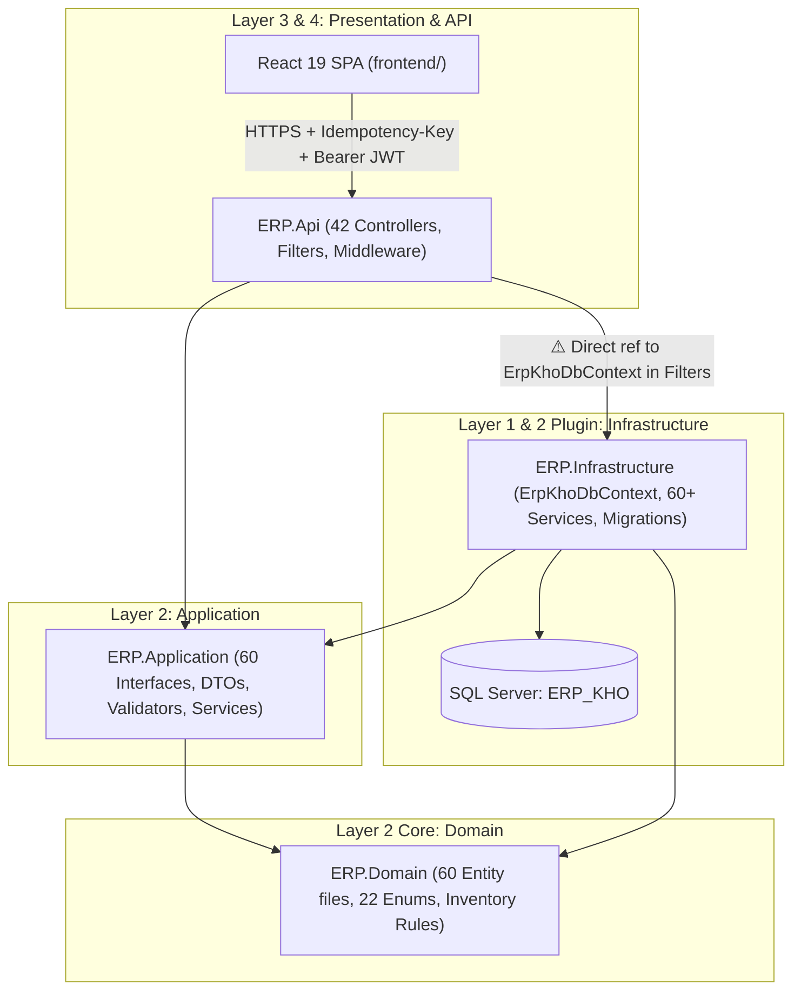
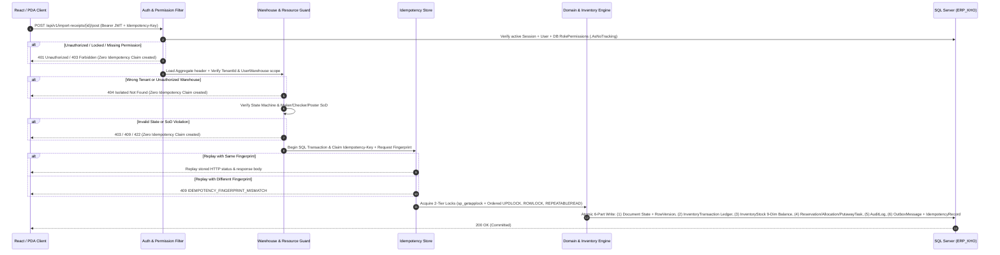

# DATA, API & ARCHITECTURE IMPACT ANALYSIS (DELIVERABLE M)

**Project:** ERP_KHO — Cloud ERP & WMS SaaS  
**Document ID:** `DELIVERABLE-M`  
**Audit Run:** `2026-11-01_REASSESSMENT_001`  
**Mode:** READ-ONLY SYSTEM AUDIT + TO-BE DESIGN PROPOSAL (Pending Project Owner Approval)  
**Baseline Branch / SHA:** `feat/WMS-61-project-development` (`6e0a333390c1db6222e55ae3945b7ce33a56bef6`)

---

## 1. Executive Summary

ERP_KHO possesses an **enterprise-grade core inventory data model and concurrency architecture** that outperforms every open-source WMS and Tier-3 e-commerce WMS benchmarked:
- **9-Dimension Canonical Inventory Bucket (`InventoryStock`)** with deterministic `SHA256` `GrainHash` (`ERP.Domain/Entities/InventoryStock.cs:11-208`).
- **6 Immutable Append-Only Ledgers** enforced at the `DbContext` interceptor/SaveChanges boundary (`ERP.Infrastructure/Persistence/ErpKhoDbContext.cs:580-660`).
- **2-Tier Deterministic Locking** combining `sp_getapplock` with ordered row-level `UPDLOCK, ROWLOCK, REPEATABLEREAD` (`ErpKhoDbContext.cs:195-315`).
- **Multi-Tenant Isolation** via Global Query Filters + cross-tenant FK validation on `SaveChanges` (`ErpKhoDbContext.cs:662-755`).

However, forensic inspection of the API, Application, and Domain layers reveals **7 structural architecture issues** that must be resolved in the TO-BE design (subject to Project Owner approval under `[WF-003]`):
1. **Cross-Domain Controller Bloat & Misplaced Endpoints (`[ARCH-002]`, `[ARCH-003]`):** `ExportReceiptsController`, `ImportReceiptsController`, and `PermissionsController` host endpoints belonging to Returns/RMA, Handover Manifests, Data Imports, Accounting/E-Invoice, and SaaS Billing.
2. **In-Controller Null-Service Fallback Payloads (`[ARCH-003]`, `[FAKE-001]` risk):** Optional constructor dependencies (`IImportReceiptOperationsService?`, `IExportReceiptOperationsService?`, `IReportOperationsService?`) have hardcoded fallback payloads inside controllers (`ImportReceiptsController.cs:169-181`, `ExportReceiptsController.cs:212-213, 343-346`, `ReportsController.cs:65`).
3. **Dual Route Conventions (`/api/PascalCase` vs `/api/v1/kebab-case-plural`):** Controllers expose 3–7 route aliases per action, and frontend pages mix `/api/ImportReceipts` with `/api/v1/handover-manifests` (`[API-001]`).
4. **Unpaginated Collection Endpoints (`[API-004]`):** Several list endpoints (`GET /api/ImportReceipts`, `GET /api/ExportReceipts`) return full collections or load all rows into memory to compute pipeline summaries (`ImportReceiptsController.cs:112-145`, `ExportReceiptsController.cs:76-126`).
5. **Domain Entities with String Statuses & Missing Concurrency Tokens (`[CON-002]`):** Newer entities (`CustomerReturn` in `CustomerReturnEntities.cs:16`, `KitWorkOrder` in `KitWorkOrder.cs:19`) use raw `string Status` instead of strongly-typed enums, and `CustomerReturn` / `CustomerReturnLine` lack `RowVersion` (`byte[]`) optimistic concurrency tokens and Base-UOM snapshot fields (`[INV-005]`).
6. **Split `AppPermissions` Registry:** Permission constants are split between `ERP.Domain.Security.AppPermissions` (5 constants) and `ERP.Api.Authorization.AppPermissions` (~85 constants), with 3 constants aliasing `"inventory_movement.create"`.
7. **Idempotency Claim Ordering vs Resource Authorization:** Per Notion Spec 17 §33.5, resource/warehouse authorization must execute *before* durable idempotency claim creation so denied requests never leave durable claims.

---

## 2. Clean Architecture & Layer Dependency Audit

### 2.1 Current Layer Topology (`FACT`)



### 2.2 Clean Architecture Compliance Matrix

| Rule | Requirement | Current State (`FACT`) | Status | Evidence |
|------|-------------|------------------------|--------|----------|
| `[ARCH-001]` | `ERP.Domain` has 0 external/framework dependencies | `ERP.Domain` only contains pure C# entities, enums, domain exceptions, and value rules. | ✅ PASS | `ERP.Domain/ERP.Domain.csproj` |
| `[ARCH-002]` | Module boundary isolation (no cross-module direct table mutation) | `ErpKhoDbContext` is a single shared context across all 90+ DbSets; some Operations services (`ImportReceiptOperationsService`, `ExportReceiptOperationsService`) span multiple aggregates (Receipts, RMA, Accounting, Manifests). | ⚠️ PARTIAL | `ERP.Infrastructure/Persistence/ErpKhoDbContext.cs` |
| `[ARCH-003]` | Thin Controllers (no business logic, no fallback data generation, no `DbContext`) | Controllers do not inject `ErpKhoDbContext` directly, **but** `ImportReceiptsController`, `ExportReceiptsController`, and `ReportsController` compute pipeline KPIs in-memory and contain fallback response objects when optional `*OperationsService` is null. | 🔴 NEEDS REFACTOR | `ImportReceiptsController.cs:117-182`, `ExportReceiptsController.cs:79-126, 212-214, 343-346` |
| `[ARCH-004]` | Inventory math, state transitions, and allocation rules in Domain/Engine | Core stock math (`InventoryStock.cs`), transaction sign mapping (`InventoryTransactionTypeMapping`), and lock ordering live in Domain/Infrastructure Engine. | ✅ PASS | `ERP.Domain/Entities/InventoryStock.cs:1-208` |
| `[INV-001]` | All balance mutations go through `InventoryStock` / Engine with 2-tier lock | Enforced via `AcquireInventoryAllocationLocksAsync` (`sp_getapplock` + `UPDLOCK, ROWLOCK, REPEATABLEREAD`). | ✅ PASS | `ErpKhoDbContext.cs:195-315` |
| `[INV-002]` | Immutable append-only ledgers | 6 tables blocked from `Modified`/`Deleted` states in `ErpKhoDbContext.EnforceAppendOnlyLedgers`. | ✅ PASS | `ErpKhoDbContext.cs:580-660` |

---

## 3. Data Model & Database Schema Impact Analysis (`Layer 1`)

> [!IMPORTANT]
> **Guardrail `[WF-003]` & `[DB-004..006]`:** No database schema or migration changes are executed during this read-only reassessment. Every schema improvement below is a **TO-BE Proposal (`PENDING OWNER DECISION`)** that must be implemented exclusively via additive EF Core Migrations (`Expand-and-Contract`) with Accompanying Spec 02 / Spec 16 updates.

### 3.1 Strengths of Current Schema (Preserve 100%)

1. **9-Dimension `InventoryStock` Canonical Bucket (`ERP.Domain/Entities/InventoryStock.cs`):**
   - Dimensions: `(TenantId, WarehouseId, ProductId, Status, LocationId, LotId, SerialId, HandlingUnitId, OwnerId)`.
   - Computed `NormalizedGrainKey` and deterministic 64-hex `GrainHash` (`SHA2_256`) with Unique Index.
   - Tracks `Quantity` (Physical On-Hand), `ReservedQuantity` (Soft Reserved), `AllocatedQuantity` (Hard Allocated), `PickedPendingDispatchQuantity`, `LockedQuantity`, and `MovingAverageCost`.
2. **6 Append-Only Ledgers:**
   - `InventoryTransactions`, `InventoryLocationMovements`, `PartnerDebtLedger`, `ShipmentTrackingEvents`, `DockAppointmentEvents`, `AuditLogs`.
3. **Database Check Constraints & Precision:**
   - `decimal(18,4)` / `decimal(19,4)` on quantities and monetary columns (`[DB-001]`).
   - Non-negative check constraints on `InventoryStock` quantities (`[DB-002]`, `[INV-006]`).

### 3.2 Data Model Gaps & Proposed Additive Schema Changes

| Gap ID | Entity / Table | Current Issue (`FACT` Evidence) | Proposed Additive Change (TO-BE) | Migration Strategy |
|--------|----------------|----------------------------------|----------------------------------|--------------------|
| **DM-01** | `CustomerReturn` & `CustomerReturnLine` (`CustomerReturnEntities.cs:5-40`) | 1. Missing `byte[] RowVersion` (`[CON-002]`).<br>2. `Status`, `Condition`, `Disposition` are raw strings instead of enums.<br>3. Missing Base-UOM snapshot fields (`BaseUomId`, `BaseUomCode`, `TransactionUomCode`, `ConversionRateSnapshot` per `[INV-005]`).<br>4. Missing `LotId`, `SerialId`, `ExpiryDate` on `CustomerReturnLine` for 9-dimension restock accuracy.<br>5. Missing `ApprovedBy`, `ApprovedAtUtc`, `PostedLedgerTransactionId`. | Add `RowVersion` (`rowversion`), typed enums (`CustomerReturnStatus`, `ReturnItemCondition`, `ReturnDispositionType`), Base-UOM snapshot columns, `LotId`, `SerialId`, and audit/posting FK columns. | Additive EF Core Migration (`AddColumn` nullable first, backfill defaults, add `CheckConstraint`). |
| **DM-02** | `KitWorkOrder` & `KitWorkOrderComponentLine` (`KitWorkOrder.cs:11-51`) | 1. `Status` is raw `string` (`"Draft"`) instead of `KitWorkOrderStatus` enum (`Draft`, `Released`, `InProgress`, `Completed`, `Cancelled`, `Reversed`).<br>2. Missing Base-UOM snapshot columns on header and component lines (`[INV-005]`). | Convert `Status` via EF value converter or enum mapping; add Base-UOM snapshot columns so changing UOM conversion later does not corrupt historical BOM ratios. | Additive EF Core Migration. |
| **DM-03** | `ReplenishmentRule` & `ReplenishmentTask` (Currently Missing Entity) | Min/Max bin replenishment is only partially simulated inside analytics/putaway; no dedicated `ReplenishmentRule` (per Bin + SKU: `MinBaseQty`, `MaxBaseQty`, `SourceZoneId`, `TriggerMode`) or `ReplenishmentTask` table exists. | Introduce `ReplenishmentRules` (config table) and reuse `InventoryLocationMovement` / `PutawayTask` with `TaskType = Replenishment` (avoiding table proliferation per Ponytail rule). | Reuse existing `PutawayTask` + add 1 lightweight `LocationReplenishmentRules` table if Owner approves Phase 2 replenishment. |
| **DM-04** | `ImportReceipt` & `ExportReceipt` Summary Projections | `GetPipelineSummary` loads all receipts via `GetAllAsync()` into C# memory (`ImportReceiptsController.cs:119`, `ExportReceiptsController.cs:82`). At 50,000+ receipts, this will cause high memory/CPU usage. | Replace in-memory `.ToList()` counting with server-side SQL `GROUP BY Status` projection (`AsNoTracking()`) and composite covering index `IX_ImportReceipts_TenantId_WarehouseId_Status` and `IX_ExportReceipts_TenantId_WarehouseId_Status_MarketplaceShipByUtc`. | Query refactor + Index migration. |

---

## 4. REST API Contract & Endpoint Architecture Impact (`Layer 3`)

### 4.1 Route Standardization Plan (`/api/v1/<kebab-case-plural>`)

Currently, controllers declare multiple legacy and v1 routes simultaneously, and frontend pages call a mix of `/api/ImportReceipts` and `/api/v1/...` (`FRONTEND_AUDIT.md §10.4`).

**TO-BE API Contract Rule (`[API-001]` & Spec 17 §2):**
- **Canonical Primary Route:** Every controller must expose `[Route("api/v1/<kebab-case-plural>")]`.
- **Frontend Alignment:** Update all frontend `apiClient` calls in `frontend/src/pages/*` and `demoApiAdapter.ts` to call **only** `/api/v1/<kebab-case-plural>`.
- **Backward Compatibility Deprecation:** Keep legacy `[Route("api/[controller]")]` attributes marked with `[Obsolete]` / OpenAPI `deprecated: true` header (`Deprecation: true`, `Sunset: <date>`) for 1 release cycle so existing integration tests do not break during cutover.

### 4.2 Controller Decomposition & Ownership Realignment

To eliminate Cross-Domain Controller Bloat (`[ARCH-002]`, `[ARCH-003]`):

| Bloated Controller | Misplaced Endpoints Currently Inside It | Target Canonical Controller (`/api/v1/...`) |
|--------------------|-----------------------------------------|---------------------------------------------|
| `ImportReceiptsController` (`lines 148-200`) | `POST rma-intake-check`, `GET customer-returns`, `POST execute-rtv-refurbish` | **`CustomerReturnsController`** (`/api/v1/customer-returns`) — dedicated controller for RMA intake, inspection, disposition, and restock/RTV posting. |
| `ExportReceiptsController` (`lines 234-277`) | `GET handover-manifests`, `POST handover-manifests/scan-awb`, `POST handover-manifests/{id}/seal`, `POST confirm-carrier-handover` | **`HandoverManifestsController`** (`/api/v1/handover-manifests`) — already exists! Remove duplicate logic from `ExportReceiptsController` and route aliases to single canonical service. |
| `ExportReceiptsController` (`lines 283-309`) | `GET data-imports/templates`, `POST data-imports/opening-balance` | **`DataImportsController`** (`/api/v1/data-imports`) & **`ImportTemplatesController`** (`/api/v1/import-templates`) — already exist! |
| `ExportReceiptsController` (`lines 311-390`) | `GET/POST misa-excel-export`, `POST einvoice-nd70-draft`, `GET/POST accounting-einvoice/*` | **`AccountingExportsController`** (`/api/v1/accounting-exports`) or consolidate cleanly under Finance/Reports module. |
| `PermissionsController` (`lines 128-260`) | `POST saas/tenants/provision`, `GET saas/setup-wizard`, `POST saas/demo-seed`, `GET/POST saas/subscription-billing/*` | **`SaasBillingController`** (`/api/v1/saas-billing`) & **`TenantOnboardingController`** (`/api/v1/saas/onboarding`). |

### 4.3 Elimination of In-Controller Null-Service Fallbacks

**Problem (`FACT`):**
In `ImportReceiptsController.cs:161-181`, `ExportReceiptsController.cs:208-214, 341-346`, and `ReportsController.cs:63-65`, constructors declare optional service parameters (`IImportReceiptOperationsService? receiptOps = null!`, `IExportReceiptOperationsService? exportReceiptOps = null!`, `IReportOperationsService? reportOps = null`) and return hardcoded dummy objects when those services are `null`.

**Root Cause:**
Older unit tests in `ERP.Api.Tests` instantiated controllers directly via `new ImportReceiptsController(mockService)` without passing the newer `*OperationsService` dependency.

**TO-BE Fix:**
1. Make constructor dependencies **required (non-nullable)** in all controllers.
2. Delete `ReportOperationsTextAndFallbackHelper.FallbackWhenNoOpsAsync` and all hardcoded fallback JSON blocks in controllers (`[FAKE-001]`).
3. Update controller unit test builders/fixtures in `ERP.Api.Tests` to pass mocked or test-double `I*OperationsService` instances.

### 4.4 Mandatory Pagination & Filtering Standard (`[API-004]`)

Every collection `GET` endpoint must support standardized query parameters and envelope:
```json
{
  "items": [...],
  "pageNumber": 1,
  "pageSize": 50,
  "totalCount": 1420,
  "totalPages": 29
}
```
- Enforce `Math.Clamp(pageSize, 1, 100)` at the query validator boundary.
- Convert `GET /api/v1/import-receipts` and `GET /api/v1/export-receipts` to server-side pagination (while supporting a transitional query flag or header if legacy tests expect a flat array during migration).

### 4.5 Error Response Contract & Error Code Registry (`[API-002]`, `[API-003]`, `[FE-003]`)

All domain and application errors must return RFC 9457 / Spec 18 structured payloads:
```json
{
  "errorCode": "INV_INSUFFICIENT_AVAILABLE_STOCK",
  "message": "Tồn khả dụng tại vị trí A-01-01 không đủ để xuất (Cần: 50, Khả dụng: 32).",
  "correlationId": "0HN7G89K2L:00000001",
  "details": {
    "warehouseId": 1,
    "productId": 104,
    "requestedBaseQty": 50.0000,
    "availableBaseQty": 32.0000
  }
}
```
- **HTTP Status Mapping:**
  - `400 Bad Request`: Malformed JSON, missing required field, invalid query format.
  - `401 Unauthorized`: Missing/expired JWT or revoked session.
  - `403 Forbidden`: Authenticated user lacks required `<resource>.<action>` permission or SoD guard (e.g., Maker == Checker).
  - `404 Not Found`: Resource does not exist OR belongs to an unauthorized `TenantId`/`WarehouseId` (anti-enumeration rule per Spec 17 §33.4.3).
  - `409 Conflict`: `DbUpdateConcurrencyException` (`RowVersion` mismatch), duplicate/mismatched `Idempotency-Key` payload, or active lock conflict (`CONCURRENCY_CONFLICT`, `IDEMPOTENCY_CONFLICT`).
  - `422 Unprocessable Entity`: Valid syntax, but violates domain state machine or stock invariant (`DOC_INVALID_STATE_TRANSITION`, `INV_INSUFFICIENT_AVAILABLE_STOCK`, `PICK_WRONG_LOT`).

---

## 5. Concurrency, Idempotency & Atomic Transaction Architecture

### 5.1 Canonical 8-Step Command Execution Pipeline (Spec 17 §33.5)



### 5.2 Key Architectural Safeguards to Enforce

1. **Authorization Before Idempotency Claim (`[CON-001]` + Spec 17 §33.5):**
   - Currently, `[IdempotentCommand]` runs as an action/resource filter. Ensure that if an action returns `403 Forbidden`, `404 Not Found`, or `422/409` domain rejection, any provisional `IdempotencyRecord` is rolled back or never committed so an attacker or misconfigured user cannot poison an `Idempotency-Key` before permissions are granted.
2. **Canonical 9-Dimension Lock Ordering (`[CON-003]`):**
   - Whenever a multi-line document (ImportReceipt, ExportReceipt, PickingTask, StockTransfer, Stocktake, KitWorkOrder, CustomerReturn) mutates multiple stock buckets, always sort lock keys by `(TenantId, WarehouseId, ProductId, LocationId, LotId, SerialId, HandlingUnitId, OwnerId, Status)` before calling `AcquireInventoryAllocationLocksAsync`.

---

## 6. Frontend Technical Architecture Impact (`Layer 4`)

1. **God-Component Decomposition (`[Rule Role 7: >500 LOC must split]`):**
   - `Permissions.tsx` (2,280 LOC) → Split into 5 tab modules under `frontend/src/pages/permissions/`: `UsersSecurityTab.tsx`, `RolesMatrixTab.tsx`, `WarehouseScopeTab.tsx`, `IamAuditLogsTab.tsx`, `SecurityDashboardTab.tsx`.
   - `ImportReceipts.tsx` (1,991 LOC) → Split into `ImportReceiptList.tsx`, `ImportReceiptFormDrawer.tsx`, `ReceivingWorksheetPanel.tsx`, `QcDispositionPanel.tsx`, `DiscrepancyResolutionPanel.tsx`.
   - `Stocktakes.tsx` (1,568 LOC), `SaasBilling.tsx` (1,455 LOC), `ExportReceipts.tsx` (1,417 LOC), `Inventory.tsx` (1,394 LOC), `InventoryReconciliation.tsx` (1,307 LOC), `DockYard.tsx` (1,305 LOC), `Products.tsx` (1,304 LOC) → Extract tab views and modal drawers into sub-components so every file stays `< 450 LOC`.
2. **Hardware Barcode Scanner Event Bus:**
   - Complement camera-based `MobileBarcodeScannerBar.tsx` with a global keyboard-wedge / Android broadcast-intent listener hook (`useHardwareBarcodeScanner`) that captures high-speed character bursts (`< 35ms` inter-keystroke interval ending in `Enter`/`Tab`) and routes them to the active scan input without requiring the user to tap the input box first.
3. **React Error Boundary (`<WorkspaceErrorBoundary>`):**
   - Wrap route `<Suspense>` in `AppRoutes.tsx` with an error boundary that displays a Vietnamese recovery panel and one-click `CorrelationId` copy for Zalo support.
