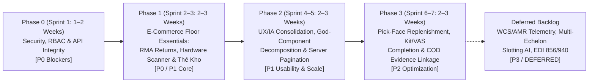

# PRODUCT ROADMAP & PRIORITIZATION PLAN (DELIVERABLE P)

**Project:** ERP_KHO — Cloud ERP & WMS SaaS  
**Document ID:** `DELIVERABLE-P`  
**Audit Run:** `2026-11-01_REASSESSMENT_001`  
**Mode:** READ-ONLY SYSTEM AUDIT + TO-BE PRODUCT ROADMAP PROPOSAL  
**Baseline Branch / SHA:** `feat/WMS-61-project-development` (`6e0a333390c1db6222e55ae3945b7ce33a56bef6`)

---

## 1. Strategic Product Philosophy & ICP Fit

### 1.1 Ideal Customer Profile (ICP) Anchor
- **First Paying Customer Archetype:** Vietnamese multi-channel e-commerce seller (Shopee, Lazada, TikTok Shop, Website) & B2B distributor.
- **Scale:** **1 physical warehouse**, **5–30 warehouse staff**, **300–5,000 orders/day**, **500–10,000 SKUs**.
- **Migration Origin:** Currently using Excel or basic inventory/POS software (KiotViet, Sapo) that lacks location-level bin tracking, lot/FEFO control, double-entry ledger reconciliation, and anti-oversell concurrency locks.

### 1.2 Core Prioritization Principles (Ponytail / YAGNI Discipline)
1. **Protect Core Differentiators First:** ERP_KHO's 9-dimension `InventoryStock` bucket (`GrainHash`), 6 append-only ledgers, and 2-tier concurrency locks (`sp_getapplock` + `UPDLOCK`) are already enterprise-grade. Never compromise stock accuracy to simplify a form.
2. **Close Security & RBAC Gaps Immediately (`Phase 0 / P0`):** Fix persistent TOTP 2FA state, anonymous tenant provisioning guard, `.read` permission misuse on `POST` endpoints, and `ReportsController` role gates before customer onboarding.
3. **Deliver Missing High-Frequency E-Commerce Workflows (`Phase 1 / P0-P1`):** E-commerce warehouses face 10–25% return/RTO rates and rely on hardware barcode guns (HID keyboard wedge) and statutory `Thẻ Kho Mẫu S12-DN`.
4. **Eliminate UX & Cognitive Friction (`Phase 2 / P1-P2`):** Consolidate the 36+ sidebar links into 16 workspace hubs, decompose the 9 God Components (`> 1,000 LOC`), and clarify the Express (2-step) vs Full WMS (5-step) outbound tracks.
5. **Defer Enterprise Bloat (`DEFERRED`):** Do not invest engineering cycles in WCS conveyor/robotics telemetry, voice-picking hardware, or multi-site yard automation until a paying customer with `> 2` warehouses or automated conveyors signs a contract.

---

## 2. Phased Roadmap Overview

---

## 3. Detailed Phase Breakdown & Deliverables

### Phase 0 — Security, RBAC & API Contract Hardening (`P0 — Immediate Pre-Launch Gate`)
**Target Duration:** 1–2 Weeks  
**Goal:** Eliminate all security vulnerabilities, authorization mismatches, and in-controller null-service fallbacks before onboarding the first paying customer.

| Item ID | Finding Ref | Work Package Description | Layer | Effort | Dependencies |
|---------|-------------|--------------------------|-------|:------:|--------------|
| **RM-0.1** | `FND-001` | **Database-Persisted TOTP 2FA:** Replace static `TotpEnrollments` dictionary, remove client-supplied `Base32Secret` acceptance, delete deterministic `GetTotpSecretBytes`, and store encrypted TOTP secret + hashed recovery codes on `Users` table. | Layer 1, 2, 3 | `M` | Additive Migration `DM-IAM-01` |
| **RM-0.2** | `FND-002` | **Tenant Provisioning Auth Boundary:** Remove `[AllowAnonymous]` from `PermissionsController.ProvisionSaaSTenant`; split rate-limited public signup (`POST /api/v1/auth/register-tenant`) from admin provisioning (`system_config.manage`). | Layer 3, 4 | `S` | None |
| **RM-0.3** | `FND-004`, `FND-006` | **Canonical Permission Registry & Mutation Enforcement:** Merge `ERP.Domain.Security.AppPermissions` and `ERP.Api.Authorization.AppPermissions`; separate `inventory_opening_balance.import` from `inventory_movement.create`; replace `.read` + `!IsInRole("Viewer")` on all `POST` endpoints with dedicated mutation permission codes. | Layer 2, 3 | `M` | Role Bundle Seed Update |
| **RM-0.4** | `FND-005` | **Remove Legacy `[Authorize(Roles = ...)]` on `ReportsController`:** Allow `Accountant` and `WarehouseStaff` with `inventory.read` to access `GET /api/v1/reports/inventory-in-out-stock` (while preserving `CanReadInventoryCost()` masking). | Layer 3 | `S` | None |
| **RM-0.5** | `FND-008`, `FND-023` | **Eliminate Null-Service Controller Fallbacks & Enforce Auth-Before-Idempotency:** Make `*OperationsService` dependencies non-nullable in controllers; delete `FallbackWhenNoOpsAsync`; verify `IdempotencyRecord` is never persisted on `401/403/404` responses. | Layer 3, 5 | `M` | Update `ERP.Api.Tests` fixtures |
| **RM-0.6** | `FND-016` | **Refresh Cookie Path Fix:** Update `AuthController` refresh cookie `Path` from `"/api/Auth"` to `"/"` so `/api/v1/auth/refresh` works seamlessly. | Layer 3 | `S` | None |

---

### Phase 1 — E-Commerce Warehouse Floor Essentials (`P0 / P1 — First Paying Customer Go-Live`)
**Target Duration:** 2–3 Weeks  
**Goal:** Complete the daily physical floor loop for Vietnamese Shopee/Lazada/TikTok Shop sellers: Returns/RMA workbench, industrial HID barcode gun support, PDA floor launcher, and statutory `Thẻ Kho Mẫu S12-DN`.

| Item ID | Finding Ref | Work Package Description | Layer | Effort | Dependencies |
|---------|-------------|--------------------------|-------|:------:|--------------|
| **RM-1.1** | `FND-003` | **Customer Returns & RMA Workbench (`/customer-returns`):** - Add `RowVersion`, Base-UOM snapshots, and `LotId`/`SerialId` to `CustomerReturn` & `CustomerReturnLine` (`DM-01`). - Extract `CustomerReturnsController` (`/api/v1/customer-returns`). - Build `CustomerReturns.tsx`: Scan returned AWB / Order Code → Receive into `Quarantine` → Inspect (`GOOD`, `DAMAGED_BOX`, `DEFECTIVE`) → Post Disposition (`RESTOCK_AVAILABLE`, `REFURBISH_REPACK`, `RTV_VENDOR`, `SCRAP_DISPOSAL`) atomically to 9-dim `InventoryStock` & `InventoryTransactions`. | Layer 1–5 | `M` | `DM-01` Migration |
| **RM-1.2** | `FND-013` | **Global Hardware Barcode Scanner Wedge & GS1-128 Parser:** - Build `useHardwareScannerWedge` hook capturing rapid HID keystroke bursts (`< 35ms/char`) without requiring input focus. - Add GS1-128 parser (`(01)GTIN(10)LOT(17)EXP(21)SN`). - Add Web Audio API success/error tones and vibration feedback on mobile/PDA. | Layer 4 | `M` | None |
| **RM-1.3** | `FND-019` | **PDA Mobile Floor Launcher (`390x844`):** Upgrade mobile bottom navigation and landing view into a 6-tile Scan-First Floor Launcher (`Nhận hàng`, `Cất hàng`, `Lấy hàng`, `Đóng gói & Bàn giao AWB`, `Chuyển vị trí`, `Kiểm kê & Hàng hoàn`). | Layer 4 | `S` | `RM-1.1` |
| **RM-1.4** | `FND-015` | **Statutory Vietnamese Stock Card (`Thẻ Kho Mẫu S12-DN`):** Add `GET /api/v1/reports/stock-card` and `.xlsx` ClosedXML export + printable S12-DN view in `Inventory.tsx` Tab 3. | Layer 3, 4 | `S` | None |

---

### Phase 2 — UX/IA Consolidation, Route Standardization & Scalability (`P1 — Post-Go-Live Polish`)
**Target Duration:** 2–3 Weeks  
**Goal:** Streamline desktop navigation, clarify Express vs Full outbound workflows, standardize `/api/v1/` routes, enforce server-side pagination on receipts, and decompose God Components.

| Item ID | Finding Ref | Work Package Description | Layer | Effort | Dependencies |
|---------|-------------|--------------------------|-------|:------:|--------------|
| **RM-2.1** | `FND-012`, `FND-014` | **Sidebar IA Consolidation (36 → 16 Hubs) & Outbound Pipeline Stepper:** Group related sub-pages into tabbed hubs; add visual step-by-step pipeline banner distinguishing `Express 2-Step ExportReceipt` vs `Full 5-Step SO Fulfillment`. | Layer 4 | `M` | None |
| **RM-2.2** | `FND-010` | **Server-Side Pagination & SQL `GROUP BY` Pipeline Summaries:** Replace in-memory `GetAllAsync().ToList()` in `ImportReceiptsController` and `ExportReceiptsController` with indexed SQL `GROUP BY` summaries and paginated `GET` queries (`pageSize <= 100`). | Layer 1, 2, 3, 4 | `M` | Covering Indexes `DM-04` |
| **RM-2.3** | `FND-007`, `FND-009` | **Controller Ownership Cleanup & 100% `/api/v1/<kebab-case-plural>` Frontend Alignment:** Move misplaced actions out of `ExportReceiptsController`, `ImportReceiptsController`, and `PermissionsController`; update all frontend `apiClient` calls to `/api/v1/...`. | Layer 3, 4 | `M` | None |
| **RM-2.4** | `FND-011`, `FND-020`, `FND-024` | **God-Component Decomposition (`<= 500 LOC`), 3-Layer CSS Tokens & `<WorkspaceErrorBoundary>`:** Split the 9 pages `> 1,000 LOC` into modular sub-components, centralize `design-tokens.css`, and add error boundary recovery. | Layer 4 | `L` | None |

---

### Phase 3 — Warehouse Optimization & Margin Protection (`P2 — Growth Stage`)
**Target Duration:** 2–3 Weeks  
**Goal:** Unlock higher throughput for 15–30 staff operations with proactive pick-face replenishment, unified Kit/Bundle work orders, and packing weight/video linkage to COD fee disputes.

| Item ID | Finding Ref | Work Package Description | Layer | Effort | Dependencies |
|---------|-------------|--------------------------|-------|:------:|--------------|
| **RM-3.1** | `FND-018` | **Min/Max Pick-Face Replenishment:** Add `MinBaseQty` / `MaxBaseQty` rules per pick-face bin and 1-click Replenishment Task generation from bulk reserve bins (`FEFO`). | Layer 1–4 | `M` | `DM-03` Migration |
| **RM-3.2** | `FND-017` | **Kit / Promotional Combo Work Order Lifecycle:** Convert `KitWorkOrder.Status` to typed enum, add Base-UOM component snapshots (`DM-02`), and unify BOM → Component Pick → Kit Assembly with `EarliestComponentExpiryDate` & `RolledUpUnitCost`. | Layer 1–4 | `M` | `DM-02` Migration |
| **RM-3.3** | `FND-022` | **Packing Weight/Video Linkage to COD & Shipping Fee Disputes:** Surface recorded `HandlingUnit.GrossWeightKg` and `PackingVideoEvidence` directly inside `CodReconciliation.tsx` variance rows and `CustomerReturns.tsx`. | Layer 3, 4 | `S` | None |

---

### Deferred Backlog (`P3 / DEFERRED — Do Not Build Until Multi-Site / Enterprise Trigger`)

| Item ID | Finding Ref | Feature | Reason for Deferral (`YAGNI` / ICP Alignment) | Unlock Trigger |
|---------|-------------|---------|-----------------------------------------------|----------------|
| **DEF-01** | `FND-021` | **WCS Conveyor / AMR Robotics / RFID / Voice-Pick Telemetry** | 1-warehouse ICP (5–30 staff) uses handheld Android PDAs and 2D barcode guns, not automated conveyor sorters or RFID tunnels. Hide UI panel behind feature flag. | Enterprise customer contract requiring hardware PLC/WCS integration. |
| **DEF-02** | `FND-021` | **Multi-Warehouse Control Tower & Inter-Site Network Balancing** | Keep backend intact, but auto-hide on Dashboard when `warehouses.length == 1`. | Customer expands to `>= 2` physical warehouses. |
| **DEF-03** | Benchmark | **Enterprise EDI (ANSI X12 856/940/945) & Engineered Labor Standards** | Vietnamese e-commerce & distribution uses REST APIs (Shopee/Lazada/TikTok/GHN/GHTK/MISA), not legacy EDI VANs. Simple task throughput metrics suffice for `< 30` staff. | Enterprise 3PL or supermarket chain integration requirement. |
