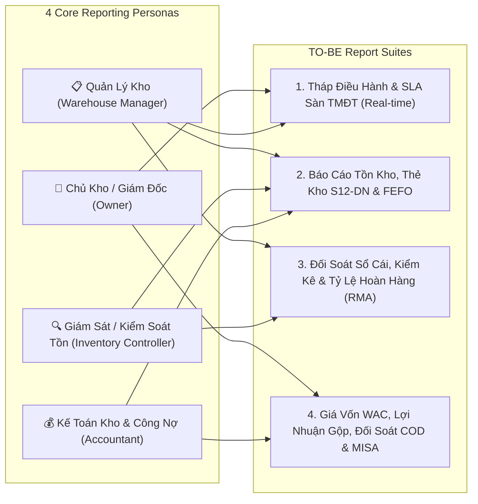

# REPORTING, ANALYTICS & CONTROL TOWER BLUEPRINT (DELIVERABLE O)

**Project:** ERP_KHO — Cloud ERP & WMS SaaS  
**Document ID:** `DELIVERABLE-O`  
**Audit Run:** `2026-11-01_REASSESSMENT_001`  
**Mode:** READ-ONLY SYSTEM AUDIT + TO-BE REPORTING & ANALYTICS DESIGN PROPOSAL  
**Baseline Branch / SHA:** `feat/WMS-61-project-development` (`6e0a333390c1db6222e55ae3945b7ce33a56bef6`)

---

## 1. Executive Summary

ERP_KHO already implements a remarkably rich set of operational and financial reports in [`ReportsController.cs`](file:///d:/ERP_KHO/ERP.Api/Controllers/ReportsController.cs#L1-L354), [`Inventory.tsx`](file:///d:/ERP_KHO/frontend/src/pages/Inventory.tsx#L350-L372), [`Dashboard.tsx`](file:///d:/ERP_KHO/frontend/src/pages/Dashboard.tsx#L254-L275), [`CodReconciliation.tsx`](file:///d:/ERP_KHO/frontend/src/pages/CodReconciliation.tsx), and [`CostValuation.tsx`](file:///d:/ERP_KHO/frontend/src/pages/CostValuation.tsx):
- **Operational Control Tower:** `GET /api/v1/reports/operational-dashboard`, `multi-warehouse-control-tower`, `warehouse-tasks`, `operational-exceptions`, `productivity-and-bi-snapshot`.
- **Core Inventory Reports:** `GET /api/v1/reports/inventory` (with real `.xlsx` ClosedXML export `BaoCaoTonKho_*.xlsx`), `GET /api/v1/reports/inventory-in-out-stock` (with `.xlsx` export `BaoCaoXuatNhapTon_*.xlsx`), `GET /api/v1/reports/expiry-aging`, `GET /api/v1/reports/analytics-summary`.
- **Audit & Ledger Reconciliation:** `InventoryReconciliation` (Balance vs Ledger parity), `InventoryTraceability` (Lot/Serial genealogy & recall exposure).
- **Financial & E-Commerce Settlement:** `owner-gross-profit` (with server-side `inventory.cost.read` masking), `cod-reconciliation` (3-way Carrier COD vs Order vs Ledger), `3pl-storage-snapshot`, and MISA AMIS / E-Invoice NĐ 70/2025 export.

### Key Reporting Gaps Identified (`FACT`)

| Gap ID | Gap Summary | Evidence (`FACT`) | Priority |
|--------|-------------|-------------------|----------|
| **REP-G01** | **Role Gate Blocks Staff & Accountant from Xuất-Nhập-Tồn Report:** `GetInventoryInOutReport` and `ExportInventoryInOutReport` use `[Authorize(Roles = AppRoles.AdminManagerOrViewer)]`, inadvertently excluding `Accountant` and `WarehouseStaff` roles even if they hold `inventory.read` or `report.inventory.read`. | `ReportsController.cs:301, 323` | 🔴 **P0** |
| **REP-G02** | **In-Memory Pipeline Aggregations on Receipt Controllers:** `ImportReceiptsController.GetPipelineSummary` and `ExportReceiptsController.GetPipelineSummary` load all rows via `GetAllAsync()` into memory before counting by status. | `ImportReceiptsController.cs:119`, `ExportReceiptsController.cs:82` | 🟠 **P1** |
| **REP-G03** | **Missing Marketplace Order SLA & Carrier On-Time Performance Report:** While `ExportReceiptsController.GetSlaQueue` tracks active pending receipts (`< 2h` to `MarketplaceShipByUtc`), there is no historical report on SLA breach rate by channel (Shopee/Lazada/TikTok Shop) or carrier pickup latency (GHN/GHTK/J&T/ViettelPost). | `ExportReceiptsController.cs:108-126` | 🟠 **P1** |
| **REP-G04** | **Missing Return / RMA Rate & Defect Reason Analytics:** E-commerce sellers experience 10–25% return/RTO rates, but there is no report breaking down Return Rate by SKU, Carrier (RTO delivery failed), or Customer Defect Reason. | `CustomerReturnEntities.cs`, `ReportsController.cs` | 🟠 **P1** |
| **REP-G05** | **Scattered Report Navigation:** Reports are fragmented across `Dashboard.tsx`, 6 tabs inside `Inventory.tsx`, `CodReconciliation.tsx`, `CostValuation.tsx`, and `WarehouseMap.tsx` with no unified **Report Center (`/reports`)** or scheduled export catalog. | `productionNavigation.ts`, `AppRoutes.tsx` | 🟡 **P2** |
| **REP-G06** | **Missing Stock Card (`Thẻ Kho` — Mẫu S12-DN / Thông tư 200 & 133) Print/Excel Export:** Vietnamese accountants and tax auditors require a formal per-SKU chronological Stock Card (`Thẻ kho`) with opening balance, document date/number, inbound qty, outbound qty, running balance after each transaction, and signature blocks. | `Inventory.tsx` (Transaction History tab has filter but no formal S12-DN `.xlsx`/PDF export) | 🟠 **P1** |

---

## 2. AS-IS Reporting & Analytics Inventory

| Report / Dashboard | Frontend Location | Backend Endpoint | Excel / File Export | Cost Masking (`inventory.cost.read`) | Status |
|--------------------|-------------------|------------------|---------------------|--------------------------------------|--------|
| **Operational Command Center** | `Dashboard.tsx` (`/`) | `GET /api/v1/reports/operational-dashboard` | No | N/A | `IMPLEMENTED_VERIFIED` |
| **Multi-Warehouse Control Tower** | `Dashboard.tsx` (`/`) | `GET /api/v1/reports/multi-warehouse-control-tower` | No | N/A | `IMPLEMENTED_VERIFIED` |
| **Operational Exceptions Queue** | `Dashboard.tsx` (`/`) | `GET /api/v1/reports/operational-exceptions` | No | N/A | `IMPLEMENTED_VERIFIED` |
| **Current Stock Balance Report** | `Inventory.tsx` Tab 1 | `GET /api/v1/reports/inventory` | ✅ `GET /api/v1/reports/inventory/export` (`.xlsx`) | ✅ Server + UI | `IMPLEMENTED_VERIFIED` |
| **Nhập-Xuất-Tồn (In-Out-Stock)** | `Inventory.tsx` Tab 4 | `GET /api/v1/reports/inventory-in-out-stock` | ✅ `GET /api/v1/reports/inventory-in-out-stock/export` (`.xlsx`) | ⚠️ Needs `[PermissionAuthorize]` fix (`REP-G01`) | `IMPLEMENTED_PARTIAL` |
| **FEFO / Expiry Aging Report** | `Inventory.tsx` Tab 5 | `GET /api/v1/reports/expiry-aging` | No `.xlsx` export yet | N/A | `IMPLEMENTED_VERIFIED` |
| **SKU Velocity & ABC Turnover** | `Inventory.tsx` Tab 6 | `GET /api/v1/reports/analytics-summary` | No `.xlsx` export yet | N/A | `IMPLEMENTED_VERIFIED` |
| **Balance vs Ledger Reconciliation** | `InventoryReconciliation.tsx` | `GET /api/v1/inventory-reconciliation` | No | N/A | `IMPLEMENTED_VERIFIED` |
| **Lot/Serial Genealogy & Recall** | `InventoryTraceability.tsx` | `GET /api/v1/inventory-traceability` | No | N/A | `IMPLEMENTED_VERIFIED` |
| **Owner Gross Profit & COGS (WAC)** | `Dashboard.tsx` & `CostValuation.tsx` | `GET /api/v1/reports/owner-gross-profit` | ✅ MISA Excel export | ✅ Enforced (`CanReadInventoryCost()`) | `IMPLEMENTED_VERIFIED` |
| **3-Way COD Reconciliation** | `CodReconciliation.tsx` | `GET/POST /api/v1/reports/cod-reconciliation` | ✅ CSV/Excel upload | ✅ Enforced on UI route | `IMPLEMENTED_VERIFIED` |
| **3PL Daily Storage Snapshot** | `SaasBilling.tsx` / API | `GET/POST /api/v1/reports/3pl-storage-snapshot` | No | N/A | `IMPLEMENTED_PARTIAL` |

---

## 3. TO-BE Reporting & Analytics Architecture

### 3.1 Role-Based Reporting Personas (Tailored for ICP)

### 3.2 Core TO-BE Report Specifications

#### A. Operational SLA & Marketplace Fulfillment Monitor (Upgraded `Dashboard.tsx`)
- **Objective:** Prevent Shopee / Lazada / TikTok Shop late-shipment penalty points.
- **Key Metrics (Real-Time SQL Projection):**
  1. **Đơn sắp trễ hạn giao (`SLA At-Risk < 2h`):** Count & clickable drill-down to orders where `MarketplaceShipByUtc <= UtcNow + 2h` and status != `Dispatched`.
  2. **Đơn đã quá hạn (`SLA Breached`):** Count & channel breakdown (Shopee / Lazada / TikTok Shop / Website).
  3. **Tỷ lệ giao đúng hạn (`On-Time Dispatch %`):** `(DispatchedBeforeCutoff / TotalDueToday) * 100`.
  4. **Hàng đợi tác vụ kho (`Open Floor Tasks`):** Pending Receipts, Open Putaway Tasks, Open Picking Tasks, Unsealed Packing Sessions, Unsealed Handover Manifests.
  5. **Cảnh báo ngoại lệ (`Active Exceptions`):** Short-picks pending resolution, Cancel-pending-putback orders, Receiving discrepancies pending approval, Stocktake variances pending review.

#### B. Vietnamese Statutory Stock Card (`Thẻ Kho Mẫu S12-DN` — NEW Export)
- **Objective:** Provide 1-click export of statutory `Thẻ Kho` (Circular 200/2014/TT-BTC & Circular 133/2016/TT-BTC) from `InventoryTransactions` immutable ledger.
- **Filter Inputs:** `WarehouseId` (required), `ProductId` (required), `LotId` (optional), `FromDate`, `ToDate`.
- **Columns (`.xlsx` & Print PDF):**
  - `STT`, `Ngày ghi sổ (PostedAtUtc)`, `Số hiệu chứng từ (Nhập / Xuất)`, `Ngày chứng từ`, `Diễn giải ( Lý do / Đối tượng)`, `Đơn vị tính (BaseUomCode)`, `Số lượng Nhập`, `Số lượng Xuất`, `Số lượng Tồn cuối sau giao dịch` (running balance), `Ký xác nhận Thủ kho / Kế toán`.
- **Mathematical Invariant:**
  $$\text{ClosingBalance}(t_n) = \text{OpeningBalance}(t_0) + \sum_{i=1}^{n} \Delta\text{BaseQty}(t_i)$$
  Must match `InventoryStock.Quantity` (`OnHand`) 100% when `ToDate == Now`.

#### C. Báo Cáo Xuất - Nhập - Tồn Tổng Hợp (`Inventory In-Out-Stock Summary`)
- **Fix Required (`REP-G01`):** Replace `[Authorize(Roles = AppRoles.AdminManagerOrViewer)]` on `ReportsController.cs:301, 323` with `[PermissionAuthorize(AppPermissions.InventoryRead)]` (and mask monetary columns `OpeningValue`, `InboundValue`, `OutboundValue`, `ClosingValue` unless `CanReadInventoryCost()` is true).
- **Columns:**
  - `Mã SKU`, `Tên sản phẩm`, `Nhóm hàng`, `ĐVT Cơ sở`, `Tồn đầu kỳ (SL / Giá trị*)`, `Nhập trong kỳ (Mua hàng / Chuyển kho đến / Nhập hoàn RMA / Kiểm kê tăng)`, `Xuất trong kỳ (Xuất bán / Chuyển kho đi / Xuất trả NCC / Kiểm kê giảm)`, `Tồn cuối kỳ (SL / Giá trị*)`.
  - *(`Giá trị` columns omitted on server DTO when user lacks `inventory.cost.read`).*

#### D. Báo Cáo Tuổi Tồn, Cận Date (FEFO) & Hàng Chậm Luân Chuyển (`Dead Stock`)
- **Buckets:**
  - `EXPIRED` (`ExpiryDate < Today`) — Highlighted in Danger Red; 1-click action to create `InventoryLock` or move to `Quarantine`.
  - `CRITICAL_NEAR_EXPIRY` (`0–15 days` remaining).
  - `WARNING_NEAR_EXPIRY` (`16–30 days` remaining).
  - `SLOW_MOVING / DEAD_STOCK` (No outbound movement in `> 60` / `> 90` days, ranked by tied-up working capital `OnHandQty * MovingAverageCost`).

#### E. Báo Cáo Hoàn Hàng & Chất Lượng Đầu Ra (`Returns / RMA & RTO Analytics` — NEW)
- **Metrics:**
  - **Tỷ lệ hoàn hàng (`Return Rate %`):** Total Returned Units / Total Dispatched Units by Channel (Shopee, Lazada, TikTok) and by Carrier (GHN, GHTK, J&T).
  - **Phân tích nguyên nhân hoàn (`Return Reason Breakdown`):**
    - `CARRIER_RTO_FAILED_DELIVERY` (Giao không thành công / Khách bom hàng)
    - `WAREHOUSE_WRONG_ITEM_PICKED` (Kho nhặt sai SKU/Size/Màu)
    - `PACKING_DAMAGED_IN_TRANSIT` (Vỡ/móp do đóng gói hoặc vận chuyển)
    - `PRODUCT_DEFECT` (Lỗi nhà sản xuất)
  - **Kết quả xử lý hàng hoàn (`Disposition Breakdown`):** `% Restocked to Available`, `% Refurbished/Repacked`, `% Returned to Vendor (RTV)`, `% Scrapped`.

#### F. Báo Cáo Tài Chính Kho: Giá Vốn WAC, Lợi Nhuận Gộp & Đối Soát COD 3 Chiều
- **RBAC Protection:** Strictly gated by `[PermissionAuthorize(AppPermissions.InventoryCostRead)]` (`403 Forbidden` for unauthorized roles).
- **3-Way COD Reconciliation Statuses:**
  - `MATCHED` (Tiền thu hộ thực nhận == Tiền COD trên đơn & Phí vận chuyển khớp biểu phí).
  - `COD_SHORTFALL` (ĐVVC chuyển thiếu tiền COD).
  - `SHIPPING_FEE_OVERCHARGE` (ĐVVC tính vượt cước cân nặng/kích thước quy đổi — đối chiếu với `HandlingUnit.GrossWeightKg` & `Length*Width*Height` ghi nhận tại bàn đóng gói!).
  - `ORPHAN_AWB` (Mã vận đơn có trên bảng kê ĐVVC nhưng không có Phiếu xuất kho trong ERP_KHO).

---

## 4. Performance & Query Engineering Standards for Reports (`[DB-007]`)

1. **Read-Only `.AsNoTracking()` Mandatory:** Every report query in `ReportService` and `ReportOperationsService` must use `.AsNoTracking()` (or Dapper read-only projections) with zero open transactions.
2. **Server-Side SQL Aggregation Only:** Never call `.ToListAsync()` on transactional tables (`ImportReceipts`, `ExportReceipts`, `InventoryTransactions`) and aggregate in C# LINQ (`REP-G02`). Push `COUNT`, `SUM`, and `GROUP BY` into SQL Server.
3. **Bounded Date Ranges:** Enforce a maximum date range window (e.g., `<= 366 days`) on unpaginated detail exports (`Thẻ Kho`, `Xuất-Nhập-Tồn`) to prevent memory exhaustion.
4. **Real Binary `.xlsx` Streaming via `ClosedXML` (`[Layer 3 Rule]`):** Maintain `ReportsExcelHelper` using `ClosedXML` (`XLWorkbook`) with proper Vietnamese column headers, number formatting (`#,##0.####` for quantities, `#,##0` for VND), and summary totals row.
