# Deliverable G: TO-BE Business Process Blueprint (`ERP_KHO`)

**Document ID:** `REASSESSMENT-2026-11-01-DOC-G`  
**Date:** 2026-11-01  
**Role:** Subagent 3 — Business Process Reengineering Specialist  
**Target ICP:** Vietnamese Omnichannel E-Commerce & B2B Distribution Warehouses (1 primary warehouse, 5–30 staff, 200–5,000 orders/day across Shopee, TikTok Shop, Lazada, and B2B wholesale).

---

## Architectural Principles of the TO-BE Reengineering

1. **Progressive Complexity via Configurable Routes (`EXPRESS` vs `FULL` Mode):**
   - Inspired by Odoo's 1/2/3-step warehouse routes and ShipHero/Sentry WMS scan-first execution, every inbound and outbound flow supports **1-Step Express Mode** (for 5–10 staff warehouses where receiving directly updates pickable storage bins and outbound approval/scan dispatches directly) and **Multi-Step Full Mode** (for 15–30 staff warehouses with dedicated Receiving → QC → Putaway and Allocate → Wave Pick → Pack → Manifest Handover).
2. **Canonical 6-Bucket Stock Equation Across 9 Dimensions:**
   - Every physical bucket in `InventoryStocks` is uniquely keyed by the **9-Dimension Grain** (`TenantId | WarehouseId | LocationId | ProductId | LotId | SerialId | HandlingUnitId | Status | OwnerId` → `GrainHash = SHA256`).
   - Quantity invariants enforced at both Domain Service and SQL `CHECK` constraint levels:
     $$\text{OnHand} \ge 0, \quad \text{AvailableToReserve} = \text{OnHand} - (\text{SoftReserved} + \text{HardAllocated} + \text{PickedPendingDispatch} + \text{Locked}) \ge 0$$
3. **Strict 6-Part Atomic Transaction Boundary (`[INV-004]`):**
   - Every state-posting command commits in a single SQL Server transaction: **(1) Document State + `RowVersion`**, **(2) Append-Only `InventoryTransactions` Ledger (`BaseUom` + `TransactionUom` + `ConversionRateSnapshot`)**, **(3) Materialized `InventoryStocks` Balance + `MovingAverageCost`**, **(4) `StockReservation` / `StockAllocation` / `InventoryLock` Mutation**, **(5) `AuditLogs` (`BeforeStateJson` / `AfterStateJson` / `CorrelationId`)**, and **(6) `OutboxMessages` (Integration & SaaS Usage Metering)**.
4. **Clean Controller & UI Decomposition:**
   - Dedicated controllers and screens for **Customer Returns (`/api/v1/customer-returns`, `/customer-returns`)**, **Kitting/VAS (`/api/v1/kit-work-orders`, `/kitting`)**, and **Finance/Accounting (`/api/v1/finance/...`)**, eliminating God controllers and >1,500-line God React components.

---

## Process 1: Inbound Planning & Receiving (`PO → ASN → Dock/Yard → ImportReceipt → QC → Discrepancy → Post`)

### (1) Business Objective
Enable error-free supplier receiving with 100% lot/expiry/serial capture and accurate Moving Average Cost (MAC) valuation—allowing a 5-person warehouse to receive against a PO in **1 scan-driven step (< 60 seconds)** while allowing a 30-person warehouse to enforce ASN staging, dock check-in, QC hold, and discrepancy approval gates.

### (2) Actors & Roles
- **Purchasing Officer (Maker):** Creates/opens `PurchaseOrder` and `Asn`.
- **Gate / Dock Guard:** Checks in vehicles at `DockAppointment` (Full Mode only).
- **Receiving Clerk (Maker/Executor):** Scans incoming items, records quantities, assigns Lot/Serial/Expiry, logs discrepancies.
- **QC Inspector:** Executes quality inspection and assigns `TargetStatus` (`Available`, `Quarantine`, `Damaged`, `Rejected`).
- **Warehouse Manager (Checker):** Approves over/under receiving discrepancies and approves `ImportReceipt`.
- **Inventory Accountant (Poster):** Reviews MAC preview and posts `ImportReceipt` to ledger.

### (3) Trigger Events
- Supplier delivers goods at warehouse dock (with or without prior `PurchaseOrder` / `Asn`).
- Electronic ASN webhook or Excel PO import received from upstream ERP/supplier.

### (4) Preconditions
- Tenant subscription quota tier is not `READ_ONLY_OVER_115`.
- Target `WarehouseId` is active and user has Warehouse Scope access.
- All SKUs (`Product`) exist, are active, and have valid `BaseUom` and `ProductUom` conversion factors.
- Target receiving or storage `WarehouseLocation` has `IsReceivable = true` and no active `CountFreeze` lock.

### (5) Main Success Path (with Mermaid Flowchart)

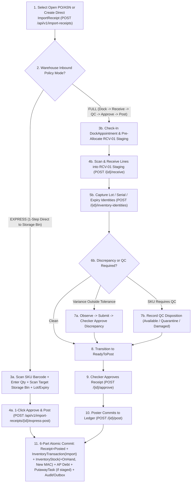

### (6) Alternative Paths (`Express 1-Step` vs `Full Multi-Step`)
- **Express 1-Step Mode (`InboundMode = EXPRESS_1_STEP`):** Hides Dock/Yard and ASN steps. Receiving clerk selects a pickable `Storage` bin directly on the receipt line. Clicking **"Duyệt & Ghi sổ ngay"** executes `Receive -> Approve -> Post` in one atomic command (provided the user holds both `receipt.approve` and `receipt.post`, or the warehouse policy disables SoD for receipts under configurable VND threshold), skipping `PutawayTask` generation because goods are already placed in a `Storage` bin.
- **Full Multi-Step Mode (`InboundMode = FULL_3_STEP`):** Enforces `Receive` into `WarehouseLocationType.Receiving` (`RCV-01`), mandatory QC disposition for flagged SKUs, Checker approval, `Post`, and automatic creation of a directed `PutawayTask`.

### (7) Exception Scenarios & Recovery
- **Over-Receipt / Under-Receipt Beyond PO Tolerance:** System compares `ObservedBaseQty` against `PurchaseOrderLine.OrderedBaseQty * (1 + OverTolerancePct)`. If exceeded, receipt transitions to `DiscrepancyPending`; blocks `Post` until Checker executes `AcceptObserved`, `AcceptExpectedRejectExcess` (rejects excess at dock door), or `Recount`.
- **Damaged Goods at Dock:** Clerk splits line identity in `ImportReceiptInventoryIdentities`: e.g., `95` units `TargetStatus = Available` and `5` units `TargetStatus = Damaged` (routed to `DAMAGED-01` bin), or `RejectAtDoor` (excluded from ledger).
- **Wrong Product Delivered:** Logged with `ReceivingResolutionAction.RejectWrongProduct`; zero stock added to `InventoryStocks`.

### (8) Canonical State Machine (`stateDiagram-v2`)

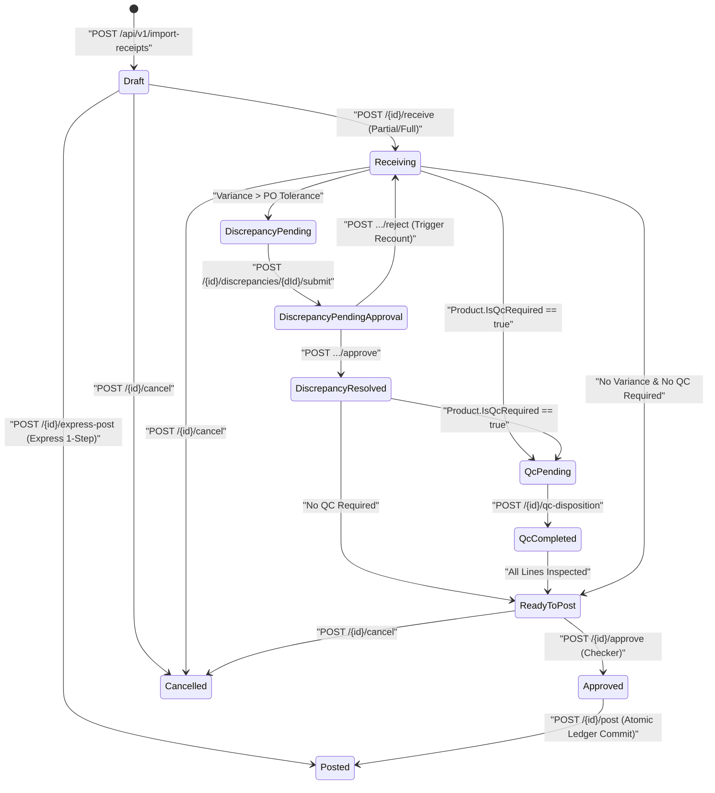

### (9) Inputs & Outputs
- **Inputs:** `WarehouseId`, `SupplierId`, optional `PurchaseOrderId`/`AsnId`, Lines (`ProductId`, `TransactionUomId`, `TransactionQty`, `UnitCost`, `TargetLocationId`, `Identities[]` with `LotNumber`, `ManufactureDate`, `ExpiryDate`, `SerialNumber`, `TargetStatus`).
- **Outputs:** Posted `ImportReceiptDto`, generated `InventoryTransaction` IDs, updated `MovingAverageCost` per SKU, auto-created `PutawayTaskDto` (if staged into `Receiving` bin), `PartnerDebtInvoice` (`AP`).

### (10) Validation & Guard Rules
- `SUM(ImportReceiptInventoryIdentities.BaseQuantity) == ImportReceiptDetail.AcceptedBaseQuantity` per line (`422 RECEIPT_IDENTITY_QUANTITY_MISMATCH`).
- If `Product.TrackingType == Lot`, `LotNumber` and `ExpiryDate` (when `IsExpiryControlled == true` and `ExpiryDate > UtcNow`) are mandatory (`422 LOT_EXPIRY_REQUIRED`).
- If `Product.TrackingType == Serial`, each unit must have a unique `SerialNumber` (`BaseQuantity == 1` per identity row; `409 SERIAL_ALREADY_EXISTS`).
- Cannot `Post` if any line has `QcState == QcPending` or any discrepancy is unresolved (`422 RECEIPT_GATES_NOT_CLEARED`).

### (11) Authorization & SoD (`<resource>.<action>` + Maker/Checker/Poster)
- **Permissions:** `purchase_order.create`, `purchase_order.release`, `asn.create`, `asn.receive`, `dock_appointment.manage`, `receipt.create`, `receipt.receive`, `quality_inspection.execute`, `receiving_discrepancy.approve`, `receipt.approve`, `receipt.post`, `receipt.cancel`, `inventory.cost.read`.
- **Segregation of Duties (SoD):** In `FULL` mode (or when receipt total > configurable SoD threshold), `ApprovedBy != CreatedBy` (`422 SOD_SELF_APPROVAL_FORBIDDEN`).

### (12) Stock & Balance Effects (Exact 6-Bucket Impact)
- **During `Draft` / `Receiving` / `QcPending` / `Approved`:** Zero impact on `InventoryStocks` (`OnHand = +0`).
- **Upon `Post` (`Posted`):**
  - Target 9-Dimension Bucket (`Status = Available | Quarantine | Damaged`):
    - `OnHand`: $+\text{AcceptedBaseQty}$
    - `SoftReserved`: $+0$
    - `HardAllocated`: $+0$
    - `PickedPendingDispatch`: $+0$
    - `Locked`: $+0$
    - `AvailableToReserve`: $+\text{AcceptedBaseQty}$ (only if `Status == InventoryStatus.Available` and location `IsPickable == true`; if posted into a non-pickable `Receiving` staging bin, `OnHand` increases by $+\text{AcceptedBaseQty}$ in the `Receiving` bin and becomes pickable once Putaway moves it to a `Storage` bin).
  - **MAC Recalculation:**
    $$\text{NewMAC} = \frac{(\text{OldTotalWarehouseOnHand} \times \text{OldMAC}) + (\text{AcceptedBaseQty} \times \text{BaseUnitCost})}{\text{OldTotalWarehouseOnHand} + \text{AcceptedBaseQty}}$$

### (13) Atomic Transaction Boundaries (6-Part Commit)
Inside `UnitOfWork.BeginTransactionAsync(IsolationLevel.ReadCommitted)` on `POST /api/v1/import-receipts/{id}/post`:
1. **Document:** `ImportReceipt.Status = ReceiptStatus.Posted`, update linked `PurchaseOrder` (`PartiallyReceived` / `Received`) and `Asn` (`Completed`).
2. **Ledger:** Append `InventoryTransactions` (`TransactionType.Import`, `+BaseQty`, `UnitCost`, `ReferenceType = "ImportReceipt"`, `ReferenceId = receipt.Id`).
3. **Balance:** Upsert 9-dimension `InventoryStocks` (`Quantity += BaseQty`, `MovingAverageCost = NewMAC`, recompute `GrainHash`).
4. **Downstream Tasks / Reservations:** Auto-create `PutawayTask` (if `LocationType == Receiving`) + upsert `PartnerDebtInvoice` (`AP`).
5. **Audit:** Insert `AuditLogs` (`Action = "ImportReceipt.Post"`, `BeforeStateJson`, `AfterStateJson`, `CorrelationId`).
6. **Outbox:** Insert `OutboxMessages` (`ImportReceiptPostedIntegrationEvent` for MISA accounting sync & 3PL billing).

### (14) Idempotency & Concurrency
- Mandatory `Idempotency-Key` header via `[IdempotentCommand("ImportReceipt.Post")]` persisted in `IdempotencyRecords`.
- Optimistic concurrency via `ImportReceipt.RowVersion` (`rowversion`); returns `409 CONCURRENCY_CONFLICT` on mismatch.
- Pessimistic 2-tier lock: `sp_getapplock` on `(TenantId, WarehouseId, ProductId)` + `UPDLOCK, ROWLOCK, REPEATABLEREAD` on `InventoryStocks` ordered by `WarehouseId, ProductId, LocationId, LotId, GrainHash`.

### (15) Immutable Audit Trail
- Logs actor, timestamp, correlation ID, PO/ASN reference, observed vs expected quantities, QC inspector disposition, and before/after MAC values.

### (16) UI Screens & Scanner Mode
- Decompose `ImportReceipts.tsx` into 3 focused sub-views (< 450 lines each): `ImportReceiptList.tsx`, `ReceivingScannerWorkbench.tsx` (supports GS1-128 single-scan parsing `(01)GTIN(10)LOT(17)EXP` + audio/haptic feedback), and `InboundQcDiscrepancyDrawer.tsx`.

### (17) REST `/api/v1` Operations
- `GET /api/v1/import-receipts` (paginated `pageNumber`, `pageSize <= 100`)
- `POST /api/v1/import-receipts`
- `POST /api/v1/import-receipts/{id}/receive`
- `POST /api/v1/import-receipts/{id}/inventory-identities`
- `POST /api/v1/import-receipts/{id}/qc-disposition`
- `POST /api/v1/import-receipts/{id}/discrepancies/{discrepancyId}/approve`
- `POST /api/v1/import-receipts/{id}/approve`
- `POST /api/v1/import-receipts/{id}/post`
- `POST /api/v1/import-receipts/{id}/express-post`
- `POST /api/v1/import-receipts/{id}/cancel` (standardized from `PUT` to `POST`)

### (18) Reports & Alerts
- Overdue PO Alert (`ExpectedDate < Today`), Dock Dwell SLA Alert (`> 60 mins` warning, `> 120 mins` overdue), Supplier Discrepancy Rate Report, and MAC Valuation Preview Report.

### (19) Testable Acceptance Criteria
- **AC-1.1 (Happy Path + MAC):** Posting an `ImportReceipt` of `100` units at `120,000 VND` when existing stock is `100` units at `100,000 VND` updates `InventoryStocks.Quantity` to `200`, `MovingAverageCost` to `110,000 VND`, writes 1 `InventoryTransaction(Import)`, and creates 1 `AP` invoice in a single transaction.
- **AC-1.2 (Idempotency):** Replaying `POST /api/v1/import-receipts/{id}/post` with the same `Idempotency-Key` returns `200 OK` without duplicating ledger rows or doubling `OnHand`.
- **AC-1.3 (Concurrency):** Two concurrent receipt posts for the same SKU/Bin serialize via ordered row locks without Deadlock `1205` or lost MAC updates.
- **AC-1.4 (Cost RBAC):** Calling `GET /api/v1/import-receipts/{id}/mac-preview` without `inventory.cost.read` returns `403 COST_READ_FORBIDDEN`.

---

## Process 2: Directed Putaway & Putback

### (1) Business Objective
Eliminate misplaced inventory and dead travel by guiding warehouse staff from the receiving dock (or outbound cancel-putback staging) to the optimal storage bin using a deterministic 5-factor scoring engine and double-scan verification (Scan Item/LPN → Scan Target Bin).

### (2) Actors & Roles
- **Warehouse Supervisor:** Monitors putaway SLA queue, assigns tasks, resolves bin capacity exceptions (`putaway.assign`, `putaway.cancel`).
- **Putaway Operator:** Executes scan-confirmed putaway or cross-dock moves on mobile PDA (`putaway.read`, `putaway.execute`).

### (3) Trigger Events
- `ImportReceipt` posted into a `Receiving` location (`RCV-01`).
- Outbound `SalesOrder` or `ExportReceipt` cancelled after picking (`CancelPendingPutback`), generating a Putback task from `STAGING` back to `Storage`.

### (4) Preconditions
- `PutawayTask` exists in `Open`, `Assigned`, or `InProgress` state.
- Source bin (`FromLocationId`) has sufficient unallocated `OnHand` stock for the task's 9-dimension grain.
- Target bin (`ToLocationId`) is active, `LocationType == Storage`, has no active `CountFreeze` or `MaintenanceFreeze` lock, and has sufficient remaining weight (`MaxWeightKg`), volume (`MaxVolumeM3`), and pallet capacity.

### (5) Main Success Path (with Mermaid Flowchart)

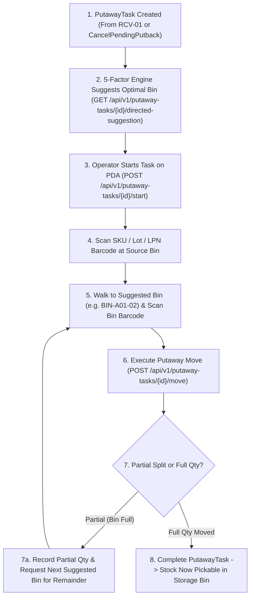

### (6) Alternative Paths (`Express` vs `Full` / `Cross-Dock` / `1-Scan LPN`)
- **Express Mode Bypass:** When Process 1 uses `express-post` directly into a `Storage` bin, Process 2 is bypassed automatically (`0` extra clicks).
- **Opportunistic Cross-Dock (`POST /{id}/cross-dock`):** If an open `Backorder` or high-priority `SalesOrder` is waiting for the incoming SKU, the engine prompts the operator to move goods directly from `RCV-01` to `STAGE-OUT-01`, fulfilling the outbound demand without shelving.
- **1-Scan LPN Pallet Putaway:** Scanning a pallet `HandlingUnitCode` moves all nested multi-SKU/multi-lot buckets on that pallet into the target rack location in one atomic operation.

### (7) Exception Scenarios & Recovery
- **Suggested Bin Physically Full or Blocked:** Operator taps "Báo lỗi vị trí" (`POST /{id}/exception` with reason `BIN_FULL_PHYSICAL` or `BIN_DAMAGED`). The system marks the bin for inspection, recalculates the next best candidate bin from `GET /{id}/items/{itemId}/destinations`, and resumes (`POST /{id}/resume`).
- **Wrong Bin Scanned (`PUTAWAY_WRONG_BIN`) or Wrong Product Scanned (`PUTAWAY_WRONG_PRODUCT`):** Server returns `422` with audio/vibration alert on PDA; operator can either scan the recommended bin or provide a supervisor override reason if an alternate valid `Storage` bin is used.

### (8) Canonical State Machine (`stateDiagram-v2`)

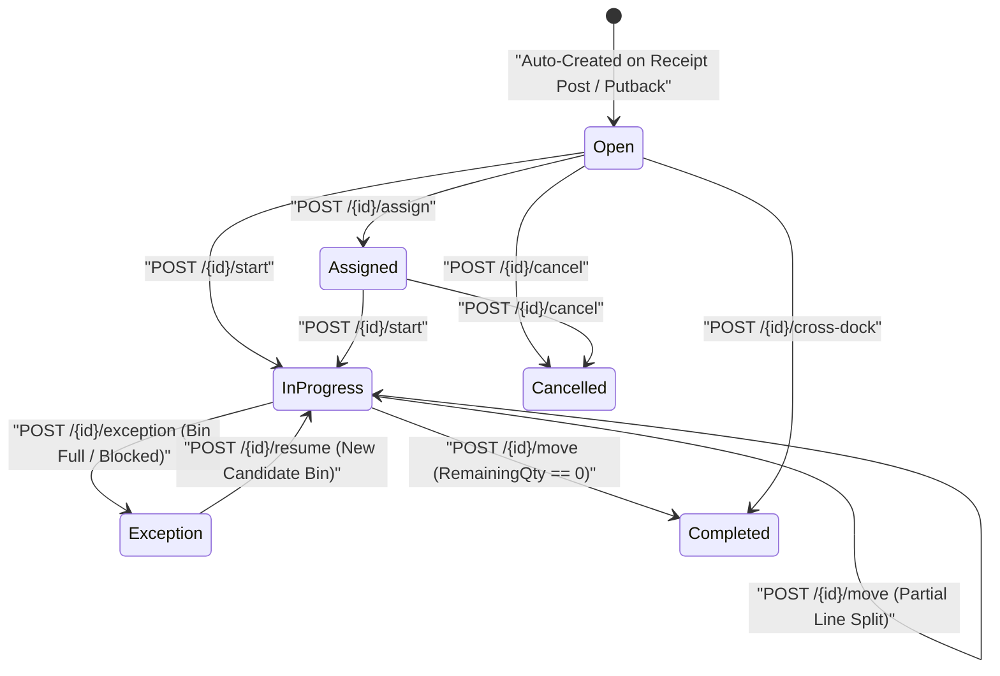

### (9) Inputs & Outputs
- **Inputs:** `PutawayTaskId`, `PutawayTaskItemId`, `ScannedProductBarcode`, `ScannedDestinationBinCode`, `MovedBaseQuantity`, optional `OverrideReasonCode`.
- **Outputs:** Updated `PutawayTaskDto`, paired `InventoryTransactions` (`Move`: `-MovedBaseQuantity` from `RCV-01`, `+MovedBaseQuantity` at `BIN-A01-02`), updated destination bin capacity utilization.

### (10) Validation & Guard Rules
- **3 Hard Constraints:** (1) `DestinationLocation.IsActive == true`, (2) Zero active `CountFreeze` or `MaintenanceFreeze` locks on destination bin (`409 BIN_LOCKED_BY_STOCKTAKE`), (3) `CurrentWeight + IncomingWeight <= MaxWeightKg` and `CurrentVolume + IncomingVolume <= MaxVolumeM3` (`422 BIN_CAPACITY_EXCEEDED`).
- `MovedBaseQuantity <= (RequiredBaseQuantity - AlreadyMovedBaseQuantity)` (`422 PUTAWAY_QTY_EXCEEDS_REMAINING`).

### (11) Authorization & SoD
- **Permissions:** `putaway.read`, `putaway.assign`, `putaway.execute`, `putaway.cancel`, `location.read`.
- Floor operators (`WarehouseStaff`) can execute `start`, `move`, `exception`, `resume`; only `Manager`/`Admin` (`putaway.cancel`) can cancel an open putaway task.

### (12) Stock & Balance Effects (Exact 6-Bucket Impact)
- **Source Bucket (`Location = RCV-01` or `STAGE-CANCEL`):**
  - `OnHand`: $-\text{MovedBaseQty}$
  - `AvailableToReserve`: $+0$ (since `RCV-01` is non-pickable)
- **Destination Bucket (`Location = BIN-A01-02`, `IsPickable = true`, `Status = Available`):**
  - `OnHand`: $+\text{MovedBaseQty}$
  - `SoftReserved`: $+0$, `HardAllocated`: $+0$, `PickedPendingDispatch`: $+0$, `Locked`: $+0$
  - `AvailableToReserve`: $+\text{MovedBaseQty}$ (stock is now available for FEFO outbound allocation).

### (13) Atomic Transaction Boundaries (6-Part Commit)
1. **Document:** Update `PutawayTaskItem.MovedBaseQuantity` and `PutawayTask.Status` (`InProgress` or `Completed`). If triggered by `CancelPendingPutback`, transition linked `SalesOrder`/`ExportReceipt` to `Cancelled`.
2. **Ledger:** Append 2 paired `InventoryTransactions` (`TransactionType.Move`, source `-Qty`, destination `+Qty`, referencing `PutawayTask.Id`).
3. **Balance:** Decrement source `InventoryStocks` row and increment/insert destination 9-dim `InventoryStocks` row.
4. **Reservation/Allocation:** If `CrossDock`, auto-create `StockAllocation` for waiting `Backorder`/`SalesOrder`.
5. **Audit:** Insert `AuditLogs` (`Putaway.Move` with suggested vs actual bin telemetry).
6. **Outbox:** Insert `OutboxMessages` (`PutawayCompletedIntegrationEvent` — triggers marketplace stock sync if `AvailableToReserve` increased).

### (14) Idempotency & Concurrency
- `[IdempotentCommand("Putaway.Move")]` with `Idempotency-Key`.
- Optimistic concurrency on `PutawayTask.RowVersion` and `InventoryStocks.RowVersion`.
- 2-tier lock: `sp_getapplock` + ordered `UPDLOCK, ROWLOCK, REPEATABLEREAD` on both source and destination `InventoryStocks` sorted by `LocationId` ascending to prevent AB-BA deadlocks when two operators move between the same bins.

### (15) Immutable Audit Trail
- Records suggested bin vs actual scanned bin, override reason code (if operator bypassed suggested bin), operator user ID, and elapsed putaway duration.

### (16) UI Screens & Scanner Mode
- [`PutawayTasks.tsx`](file:///d:/ERP_KHO/frontend/src/pages/PutawayTasks.tsx) (`/putaway-tasks`) with dedicated Mobile PDA Scan Mode (large 48px tap targets, auto-focus barcode input, green flash on bin match, red buzz on `PUTAWAY_WRONG_BIN`).
- Move location master CRUD out of `PutawayTasksController` into a dedicated `WarehouseLocationsController`.

### (17) REST `/api/v1` Operations
- `GET /api/v1/putaway-tasks`
- `GET /api/v1/putaway-tasks/{id}`
- `GET /api/v1/putaway-tasks/{id}/directed-suggestion`
- `POST /api/v1/putaway-tasks/{id}/assign`
- `POST /api/v1/putaway-tasks/{id}/start`
- `POST /api/v1/putaway-tasks/{id}/move`
- `POST /api/v1/putaway-tasks/{id}/cross-dock`
- `POST /api/v1/putaway-tasks/{id}/exception`
- `POST /api/v1/putaway-tasks/{id}/resume`
- `POST /api/v1/putaway-tasks/{id}/cancel`

### (18) Reports & Alerts
- Dock-to-Stock SLA Aging Alert (tasks open `> 4 hours`), Directed Bin Compliance Rate (`%` of moves matching primary suggested bin), and ABC-XYZ Slotting Interleaving Recommendations.

### (19) Testable Acceptance Criteria
- **AC-2.1 (Directed Suggestion):** `GET /api/v1/putaway-tasks/{id}/directed-suggestion` excludes bins with active `CountFreeze` locks or exceeded weight/volume capacity and ranks same-SKU/FEFO bins first.
- **AC-2.2 (Double-Scan Guard):** Calling `POST /{id}/move` with a bin barcode belonging to another warehouse or an inactive bin returns `422 PUTAWAY_WRONG_BIN` and leaves `InventoryStocks` unchanged.
- **AC-2.3 (Partial Line Split):** Moving `40` of `100` units updates `MovedBaseQuantity = 40`, keeps task `InProgress`, moves `40` units in `InventoryStocks`, and allows the remaining `60` units to be moved to a second bin.

---

## Process 3: Outbound Order & Express `ExportReceipt` Flow (`1-Step & 2-Step Express Fulfillment`)

### (1) Business Objective
Provide a fast, zero-ceremony outbound fulfillment path for small teams (`5–10` staff in `EXPRESS` mode) and direct B2B counter sales—supporting **1-Step Immediate Dispatch** (`Create -> ApproveAndDispatch`) and **2-Step Reserve & Dispatch** (`Create -> ApproveAndReserve -> Print AWB -> Dispatch`) with strict single-deduction guarantees.

### (2) Actors & Roles
- **Sales / Order Clerk (Maker):** Creates `ExportReceipt`, links customer or marketplace order (`export_receipt.create`, `export_receipt.update`).
- **Warehouse Supervisor (Checker):** Approves receipt and locks reservation (`export_receipt.approve`, `export_receipt.cancel`).
- **Dispatch / Packing Clerk (Poster):** Prints 100×150mm AWB thermal labels and confirms dispatch (`export_receipt.dispatch`, `export_receipt.reprint_awb`).

### (3) Trigger Events
- Direct B2B wholesale order, walk-in counter order, or Shopee/TikTok order processed in `EXPRESS` mode.

### (4) Preconditions
- Tenant subscription quota is `< 115%` (`EvaluateQuotaTier() != "READ_ONLY_OVER_115"`).
- Sufficient `AvailableToReserve` stock exists across pickable `Available` buckets in the target warehouse.
- Customer credit limit (for B2B `AR` customers) is not exceeded.

### (5) Main Success Path (with Mermaid Flowchart)

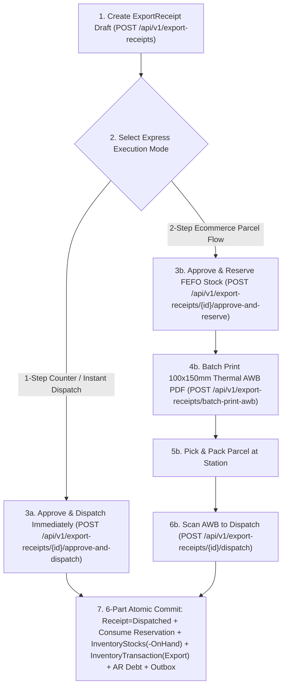

### (6) Alternative Paths (`1-Step Instant` vs `2-Step Reserve-Then-Dispatch`)
- **1-Step Instant Dispatch (`POST /{id}/approve-and-dispatch`):** Atomically validates stock, selects FEFO buckets, deducts `OnHand`, writes `InventoryTransaction(Export)`, and transitions `Draft -> Dispatched` in one click. Ideal for B2B truck pickup at the counter.
- **2-Step Reserve-Then-Dispatch (`POST /{id}/approve-and-reserve` → `POST /{id}/dispatch`):** Step 1 transitions `Draft -> Approved` and creates a `StockReservation` (incrementing `ReservedQuantity` so marketplace channels cannot oversell). Step 2 consumes the reservation and deducts `OnHand` when the parcel is handed over.

### (7) Exception Scenarios & Recovery
- **Buyer Cancels on Shopee/TikTok Before Dispatch:**
  - If status is `Approved` (not yet physically pulled from shelf): `POST /{id}/cancel` immediately releases `StockReservation` (`SoftReserved` decremented, `AvailableToReserve` restored) and transitions to `Cancelled`.
  - If parcel was already picked/staged: transitions to `CancelPendingPutback`, blocks AWB handover scan (`409 ORDER_CANCELLED_BY_BUYER`), and requires `POST /api/v1/sales-orders/{soId}/confirm-cancel-putback` to verify items are returned to bin before finalizing `Cancelled`.
- **AWB Label Damaged / Reprint Requested:** First print (`AwbPrintCount == 0`) succeeds with `export_receipt.read`; any reprint (`AwbPrintCount >= 1`) requires `export_receipt.reprint_awb` permission and a mandatory `ReprintReason` (`403 REPRINT_PERMISSION_REQUIRED` / `400 REPRINT_REASON_REQUIRED`) to prevent duplicate shipment fraud.

### (8) Canonical State Machine (`stateDiagram-v2`)

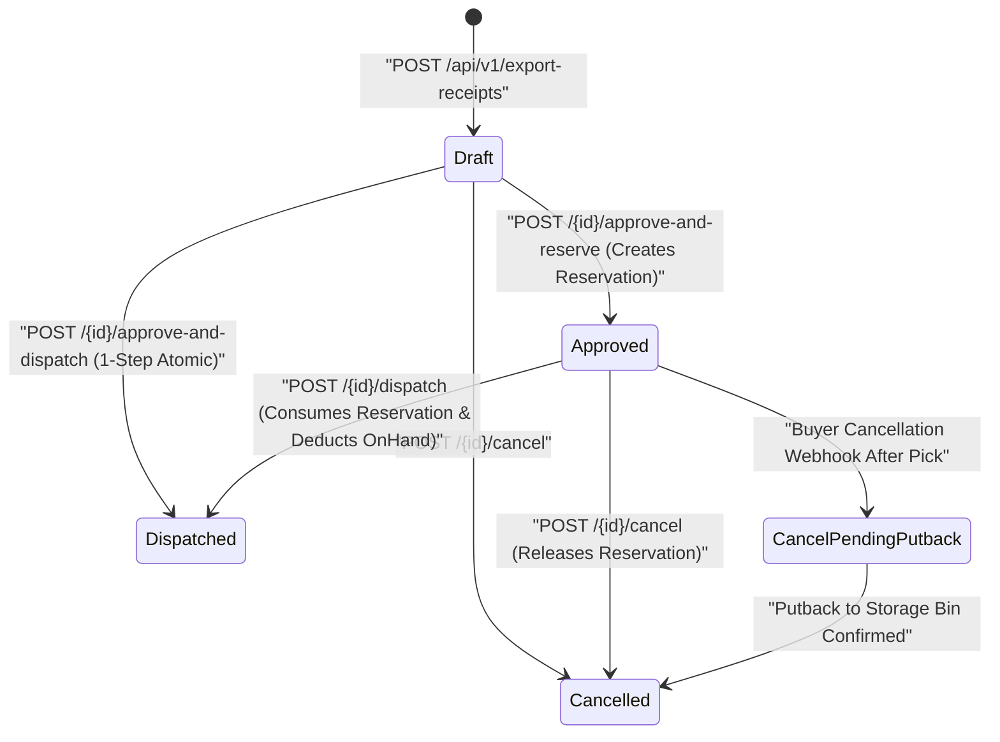

### (9) Inputs & Outputs
- **Inputs:** `WarehouseId`, `CustomerId`, optional `SalesOrderId`, `MarketplaceOrderId`, `CarrierCode`, `TrackingNumber`, `MarketplaceShipByUtc`, `DispatchMode`, `Lines[]` (`ProductId`, `LocationId`, `LotId`, `Quantity`, `UnitPrice`).
- **Outputs:** `ExportReceiptDto`, `StockReservation` records, `%PDF-1.4` 100×150mm AWB thermal stream, `InventoryTransactions` (`Export`), `ShipmentFinancialLedger` (`ExpectedCodAmount`), `PartnerDebtInvoice` (`AR`).

### (10) Validation & Guard Rules
- Consolidate `/approve` and `/approve-and-reserve` so that **every** `Approved` `ExportReceipt` is guaranteed to hold an active `StockReservation` (`INV_INSUFFICIENT_AVAILABLE_STOCK` `422` if `AvailableToReserve < RequestedBaseQty`).
- Single-deduction guard: An `ExportReceipt` that is already linked to a dispatched `Shipment` cannot deduct stock a second time (`409 ALREADY_DISPATCHED`).
- SaaS order quota (`CurrentMonthOrderCount`) is incremented upon **Approval/Release**, or refunded if a `Draft` is cancelled before dispatch.

### (11) Authorization & SoD
- **Permissions:** `export_receipt.read`, `export_receipt.create`, `export_receipt.update`, `export_receipt.approve`, `export_receipt.dispatch`, `export_receipt.cancel`, `export_receipt.reprint_awb`.
- **SoD:** Checker approving high-value B2B export receipts must differ from Maker (`ApprovedBy != CreatedBy`), whereas small e-commerce orders in `EXPRESS` mode allow combined execution by authorized fulfillment staff.

### (12) Stock & Balance Effects (Exact 6-Bucket Impact)
- **On `ApproveAndReserve` (`Draft -> Approved`):**
  - `OnHand`: $+0$
  - `SoftReserved`: $+\text{BaseQty}$
  - `AvailableToReserve`: $-\text{BaseQty}$
- **On `Dispatch` (`Approved -> Dispatched`):**
  - `OnHand`: $-\text{BaseQty}$
  - `SoftReserved`: $-\text{BaseQty}$
  - `AvailableToReserve`: $+0$ (already reduced at reservation time)
- **On `Cancel` from `Approved` (`Approved -> Cancelled`):**
  - `OnHand`: $+0$
  - `SoftReserved`: $-\text{BaseQty}$
  - `AvailableToReserve`: $+\text{BaseQty}$

### (13) Atomic Transaction Boundaries (6-Part Commit)
1. **Document:** `ExportReceipt.Status = ReceiptStatus.Dispatched`, `DispatchedBy`, `DispatchedAt`.
2. **Ledger:** Append `InventoryTransactions` (`TransactionType.Export`, `-BaseQty`, `UnitCost = CurrentMAC`, `ReferenceType = "ExportReceipt"`).
3. **Balance:** Decrement `InventoryStocks.Quantity` and `InventoryStocks.ReservedQuantity`.
4. **Reservation:** Transition `StockReservation.Status = Consumed` (`RemainingQuantity = 0`).
5. **Audit:** Insert `AuditLogs` (`ExportReceipt.Dispatch`).
6. **Outbox:** Insert `OutboxMessages` (`ExportReceiptDispatchedEvent` → creates `PartnerDebtInvoice(AR)` / `ShipmentFinancialLedger` and triggers marketplace stock sync).

### (14) Idempotency & Concurrency
- `[IdempotentCommand("ExportReceipt.ApproveAndReserve")]` and `[IdempotentCommand("ExportReceipt.Dispatch")]` with `Idempotency-Key`.
- Optimistic concurrency via `ExportReceipt.RowVersion` and `InventoryStocks.RowVersion`.
- 2-tier lock: `sp_getapplock` + ordered `UPDLOCK, ROWLOCK, REPEATABLEREAD` on candidate `InventoryStocks` rows sorted by `WarehouseId, ProductId, LocationId, LotId`.

### (15) Immutable Audit Trail
- Captures AWB print count, reprint actor and reason, reservation consumption IDs, COGS snapshot (`MovingAverageCost` at dispatch), and dispatch cutoff compliance.

### (16) UI Screens & Scanner Mode
- [`ExportReceipts.tsx`](file:///d:/ERP_KHO/frontend/src/pages/ExportReceipts.tsx) (`/export-receipts`) with SLA Countdown Badges (`Overdue`, `At Risk < 2h`, `Due Today`) and 1-scan AWB dispatch bar.
- Remove MISA export and Opening Balance endpoints from `ExportReceiptsController` (relocated to `FinanceController` and `DataImportsController`).

### (17) REST `/api/v1` Operations
- `GET /api/v1/export-receipts`
- `GET /api/v1/export-receipts/sla-queue`
- `POST /api/v1/export-receipts`
- `POST /api/v1/export-receipts/{id}/approve-and-reserve`
- `POST /api/v1/export-receipts/{id}/approve-and-dispatch`
- `POST /api/v1/export-receipts/{id}/dispatch`
- `POST /api/v1/export-receipts/{id}/cancel`
- `POST /api/v1/export-receipts/batch-print-awb`

### (18) Reports & Alerts
- Marketplace Ship-By SLA Countdown Queue (`< 2 hours` warning), Outbound Cutoff (`22:00`) Compliance Report, and AWB Reprint Audit Log.

### (19) Testable Acceptance Criteria
- **AC-3.1 (2-Step Reserve & Dispatch):** `ApproveAndReserve` for `10` units increases `ReservedQuantity` by `10` and reduces `AvailableToReserve` by `10` (`OnHand` unchanged). Subsequent `Dispatch` reduces both `OnHand` and `ReservedQuantity` by `10` and writes 1 `InventoryTransaction(Export)`.
- **AC-3.2 (AWB Reprint Guard):** Calling `POST /batch-print-awb` a second time for the same receipt without `ReprintReason` or `export_receipt.reprint_awb` returns `400`/`403`.
- **AC-3.3 (Concurrent Oversell Prevention):** Two concurrent `ApproveAndReserve` requests for `8` units each when `OnHand = 10` result in one `200 OK` and one `422 INV_INSUFFICIENT_AVAILABLE_STOCK`.

---

## Process 4: Full Outbound Warehouse Execution (`SO → Reservation → Allocation → Wave/Picking → Packing/HU → Shipment → Handover Manifest`)

### (1) Business Objective
Deliver high-throughput, error-proof multi-stage fulfillment for structured warehouses (`15–30` staff in `FULL` mode)—automating the transition from `SalesOrder` release through FEFO bin allocation, cluster/wave picking, Put-to-Wall sortation, video-verified packing, and AWB handover manifest sealing without requiring 7 manual screen hops.

### (2) Actors & Roles
- **OMS / Customer Service Clerk:** Manages `SalesOrder`, `Backorder`, marketplace sync, and promotional gift rules (`sales_order.*`, `backorder.*`).
- **Wave Planner / Supervisor:** Releases picking waves, resolves short-picks (`allocation.*`, `picking.assign`).
- **Warehouse Picker:** Executes barcode-verified single/cluster wave picking and Put-to-Wall sorting on PDA (`picking.execute`).
- **Packing Operator:** Scans picked items into `HandlingUnit` cartons, records packing video SHA256, prints AWB (`packing.execute`, `handling_unit.create`).
- **Shipping / Handover Clerk:** Scans AWB parcels into `HandoverManifest`, verifies zero buyer cancellations, captures driver plate/signature, and seals manifest (`shipment.dispatch`, `handover_manifest.seal`).

### (3) Trigger Events
- Order ingested via Shopee/TikTok/Lazada webhook/OAuth sync, Excel batch import, or B2B Sales Order creation.
- Scheduled wave cutoff window reached (e.g., `11:00`, `15:00`, `18:00` carrier pickup cutoffs).

### (4) Preconditions
- `SalesOrder` is validated, promotional gift rules (`PromotionGiftRule`) evaluated, and order is not on credit/fraud `Hold`.
- Pickable `Storage` bins contain `Available` stock with valid non-expired FEFO lots (`ExpiryDate > UtcNow + MinShelfLifeDays`).

### (5) Main Success Path (with Mermaid Flowchart)

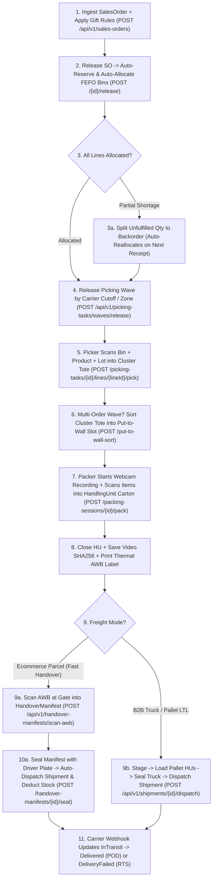

### (6) Alternative Paths (`Parcel Fast-Track` vs `B2B Pallet Loading`)
- **TO-BE Streamlined Auto-Chaining:** Releasing a `SalesOrder` (`POST /api/v1/sales-orders/{id}/release`) with `AutoAllocate = true` automatically creates the `StockReservation` AND runs FEFO `AutoAllocate` in a single transaction, eliminating 2 manual screen hops (`/stock-reservations` and `/stock-allocations`).
- **Parcel Fast-Track Handover:** For parcel carriers (GHN, GHTK, SPX, J&T, ViettelPost), closing the `HandlingUnit` in `PackingSessions` automatically marks the parcel `Staged`. Scanning the AWB into `HandoverManifest` and sealing the manifest automatically transitions the linked `Shipment`/`ExportReceipt` to `Dispatched` and deducts inventory, skipping the 4 manual truck-loading calls (`stage -> start-loading -> load-hu -> complete-loading`).
- **B2B Pallet LTL/FTL Loading:** Retains explicit `Stage -> StartLoading -> LoadHu -> CompleteLoading -> Dispatch` for multi-pallet truckloads requiring dock door and container seal verification.

### (7) Exception Scenarios & Recovery
- **Short-Pick at Bin (`POST /picking-tasks/{id}/lines/{lineId}/short-pick`):**
  - Picker scans bin but physical stock is missing/damaged. System locks the suspect bin (`InvestigationHold`), queries `GET /picking-tasks/{id}/alternate-bins`, and re-allocates the remaining quantity to the next FEFO bin (`ShortPickResolutionType.AlternativeLocation`). If no alternate bin has stock, converts the unpicked remainder into a `Backorder`.
- **Mid-Flight Buyer Cancellation Webhook (`POST /api/v1/integrations/webhooks/{channelCode}/buyer-cancel`):**
  - **Before Pick (`Status == Released/Allocated`):** Immediately releases allocation/reservation and cancels order (`Decision = ACCEPT`).
  - **After Pick / During Pack (`PickedPendingDispatch`):** Transitions order to `CancelPendingPutback`, blocks `HandoverManifest.ScanAwb` with loud error (`409 ORDER_CANCELLED_HOLD_PARCEL`), and creates a Putback task to return stock to a `Storage` bin.
  - **After Carrier Handover (`Status == Dispatched`):** Rejects cancellation webhook (`Decision = REJECT_ALREADY_SHIPPED`).
- **Failed Last-Mile Delivery / RTS (`DeliveryFailed -> ReturnToWarehouse`):**
  - After 3 failed carrier delivery attempts, carrier webhook transitions `Shipment` to `ReturnToWarehouse`. When the RTS parcel arrives back at the dock, `POST /api/v1/shipments/{id}/complete-rts-return` routes items into `CustomerReturn` (`Quarantine` or `Available`) and reverses the pending COD receivable.

### (8) Canonical State Machine (`stateDiagram-v2`)

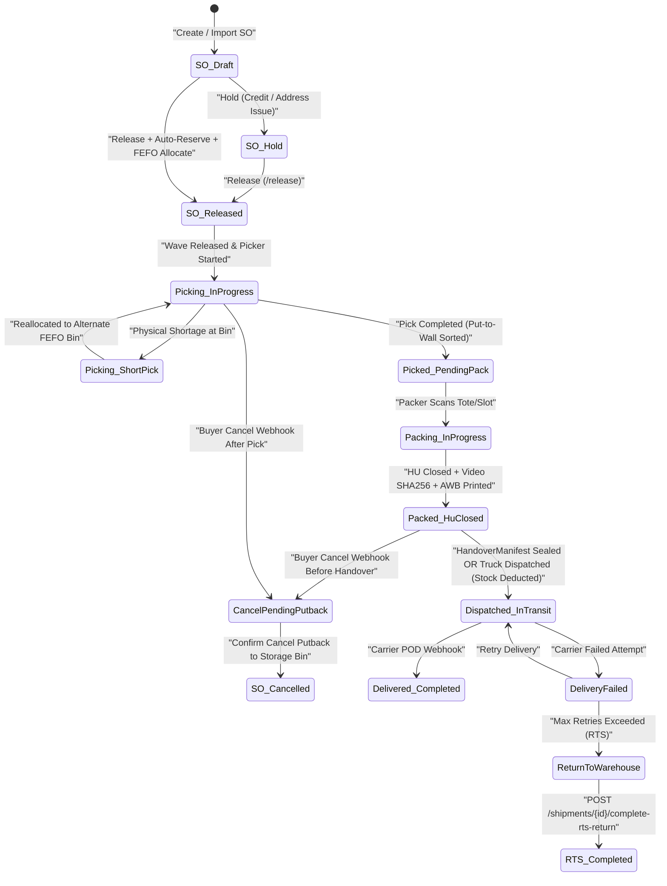

### (9) Inputs & Outputs
- **Inputs:** `SalesOrder` payload, Wave release filter (`CarrierCutoffWindow`, `ZoneCode`, `MaxOrdersPerClusterTote`), Barcode scans (`LocationBarcode`, `ProductBarcode`, `LotNumber`, `ToteBarcode`, `SlotCode`, `HuCode`, `AwbTrackingNumber`), Packing video stream (`IFormFile` + `VideoHashSha256`), Driver plate/name.
- **Outputs:** `SalesOrderDto`, `StockReservationDto`, `StockAllocationDto`, `PickingWaveDto`, `PickingTaskDto`, `PackingSessionDto`, `HandlingUnitDto` (SSCC-18), `ShipmentDto`, sealed `HandoverManifestDto`, `InventoryTransactions` (`Ship`).

### (10) Validation & Guard Rules
- **FEFO Strict Enforcement:** `VerifyFefoCompliance` blocks allocating a newer lot if an older non-expired lot in an unlocked pickable bin is available, unless supervisor override reason is provided.
- **Triple-Scan Pick Verification:** Picker must scan `LocationCode` → `ProductBarcode` → `LotNumber` (`422 PICK_WRONG_LOCATION`, `PICK_WRONG_PRODUCT`, `PICK_WRONG_LOT`).
- **Pack Quantity Guard:** `PackedQty <= PickedQty` (`422 PACK_QUANTITY_EXCEEDS_PICKED`); `HandlingUnit` circular nesting blocked (`422 HU_CIRCULAR_NESTING`).
- **Handover Manifest Guard:** Scanning an AWB whose `SalesOrder`/`ExportReceipt` is `Cancelled` or `CancelPendingPutback` is hard-blocked (`409 MANIFEST_SCAN_CANCELLED_ORDER`). Sealing a manifest requires non-empty `VehiclePlate` and `DriverName` (`409 HANDOVER_VEHICLE_DRIVER_REQUIRED`).

### (11) Authorization & SoD
- **Permissions:** `sales_order.create`, `sales_order.release`, `sales_order.cancel`, `backorder.manage`, `allocation.create`, `allocation.reallocate`, `picking.assign`, `picking.execute`, `packing.execute`, `handling_unit.create`, `shipment.load`, `shipment.dispatch`, `shipment.confirm_delivery`.

### (12) Stock & Balance Effects (Exact 6-Bucket Impact)
1. **SO Release (`SoftReservation` Created):** `SoftReserved` $+\text{Qty}$, `AvailableToReserve` $-\text{Qty}$.
2. **FEFO Allocation (`StockAllocation` Created at Bin/Lot):** `SoftReserved` $-\text{Qty}$, `HardAllocated` $+\text{Qty}$ (`AvailableToReserve` unchanged).
3. **Pick Confirmation (`PickingTaskLine` Picked):** `HardAllocated` $-\text{Qty}$, `PickedPendingDispatch` $+\text{Qty}$ (or moved to `STAGING` bin bucket).
4. **Manifest Seal / Shipment Dispatch:** `OnHand` $-\text{Qty}$, `PickedPendingDispatch` $-\text{Qty}$, append `InventoryTransaction(Ship)`.
5. **Cancel-Pending-Putback Confirmed:** `PickedPendingDispatch` $-\text{Qty}$, `AvailableToReserve` $+\text{Qty}$ in target `Storage` bin.

### (13) Atomic Transaction Boundaries (6-Part Commit)
At **Shipment Dispatch / Handover Manifest Seal**:
1. **Document:** `HandoverManifest.Status = "SEALED"`, `Shipment.Status = Dispatched`, `SalesOrder.Status = Fulfilled` (or `PartiallyFulfilled`).
2. **Ledger:** Append `InventoryTransactions` (`TransactionType.Ship`, `-BaseQty`, `UnitCost = MAC`, `ReferenceType = "Shipment"`).
3. **Balance:** Decrement `InventoryStocks.Quantity` and `AllocatedQuantity` across all picked 9-dim buckets.
4. **Reservation/Allocation:** Mark `StockAllocation.Status = Consumed` and `StockReservation.Status = Consumed`.
5. **Audit:** Insert `AuditLogs` (`Shipment.Dispatch` / `HandoverManifest.Seal` with driver plate & AWB count).
6. **Outbox:** Insert `OutboxMessages` (`ShipmentDispatchedIntegrationEvent` → carrier EDI/webhook, COD ledger creation, SaaS usage metering).

### (14) Idempotency & Concurrency
- All wave release, pick line, pack, load HU, scan AWB, seal manifest, and carrier webhook endpoints enforce `[IdempotentCommand]` + `Idempotency-Key` (and `X-Webhook-Event-Id` inbox deduplication for marketplace/carrier webhooks).
- 2-tier lock (`sp_getapplock` + ordered `UPDLOCK, ROWLOCK, REPEATABLEREAD` by `WarehouseId, ProductId, LocationId, LotId`) during FEFO allocation and dispatch deduction.

### (15) Immutable Audit Trail
- Full chain of custody: `SalesOrderId -> ReservationId -> AllocationId -> PickingTaskLineId (Picker + Timestamp) -> PackingSessionId (Packer + VideoHashSha256 + CameraStationId) -> HandlingUnitId (SSCC) -> ManifestId (DriverPlate + SealedAtUtc) -> InventoryTransactionId`.

### (16) UI Screens & Scanner Mode
- Add a unified **"Trung tâm Điều phối Xuất kho" (Outbound Fulfillment Bar)** on `OutboundDemand.tsx` / `PickingTasks.tsx` so supervisors can execute `Release Wave -> Print Pick List -> Put-to-Wall -> Pack -> Seal Manifest` smoothly.

### (17) REST `/api/v1` Operations
- `POST /api/v1/sales-orders/{id}/release`
- `POST /api/v1/stock-allocations/auto`
- `POST /api/v1/picking-tasks/waves/release`
- `POST /api/v1/picking-tasks/{id}/lines/{lineId}/pick`
- `POST /api/v1/picking-tasks/{id}/lines/{lineId}/short-pick`
- `POST /api/v1/picking-tasks/{id}/put-to-wall-sort`
- `POST /api/v1/packing-sessions/{id}/pack`
- `POST /api/v1/packing-sessions/{id}/video-evidence`
- `POST /api/v1/handover-manifests/scan-awb`
- `POST /api/v1/handover-manifests/{id}/seal`
- `POST /api/v1/shipments/{id}/dispatch`
- `POST /api/v1/shipments/{id}/complete-rts-return`

### (18) Reports & Alerts
- Marketplace SLA Breach Alert, Short-Pick Bin Anomaly Alert, Put-to-Wall Slot Utilization, Packing Video Evidence Lookup by AWB (for Shopee/TikTok buyer dispute claims), and Carrier Delivery SLA Summary.

### (19) Testable Acceptance Criteria
- **AC-4.1 (FEFO Allocation):** Given Lot A (`Expiry = +15 days`, `Qty = 5`) and Lot B (`Expiry = +90 days`, `Qty = 10`), `AutoAllocate` for `8` units allocates `5` from Lot A and `3` from Lot B.
- **AC-4.2 (Cancelled Order Gate Block):** If a Shopee buyer cancels after picking (`CancelPendingPutback`), scanning that AWB at `POST /api/v1/handover-manifests/scan-awb` returns `409` and prevents adding the parcel to the manifest.
- **AC-4.3 (Video Evidence Integrity):** Uploading a binary video stream to `POST /api/v1/packing-sessions/{id}/video-evidence` computes/verifies `VideoHashSha256` and links it to the `TrackingNumber` for 1-click retrieval.

---

## Process 5: Inventory Control (`9-Dimension Buckets, Status Change, Internal Movements, Locks`)

### (1) Business Objective
Maintain 100% real-time physical and logical accuracy across all **9 Inventory Dimensions** (`TenantId, WarehouseId, LocationId, ProductId, LotId, SerialId, HandlingUnitId, Status, OwnerId`) while enabling rapid internal bin-to-bin moves, 1-scan LPN pallet transfers, automated Reserve-to-PickFace break-bulk replenishment, strict 8-state quality/recall status transitions, and deterministic lock precedence.

### (2) Actors & Roles
- **Forklift / Replenishment Operator:** Executes bin-to-bin moves, 1-scan LPN pallet moves, and break-bulk replenishment (`inventory_movement.create`).
- **QA / Inventory Controller (Maker):** Initiates status changes (`Available <-> Quarantine/Damaged`), places/releases operational locks, triggers batch recall blocks (`inventory_status_change.create`, `inventory_lock.manage`).
- **Warehouse Manager (Checker):** Approves scrap/write-off dispositions (`Disposition = Scrap`) under Segregation of Duties.

### (3) Trigger Events
- Pick-face bin quantity drops below `MinPickFaceThresholdQty`, triggering auto break-bulk replenishment from a Reserve rack.
- Operator consolidates bins or moves a pallet LPN to a new aisle.
- QA discovers damaged/expired goods or receives a manufacturer batch recall notice.

### (4) Preconditions
- Source 9-dimension bucket exists with sufficient unallocated, unlocked quantity (`AvailableToReserve >= MoveOrChangeQty` for `Available` buckets, or `OnHand - Locked >= Qty` for non-available buckets).
- Neither source nor destination bin has a blocking higher-precedence lock (`RecallBlocked > QualityHold > CountFreeze > ManualOperationalLock`).

### (5) Main Success Path (with Mermaid Flowchart)

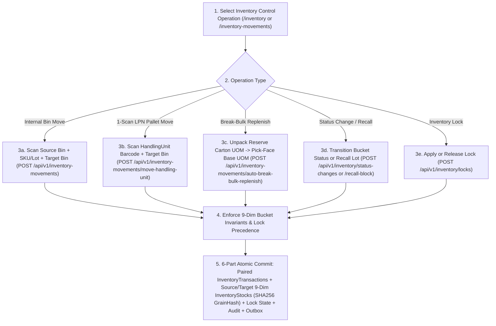

### (6) Alternative Paths (`Express` vs `Full`)
- **Express 1-Scan LPN Move:** Scanning a pallet barcode (`HU-PALLET-001`) and destination rack (`BIN-B02-01`) moves all constituent SKUs/Lots on that pallet in one atomic transaction without scanning individual cartons.
- **Automated Break-Bulk Replenishment:** In `EXPRESS` mode, operators can trigger 1-click immediate break-bulk (`ExecuteImmediately = true`); in `FULL` mode, the system generates replenishment tasks queued by pick-face urgency.

### (7) Exception Scenarios & Recovery
- **Attempt to Move or Pick Stock Under `CountFreeze` or `RecallBlocked`:** Blocked with `409 INVENTORY_BUCKET_LOCKED` showing the active lock code and precedence tier.
- **Attempt to Scrap Stock Directly from `Available`:** Blocked (`422 INVALID_DISPOSITION_TRANSITION`); stock must first reside in `Quarantine`, `Damaged`, or `Expired`, and scrap disposition requires Checker SoD approval.

### (8) Canonical State Machine (`stateDiagram-v2`)

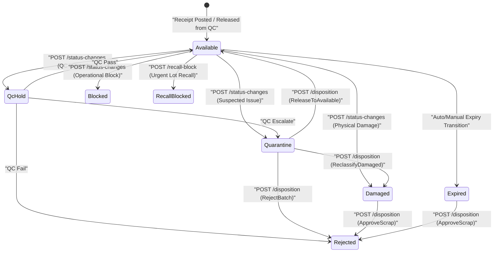

### (9) Inputs & Outputs
- **Inputs:** Source 9-dim identity (`WarehouseId`, `SourceLocationId`, `ProductId`, `LotId`, `SerialId`, `HandlingUnitId`, `FromStatus`, `OwnerId`), Target 9-dim identity (`DestinationLocationId`, `ToStatus`), `Quantity`, `ReasonCode`, `Note`.
- **Outputs:** `InventoryMoveResultDto` / `InventoryStatusChangeResultDto`, paired `InventoryTransactions` (`Move` or `StatusChange`), updated `InventoryStocks` with recomputed `GrainHash`.

### (10) Validation & Guard Rules
- **9-Dimension `GrainHash` Uniqueness:** Every `InventoryStocks` row computes `GrainHash = SHA256(TenantId|WarehouseId|LocationId|ProductId|LotId|SerialId|HandlingUnitId|Status|OwnerId)` via `InventoryStock.ComputeCanonicalGrainHash`.
- **5-Bucket Equation Guard:** `0 <= ReservedQuantity + AllocatedQuantity + LockedQuantity <= Quantity` at all times.
- **Non-Pickable Hold Guard:** Any bucket with `Status != InventoryStatus.Available` has `IsPickable = false`, `IsAllocatable = false`, `IsReservable = false`.

### (11) Authorization & SoD
- **Permissions:** `inventory.read`, `inventory_movement.create`, `inventory_status_change.create`, `inventory_lock.read`, `inventory_lock.manage`.
- **SoD:** Scrap/write-off (`AdjustmentDecrease` from `Damaged`/`Quarantine`/`Rejected`) above threshold requires independent Checker approval (`ApprovedBy != CreatedBy`).

### (12) Stock & Balance Effects (Exact 6-Bucket Impact)
- **Internal Bin Move (`Move` from `Bin A` to `Bin B`):**
  - Source Bucket (`Bin A`): `OnHand` $-\text{Qty}$, `AvailableToReserve` $-\text{Qty}$.
  - Target Bucket (`Bin B`): `OnHand` $+\text{Qty}$, `AvailableToReserve` $+\text{Qty}$ (total warehouse `OnHand` net change $= 0$).
- **Status Change (`Available -> Quarantine`):**
  - `Available` Bucket: `OnHand` $-\text{Qty}$, `AvailableToReserve` $-\text{Qty}$.
  - `Quarantine` Bucket: `OnHand` $+\text{Qty}$, `AvailableToReserve` $+0$ (not reservable/pickable).
- **Inventory Lock Applied (`CreateInventoryLock`):**
  - Target Bucket: `Locked` $+\text{LockedQty}$, `AvailableToReserve` $-\text{LockedQty}$ (`OnHand` unchanged).

### (13) Atomic Transaction Boundaries (6-Part Commit)
1. **Document / Lock Entity:** Persist movement/status-change command record or `InventoryLock`.
2. **Ledger:** Append paired `InventoryTransactions` (`TransactionType.Move` or `TransactionType.StatusChange` with `FromLocationId`/`ToLocationId` or `FromInventoryStatus`/`ToInventoryStatus`).
3. **Balance:** Decrement source 9-dim `InventoryStocks` row and upsert target 9-dim `InventoryStocks` row (preserving `MovingAverageCost`).
4. **Reservation/Allocation:** Verify zero active `StockAllocations` are orphaned on the source bucket.
5. **Audit:** Insert `AuditLogs` with full 9-dim before/after JSON snapshots.
6. **Outbox:** Insert `OutboxMessages` (triggers real-time marketplace ATP stock sync when `AvailableToReserve` changes).

### (14) Idempotency & Concurrency
- `[IdempotentCommand]` on all move, LPN move, break-bulk, status change, recall block, and lock endpoints.
- Deterministic lock ordering: When locking source and destination 9-dim buckets, always sort keys by `(WarehouseId, ProductId, LocationId, LotId, Status, GrainHash)` before issuing `UPDLOCK, ROWLOCK, REPEATABLEREAD`.

### (15) Immutable Audit Trail
- Every status transition, recall block, and lock release records mandatory `ReasonCode`, actor ID, timestamp, and correlation ID.

### (16) UI Screens & Scanner Mode
- Consolidate duplicate movement/replenishment endpoints into `InventoryMovementsController` (removing duplicates from `InventoryControlController`).
- Support 2-scan mobile execution (`Scan Source Bin/LPN` → `Scan Destination Bin`) on [`InventoryMovements.tsx`](file:///d:/ERP_KHO/frontend/src/pages/InventoryMovements.tsx).

### (17) REST `/api/v1` Operations
- `GET /api/v1/inventory/buckets`
- `POST /api/v1/inventory/status-changes`
- `POST /api/v1/inventory/disposition`
- `POST /api/v1/inventory/recall-block`
- `GET /api/v1/inventory/locks`
- `POST /api/v1/inventory/locks`
- `POST /api/v1/inventory/locks/{id}/release`
- `POST /api/v1/inventory-movements`
- `POST /api/v1/inventory-movements/move-handling-unit`
- `POST /api/v1/inventory-movements/auto-break-bulk-replenish`

### (18) Reports & Alerts
- Expiry Aging Report (`EXPIRED`, `NEAR_EXPIRY <= 30 days`, `GOOD`), Active Lock Precedence Monitor, and Pick-Face Low Stock Replenishment Alert.

### (19) Testable Acceptance Criteria
- **AC-5.1 (9-Dim Grain Conservation):** Moving `25` units of Lot `L1` from `BIN-01` to `BIN-02` decreases `BIN-01` by `25` and increases `BIN-02` by `25` with identical `LotId` and `MovingAverageCost`, writing 1 `InventoryTransaction(Move)`.
- **AC-5.2 (Recall Block):** Executing `POST /api/v1/inventory/recall-block` for `LotNumber = "LOT-BAD-01"` transitions all matching buckets across the warehouse to `RecallBlocked` (`AvailableToReserve = 0`) and prevents any outbound allocation.

---

## Process 6: Inventory Traceability, Reconciliation & Reversals

### (1) Business Objective
Provide CFO- and auditor-grade mathematical proof that `Materialized Balance == Immutable Ledger Sum` across every 9-dimension grain, enable instant upstream/downstream recall genealogy (`PO -> Lot -> Bin -> HU -> Shipment -> Customer`), and enforce append-only compensating reversals (`TransactionType.Reversal`) without ever mutating or deleting historical ledger rows.

### (2) Actors & Roles
- **Inventory Auditor / QA Manager:** Runs reconciliation, drills down into bucket vs ledger investigations, executes recall tree simulations (`inventory_ledger.read`, `inventory_traceability.read`).
- **Warehouse Manager / Chief Accountant:** Executes controlled transaction reversals (`inventory_reversal.create`) and authorizes balance rebuilds.

### (3) Trigger Events
- Scheduled end-of-day / end-of-month ledger reconciliation check.
- Operator mistakenly posts an internal move or status change and requests an immediate reversal.
- Supplier or regulatory authority issues a batch/lot recall requiring customer exposure tracing.

### (4) Preconditions
- Original `InventoryTransaction` to be reversed exists, is of a directly reversible operational type (`Move` or `StatusChange`), has `ReversalOfTransactionId == null`, and has `CorrectiveTransactionId == null` (not already reversed).
- Target bucket currently holds sufficient unallocated `OnHand` stock to absorb the compensating reversal without driving `OnHand < 0`.

### (5) Main Success Path (with Mermaid Flowchart)

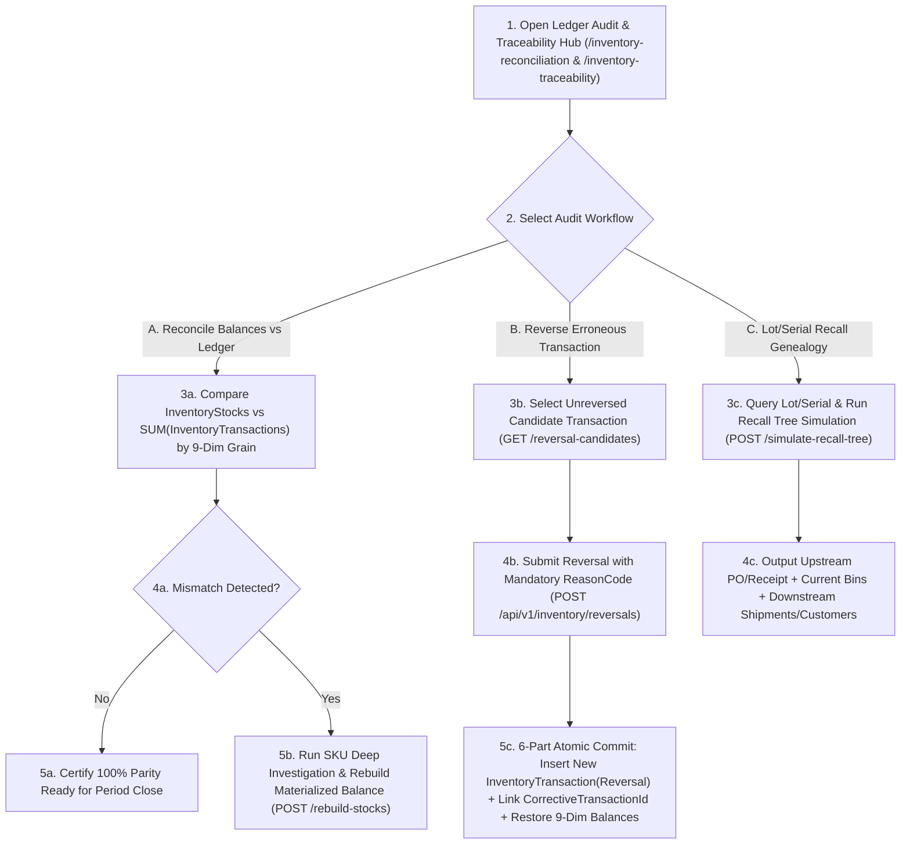

### (6) Alternative Paths
- **Direct Operational Reversal (`Move` / `StatusChange`):** Reversed in 1 click via `POST /api/v1/inventory/reversals`.
- **Document-Level Reversal (`ImportReceipt` / `ExportReceipt` / `StockTransfer`):** Document postings are reversed through their domain document workflows (`CustomerReturn`, `ReverseDraft` transfer, or adjustment proposal) so partner AP/AR debts and WAC valuations remain synchronized.

### (7) Exception Scenarios & Recovery
- **Duplicate Reversal Attempt:** If `OriginalTransaction.CorrectiveTransactionId != null`, server rejects with `409 TRANSACTION_ALREADY_REVERSED`.
- **Insufficient Stock to Reverse:** If the stock moved to `BIN-02` has already been picked/shipped to a customer, reversing the earlier move `BIN-01 -> BIN-02` would make `BIN-02` negative; server blocks with `422 INSUFFICIENT_STOCK_FOR_REVERSAL`.

### (8) Canonical State Machine (`stateDiagram-v2`)

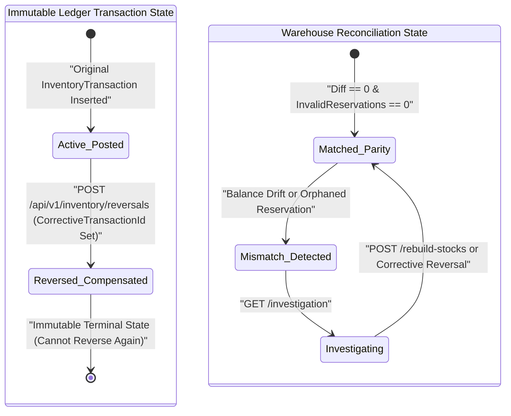

### (9) Inputs & Outputs
- **Inputs:** Reversal (`OriginalTransactionId`, `ReasonCode`, `Note`), Traceability (`WarehouseId`, `ProductId`, `LotNumber`, `SerialNumber`, `ReferenceType`, `ReferenceId`), Reconciliation (`WarehouseId`, `ProductId`, `Keyword`, `Page`, `PageSize`).
- **Outputs:** `InventoryReversalResultDto` (`OriginalTransactionId`, `ReversalTransactionId`), `InventoryTraceabilityResultDto` (buckets, timeline events, receipt/shipment exposure), `InventoryReconciliationPageDto`.

### (10) Validation & Guard Rules
- **Immutable Ledger Rule (`[INV-002]`):** `InventoryTransactions` rows are never deleted or quantity-mutated; the only permitted update on an existing row is setting the forward pointer `CorrectiveTransactionId` when its compensating `TransactionType.Reversal` row is inserted.
- **SQL-Level Pagination:** Replace the in-memory `while` loop in `ReversalSummary` ([`InventoryReversalTraceabilityController.cs:69-77`](file:///d:/ERP_KHO/ERP.Api/Controllers/InventoryReversalTraceabilityController.cs#L69-L77)) with a direct SQL `GROUP BY` aggregate query.

### (11) Authorization & SoD
- **Permissions:** `inventory_ledger.read`, `inventory_traceability.read`, `inventory_reversal.create`, `inventory.cost.read`.

### (12) Stock & Balance Effects (Exact 6-Bucket Impact)
- **Reversing a `Move` (`FromBin -> ToBin`, `Qty = Q`):**
  - `ToBin` Bucket: `OnHand` $-Q$, `AvailableToReserve` $-Q$.
  - `FromBin` Bucket: `OnHand` $+Q$, `AvailableToReserve` $+Q$.
- **Reversing a `StatusChange` (`Available -> Damaged`, `Qty = Q`):**
  - `Damaged` Bucket: `OnHand` $-Q$.
  - `Available` Bucket: `OnHand` $+Q$, `AvailableToReserve` $+Q$.

### (13) Atomic Transaction Boundaries (6-Part Commit)
1. **Document / Pointer:** Set `OriginalTransaction.CorrectiveTransactionId = reversalTx.Id`.
2. **Ledger:** Insert new `InventoryTransaction` (`TransactionType = Reversal`, `ReversalOfTransactionId = OriginalTransaction.Id`, opposite sign/direction, `ReasonCode`).
3. **Balance:** Restore source and destination 9-dim `InventoryStocks` rows.
4. **Reservation/Allocation:** Reconcile `ReservedQuantity` / `AllocatedQuantity` invariants.
5. **Audit:** Insert `AuditLogs` (`InventoryReversal.Create`).
6. **Outbox:** Insert `OutboxMessages` (`InventoryTransactionReversedEvent`).

### (14) Idempotency & Concurrency
- `[IdempotentCommand("InventoryReversal.Create")]` with `Idempotency-Key`.
- Ordered 2-tier row locks on both affected 9-dim `InventoryStocks` rows and `UPDLOCK` on `OriginalTransaction`.

### (15) Immutable Audit Trail
- Bidirectional link (`OriginalTransaction.CorrectiveTransactionId <-> ReversalTransaction.ReversalOfTransactionId`) + `ReasonCode` + actor + UTC timestamp.

### (16) UI Screens & Scanner Mode
- [`InventoryTraceability.tsx`](file:///d:/ERP_KHO/frontend/src/pages/InventoryTraceability.tsx), [`InventoryReconciliation.tsx`](file:///d:/ERP_KHO/frontend/src/pages/InventoryReconciliation.tsx), [`InventoryReversals.tsx`](file:///d:/ERP_KHO/frontend/src/pages/InventoryReversals.tsx).

### (17) REST `/api/v1` Operations
- `GET /api/v1/inventory/reversal-candidates`
- `POST /api/v1/inventory/reversals`
- `POST /api/v1/inventory/reversals/verify-chain-integrity`
- `GET /api/v1/inventory/traceability`
- `POST /api/v1/inventory/traceability/simulate-recall-tree`
- `GET /api/v1/inventory-reconciliation`
- `GET /api/v1/inventory-reconciliation/investigation`
- `POST /api/v1/inventory-reconciliation/rebuild-stocks`

### (18) Reports & Alerts
- Ledger-vs-Balance Drift Alert (`mismatchCount > 0`), Outbox DLQ Alert (`dlqFailedCount > 0`), and Recall Exposure Tree Report.

### (19) Testable Acceptance Criteria
- **AC-6.1 (Append-Only Reversal):** Reversing a `Move` of `15` units increases total `InventoryTransactions` count by `+1`, leaves the original row's `Quantity` untouched, sets `ReversalOfTransactionId`, and restores both bins' `OnHand` to their pre-move values.
- **AC-6.2 (Double-Reversal Block):** Calling `POST /api/v1/inventory/reversals` a second time on an already-reversed transaction returns `409`.

---

## Process 7: Cycle Counting / Stocktake (`Blind/Non-Blind, Multi-Attempt, Auto-Approval, Adjustment Posting`)

### (1) Business Objective
Maintain `> 99.5%` inventory accuracy without shutting down warehouse operations—using targeted `CountFreeze` bin locks, blind mobile counting (to prevent lazy "pencil-whipping"), multi-attempt recounting for out-of-tolerance variances, automated dual-threshold evaluation (`<= 1.0%` AND `<= 500,000 VND`), and SoD Checker approval before posting ledger adjustments.

### (2) Actors & Roles
- **Inventory Planner (Maker):** Creates stocktake session (by Zone, Aisle, ABC class, or SKU) or ad-hoc adjustment proposal (`stocktake.create`).
- **Cycle Counter (Counter 1 & Counter 2):** Performs physical blind count on Mobile PDA (`stocktake.count`).
- **Warehouse Manager (Checker):** Triggers recounts (`stocktake.recount`) and approves stocktakes / adjustment proposals (`stocktake.approve`, `ApprovalPolicies.Checker`).

### (3) Trigger Events
- Scheduled ABC cycle count (A-items weekly, B-items monthly, C-items quarterly).
- Short-pick exception or reconciliation mismatch triggers an immediate spot check on a specific bin.

### (4) Preconditions
- Target bins have no mid-flight uncompleted `PickingTask` or `PutawayTask` moves in progress.
- `StocktakeStatus` enum collision fixed: distinct values `Completed = 6, Posted = 9` (or unified `Posted = 6` with consistent naming).

### (5) Main Success Path (with Mermaid Flowchart)

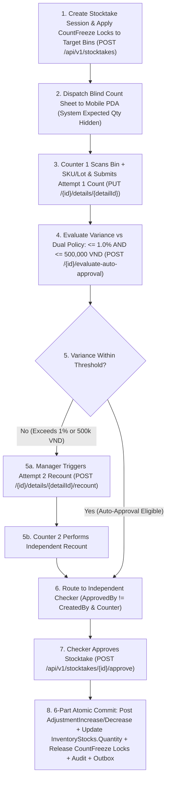

### (6) Alternative Paths (`Express Spot Adjustment` vs `Full Cycle Count`)
- **Express Spot Adjustment Proposal (`POST /api/v1/stocktakes/adjustment-proposals`):** When a staff member finds a single damaged or miscounted item, they submit a 1-line Adjustment Proposal with a mandatory `ReasonCode` (`COUNT_VARIANCE`, `DAMAGED_FOUND`, `EXPIRY_WRITE_OFF`), which routes to the Manager for 1-click approval (`POST /adjustment-proposals/{id}/approve`).
- **Full Zone/Aisle Cycle Count:** Freezes all bins in the selected zone (`CountFreeze`), executes blind Attempt 1 and Attempt 2 counts across dozens of bins, and posts all net variances atomically upon approval.

### (7) Exception Scenarios & Recovery
- **Inbound/Outbound Attempted on Frozen Bin:** Any `Putaway`, `Pick`, or `Move` targeting a bin with an active `CountFreeze` lock is blocked with `409 BIN_FROZEN_BY_STOCKTAKE`.
- **Stocktake Cancelled Mid-Count (`POST /api/v1/stocktakes/{id}/cancel`):** Releases all associated `CountFreeze` locks and transitions `Stocktake` to `Cancelled` with zero ledger mutations.

### (8) Canonical State Machine (`stateDiagram-v2`)

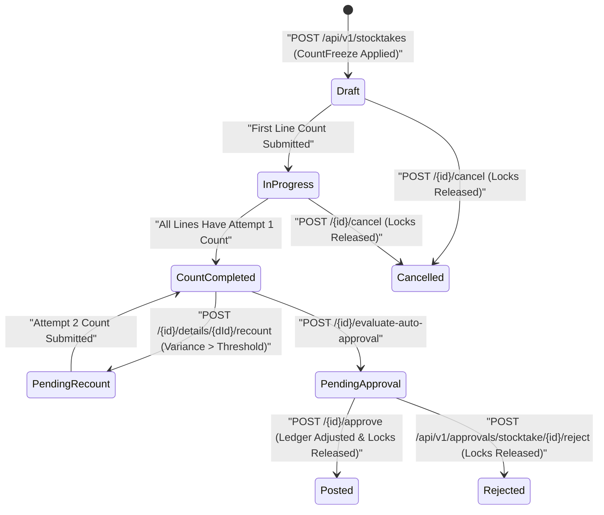

### (9) Inputs & Outputs
- **Inputs:** `WarehouseId`, `IsBlindCount` (default `true`), Target `LocationIds[]` / `ProductIds[]`, Count submissions (`DetailId`, `CountedQuantity`, `Note`), Approval thresholds (`ThresholdPct = 1.0`, `ThresholdValueVnd = 500000`).
- **Outputs:** `StocktakeDto`, variance valuation (`VarianceQty * MovingAverageCost`), `InventoryTransactions` (`AdjustmentIncrease` for gains, `AdjustmentDecrease` for losses), released `InventoryLocks`.

### (10) Validation & Guard Rules
- `CountedQuantity >= ReservedQuantity + AllocatedQuantity` (`422 COUNT_BELOW_COMMITTED_STOCK` — if physical count is less than already reserved/allocated stock, supervisor must first release or reallocate the affected outbound commitment before posting the reduction).
- Mandatory `ReasonCode` from `reason-codes-and-adjustments` catalog for all non-zero variances.
- Enforce strict state transition guard in `Stocktake.TransitionTo`: `Draft` cannot jump to `Approved`/`Posted` without all lines having recorded counts (`CountCompleted` / `PendingApproval`).

### (11) Authorization & SoD
- **Permissions:** `stocktake.read`, `stocktake.create`, `stocktake.count`, `stocktake.recount`, `stocktake.approve`, `stocktake.cancel`, `inventory.cost.read`.
- **SoD (`ApprovalPolicies.Checker`):** The user approving a stocktake or adjustment proposal (`ApprovedBy`) must not be the creator (`CreatedBy`) when variance exceeds auto-approval thresholds (`422 SOD_VIOLATION`).

### (12) Stock & Balance Effects (Exact 6-Bucket Impact)
- **On `Create` (`Draft` / `InProgress`):**
  - `CountFreeze` lock applied: `Locked` $= \text{OnHand} - (\text{SoftReserved} + \text{HardAllocated})$, reducing `AvailableToReserve` to $0$ during the count window.
- **On `Approve` (`Posted`):**
  - Let $\Delta = \text{CountedQuantity} - \text{SystemQuantitySnapshot}$.
  - If $\Delta > 0$ (`AdjustmentIncrease`): `OnHand` $+\Delta$, `Locked` released, `AvailableToReserve` $+\Delta$ (at current `MovingAverageCost`).
  - If $\Delta < 0$ (`AdjustmentDecrease`): `OnHand` $-|\Delta|$, `Locked` released, `AvailableToReserve` $-|\Delta|$.

### (13) Atomic Transaction Boundaries (6-Part Commit)
1. **Document:** `Stocktake.Status = StocktakeStatus.Posted`, `ApprovedBy`, `ApprovedAt`.
2. **Ledger:** Append `InventoryTransactions` (`AdjustmentIncrease` or `AdjustmentDecrease` for each line where $\Delta \ne 0$, `UnitCost = CurrentMAC`, `ReasonCode`).
3. **Balance:** Set `InventoryStocks.Quantity = CountedQuantity` and `LockedQuantity = 0`.
4. **Locks:** Transition all `InventoryLocks` (`CountFreeze` for this stocktake) to `Released`.
5. **Audit:** Insert `AuditLogs` (`Stocktake.Approve` with line-by-line system vs counted snapshot).
6. **Outbox:** Insert `OutboxMessages` (`StocktakePostedIntegrationEvent` → MISA GL inventory gain/loss journal & marketplace stock sync).

### (14) Idempotency & Concurrency
- `[IdempotentCommand]` on `Create`, `UpdateDetail`, `Recount`, `EvaluateAutoApproval`, `Approve`, `Cancel`, and `ApproveAdjustmentProposal`.
- 2-tier lock: `sp_getapplock` + ordered `UPDLOCK, ROWLOCK, REPEATABLEREAD` on all counted 9-dim `InventoryStocks` rows.

### (15) Immutable Audit Trail
- Preserves `SystemQuantity` snapshot at count start, `Attempt1CountedQty` + Counter 1 ID, `Attempt2CountedQty` + Counter 2 ID, VND variance valuation, and Checker approval ID.

### (16) UI Screens & Scanner Mode
- [`Stocktakes.tsx`](file:///d:/ERP_KHO/frontend/src/pages/Stocktakes.tsx) (`/stocktakes`) decomposed into `StocktakeSessionList.tsx`, `MobileBlindCountScanner.tsx` (hides expected qty column when `IsBlindCount == true`), and `StocktakeVarianceApprovalDrawer.tsx`.
- Add the missing `POST /api/v1/stocktakes/{id}/cancel` endpoint to `StocktakesController`.

### (17) REST `/api/v1` Operations
- `GET /api/v1/stocktakes`
- `POST /api/v1/stocktakes`
- `PUT /api/v1/stocktakes/{id}/details/{detailId}`
- `POST /api/v1/stocktakes/{id}/details/{detailId}/recount`
- `POST /api/v1/stocktakes/{id}/evaluate-auto-approval`
- `POST /api/v1/stocktakes/{id}/approve`
- `POST /api/v1/stocktakes/{id}/cancel` (newly standardized)
- `POST /api/v1/stocktakes/adjustment-proposals`
- `POST /api/v1/stocktakes/adjustment-proposals/{proposalAuditId}/approve`

### (18) Reports & Alerts
- Cycle Count Accuracy KPI (`1 - |TotalVarianceQty| / TotalCountedQty`), High-Value Variance Alert (`> 500,000 VND`), and Frozen Bin Aging Alert.

### (19) Testable Acceptance Criteria
- **AC-7.1 (Blind Count + Gain/Loss Posting):** Approving a stocktake where SKU A has `SystemQty = 50, CountedQty = 48` and SKU B has `SystemQty = 20, CountedQty = 23` writes 1 `AdjustmentDecrease(-2)` and 1 `AdjustmentIncrease(+3)` ledger entry, updates `InventoryStocks` to `48` and `23`, and releases all `CountFreeze` locks in one transaction.
- **AC-7.2 (Dual Threshold Auto-Approval Guard):** A variance of `2` units on a `300,000 VND` item (`600,000 VND > 500,000 VND` threshold) is flagged `isAutoApprovalEligible = false` even if quantity variance is `0.5% <= 1.0%`.

---

## Process 8: Inter-Warehouse Stock Transfers (`In-Transit, Discrepancy, Return`)

### (1) Business Objective
Provide full financial and physical accountability for inventory moving between warehouses (`SourceWarehouseId -> DestinationWarehouseId`) by tracking in-transit stock explicitly, capturing transit damage/shortage discrepancies upon arrival, and supporting full or partial returns to the source warehouse.

### (2) Actors & Roles
- **Supply Chain Planner (Maker):** Creates/updates transfer order (`stock_transfer.create`, `stock_transfer.update`).
- **Source Warehouse Manager (Checker):** Approves transfer (`stock_transfer.approve`, `ApprovalPolicies.Checker`).
- **Source Dispatch Clerk:** Dispatches transfer from source warehouse (`stock_transfer.dispatch`).
- **Destination Receiving Clerk:** Receives transfer at destination warehouse, logs damaged/missing transit quantities, completes or returns transfer (`stock_transfer.receive`, `stock_transfer.complete`, `stock_transfer.return`).

### (3) Trigger Events
- Regional stock rebalancing recommendation (`POST /api/v1/stock-transfers/simulate-network-rebalancing`) or hub-to-branch replenishment request.

### (4) Preconditions
- `SourceWarehouseId != DestinationWarehouseId`.
- User has Warehouse Scope access to the warehouse performing the action (Source scope for `Create`/`Approve`/`Dispatch`/`Return`; Destination scope for `Receive`/`Complete`).
- Source warehouse has sufficient `AvailableToReserve` stock for all lines.

### (5) Main Success Path (with Mermaid Flowchart)

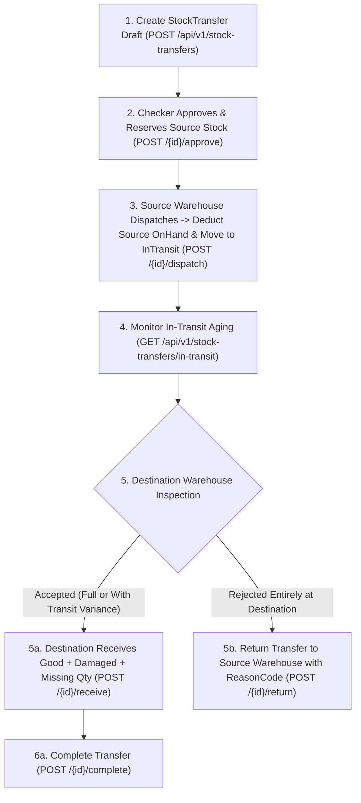

### (6) Alternative Paths
- **Hidden in Single-Warehouse `EXPRESS` Mode:** Automatically hidden from the navigation bar when `Tenant.Warehouses.Count == 1` or complexity mode is `EXPRESS`.
- **Post-Completion Reverse Draft (`POST /{id}/reverse-draft`):** Generates a pre-populated `Draft` transfer in the opposite direction (`Destination -> Source`) linked to the completed transfer.

### (7) Exception Scenarios & Recovery
- **In-Transit Shortage or Damage (`ReceivedGoodQty + DamagedQty + MissingQty == DispatchedQty`):**
  - `ReceivedGoodQty` is posted to Destination `Available` bucket (`TransactionType.TransferIn`).
  - `DamagedQty` is posted to Destination `Damaged` bucket (`TransactionType.TransferIn` with `Status = Damaged`).
  - `MissingQty` is recorded as an in-transit loss (`TransactionType.TransferAdjustment`) attributed to Carrier/Warehouse for claim recovery.
- **Full Return (`POST /{id}/return`):** Restores `DispatchedQty` back into `SourceWarehouseId` (`TransactionType.TransferIn` / `Reversal`) with a mandatory `ReasonCode` from `StockTransferReturnReasonCatalog`.

### (8) Canonical State Machine (`stateDiagram-v2`)

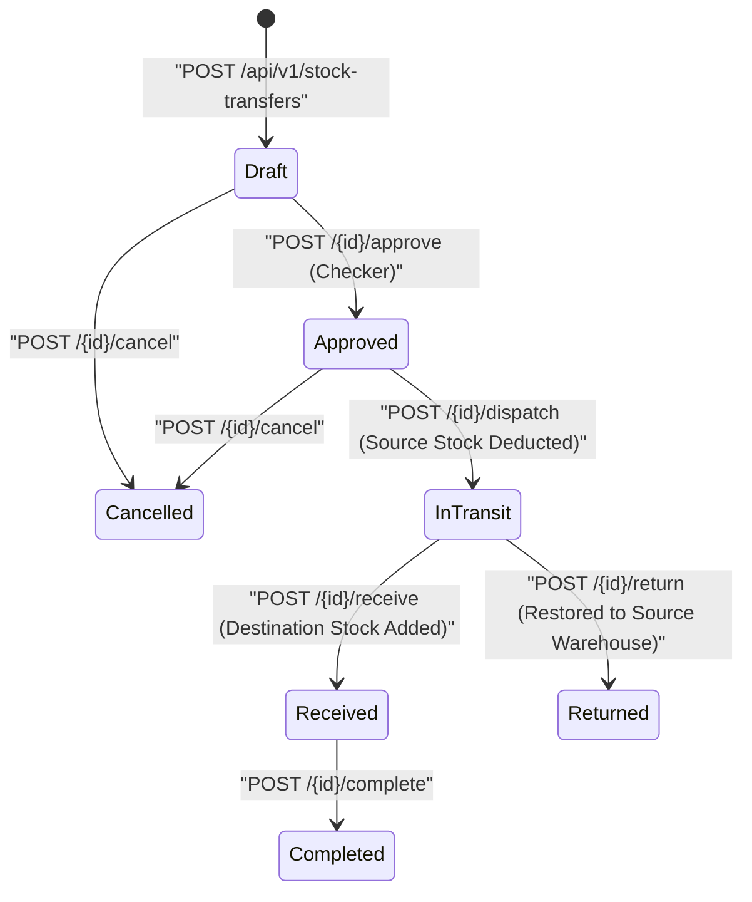

### (9) Inputs & Outputs
- **Inputs:** `SourceWarehouseId`, `DestinationWarehouseId`, `Lines[]` (`ProductId`, `SourceLocationId`, `DestinationLocationId`, `LotId`, `RequestedQty`), Receive payload (`ReceivedQty`, `DamagedQty`, `MissingQty`, `VarianceNote`).
- **Outputs:** `StockTransferDto`, `InTransitInventoryDto`, `InventoryTransactions` (`TransferOut`, `TransferIn`, `TransferAdjustment`).

### (10) Validation & Guard Rules
- `SourceWarehouseId != DestinationWarehouseId` (`400 SAME_WAREHOUSE_TRANSFER_INVALID`).
- On `Receive`: `ReceivedQty + DamagedQty + MissingQty == DispatchedQty` (`422 TRANSFER_RECEIVE_QTY_MISMATCH`).
- Replace hardcoded `[Authorize(Roles = ...)]` attributes in `StockTransfersController` with granular `[PermissionAuthorize(AppPermissions.StockTransfer*)]` attributes (`[SEC-001]`).

### (11) Authorization & SoD
- **Permissions:** `stock_transfer.read`, `stock_transfer.create`, `stock_transfer.update`, `stock_transfer.approve`, `stock_transfer.dispatch`, `stock_transfer.receive`, `stock_transfer.return`, `stock_transfer.cancel`.
- **SoD:** `ApprovedBy != CreatedBy` (`ApprovalPolicies.Checker`).

### (12) Stock & Balance Effects (Exact 6-Bucket Impact)
1. **On `Approve`:** Source bucket `SoftReserved` $+\text{Qty}$, `AvailableToReserve` $-\text{Qty}$.
2. **On `Dispatch` (`InTransit`):** Source bucket `OnHand` $-\text{Qty}$, `SoftReserved` $-\text{Qty}$; In-Transit virtual balance $+\text{Qty}$ (carrying source `MovingAverageCost` and `LotId`).
3. **On `Receive` (`Received`):** In-Transit balance $-\text{DispatchedQty}$; Destination `Available` bucket `OnHand` $+\text{ReceivedGoodQty}$, `AvailableToReserve` $+\text{ReceivedGoodQty}$; Destination `Damaged` bucket `OnHand` $+\text{DamagedQty}$ (with MAC recalculated at destination warehouse using incoming source MAC).

### (13) Atomic Transaction Boundaries (6-Part Commit)
- **Dispatch Transaction:** (1) `StockTransfer.Status = InTransit`, (2) `InventoryTransaction(TransferOut)`, (3) Decrement Source `InventoryStocks`, (4) Consume Source `StockReservation`, (5) `AuditLogs`, (6) `OutboxMessages`.
- **Receive Transaction:** (1) `StockTransfer.Status = Received`, (2) `InventoryTransaction(TransferIn)` + optional `TransferAdjustment`, (3) Increment Destination `InventoryStocks` + update destination `MovingAverageCost`, (4) Clear In-Transit commitment, (5) `AuditLogs`, (6) `OutboxMessages`.

### (14) Idempotency & Concurrency
- `[IdempotentCommand]` on all transfer state transitions + `RowVersion` concurrency token on `StockTransfer`.
- Ordered 2-tier locks (`sp_getapplock` + `UPDLOCK, ROWLOCK, REPEATABLEREAD`) on source/destination buckets.

### (15) Immutable Audit Trail
- Tracks revision count on draft edits, approval actor, dispatch timestamp, in-transit elapsed hours, destination receiver, and any transit discrepancy/return reason codes.

### (16) UI Screens & Scanner Mode
- [`StockTransfers.tsx`](file:///d:/ERP_KHO/frontend/src/pages/StockTransfers.tsx) (`/stock-transfers`) and [`StockTransferDetailsDialog.tsx`](file:///d:/ERP_KHO/frontend/src/pages/StockTransferDetailsDialog.tsx).

### (17) REST `/api/v1` Operations
- `GET /api/v1/stock-transfers`
- `GET /api/v1/stock-transfers/in-transit`
- `POST /api/v1/stock-transfers`
- `PUT /api/v1/stock-transfers/{id}`
- `POST /api/v1/stock-transfers/{id}/approve`
- `POST /api/v1/stock-transfers/{id}/dispatch`
- `POST /api/v1/stock-transfers/{id}/receive`
- `POST /api/v1/stock-transfers/{id}/return`
- `POST /api/v1/stock-transfers/{id}/reverse-draft`
- `POST /api/v1/stock-transfers/{id}/complete`
- `POST /api/v1/stock-transfers/{id}/cancel`

### (18) Reports & Alerts
- In-Transit Aging Alert (transfers in transit `> 48 hours`), Transit Loss/Damage Carrier Claim Report, and Multi-Warehouse Rebalancing Simulation.

### (19) Testable Acceptance Criteria
- **AC-8.1 (Two-Step In-Transit Integrity):** Dispatching `50` units from `WH01` to `WH02` deducts `50` from `WH01` immediately, shows `50` in `GET /api/v1/stock-transfers/in-transit`, and does not increase `WH02` stock until `POST /{id}/receive` is called.
- **AC-8.2 (Transit Variance Handling):** Receiving `48` good, `1` damaged, and `1` missing at `WH02` adds `48` to `WH02 Available`, `1` to `WH02 Damaged`, and logs `1` `TransferAdjustment` loss.


---

## Process 9: Customer Returns / RMA & Kitting/VAS (`Dedicated Controllers, Quarantine Intake, Disposition, Kit Assembly/Disassembly`)

### (1) Business Objective
Promote Customer Returns (`CustomerReturn`) and Kitting/VAS (`KitWorkOrder`) from hidden, piggybacked endpoints into first-class WMS processes with dedicated REST `/api/v1` controllers, strongly typed enum state machines (`CustomerReturnStatus`, `KitWorkOrderStatus`), mandatory Quarantine-first RMA intake, FEFO expiry inheritance for assembled kits, and rolled-up Moving Average Cost (`MAC`) calculation across component and parent SKUs.

### (2) Actors & Roles
- **Returns & QC Clerk:** Scans returned parcel/AWB at RMA dock, records customer return intake into `Quarantine`, inspects items, and executes disposition (`Restock`, `Refurbish`, `ReturnToVendor`, `Scrap`) (`customer_return.create`, `customer_return.inspect`, `customer_return.disposition`).
- **Warehouse Manager / Finance Checker:** Approves customer credit note / AR refund impact (`customer_return.approve`, `ApprovalPolicies.Checker`).
- **VAS / Kitting Operator:** Executes kit assembly (`Assemble`) or disassembly (`Disassemble`) work orders (`kitting.create`, `kitting.execute`).

### (3) Trigger Events
- Carrier returns an undeliverable/failed-delivery parcel (`RTS`), or a B2B/B2C buyer initiates a post-delivery return (`RMA`).
- Merchandising / Sales creates a promotional bundle SKU requiring physical pre-assembly (`KitWorkOrder`) or disassembly back into individual components after a campaign ends.

### (4) Preconditions
- **RMA:** Referenced `ExportReceiptId` or `ShipmentId` (when provided) exists in `Approved`/`Dispatched`/`Delivered`/`Returned` status and returned quantities do not exceed originally shipped quantities.
- **Kitting:** Parent Kit Product (`Product.IsKit == true`) has an active Bill of Materials (`KitComponents[]` with `ComponentProductId` and `QuantityPerKit > 0`), and component bins hold sufficient `AvailableToReserve` stock for the planned kit quantity.

### (5) Main Success Path (with Mermaid Flowchart)

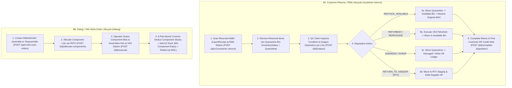

### (6) Alternative Paths
- **Carrier Failed-Delivery Auto-RTS (`POST /api/v1/shipments/{id}/complete-rts-return`):** Since the sealed parcel never opened at the customer's site, the operator verifies seal integrity at the dock and restocks directly into the `Available` pick face (or `Quarantine` if outer carton is crushed) while automatically reversing any pending COD expectation on `ShipmentFinancialLedgers`.
- **Kit Disassembly (`OperationType = Disassemble`):** Deducts the parent Kit SKU from `Available` stock and restores component SKUs proportionally into their target bins at their pro-rata MAC share.

### (7) Exception Scenarios & Recovery
- **Serial Mismatch on RMA Fraud Check:** When a serialized item is returned, the system validates that the scanned `SerialNumber` matches the exact `SerialId` shipped on the original `ExportReceipt`; if a buyer swaps in a counterfeit/different serial, the system blocks restock with `422 RMA_SERIAL_MISMATCH_FRAUD_ALERT`.
- **Component Shortage Mid-Kitting:** If a component bin has fewer units than required during VAS execution, the work order cannot be partially committed with missing BOM parts; the operator must either reduce `TargetKitQty` or replenish the component bin first (`422 KIT_COMPONENT_SHORTAGE`).

### (8) Canonical State Machine (`stateDiagram-v2`)

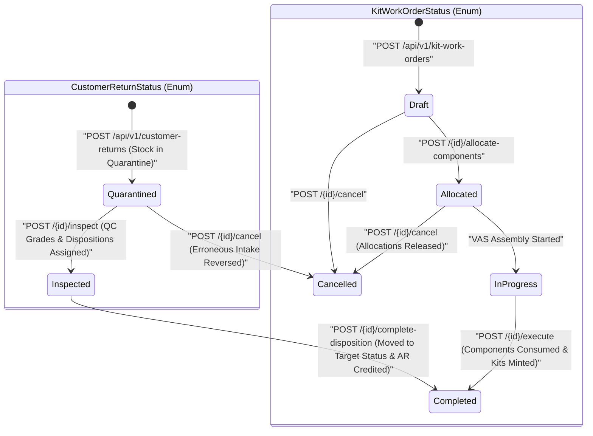

### (9) Inputs & Outputs
- **Inputs:**
  - `CustomerReturn`: `WarehouseId`, `CustomerId`, `ExportReceiptId?`, `ShipmentId?`, `QuarantineLocationId`, `ReturnReason`, `Lines[]` (`ProductId`, `LotId?`, `SerialId?`, `Quantity`, `ConditionGrade`, `DispositionAction`, `TargetLocationId`).
  - `KitWorkOrder`: `WarehouseId`, `KitProductId`, `OperationType` (`Assemble` / `Disassemble`), `Quantity`, `SourceBinIds[]`, `DestinationBinId`.
- **Outputs:** `CustomerReturnDto`, `KitWorkOrderDto`, `InventoryTransactions` (`ReturnIn`, `StatusChange`, `DispositionWriteOff`, `KitComponentIssue`, `KitAssemblyReceipt`), updated `PartnerDebtInvoice` (AR Credit Note / AP RTV Debit).

### (10) Validation & Guard Rules
- Replace raw string statuses on [`CustomerReturn.Status`](file:///d:/ERP_KHO/ERP.Domain/Entities/CustomerReturnEntities.cs#L19) and [`KitWorkOrder.Status`](file:///d:/ERP_KHO/ERP.Domain/Entities/KitWorkOrder.cs#L15) with C# enums `CustomerReturnStatus` (`Quarantined = 1, Inspected = 2, Completed = 3, Cancelled = 4`) and `KitWorkOrderStatus` (`Draft = 1, Allocated = 2, InProgress = 3, Completed = 4, Cancelled = 5`).
- **Kit FEFO Expiry Inheritance:** When assembling a kit from lot-tracked components, the assembled kit lot automatically inherits:
  $$\text{KitLot.ExpiryDate} = \min_{i \in \text{Components}} \left(\text{ComponentLot}_i.\text{ExpiryDate}\right)$$
- **Kit Rolled-Up MAC Formula:**
  $$\text{KitUnitMAC} = \sum_{i \in \text{Components}} \left(\text{QtyPerKit}_i \times \text{ComponentMAC}_i\right) + \text{UnitVasLaborAndPackagingCost}$$

### (11) Authorization & SoD
- **Permissions:** `customer_return.read`, `customer_return.create`, `customer_return.inspect`, `customer_return.disposition`, `kitting.read`, `kitting.create`, `kitting.execute`, `inventory.cost.read`.
- **SoD:** Writing off returned goods (`SCRAP`) or issuing customer AR refunds exceeding threshold requires `ApprovalPolicies.Checker` (`CompletedBy != CreatedBy`).

### (12) Stock & Balance Effects (Exact 6-Bucket Impact)
- **RMA Intake (`Quarantined`):**
  - `Quarantine` Bucket (`InventoryStatus.Quarantine`): `OnHand` $+\text{ReturnedQty}$, `AvailableToReserve` $+0$ (cannot be allocated to new sales orders).
- **RMA Disposition (`Completed`):**
  - `Quarantine` Bucket: `OnHand` $-\text{ReturnedQty}$.
  - If `RESTOCK_AVAILABLE`: Target `Available` Bucket `OnHand` $+\text{RestockQty}$, `AvailableToReserve` $+\text{RestockQty}$ (valued at original `ExportReceipt` COGS or current `MovingAverageCost`).
  - If `DAMAGED`: Target `Damaged` Bucket `OnHand` $+\text{DamagedQty}$.
  - If `SCRAP` / `RTV`: `OnHand` deducted from warehouse via `DispositionWriteOff`.
- **Kit Assembly (`Assemble` for $K$ kits):**
  - Each Component $i$'s `Available` Bucket: `OnHand` $-(K \times \text{QtyPerKit}_i)$, `HardAllocated` $-(K \times \text{QtyPerKit}_i)$.
  - Parent Kit SKU's `Available` Bucket: `OnHand` $+K$, `AvailableToReserve` $+K$ (at `KitUnitMAC`).

### (13) Atomic Transaction Boundaries (6-Part Commit)
- **RMA Disposition Commit:** (1) `CustomerReturn.Status = Completed`, (2) `InventoryTransactions` (`StatusChange` / `DispositionWriteOff`), (3) Update `Quarantine` and target 9-dim `InventoryStocks`, (4) Create/adjust `PartnerDebtTransaction` (AR credit / AP debit), (5) `AuditLogs`, (6) `OutboxMessages`.
- **Kit Execution Commit:** (1) `KitWorkOrder.Status = Completed`, (2) `InventoryTransactions` (component deductions + parent kit receipt), (3) Decrement component 9-dim `InventoryStocks` & increment parent kit 9-dim `InventoryStocks` (with rolled-up MAC & min expiry lot), (4) Consume component allocations, (5) `AuditLogs`, (6) `OutboxMessages`.

### (14) Idempotency & Concurrency
- `[IdempotentCommand]` on all `/api/v1/customer-returns` and `/api/v1/kit-work-orders` mutation endpoints.
- Deterministic lock ordering across all component and parent kit 9-dim buckets (`ORDER BY WarehouseId, ProductId, LocationId, LotId`) before `UPDLOCK, ROWLOCK, REPEATABLEREAD`.

### (15) Immutable Audit Trail
- RMA records original `ExportReceiptId`/`ShipmentId`, intake photos/notes, QC inspector ID, disposition reason code, and financial credit linkage.
- Kit Work Order records every component lot consumed (`KitWorkOrderComponent`) and the resulting parent kit lot created.

### (16) UI Screens & Scanner Mode
- Extract RMA endpoints out of `ImportReceiptsController` into a dedicated `CustomerReturnsController` (`[Route("api/v1/customer-returns")]`) and build a dedicated frontend screen `/customer-returns` (`CustomerReturns.tsx`).
- Extract Kitting endpoints out of `PackingSessionsController` into a dedicated `KitWorkOrdersController` (`[Route("api/v1/kit-work-orders")]`) and build a dedicated frontend screen `/kitting` (`KitWorkOrders.tsx`).

### (17) REST `/api/v1` Operations
- `GET /api/v1/customer-returns`
- `POST /api/v1/customer-returns`
- `POST /api/v1/customer-returns/{id}/inspect`
- `POST /api/v1/customer-returns/{id}/complete-disposition`
- `POST /api/v1/customer-returns/{id}/cancel`
- `GET /api/v1/kit-work-orders`
- `POST /api/v1/kit-work-orders`
- `POST /api/v1/kit-work-orders/{id}/allocate-components`
- `POST /api/v1/kit-work-orders/{id}/execute`
- `POST /api/v1/kit-work-orders/{id}/cancel`

### (18) Reports & Alerts
- Return Rate by SKU & Carrier Report, Quarantine Aging Alert (`> 48 hours` uninspected), and Kit Component Availability / Max Assemblable Kits Calculator.

### (19) Testable Acceptance Criteria
- **AC-9.1 (RMA Quarantine-to-Disposition):** Creating a `CustomerReturn` for `5` units places all `5` in `InventoryStatus.Quarantine` (`AvailableToReserve = 0`). Completing disposition with `4` `RESTOCK_AVAILABLE` and `1` `DAMAGED` leaves `0` in `Quarantine`, adds `4` to `Available` (`AvailableToReserve = +4`), and adds `1` to `Damaged`.
- **AC-9.2 (Kit FEFO & Rolled-Up MAC):** Assembling `10` gift boxes where each box consumes `1` Tea (`MAC = 50,000`, `Expiry = 2027-03-01`) and `2` Honey jars (`MAC = 80,000`, `Expiry = 2026-12-15`) deducts `10` Tea and `20` Honey, and creates `10` Gift Boxes with `MovingAverageCost = 210,000 VND` and `ExpiryDate = 2026-12-15`.

---

## Process 10: Financial & COD Reconciliation (`Moving Average Cost, Carrier COD 3-Way Match, Partner AP/AR Debts, MISA & E-Invoice Sync`)

### (1) Business Objective
Bridge the gap between physical warehouse movements and corporate accounting in Vietnam by maintaining real-time Moving Average Cost (`MAC`), automating 3-way Carrier COD & shipping fee reconciliation (`Order vs Shipment vs Carrier Statement`), enforcing B2B customer credit limits and AP/AR aging, and providing 1-click MISA AMIS `.xlsx` exports and Decree `70/2025/NĐ-CP` e-invoice integration.

### (2) Actors & Roles
- **Chief Accountant / Finance Controller:** Reviews inventory valuation (`MAC`), uploads carrier COD settlement files, resolves COD discrepancies, records AP/AR payments, exports MISA journals, and issues e-invoices (`inventory.cost.read`, `partner_debt.read`, `partner_debt.manage`, `report.read`).
- **Sales / Purchasing Manager:** Views partner credit exposure and aging buckets (`partner_debt.read`).

### (3) Trigger Events
- Inbound `ImportReceipt` approval (recalculates weighted `MovingAverageCost` and creates Supplier `AP` invoice).
- Outbound `ExportReceipt` approval / `Shipment` dispatch (locks COGS at current `MovingAverageCost`, creates Customer `AR` invoice or records expected `COD` on `ShipmentFinancialLedger`).
- Carrier (GHN, GHTK, ViettelPost, J&T) sends weekly/daily Excel/CSV COD settlement statement.
- Finance closes accounting period and exports journals to MISA AMIS / Viettel SInvoice / MISA meInvoice.

### (4) Preconditions
- User holds `inventory.cost.read` permission to view any unit cost, COGS, gross margin, or inventory valuation fields (`[SEC-001]`, `PROJECT_RULE` Layer 3).
- For Carrier COD import, `TrackingNumber` / `ShipmentNumber` rows in the uploaded `.xlsx`/`.csv` file map to dispatched `Shipments` in `ERP_KHO`.

### (5) Main Success Path (with Mermaid Flowchart)

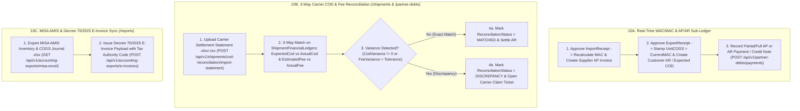

### (6) Alternative Paths
- **Prepaid / Bank-Transfer B2C Orders (`ExpectedCodAmount == 0`):** Reconciles only carrier shipping fees (`EstimatedShippingFee` vs `ActualShippingFee`) and marketplace commission/voucher deductions (`PlatformCommissionFee`, `SellerVoucherAmount`).
- **B2B Credit Terms (`Net 30 / Net 60`):** Managed via `PartnerDebtInvoices` (`DueDate`, `PaidAmount`, `RemainingAmount`, `Status = Unpaid | PartiallyPaid | Paid | Overdue | Cancelled`) with automated Aging Analysis (`0–30`, `31–60`, `61–90`, `> 90` days).

### (7) Exception Scenarios & Recovery
- **COD Under-Collection (`ActualCodCollected < ExpectedCodAmount`):** `ShipmentFinancialLedger.ReconciliationStatus` transitions to `DISCREPANCY` (`CodVariance = ActualCodCollected - ExpectedCodAmount < 0`), blocking automatic closure until Finance either collects the balance from the carrier or approves a write-off with `ReasonCode`.
- **Overpayment Attempt on Partner Debt:** If `PaymentAmount > Invoice.RemainingAmount`, server rejects with `422 PAYMENT_EXCEEDS_REMAINING_DEBT` (or requires explicit unapplied credit allocation).
- **Unauthorized Cost Access:** Any caller without `inventory.cost.read` requesting receipt details, stock buckets, or reports receives cost fields masked (`null`) or `403 Forbidden` on cost-specific endpoints.

### (8) Canonical State Machine (`stateDiagram-v2`)

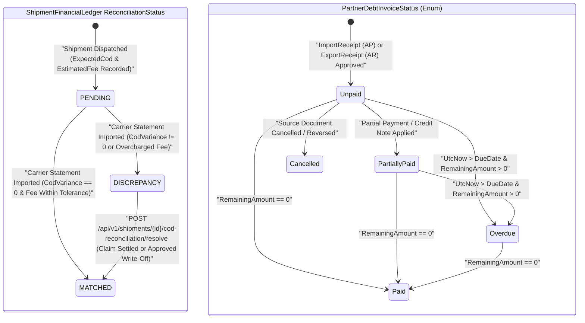

### (9) Inputs & Outputs
- **Inputs:** Carrier statement `.xlsx`/`.csv` (`IFormFile` binary upload), Debt payment (`PartnerId`, `InvoiceId`, `Amount`, `PaymentMethod`, `ReferenceNo`), Date range filters (`FromDate`, `ToDate`, `WarehouseId`).
- **Outputs:** `ShipmentFinancialLedgerDto` (`ExpectedCodAmount`, `ActualCodCollected`, `CodVariance`, `EstimatedShippingFee`, `ActualShippingFee`, `ShippingFeeVariance`, `NetSettlementAmount`, `ReconciliationStatus`), `PartnerDebtSummaryDto`, `PartnerDebtAgingDto`, ClosedXML `.xlsx` binary stream for MISA AMIS, Decree `70/2025/NĐ-CP` XML/JSON e-invoice payload.

### (10) Validation & Guard Rules
- **Net Settlement Invariant ([`ShipmentFinancialLedger.cs:62-66`](file:///d:/ERP_KHO/ERP.Domain/Entities/ShipmentFinancialLedger.cs#L62-L66)):**
  $$\text{NetSettlementAmount} = \text{ActualCodCollected} - \text{ActualShippingFee} - \text{PlatformCommissionFee} - \text{ReturnFee} + \text{SellerVoucherAmount}$$
- **Strict RBAC Cost Masking:** Server DTO mappers strip `UnitCost`, `TotalCost`, `MovingAverageCost`, and `GrossMargin` whenever `!User.HasPermission(AppPermissions.InventoryCostRead)`.
- **Real Binary Stream Rule (`PROJECT_RULE` Layer 3):** MISA export must generate a valid OpenXML `.xlsx` workbook via `ClosedXML` (`application/vnd.openxmlformats-officedocument.spreadsheetml.sheet`), never CSV/HTML renamed to `.xlsx`.

### (11) Authorization & SoD
- **Permissions:** `inventory.cost.read`, `partner_debt.read`, `partner_debt.create`, `partner_debt.payment`, `shipment.reconcile_cod`, `accounting.export`.
- **SoD:** Resolving a `DISCREPANCY` via financial write-off requires `ApprovalPolicies.Checker` (`ResolvedBy != DispatchedBy`).

### (12) Stock & Balance Effects (Exact 6-Bucket Impact)
- Financial reconciliation (`COD` matching, `AP`/`AR` payment settlement, MISA export) mutates financial sub-ledgers (`ShipmentFinancialLedgers`, `PartnerDebtInvoices`, `PartnerDebtTransactions`) without altering physical inventory quantities.
- Inbound `ImportReceipt` approval updates `InventoryStocks.MovingAverageCost` on the target 9-dim bucket; Outbound `ExportReceipt` approval reads `MovingAverageCost` to stamp immutable `UnitCost` on `InventoryTransactions(Export)`.

### (13) Atomic Transaction Boundaries (6-Part Commit)
- **Debt Payment / COD Settlement Transaction:** (1) Update `PartnerDebtInvoice` (`PaidAmount`, `Status`) or `ShipmentFinancialLedger` (`ReconciliationStatus`, `SettledAtUtc`), (2) Append immutable `PartnerDebtTransaction` ledger row, (3) Update partner credit exposure balance, (4) Release credit-hold flag on pending `SalesOrders` if balance drops below `CreditLimit`, (5) `AuditLogs`, (6) `OutboxMessages`.

### (14) Idempotency & Concurrency
- `[IdempotentCommand]` on payment recording, COD statement import, and COD discrepancy resolution.
- Optimistic concurrency (`RowVersion`) + `UPDLOCK` on `PartnerDebtInvoice` and `ShipmentFinancialLedger` to prevent double-payment or duplicate carrier statement settlement.

### (15) Immutable Audit Trail
- Every payment, credit note, COD statement import, and discrepancy write-off logs `BeforeStateJson`, `AfterStateJson`, actor, correlation ID, and external bank/carrier reference number.

### (16) UI Screens & Scanner Mode
- [`PartnerDebts.tsx`](file:///d:/ERP_KHO/frontend/src/pages/PartnerDebts.tsx) (`/partner-debts`), [`Reports.tsx`](file:///d:/ERP_KHO/frontend/src/pages/Reports.tsx) (`/reports`), and COD Reconciliation tab in [`Shipments.tsx`](file:///d:/ERP_KHO/frontend/src/pages/Shipments.tsx).
- Add bulk `.xlsx`/`.csv` `FormData` upload (`POST /api/v1/shipments/cod-reconciliation/import-statement`) so accountants can reconcile thousands of carrier waybills in one upload instead of row-by-row JSON entry.

### (17) REST `/api/v1` Operations
- `GET /api/v1/partner-debts/summary`
- `GET /api/v1/partner-debts/invoices`
- `GET /api/v1/partner-debts/aging`
- `POST /api/v1/partner-debts/payments`
- `POST /api/v1/shipments/cod-reconciliation`
- `POST /api/v1/shipments/cod-reconciliation/import-statement` (newly added bulk `.xlsx` import)
- `POST /api/v1/shipments/{id}/cod-reconciliation/resolve`
- `GET /api/v1/export-receipts/{id}/misa-export`
- `POST /api/v1/export-receipts/{id}/e-invoice-draft`

### (18) Reports & Alerts
- Unsettled COD Aging Alert (`PENDING > 7 days`), Carrier Overcharge Variance Report (`ActualShippingFee > EstimatedShippingFee * 1.10`), AR Overdue Debt Alert, and Inventory Valuation & COGS Gross Margin Report (gated by `inventory.cost.read`).

### (19) Testable Acceptance Criteria
- **AC-10.1 (3-Way COD Discrepancy Detection):** Given a shipment with `ExpectedCodAmount = 1,500,000 VND` and `EstimatedShippingFee = 35,000 VND`, importing a carrier statement row with `ActualCodCollected = 1,400,000 VND` and `ActualShippingFee = 35,000 VND` sets `CodVariance = -100,000 VND` and `ReconciliationStatus = "DISCREPANCY"`.
- **AC-10.2 (Cost RBAC Protection):** Calling inventory bucket or report endpoints with a token lacking `inventory.cost.read` returns `0` exposed unit cost fields (`null` or `403`).

---

## Process 11: Approval Center & Operational Exceptions (`Maker-Checker Queue, 30-Min SLA Escalation, Unified Approve/Reject, Exception Acknowledgement`)

### (1) Business Objective
Provide Warehouse Managers and Controllers with a single, zero-latency Command Center (`/approvals` and `/reports`) to review, approve, or reject all pending documents (`ImportReceipt`, `ExportReceipt`, `StockTransfer`, `Stocktake`, `PurchaseOrder`, `SalesOrder`), enforce strict Maker-Checker Segregation of Duties (`SoD`), auto-escalate bottlenecks breaching the 30-minute SLA, and acknowledge real-time operational exceptions.

### (2) Actors & Roles
- **Operational Maker (Clerk / Planner):** Submits documents into `Pending` / `PendingApproval` state.
- **Approving Checker (Warehouse Manager / Operations Director):** Reviews pending queue, approves or rejects documents with reason codes, and acknowledges operational exceptions (`approval.read`, `approval.decide`, `ApprovalPolicies.Checker`).

### (3) Trigger Events
- Any document transitions to `Pending` / `PendingApproval`, or a high-variance stocktake/adjustment proposal is submitted.
- Pending wait time exceeds `30 minutes` (`WaitMinutes > 30`), triggering SLA breach warning and optional auto-escalation.
- Background health monitor detects operational exceptions (overdue dock appointments, unallocated backorders, overdue in-transit transfers, outbox DLQ failures).

### (4) Preconditions
- Target document is currently in `Pending` / `PendingApproval` state.
- Acting user holds the document-specific approval permission AND satisfies `CheckerUserId != MakerUserId` (`SoD`).

### (5) Main Success Path (with Mermaid Flowchart)

```mermaid
flowchart TD
    QUEUE["1. Load Unified Approval Queue & SQL SLA Summary (GET /api/v1/approvals/queue & /sla-summary)"] --> SLA{"2. Any Item Waiting > 30 Mins?"}
    SLA -- "Yes" --> ESC["2a. Flag SLA Breach & Escalate Overdue Items (POST /api/v1/approvals/escalate-overdue)"]
    SLA -- "No" --> REV["3. Checker Reviews Document Lines, Variance Valuation & Maker Notes"]
    ESC --> REV
    REV --> DEC{"4. Checker Decision (SoD: Checker != Maker)"}
    DEC -- "Approve" --> APPR["5a. Call Unified Approve Endpoint (POST /api/v1/approvals/{documentType}/{id}/approve) -> Delegates to Domain Engine"]
    DEC -- "Reject (Mandatory Reason)" --> REJ["5b. Call Unified Reject Endpoint (POST /api/v1/approvals/{documentType}/{id}/reject) -> Releases Reservations/Locks"]
    APPR & REJ --> HIST["6. Append Immutable Decision to Approval History (GET /api/v1/approvals/history)"]
```

### (6) Alternative Paths
- **Batch Approval from Queue:** Checker selects multiple low-risk documents in `/approvals` and approves them sequentially with per-document idempotency keys and independent atomic transactions.
- **Operational Exception Acknowledgement (`POST /api/v1/reports/operational-exceptions/acknowledge`):** Supervisor acknowledges an active operational alert (e.g., dock congestion or carrier pickup delay) with an owner assignment and remediation note.

### (7) Exception Scenarios & Recovery
- **Self-Approval Attempt (`CheckerUserId == CreatedBy`):** Server rejects with `403/422 SOD_MAKER_CANNOT_APPROVE_OWN_DOCUMENT`.
- **Concurrent Approval/Rejection Race:** If Manager A approves a receipt 100ms before Manager B clicks Reject, Manager B receives `409 DOCUMENT_ALREADY_DECIDED` with a prompt to refresh the queue.

### (8) Canonical State Machine (`stateDiagram-v2`)

```mermaid
stateDiagram-v2
    state "Approval Queue Item Lifecycle" as AQL {
        [*] --> Queued_Within_SLA: "Document Submitted (WaitMinutes <= 30)"
        Queued_Within_SLA --> Overdue_SLA_Breached: "WaitMinutes > 30"
        Overdue_SLA_Breached --> Escalated: "POST /api/v1/approvals/escalate-overdue"
        Queued_Within_SLA --> Approved: "POST /api/v1/approvals/{docType}/{id}/approve"
        Overdue_SLA_Breached --> Approved: "POST /api/v1/approvals/{docType}/{id}/approve"
        Escalated --> Approved: "POST /api/v1/approvals/{docType}/{id}/approve"
        Queued_Within_SLA --> Rejected: "POST /api/v1/approvals/{docType}/{id}/reject"
        Overdue_SLA_Breached --> Rejected: "POST /api/v1/approvals/{docType}/{id}/reject"
        Escalated --> Rejected: "POST /api/v1/approvals/{docType}/{id}/reject"
    }
```

### (9) Inputs & Outputs
- **Inputs:** `documentType` (`ImportReceipt`, `ExportReceipt`, `StockTransfer`, `Stocktake`, `PurchaseOrder`, `SalesOrder`), `id`, `Reason` / `Note`, pagination (`Page`, `PageSize`, `WarehouseId`, `SlaBreachedOnly`).
- **Outputs:** `ApprovalQueueItemDto` (`DocumentType`, `DocumentId`, `DocumentNumber`, `WarehouseId`, `CreatedBy`, `CreatedAt`, `WaitMinutes`, `IsSlaBreached`, `TotalValueVnd`), `ApprovalSlaSummaryDto`, `OperationalExceptionDto`.

### (10) Validation & Guard Rules
- **Real Domain Delegation (`[FAKE-001]`):** `POST /api/v1/approvals/{documentType}/{id}/approve` and `/reject` must dispatch to the exact same Application/Domain service methods used by the individual document controllers—updating the real document table, ledger, balances, reservations/locks, audit log, and outbox in one transaction (never just inserting an `AuditLog` row).
- **SQL-Level Aggregation & Pagination (`[API-004]`, `[DB-007]`):** Replace the in-memory `BuildQueueAsync(takePerType: 100)` pattern in [`ApprovalsController.cs:37-46`](file:///d:/ERP_KHO/ERP.Api/Controllers/ApprovalsController.cs#L37-L46) with a SQL `UNION ALL` projection query using `.AsNoTracking()`, database-level `COUNT(*)`, and `.Skip().Take()`.

### (11) Authorization & SoD
- **Permissions:** `approval.read`, plus the underlying document approval permission (`import.approve`, `export.approve`, `stock_transfer.approve`, `stocktake.approve`, `purchase_order.approve`, `sales_order.approve`).
- **SoD:** Enforced uniformly across all 6 document types (`ApprovedBy != CreatedBy` and `RejectedBy != CreatedBy`).

### (12) Stock & Balance Effects (Exact 6-Bucket Impact)
- **On `Approve`:** Executes the exact 6-bucket transition of the underlying document (e.g., `+OnHand` for `ImportReceipt`, `-OnHand` for `ExportReceipt`, `+SoftReserved` for `SalesOrder`/`StockTransfer`, `+/-Adjustment` & lock release for `Stocktake`).
- **On `Reject`:** Releases any active `SoftReserved`, `HardAllocated`, or `CountFreeze` locks held by the rejected document (`AvailableToReserve` restored).

### (13) Atomic Transaction Boundaries (6-Part Commit)
- Identical to the underlying document's 6-part commit (Document state + `InventoryTransactions` + `InventoryStocks` + Reservations/Locks release + `AuditLogs` + `OutboxMessages`).

### (14) Idempotency & Concurrency
- `[IdempotentCommand]` on `Approve`, `Reject`, `EscalateOverdue`, and `AcknowledgeOperationalException`.
- Optimistic concurrency (`RowVersion`) on the target document entity.

### (15) Immutable Audit Trail
- Every approval, rejection, SLA escalation, and exception acknowledgement is recorded in `AuditLogs` with `WaitMinutesAtDecision`, `MakerUserId`, `CheckerUserId`, and `Reason`.

### (16) UI Screens & Scanner Mode
- [`Approvals.tsx`](file:///d:/ERP_KHO/frontend/src/pages/Approvals.tsx) (`/approvals`) and Operational Exceptions panel in [`Reports.tsx`](file:///d:/ERP_KHO/frontend/src/pages/Reports.tsx).

### (17) REST `/api/v1` Operations
- `GET /api/v1/approvals/queue`
- `GET /api/v1/approvals/sla-summary`
- `GET /api/v1/approvals/history`
- `POST /api/v1/approvals/escalate-overdue`
- `POST /api/v1/approvals/{documentType}/{id}/approve` (newly unified endpoint)
- `POST /api/v1/approvals/{documentType}/{id}/reject`
- `GET /api/v1/reports/operational-exceptions`
- `POST /api/v1/reports/operational-exceptions/acknowledge`

### (18) Reports & Alerts
- 30-Minute Approval SLA Breach Counter, Average Approval Turnaround Time by Manager, and Unacknowledged Operational Exceptions Banner.

### (19) Testable Acceptance Criteria
- **AC-11.1 (Unified Approval Parity):** Approving an `ImportReceipt` via `POST /api/v1/approvals/ImportReceipt/{id}/approve` produces the exact same `InventoryTransactions`, `InventoryStocks`, `PartnerDebtInvoices`, `AuditLogs`, and `OutboxMessages` rows as `POST /api/v1/import-receipts/{id}/approve`.
- **AC-11.2 (Rejection Resource Release):** Rejecting a `Stocktake` via `POST /api/v1/approvals/Stocktake/{id}/reject` transitions the stocktake to `Rejected` and releases 100% of its `CountFreeze` bin locks.

---

## Process 12: Tenant Onboarding, Master Data Setup & SaaS Billing (`5-Step Wizard, ClosedXML Opening Balance Cutover, 4-Tier Quota Engine, VietQR Webhook`)

### (1) Business Objective
Enable a new B2B/3PL customer in Vietnam to self-onboard a production-ready warehouse in `< 15 minutes` via a guided 5-step wizard, import initial inventory opening balances from Excel (`ClosedXML`) with full 9-dimension grain integrity, and monetize usage through a transparent 4-tier SaaS quota engine (`NORMAL -> WARNING_80_100 -> SOFT_BURST_100_115 -> READ_ONLY_OVER_115`) with instant VietQR Napas247 HMAC-SHA256 webhook auto-upgrade.

### (2) Actors & Roles
- **Tenant Owner / System Administrator:** Completes the 5-step onboarding wizard, configures warehouse complexity mode (`EXPRESS`, `STANDARD`, `ENTERPRISE`), imports master data & opening balances, and manages SaaS subscription billing (`warehouse.manage`, `product.create`, `data_import.execute`, `saas_billing.manage`).
- **VietQR Payment Gateway:** Calls `POST /api/v1/saas-billing/vietqr-webhook` with `X-VietQR-Signature` upon bank transfer settlement.

### (3) Trigger Events
- New tenant registers or provisions a new warehouse facility.
- Legacy WMS/Excel cutover requires bulk import of SKUs, UOM conversions, Locations/Bins, Lots, and Opening Stock Balances.
- Monthly order volume crosses `80%`, `100%`, or `115%` of `TenantSubscription.MonthlyOrderLimit`.

### (4) Preconditions
- Opening balance cutover import (`POST /api/v1/data-imports/opening-balance`) requires valid existing `WarehouseCode`, `LocationCode`, and `ProductCode` (or creates them atomically in staging if configured), with non-negative quantities and unit costs.
- VietQR webhook payload must carry a valid HMAC-SHA256 signature (`X-VietQR-Signature`) computed with the configured secret key.

### (5) Main Success Path (with Mermaid Flowchart)

```mermaid
flowchart TD
    W1["Step 1: Create Warehouse & Select Complexity Mode: EXPRESS / STANDARD / ENTERPRISE (/onboarding)"] --> W2["Step 2: Generate Zone / Aisle / Rack / Bin Topology & Barcode Labels (/warehouses)"]
    W2 --> W3["Step 3: Configure Categories, Base UOMs, UOM Conversions & Products (/categories, /uoms, /products)"]
    W3 --> W4["Step 4: Upload ClosedXML Excel Opening Balance Template (POST /api/v1/data-imports/opening-balance)"]
    W4 --> W5["Step 5: Atomic Opening Stock Commit -> Seed 9-Dim InventoryStocks + Initial MAC + InventoryTransactions(Import)"]
    W5 --> LIVE["6. Go-Live Ready -> Monitor SaaS Usage Quota (/saas-billing)"]
    LIVE --> QUOTA{"7. Evaluate Quota Tier on Approved/Dispatched Orders"}
    QUOTA -- "<= 80%" --> T_NORM["NORMAL Tier (Full Read/Write)"]
    QUOTA -- "80% - 100%" --> T_WARN["WARNING_80_100 Banner"]
    QUOTA -- "100% - 115%" --> T_BURST["SOFT_BURST_100_115 (15% Peak Grace Buffer Allowed)"]
    QUOTA -- "> 115%" --> T_RO["READ_ONLY_OVER_115 (New Order Creation Blocked, Read/Export Allowed)"]
    T_WARN & T_BURST & T_RO --> QR["8. Generate VietQR Napas247 Upgrade Invoice (POST /api/v1/saas-billing/vietqr-invoice)"]
    QR --> WH["9. Bank Webhook Verified (POST /api/v1/saas-billing/vietqr-webhook) -> Auto-Upgrade Plan & Unlock Write Access"]
```

### (6) Alternative Paths
- **Dry-Run Validation on Opening Balance Import (`ValidateOnly = true`):** Parses the `.xlsx` workbook via `ClosedXML` and returns a row-by-row validation report (missing SKU codes, invalid expiry dates, negative quantities, duplicate serials) without committing to SQL.
- **Complexity Mode Switching (`EXPRESS` vs `STANDARD` vs `ENTERPRISE`):** Tenant Admin can start in `EXPRESS` mode (simplified 2-step inbound/outbound) and later toggle `STANDARD` or `ENTERPRISE` mode as warehouse maturity grows, without any database migration.

### (7) Exception Scenarios & Recovery
- **Quota Exceeded (`> 115%` — `READ_ONLY_OVER_115`):** Creating new outbound/inbound orders returns `402/422 SAAS_QUOTA_READ_ONLY_TIER_EXCEEDED` with a direct link to `/saas-billing`, while all read queries, financial exports, and in-flight shipment completions remain unblocked so warehouse staff are never stranded mid-operation.
- **Invalid VietQR Webhook Signature:** If `X-VietQR-Signature` is missing or fails cryptographic HMAC-SHA256 verification, server rejects with `401 INVALID_WEBHOOK_SIGNATURE` and logs a security audit event.
- **Malformed `.xlsx` Upload:** Non-Excel binary or missing required columns returns `400 INVALID_EXCEL_TEMPLATE` with exact column/row coordinates.

### (8) Canonical State Machine (`stateDiagram-v2`)

```mermaid
stateDiagram-v2
    state "SaaS Subscription Quota Tier (EvaluateQuotaTier)" as SQT {
        [*] --> NORMAL: "Usage <= 80% of MonthlyOrderLimit"
        NORMAL --> WARNING_80_100: "80% < Usage <= 100%"
        WARNING_80_100 --> SOFT_BURST_100_115: "100% < Usage <= 115% (15% Soft Burst Grace)"
        SOFT_BURST_100_115 --> READ_ONLY_OVER_115: "Usage > 115% (New Order Creation Blocked)"
        WARNING_80_100 --> NORMAL: "VietQR Plan Upgrade Paid or New Billing Cycle"
        SOFT_BURST_100_115 --> NORMAL: "VietQR Plan Upgrade Paid or New Billing Cycle"
        READ_ONLY_OVER_115 --> NORMAL: "VietQR Plan Upgrade Paid or New Billing Cycle"
    }
```

### (9) Inputs & Outputs
- **Inputs:**
  - Onboarding & Master Data: Warehouse (`Code`, `Name`, `OperationalMode`), Location (`Code`, `Zone`, `Type`, `MaxWeight`, `MaxVolume`), Product (`Code`, `Name`, `BaseUomId`, `TrackingType`, `PutawayStrategy`), Opening Balance `.xlsx` (`IFormFile` binary via `FormData`).
  - SaaS Billing: `TargetPlanCode` (`STARTER`, `GROWTH`, `PRO`, `ENTERPRISE`), VietQR webhook payload (`InvoiceNumber`, `PaidAmountVnd`, `BankTransactionRef`, `X-VietQR-Signature` header).
- **Outputs:** `ImportJobSummaryDto` (`TotalRows`, `SuccessRows`, `ErrorRows`, `Errors[]`), `SaasSubscriptionStatusDto` (`PlanCode`, `MonthlyOrderLimit`, `HardStopLimit115`, `CurrentOrderUsage`, `QuotaTier`, `IsWriteBlocked`), `VietQrBillingInvoiceDto` (`QrPayload`, `AmountVnd`, `InvoiceNumber`).

### (10) Validation & Guard Rules
- **Fair SaaS Order Usage Counting (`[SAAS-004]`):** Fix [`SaasBillingController.cs:40-41`](file:///d:/ERP_KHO/ERP.Api/Controllers/SaasBillingController.cs#L40-L41) so `CurrentOrderUsage` counts only **approved/dispatched** outbound orders (`Status != ExportReceiptStatus.Cancelled && Status != ExportReceiptStatus.Rejected && Status != ExportReceiptStatus.Draft`) within the current billing cycle (`CurrentPeriodStartUtc..CurrentPeriodEndUtc`), never charging customers for cancelled or rejected drafts.
- **Persist Live `CurrentOrderUsage`:** Increment `TenantSubscription.CurrentOrderUsage` via Outbox/Domain event on order approval and persist the updated tier in `TenantSubscriptions`.
- **Opening Balance Grain Integrity:** Opening balance import must route through the 9-Dimension Inventory Engine (`InventoryStocks` + `GrainHash` + `InventoryTransactions(Import)` + `MovingAverageCost`), never bypassing the ledger.

### (11) Authorization & SoD
- **Permissions:** `warehouse.manage`, `location.manage`, `product.manage`, `data_import.execute`, `saas_billing.read`, `saas_billing.manage`.
- Webhook endpoint (`POST /api/v1/saas-billing/vietqr-webhook`) uses `[AllowAnonymous]` protected by mandatory HMAC-SHA256 signature verification (`X-VietQR-Signature`) and idempotent `BankTransactionRef` deduplication.

### (12) Stock & Balance Effects (Exact 6-Bucket Impact)
- **Opening Balance Import (`POST /api/v1/data-imports/opening-balance`):**
  - Target 9-Dim Bucket: `OnHand` $+\text{OpeningQty}$, `AvailableToReserve` $+\text{OpeningQty}$, `MovingAverageCost` initialized to `OpeningUnitCost`.
  - Appends `InventoryTransaction` (`TransactionType = Import`, `ReferenceNumber = "OPENING-BALANCE-..."`).

### (13) Atomic Transaction Boundaries (6-Part Commit)
- **Opening Balance Commit:** (1) Create `DataImportLog` / batch header, (2) Append `InventoryTransactions(Import)` for all valid rows, (3) Upsert 9-dim `InventoryStocks` with `GrainHash` and `MovingAverageCost`, (4) Auto-create `Lot` / `ProductSerial` records if specified, (5) `AuditLogs`, (6) `OutboxMessages`.
- **VietQR Webhook Settlement Commit:** (1) Mark `SaasBillingInvoice.Status = "PAID"`, (2) Upgrade `TenantSubscription` (`PlanCode`, `MonthlyOrderLimit`, `Status = "ACTIVE"`), (3) Re-evaluate `QuotaTier` (`NORMAL`), (4) Unlock tenant write access, (5) `AuditLogs`, (6) `OutboxMessages`.

### (14) Idempotency & Concurrency
- `[IdempotentCommand]` on opening balance import and invoice creation.
- VietQR webhook enforces idempotency on `(InvoiceNumber, BankTransactionRef)` so duplicate bank webhook retries return `200 OK` without double-applying upgrades.

### (15) Immutable Audit Trail
- Logs every master data change, opening balance batch import summary, and SaaS plan upgrade / webhook signature verification result in `AuditLogs`.

### (16) UI Screens & Scanner Mode
- [`OnboardingWizard.tsx`](file:///d:/ERP_KHO/frontend/src/pages/OnboardingWizard.tsx) (`/onboarding`), [`DataImports.tsx`](file:///d:/ERP_KHO/frontend/src/pages/DataImports.tsx) (`/data-imports`), [`SaasBilling.tsx`](file:///d:/ERP_KHO/frontend/src/pages/SaasBilling.tsx) (`/saas-billing`), [`Warehouses.tsx`](file:///d:/ERP_KHO/frontend/src/pages/Warehouses.tsx), [`Locations.tsx`](file:///d:/ERP_KHO/frontend/src/pages/Locations.tsx), [`Products.tsx`](file:///d:/ERP_KHO/frontend/src/pages/Products.tsx), [`Categories.tsx`](file:///d:/ERP_KHO/frontend/src/pages/Categories.tsx), [`Uoms.tsx`](file:///d:/ERP_KHO/frontend/src/pages/Uoms.tsx), [`Suppliers.tsx`](file:///d:/ERP_KHO/frontend/src/pages/Suppliers.tsx), [`Customers.tsx`](file:///d:/ERP_KHO/frontend/src/pages/Customers.tsx).

### (17) REST `/api/v1` Operations
- `GET /api/v1/data-imports/opening-balance-template`
- `POST /api/v1/data-imports/opening-balance`
- `GET /api/v1/saas-billing/subscription`
- `POST /api/v1/saas-billing/vietqr-invoice`
- `POST /api/v1/saas-billing/vietqr-webhook`

### (18) Reports & Alerts
- Onboarding Readiness Checklist (`% Complete`), Opening Balance Cutover Reconciliation Report, and SaaS Quota Threshold Alerts (`80% Warning`, `100% Soft Burst Entered`, `115% Read-Only Lock`).

### (19) Testable Acceptance Criteria
- **AC-12.1 (Fair Quota Tier Evaluation):** For a tenant with `MonthlyOrderLimit = 1,000` (`HardStopLimit115 = 1,150`), having `950` approved `ExportReceipts` and `300` `Cancelled` `ExportReceipts` evaluates `CurrentOrderUsage = 950` (`WARNING_80_100`), NOT `1,250` (`READ_ONLY_OVER_115`).
- **AC-12.2 (Soft Burst & VietQR Auto-Unlock):** At `1,100` approved orders (`110%`), `QuotaTier == "SOFT_BURST_100_115"` and `IsWriteBlocked == false`. At `1,151` approved orders, `QuotaTier == "READ_ONLY_OVER_115"` and `IsWriteBlocked == true`. Sending a valid HMAC-signed `POST /api/v1/saas-billing/vietqr-webhook` for the `PRO` plan (`MonthlyOrderLimit = 5,000`) immediately transitions the invoice to `PAID`, updates `MonthlyOrderLimit = 5000`, and restores `QuotaTier == "NORMAL"` (`IsWriteBlocked == false`).

---

## 3. Consolidated TO-BE Reengineering Summary Matrix (All 12 Processes)

| # | Process Area | Express Mode Path (`EXPRESS`) | Standard / Enterprise Path (`STANDARD` / `ENTERPRISE`) | Canonical Enum State Machine | 6-Bucket & 9-Dim Ledger Invariant | Key API / Architectural Fix over AS-IS |
| :--- | :--- | :--- | :--- | :--- | :--- | :--- |
| **1** | **Inbound Receiving** (`PO -> ASN -> Dock -> Receipt -> QC -> Putaway`) | 1-Screen Express Receive (`Create & Approve` directly to target bin) | Full 6-stage `PO -> ASN -> Dock -> Receipt -> QC -> Directed Putaway` | `PurchaseOrderStatus`, `AsnStatus`, `DockAppointmentStatus`, `ImportReceiptStatus`, `PutawayTaskStatus` | `+OnHand` (`Available` or `Quarantine`), recalculates weighted `MovingAverageCost` | Convert `AsnStatus` & `DockAppointmentStatus` to enums; enforce `+5%` over-receipt guard; decompose `ImportReceipts.tsx` (`1,148` LOC) |
| **2** | **Outbound Order-to-Cash** (`SO -> Credit Check -> Backorder -> Reservation`) | Auto-Reserve on SO Approval | Multi-warehouse ATP routing + Automated Backorder Replenishment | `SalesOrderStatus`, `BackorderStatus`, `StockReservationStatus` | `+SoftReserved`, `-AvailableToReserve` (`OnHand` unchanged) | Enforce B2B credit limit & overdue debt guard before reservation; auto-release `SoftReserved` on SO cancel/reject |
| **3** | **Warehouse Execution** (`Allocation -> Wave/Batch/Cluster Pick -> Pack -> Ship -> Manifest`) | 1-Click Express Issue (`ExportReceipt` approve deducts stock directly) | `FEFO/FIFO Allocation -> Wave/Cluster Pick -> Pack + Video -> Shipment -> Manifest Handover` | `StockAllocationStatus`, `PickingTaskStatus`, `PackingSessionStatus`, `ShipmentStatus`, `HandoverManifestStatus` | `SoftReserved -> HardAllocated -> PickedStaged -> -OnHand` (stamped at `MovingAverageCost`) | Convert `PackingSessionStatus`, `ShipmentStatus`, `HandoverManifestStatus` to enums; link `ExportReceipt <-> Shipment` 1-to-1; decompose `ExportReceipts.tsx` (`1,111` LOC) |
| **4** | **Cross-Docking** (`Inbound Dock -> Staging -> Outbound Allocation`) | N/A (Hidden in `EXPRESS` Mode) | Opportunistic Inbound Scan Alert + Planned Flow-Through Cross-Dock | Linked `ImportReceipt(Approved) -> PutawayTask(Completed at XDOCK) -> StockAllocation(Allocated)` | `+OnHand` at `XDOCK-STAGE` & immediate `+HardAllocated` to waiting `Backorder` | Add explicit `LocationType = CrossDockStaging` bypass in `PutawayTaskService` to skip storage racks and auto-allocate waiting backorders |
| **5** | **Internal Inventory Control** (`Bin Move, LPN Move, Break-Bulk, Status, Quarantine, Recall, Locks`) | Simple Bin-to-Bin Move & Status Toggle | Full LPN/HU Move, Case-to-Piece Break-Bulk Replenishment, Lot Recall Block, 5-Precedence Locks | `InventoryStatus` (`1..7`), `InventoryLockType`, `InventoryLockStatus` | Preserves total `OnHand` across bins/statuses; `Locked` reduces `AvailableToReserve` | Remove duplicate move/replenish endpoints from `InventoryControlController` (keep canonical in `InventoryMovementsController`) |
| **6** | **Traceability, Reconciliation & Reversals** | Admin / Auditor Only | 9-Dim Grain Reconciliation, Forward/Backward Recall Tree, Compensating Reversals | Immutable `Active_Posted -> Reversed_Compensated`; `Matched_Parity <-> Mismatch_Detected` | Appends `TransactionType.Reversal` with opposite delta; never updates/deletes ledger rows | Replace in-memory `while` loop in `ReversalSummary` with SQL `GROUP BY` aggregation |
| **7** | **Cycle Counting / Stocktake** (`Blind Count, Recount, Auto-Approval, Adjustment`) | Express 1-Line Adjustment Proposal with `ReasonCode` | Blind Zone/Aisle Cycle Count (`CountFreeze` -> Attempt 1 -> Attempt 2 -> Dual Threshold Check -> Approve) | `StocktakeStatus` (fixed `Completed = 6, Posted = 9` collision) | `CountFreeze` sets `Locked`; Approval posts `AdjustmentIncrease`/`Decrease` & releases locks | Fix `Completed == Posted == 6` enum collision; enforce `Draft -> InProgress -> CountCompleted -> PendingApproval -> Posted`; add `POST /stocktakes/{id}/cancel` |
| **8** | **Inter-Warehouse Stock Transfers** (`In-Transit, Discrepancy, Return`) | Hidden when `Warehouses.Count == 1` | `Draft -> Approved -> InTransit -> Received (with Damaged/Missing split) -> Completed` or `Returned` | `StockTransferStatus` (`Draft`, `Approved`, `InTransit`, `Received`, `Completed`, `Returned`, `Cancelled`) | `Approve` (`+SoftReserved` at Source) -> `Dispatch` (`-OnHand` Source, `+InTransit`) -> `Receive` (`+OnHand` Dest) | Replace hardcoded `[Authorize(Roles = ...)]` in `StockTransfersController` with `[PermissionAuthorize(AppPermissions.StockTransfer*)]` |
| **9** | **Customer Returns / RMA & Kitting/VAS** | Express RMA Restock / Scrap | Quarantine-first RMA Intake -> QC Inspection -> Disposition (`Restock`, `Refurbish`, `RTV`, `Scrap`); BOM Kit Assembly/Disassembly | `CustomerReturnStatus`, `KitWorkOrderStatus` (enums replacing strings) | RMA: `+Quarantine` -> `+Available`/`+Damaged`; Kit: `-Components` -> `+ParentKit` (min expiry + rolled-up MAC) | Extract dedicated `CustomerReturnsController` (`/api/v1/customer-returns`) & `KitWorkOrdersController` (`/api/v1/kit-work-orders`) + dedicated `/customer-returns` & `/kitting` UI screens |
| **10** | **Financial & COD Reconciliation** (`MAC, COD 3-Way Match, AP/AR, MISA, E-Invoice`) | Automated WAC/MAC + Basic AP/AR Ledger | Bulk `.xlsx` Carrier COD 3-Way Reconciliation, Aging Analysis, MISA `.xlsx` Export, Decree `70/2025/NĐ-CP` E-Invoice | `ShipmentFinancialLedger.ReconciliationStatus` (`PENDING`, `MATCHED`, `DISCREPANCY`), `PartnerDebtInvoiceStatus` | Financial sub-ledger updates (`ShipmentFinancialLedgers`, `PartnerDebtTransactions`); cost masked by `inventory.cost.read` | Add bulk `.xlsx`/`.csv` upload (`POST /api/v1/shipments/cod-reconciliation/import-statement`) for 3-way carrier COD matching |
| **11** | **Approval Center & Operational Exceptions** | 1-Click Manager Approval Drawer | Unified Multi-Document Queue, 30-Min SLA Escalation, SoD (`Maker != Checker`), Operational Exception Acknowledge | `Queued_Within_SLA -> Overdue_SLA_Breached -> Escalated -> Approved / Rejected` | Delegates to real Domain Engine on `Approve`; releases locks/reservations on `Reject` | Add unified `POST /api/v1/approvals/{documentType}/{id}/approve`; replace in-memory `BuildQueueAsync` with SQL `UNION ALL` pagination |
| **12** | **Tenant Onboarding, Master Data & SaaS Billing** | 5-Step Guided Self-Onboarding (`< 15 mins` to first receipt) | `ClosedXML` Opening Balance Cutover + 4-Tier SaaS Quota Engine (`115%` Soft Burst) + VietQR Webhook Auto-Upgrade | `NORMAL -> WARNING_80_100 -> SOFT_BURST_100_115 -> READ_ONLY_OVER_115` | Opening Balance seeds 9-dim `InventoryStocks` + `GrainHash` + `InventoryTransactions(Import)` | Exclude `Cancelled`/`Rejected`/`Draft` orders from `CurrentOrderUsage` quota calculation; persist live order usage counter |
