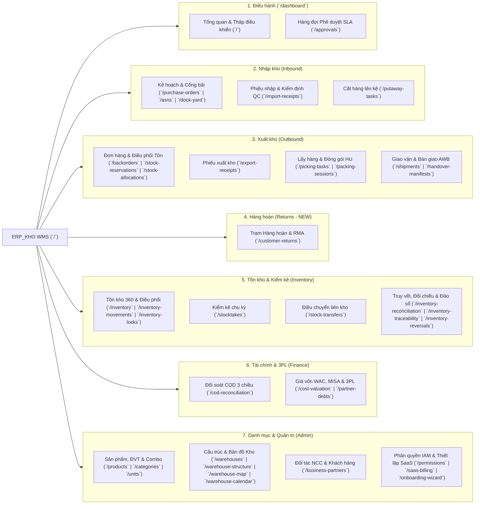

# TO-BE INFORMATION ARCHITECTURE — Cấu Trúc Thông Tin & Điều Hướng Đa Chế Độ

**Document ID:** Deliverable J (`TO_BE_INFORMATION_ARCHITECTURE.md`)  
**Run ID:** `2026-11-01_REASSESSMENT_001`  
**Target Viewports:** Desktop `1440x900` (Collapsible Sidebar + Workspace Tabs) & Mobile/PDA `390x844` (6 Core Floor Workflows)  
**Compliance Rules:** `FE-004`, `FE-006`, `FE-007`, Zero Broken Routes (100% Backward-Compatible URLs)

---

## 1. Chẩn Đoán Vấn Đề Điều Hướng Hiện Tại (`AS-IS Diagnosis`)

### 1.1 Quá tải nhận thức với 36+ mục phẳng trên thanh bên (`FACT`)
Trong [`productionNavigation.ts`](file:///d:/ERP_KHO/frontend/src/config/productionNavigation.ts#L11-L59) và [`MainLayout.tsx`](file:///d:/ERP_KHO/frontend/src/layouts/MainLayout.tsx#L282-L295):
- Thanh điều hướng bên trái (Sidebar) hiển thị **6 nhóm với 36 mục điều hướng phẳng** (31 mục chính + 5 đường dẫn phụ/alias).
- Người dùng phải cuộn dọc thanh Sidebar rất dài (`> 1,100px` chiều cao) để tìm các chức năng nằm ở nhóm **Tồn kho**, **Tài chính** và **Quản trị**.
- Các màn hình con có quan hệ cha-con hoặc nối tiếp chặt chẽ (ví dụ: `Giữ hàng` → `Phân bổ tồn`; hoặc `Kho hàng` → `Cấu trúc vị trí` → `Bản đồ kho` → `Lịch & ca kho`; hoặc `Khóa tồn` / `Di chuyển nội bộ` / `Đảo giao dịch`) đang bị tách rời thành các mục ngang hàng trên Sidebar.
- Chức năng **Hàng hoàn & Xử lý RMA (`CustomerReturns`)** đã có Entity và API nhưng hoàn toàn vắng bóng trên cấu trúc điều hướng.

### 1.2 Nguyên tắc Thiết kế Lại (`TO-BE IA Principles`)
1. **Gộp theo Không gian làm việc (Workspace Consolidation):** Giảm số mục hiển thị cấp 1 trên Sidebar từ **36 mục** xuống còn **18 Không gian làm việc (Workspaces)** ở chế độ Full WMS và **11 Không gian làm việc cốt lõi** ở chế độ Express.
2. **Thanh Tab đồng bộ URL (URL-Synced Workspace Tabs):** Các màn hình chuyên sâu cùng nhóm được gom vào thanh `UiTabs` ngay đầu Workspace. Khi bấm chuyển Tab, URL vẫn điều hướng đúng về route gốc (ví dụ: `/warehouse-structure`, `/warehouse-map`, `/stock-reservations`, `/stock-allocations`) để **bảo toàn 100% bookmark, deep-link và toàn bộ 73 bộ test hiện có**.
3. **Nhóm Sidebar Đóng/Mở thông minh (Collapsible Accordion Sections):** Tự động mở nhóm chứa route đang hoạt động (`aria-expanded="true"`), cho phép thu gọn các nhóm ít dùng (như Danh mục nền hoặc Quản trị hệ thống).
4. **Tách biệt Chế độ Văn phòng (Desktop Control) và Chế độ Sàn kho (Mobile/PDA Scanner Mode):** Nhân viên cầm máy kiểm kho PDA chỉ nhìn thấy 6 tác vụ sàn kho có nút bấm lớn (`min-height: 48px`), không bị phân tâm bởi các bảng cấu hình kế toán hay quản trị.

---

## 2. Sơ Đồ Cấu Trúc Sitemap Toàn Hệ Thống (`TO-BE Mermaid Sitemap`)



---

## 3. Ma Trận Hợp Nhất Sidebar & Workspace Tabs (Từ 36 Mục → 18 Workspaces)

Bảng dưới đây quy định chính xác cách gom 36+ đường dẫn hiện tại vào **18 mục Sidebar cấp 1** kèm **Workspace Sub-Tabs đồng bộ URL**:

| Nhóm Sidebar (Collapsible) | Mục Sidebar Cấp 1 (`Primary Nav Item`) | Chế độ `Express` | Các Tab con đồng bộ URL bên trong Workspace (`URL-Synced Sub-Tabs`) | Quyền hiển thị (`Permission Gate`) |
|---|---|---|---|---|
| **1. ĐIỀU HÀNH** | **1.1 Tổng quan & Tháp điều khiển** | ✅ Hiển thị | • `Bảng điều khiển vận hành (/)`<br>• `Tháp điều khiển Đa kho (/dashboard?tab=tower)`<br>• `Cảnh báo Ngoại lệ (/dashboard?tab=exceptions)` | `always` |
| | **1.2 Phê duyệt tập trung** *(kèm Badge số phiếu chờ)* | 🔸 Ẩn (Hiện khi có phiếu) | • `Tất cả chờ duyệt (/approvals)`<br>• `Duyệt Nhập kho`<br>• `Duyệt Xuất kho`<br>• `Duyệt Kiểm kê` | `canViewApprovals()` |
| **2. NHẬP KHO** | **2.1 Kế hoạch Nhập & Cổng bãi** | 🔸 Ẩn | • `Đơn mua hàng PO (/purchase-orders)`<br>• `Thông báo giao hàng ASN (/asns)`<br>• `Lịch hẹn Cổng & Sân bãi (/dock-yard)` | `purchase_order.read` \| `asn.read` \| `dock_appointment.read` |
| | **2.2 Phiếu nhập & Kiểm định QC** | ✅ Hiển thị | • `Danh sách Phiếu nhập (/import-receipts)`<br>• `Bàn tiếp nhận & Quét mã`<br>• `Kiểm định QC & Xử lý sai lệch` | `receipt.read` |
| | **2.3 Cất hàng lên kệ (Putaway)** | ✅ Hiển thị *(Nâng lên Express)* | • `Nhiệm vụ Cất hàng (/putaway-tasks)`<br>• `Đề xuất vị trí thông minh & Cross-Dock`<br>• `Cất trả hàng hủy (Putback)` | `putaway.read` |
| **3. XUẤT KHO** | **3.1 Nhu cầu Xuất & Phân bổ Tồn** | ✅ Hiển thị | • `Đơn bán & Đơn thiếu hàng (/backorders)`<br>• `Giữ hàng tồn kho (/stock-reservations)`<br>• `Phân bổ vị trí lấy hàng (/stock-allocations)` | `sales_order.read` \| `backorder.read` \| `allocation.read` |
| | **3.2 Phiếu xuất kho** | ✅ Hiển thị | • `Danh sách Phiếu xuất (/export-receipts)`<br>• `Tạo phiếu & Xuất nhanh` | `export_receipt.read` |
| | **3.3 Lấy hàng & Đóng gói** | ✅ Hiển thị | • `Nhiệm vụ Lấy hàng & Wave (/picking-tasks)`<br>• `Trạm Đóng gói & Đơn vị xử lý HU (/packing-sessions)` | `picking.read` \| `packing.read` |
| | **3.4 Giao vận & Bàn giao Bưu tá** | ✅ Hiển thị | • `Biên bản Bàn giao AWB (/handover-manifests)`<br>• `Lô giao hàng & Xác nhận POD (/shipments)` | `shipment.read` \| `inventory.read` |
| **4. HÀNG HOÀN** | **4.1 Hàng hoàn & Xử lý RMA** **[MỚI]** | ✅ Hiển thị | • `Tiếp nhận & Kiểm định RMA (/customer-returns)`<br>• `Tân trang & Nhập lại kho`<br>• `Xuất trả Nhà cung cấp (RTV) & Hủy` | `customer_return.read` \| `receipt.read` |
| **5. TỒN KHO** | **5.1 Tồn kho 360 & Nội bộ** | ✅ Hiển thị | • `Tồn kho tổng hợp & Nhóm 9 chiều (/inventory)`<br>• `Di chuyển vị trí nội bộ (/inventory-movements)`<br>• `Khóa / Đóng băng tồn kho (/inventory-locks)`<br>• `Báo cáo Xuất-Nhập-Tồn & Hạn dùng FEFO` | `inventory.read` \| `inventory_lock.read` |
| | **5.2 Kiểm kê kho (Cycle Count)** | ✅ Hiển thị | • `Phiếu kiểm kê & Đếm thực tế (/stocktakes)`<br>• `Phân tích chênh lệch & Tự động duyệt` | `canViewStocktakes()` |
| | **5.3 Điều chuyển liên kho** | 🔸 Ẩn | • `Phiếu điều chuyển & Hàng đang đi đường (/stock-transfers)` | `inventory.read` |
| | **5.4 Truy vết & Đối chiếu Sổ cái** | 🔸 Ẩn | • `Đối chiếu Số dư vs Sổ cái (/inventory-reconciliation)`<br>• `Truy vết Lô/Sê-ri & Cây thu hồi (/inventory-traceability)`<br>• `Đảo bút toán giao dịch (/inventory-reversals)` | `inventory_ledger.read` \| `inventory_traceability.read` |
| **6. TÀI CHÍNH** | **6.1 Đối soát COD 3 chiều** | ✅ Hiển thị | • `Đối soát Bảng kê ĐVVC (/cod-reconciliation)` | `inventory.cost.read` |
| | **6.2 Giá vốn, Công nợ & 3PL** | ✅ Hiển thị | • `Giá vốn bình quân WAC & Kết xuất MISA (/cost-valuation)`<br>• `Công nợ Phải thu / Phải trả AP-AR (/partner-debts)`<br>• `Tính cước Lưu kho 3PL (/cost-valuation?tab=3pl)` | `inventory.cost.read` \| `partner.read` |
| **7. QUẢN TRỊ** | **7.1 Sản phẩm, ĐVT & Đối tác** | ✅ Hiển thị | • `Sản phẩm & Mã vạch (/products)`<br>• `Danh mục nhóm hàng (/categories)`<br>• `Đơn vị tính (/units)`<br>• `Đối tác NCC & Khách hàng (/business-partners)` | `product.read` \| `uom.read` \| `partner.read` |
| | **7.2 Cấu trúc Kho & Hệ thống** | ✅ Hiển thị | • `Danh sách Kho (/warehouses)`<br>• `Cấu trúc Vị trí kệ (/warehouse-structure)`<br>• `Bản đồ nhiệt 2D (/warehouse-map)`<br>• `Lịch & Ca vận hành (/warehouse-calendar)`<br>• `Phân quyền IAM (/permissions)`<br>• `Gói cước SaaS (/saas-billing)` & `Thiết lập 5 bước (/onboarding-wizard)` | `warehouse.read` \| `location.read` \| `permission.read` |

> **Kết quả tối ưu nhận thức:**
> - Ở **Chế độ Đầy đủ (`Full WMS`)**: Người dùng chỉ nhìn thấy **18 mục rõ ràng** chia trong 7 nhóm có thể đóng/mở (giảm **50%** độ dài thanh cuộn so với 36 mục cũ).
> - Ở **Chế độ Rút gọn (`Express Mode`)**: Người dùng chỉ nhìn thấy **13 mục tác nghiệp cốt lõi**, vừa khít trong 1 màn hình `1440x900` **không cần thanh cuộn dọc Sidebar**.

---

## 4. Trang Đích Theo Vai Trò (`Role-Based Workspace Landing`)

Khi người dùng đăng nhập hoặc bấm vào logo `ERP WMS`, hệ thống tự động ưu tiên hiển thị bố cục phù hợp với vai trò vận hành (`role` + `permissions` từ `GET /api/v1/auth/me`):

| Vai trò (`Role Persona`) | Điểm vào mặc định (`Default Landing`) | Bố cục Ưu tiên trên Màn hình chính (`Primary Workspace Focus`) | Các nhóm Sidebar mở sẵn (`Default Expanded Groups`) |
|---|---|---|---|
| **1. Chủ kho / Giám đốc / Quản lý (`Admin` / `Manager`)** | `/` (`Control Tower Dashboard`) | • Dải KPI toàn kho + Lãi gộp (`inventory.cost.read`)<br>• Tháp điều khiển đa kho<br>• Hàng đợi Cảnh báo ngoại lệ & Phê duyệt SLA (`/approvals`) | `1. Điều hành`, `2. Nhập kho`, `3. Xuất kho`, `5. Tồn kho` |
| **2. Nhân viên Nhận hàng & QC (`Inbound Receiver`)** | `/import-receipts` (hoặc `/` chế độ Tác vụ Nhập) | • Danh sách ASN dự kiến đến hôm nay<br>• Bàn tiếp nhận quét mã vạch & Kiểm định QC<br>• Hàng đợi Cất hàng (`/putaway-tasks`) | `2. Nhập kho`, `4. Hàng hoàn` |
| **3. Nhân viên Lấy hàng & Đóng gói (`Picker / Packer`)** | `/picking-tasks` (trên PDA) hoặc `/packing-sessions` (trên PC trạm đóng gói) | • Hàng đợi Nhiệm vụ lấy hàng theo Wave<br>• Trạm đóng gói HU & In tem nhiệt AWB `100x150mm`<br>• Quét bàn giao bưu tá (`/handover-manifests`) | `3. Xuất kho` |
| **4. Kế toán Kho & Đối soát (`Accountant`)** | `/cost-valuation` (hoặc `/` chế độ Tài chính) | • Định giá tồn kho bình quân gia quyền (WAC) & Kết xuất MISA<br>• Đối soát COD 3 chiều (`/cod-reconciliation`)<br>• Đối chiếu Số dư vs Sổ cái (`/inventory-reconciliation`) | `5. Tồn kho`, `6. Tài chính` |

---

## 5. Kiến Trúc Thông Tin Chế Độ Máy Quét Cầm Tay (`Mobile / PDA Scanner Mode IA`)

### 5.1 Triết lý Thiết kế cho Thiết bị Cầm tay (`390x844` — Zebra / Honeywell / Smartphone)
Trên màn hình nhỏ `<= 768px`, nhân viên kho đeo găng tay hoặc cầm súng bắn mã vạch bằng một tay. Do đó:
1. **Thanh điều hướng dưới đáy (`Bottom Navigation Bar`)** cố định 5 nút trực tiếp + 1 nút mở nhanh menu 6 tác vụ sàn kho.
2. **Màn hình Trang chủ PDA (`/` trên viewport `<= 768px`)** tự động chuyển từ Dashboard biểu đồ sang **Bàn Phím Tác Nghiệp Sàn Kho 6 Ô Lớn (`6-Tile Floor Launcher`)**:

```text
+-------------------------------------------------------+
| [≡] ERP WMS • Kho Trung tâm (WH01)         [⚡ PDA]   |
+-------------------------------------------------------+
| [🔍 Quét bất kỳ Mã SP / Vị trí / Vận đơn AWB... ] [📷]|
+-------------------------------------------------------+
| CHỌN TÁC VỤ SÀN KHO (6 LUỒNG CHÍNH)                   |
| +-------------------------+ +-----------------------+ |
| | 📥 1. NHẬN HÀNG         | | 📦 2. CẤT HÀNG        | |
| | Quét PO/ASN & Nhận lô   | | Quét kệ gợi ý Putaway | |
| | [ 4 phiếu chờ ]         | | [ 12 nhiệm vụ ]       | |
| +-------------------------+ +-----------------------+ |
| +-------------------------+ +-----------------------+ |
| | 🛒 3. LẤY HÀNG (PICK)   | | 🚚 4. ĐÓNG GÓI & AWB  | |
| | Quét kệ -> SP -> Số lượng| | Đóng thùng & Quét AWB | |
| | [ 8 nhiệm vụ ]          | | [ 19 kiện chờ giao ]  | |
| +-------------------------+ +-----------------------+ |
| +-------------------------+ +-----------------------+ |
| | 🔄 5. CHUYỂN KỆ & RMA   | | 📋 6. KIỂM KÊ KHO     | |
| | Chuyển ô kệ / Nhận hoàn | | Đếm mù theo vị trí kệ | |
| | [ Sẵn sàng quét ]       | | [ 2 phiên đang mở ]   | |
| +-------------------------+ +-----------------------+ |
+-------------------------------------------------------+
| [🏠 Trang chủ] [📥 Nhận] [📦 Cất] [🛒 Lấy] [📋 Kiểm kê]|
+-------------------------------------------------------+
```

### 5.2 Ma trận 6 Luồng Tác Nghiệp Sàn Kho trên PDA

| STT | Tác vụ Sàn kho (`Floor Workflow`) | Đường dẫn Đích (`Route`) | Trình tự Quét Mã Vạch 1 Chạm (`Scan Sequence`) | Phản hồi Âm thanh / Xúc giác (`Audio / Haptic`) |
|---|---|---|---|---|
| **1** | **Nhận hàng (`Inbound Receive`)** | `/import-receipts` | Quét Mã Phiếu/ASN → Quét Mã vạch SP → Nhập/Quét Lô & Hạn dùng → Xác nhận số lượng | Tiếng *Bíp ngắn (880Hz)* khi khớp SP; *Bíp kép trầm (220Hz)* + rung 300ms khi sai SP |
| **2** | **Cất hàng (`Directed Putaway`)** | `/putaway-tasks` | Quét Mã HU/SP tại khu nhận → Xem kệ gợi ý trên màn hình → Đi tới kệ → Quét Mã vạch Vị trí đích (`Bin`) | Tiếng *Bíp cao* khi đúng Bin gợi ý; Cảnh báo đỏ `PUTAWAY_WRONG_BIN` nếu quét nhầm kệ |
| **3** | **Lấy hàng (`Directed Picking`)** | `/picking-tasks` | Chọn Wave/Task → Đi tới vị trí chỉ định → Quét Mã Vị trí → Quét Mã SP/Lô → Xác nhận đủ hoặc Báo thiếu (`Short-Pick`) | Chặn cứng nếu quét sai vị trí (`PICK_WRONG_LOCATION`) hoặc sai lô FEFO (`PICK_WRONG_LOT`) |
| **4** | **Đóng gói & Bàn giao (`Pack & AWB`)** | `/handover-manifests` & `/packing-sessions` | Quét Mã vận đơn `AWB` liên tục lên xe tải bưu tá; tự động phát còi báo động nếu đơn vừa bị khách hủy trên sàn | Còi cảnh báo liên hồi + màn hình đỏ nếu dính `ORDER_CANCELLED_PUTBACK_REQUIRED` |
| **5** | **Chuyển vị trí & Nhận hoàn (`Move & RMA`)** | `/inventory-movements` & `/customer-returns` | • *Chuyển kệ:* Quét Vị trí Nguồn → Quét SP → Quét Vị trí Đích.<br>• *Nhận hoàn:* Quét Mã vận đơn hoàn → Đưa vào khu Biệt trữ `RET-QUAR`. | Xác nhận tức thời và cập nhật vị trí không đổi trạng thái/lô |
| **6** | **Kiểm kê (`Cycle Count`)** | `/stocktakes` | Chọn Phiên kiểm kê → Quét Mã Vị trí kệ → Quét từng SP trong kệ (hỗ trợ Kiểm kê mù ẩn số lượng sổ sách) → Gửi kết quả đếm | Hiển thị tiến độ `Đã đếm X/Y vị trí` theo thời gian thực |

---

## 6. Chuẩn Hóa Đường Dẫn URL, Breadcrumb & Tương Thích Ngược

### 6.1 Quy chuẩn Breadcrumb trên Topbar (`MainLayout.tsx`)
Mọi trang trong hệ thống hiển thị thanh định vị 3 cấp nhất quán trên Topbar:
```text
[Nhóm Phân Hệ (Section Eyebrow)]  /  [Không Gian Làm Việc (Workspace Title)]  /  [Tab Hiện Tại hoặc Mã Chứng Từ]
Ví dụ: XUẤT KHO  /  Lấy hàng & Đóng gói  /  Nhiệm vụ Lấy hàng (PICK-20261101-04)
```

### 6.2 Cam kết Tương thích Ngược 100% (`Zero Broken Links Guarantee`)
Mọi đường dẫn hiện có trong [`AppRoutes.tsx`](file:///d:/ERP_KHO/frontend/src/routes/AppRoutes.tsx#L85-L130) đều được giữ nguyên hoạt động độc lập:
- Truy cập trực tiếp `/stock-reservations` mở ngay Workspace **Nhu cầu Xuất & Phân bổ Tồn** với tab **Giữ hàng tồn kho** đang kích hoạt (`aria-selected="true"`).
- Truy cập trực tiếp `/warehouse-map` mở ngay Workspace **Cấu trúc Kho & Hệ thống** với tab **Bản đồ nhiệt 2D** đang kích hoạt.
- Các redirect lịch sử (`/warehouse-locations` → `/warehouse-structure`, `/outbound-demand` → `/backorders`, `/users` → `/permissions`, `/roles` → `/permissions`, `/warehouse-scopes` → `/permissions`) được duy trì nguyên vẹn.
