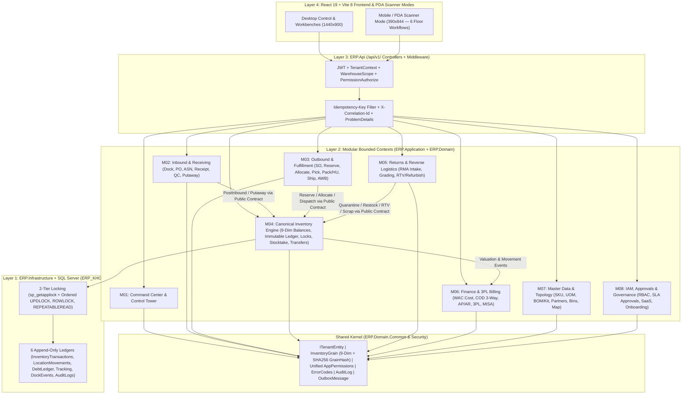

# TO-BE MODULE ARCHITECTURE — ERP_KHO Modular Monolith

**Document ID:** Deliverable H (`TO_BE_MODULE_ARCHITECTURE.md`)  
**Run ID:** `2026-11-01_REASSESSMENT_001`  
**Baseline SHA:** `6e0a333390c1db6222e55ae3945b7ce33a56bef6` (`feat/WMS-61-project-development`)  
**Target Architecture:** Clean Modular Monolith (`.NET 10` + `EF Core` + `SQL Server` + `React 19 / Vite 8 / TypeScript 6`)  
**Compliance Rules:** `ARCH-001..005`, `INV-001..007`, `CON-001..005`, `SAAS-001..004`, `SEC-001..004`

---

## 1. Executive Summary & Architectural Diagnosis (AS-IS vs. TO-BE)

### 1.1 AS-IS Structural Evaluation (`FACT`)
Based on direct codebase inspection of `ERP.Domain`, `ERP.Application`, `ERP.Infrastructure`, `ERP.Api`, and `frontend/src`:

1. **Flat Layer Folders Without Bounded Context Isolation (`FACT`):**
   - `ERP.Domain/Entities` contains ~45 entity files in a flat namespace (`ERP.Domain.Entities`), mixing core inventory primitives (`InventoryStock.cs`, `InventoryTransaction.cs`) with SaaS billing (`SaasSubscriptionEntities.cs`), 3PL billing (`ThreePlBillingStatement.cs`), and RMA returns (`CustomerReturnEntities.cs`).
   - `ERP.Api/Controllers` contains 42 controllers in a flat folder, with mixed route conventions: legacy `/api/<PascalCase>` (e.g., `/api/ImportReceipts`, `/api/ExportReceipts`, `/api/Inventory/stocks`) alongside modern `/api/v1/<kebab-case-plural>` (e.g., `/api/v1/handover-manifests`, `/api/v1/permissions/catalog`).
2. **Orphan & Cross-Module Tangled Capabilities (`FACT`):**
   - **Customer Returns (RMA) & Reverse Logistics:** `CustomerReturn` and `CustomerReturnLine` exist in [`ERP.Domain/Entities/CustomerReturnEntities.cs`](file:///d:/ERP_KHO/ERP.Domain/Entities/CustomerReturnEntities.cs#L5-L40), but their API endpoints (`GET /api/ImportReceipts/customer-returns`, `POST /api/ImportReceipts/rma-intake-check`, `POST /api/ImportReceipts/execute-rtv-refurbish`) are bolted onto [`ImportReceiptsController.cs`](file:///d:/ERP_KHO/ERP.Api/Controllers/ImportReceiptsController.cs#L154-L222) and have **no dedicated UI workbench**.
   - **3PL Depositor Billing:** `ThreePlBillingStatement` and `ThreePlStorageSnapshot` exist in Domain, yet their endpoints are split across [`BusinessPartnersController.cs`](file:///d:/ERP_KHO/ERP.Api/Controllers/BusinessPartnersController.cs#L95-L340), [`InventoryControlController.cs`](file:///d:/ERP_KHO/ERP.Api/Controllers/InventoryControlController.cs#L280-L330), and [`ReportsController.cs`](file:///d:/ERP_KHO/ERP.Api/Controllers/ReportsController.cs#L157-L166).
   - **Kitting / VAS Work Orders:** `KitWorkOrder` and `KitWorkOrderComponentLine` exist in [`ERP.Domain/Entities/KitWorkOrder.cs`](file:///d:/ERP_KHO/ERP.Domain/Entities/KitWorkOrder.cs#L11-L51) with endpoints inside [`ProductsController.cs`](file:///d:/ERP_KHO/ERP.Api/Controllers/ProductsController.cs#L339-L375), while the UI kitting station is embedded in a tab inside [`PackingSessions.tsx`](file:///d:/ERP_KHO/frontend/src/pages/PackingSessions.tsx).
3. **Dual Permission Registry Drift (`FACT`):**
   - [`ERP.Domain/Security/AppPermissions.cs`](file:///d:/ERP_KHO/ERP.Domain/Security/AppPermissions.cs#L3-L46) defines only 5 constants (`users.manage`, `roles.manage`, `inventory.read`, `inventory.cost.read`, `export_receipt.reprint_awb`), whereas [`ERP.Api/Authorization/AppPermissions.cs`](file:///d:/ERP_KHO/ERP.Api/Authorization/AppPermissions.cs#L3-L27) defines 105+ constants used by `[PermissionAuthorize]`.
4. **Navigation Overwhelm & God Components (`FACT`):**
   - [`productionNavigation.ts`](file:///d:/ERP_KHO/frontend/src/config/productionNavigation.ts#L11-L59) exposes 6 sections with **36+ flat navigation items**.
   - Five frontend pages exceed 1,300 lines of code: [`Permissions.tsx`](file:///d:/ERP_KHO/frontend/src/pages/Permissions.tsx) (2,280 LOC), [`ImportReceipts.tsx`](file:///d:/ERP_KHO/frontend/src/pages/ImportReceipts.tsx) (1,991 LOC), [`Stocktakes.tsx`](file:///d:/ERP_KHO/frontend/src/pages/Stocktakes.tsx) (1,568 LOC), [`SaasBilling.tsx`](file:///d:/ERP_KHO/frontend/src/pages/SaasBilling.tsx) (1,455 LOC), and [`ExportReceipts.tsx`](file:///d:/ERP_KHO/frontend/src/pages/ExportReceipts.tsx) (1,417 LOC).

### 1.2 TO-BE Modular Monolith Vision
To scale ERP_KHO for both **5–10 staff e-commerce/distributor warehouses (Express Mode)** and **10–30+ staff multi-warehouse / 3PL fulfillment operations (Full WMS Mode)** without premature microservice complexity, we establish **8 Bounded Context Modules** on top of a **Canonical Shared Kernel**:

1. **`M01` — Command Center & Operational Control Tower (`ControlTower`)**
2. **`M02` — Inbound & Receiving Operations (`Inbound`)**
3. **`M03` — Outbound & Omnichannel Fulfillment (`Outbound`)**
4. **`M04` — Inventory Ledger, Traceability & Quality Control (`Inventory`)**
5. **`M05` — Returns, RMA & Reverse Logistics (`Returns`) [NEW First-Class Module & UI]**
6. **`M06` — Finance, Cost Valuation & 3PL Billing (`Finance`)**
7. **`M07` — Master Data, Catalog & Warehouse Topology (`CatalogTopology`)**
8. **`M08` — IAM, Approvals & System Governance (`Governance`)**

---

## 2. High-Level Modular Monolith Architecture Diagram



---

## 3. Detailed Module Boundaries & Ownership Matrix

### 3.1 Module Summary Table

| Module ID | Module Name (VN / EN) | Core Bounded Context Responsibility | Owned Domain Entities (`ERP.Domain`) | Owned API Controllers (`ERP.Api`) | Frontend Routes (`frontend/src`) |
|---|---|---|---|---|---|
| **`M01`** | **Trung tâm Điều hành** (`ControlTower`) | Multi-warehouse operational KPIs, exception alerts, task queues, global search | Read-models over `AuditLog`, task queues, exception state | `ReportsController` (operational endpoints) | `/`, `/dashboard` |
| **`M02`** | **Nhập kho & Tiếp nhận** (`Inbound`) | Yard/Dock scheduling, PO, ASN, Receiving, Inbound QC, Discrepancy resolution, Directed Putaway | `DockAppointment`, `DockDoor`, `YardSlot`, `PurchaseOrder`, `Asn`, `ImportReceipt`, `ImportReceiptDetail`, `ReceivingDiscrepancy`, `PutawayTask`, `QcPolicy`, `ReceivingTolerancePolicy` | `DockYardController`, `PurchaseOrdersController`, `AsnsController`, `ImportReceiptsController`, `PutawayTasksController` | `/dock-yard`, `/purchase-orders`, `/asns`, `/import-receipts`, `/putaway-tasks` |
| **`M03`** | **Xuất kho & Hoàn tất đơn** (`Outbound`) | SO/Backorder demand, Reservation, Allocation, Wave/Task Picking, Packing, Handling Units (SSCC), Last-mile Shipment, AWB Handover | `SalesOrder`, `Backorder`, `ExportReceipt`, `ExportReceiptDetail`, `StockReservation`, `StockAllocation`, `PickingWave`, `PickingTask`, `PackingSession`, `HandlingUnit`, `PackingVideoEvidence`, `PutToWallSlot`, `Shipment`, `ShipmentTrackingEvent`, `HandoverManifest` | `SalesOrdersController`, `BackordersController`, `ExportReceiptsController`, `StockReservationsController`, `StockAllocationsController`, `PickingTasksController`, `PackingSessionsController`, `HandlingUnitsController`, `ShipmentsController`, `HandoverManifestsController` | `/backorders`, `/export-receipts`, `/stock-reservations`, `/stock-allocations`, `/picking-tasks`, `/packing-sessions`, `/shipments`, `/handover-manifests` |
| **`M04`** | **Tồn kho & Kiểm soát Chất lượng** (`Inventory`) | 9-Dim Inventory Engine, Internal Movements, Status Changes, Locks, Reversals, Traceability, Reconciliation, Stocktakes, Inter-warehouse Transfers | `InventoryStock`, `InventoryTransaction`, `InventoryLocationMovement`, `InventoryLock`, `InventoryLot`, `InventorySerial`, `Stocktake`, `StocktakeDetail`, `StocktakeAdjustmentProposal`, `StockTransfer`, `StockTransferDetail` | `InventoryStocksController`, `InventoryTransactionsController`, `InventoryMovementsController`, `InventoryStatusController`, `InventoryControlController`, `InventoryReversalTraceabilityController`, `InventoryReconciliationController`, `StocktakesController`, `StockTransfersController` | `/inventory`, `/inventory-locks`, `/inventory-movements`, `/inventory-reversals`, `/inventory-traceability`, `/inventory-reconciliation`, `/stocktakes`, `/stock-transfers` |
| **`M05`** | **Hàng hoàn & Logistics Ngược** (`Returns`) **[NEW]** | E-commerce failed-delivery returns, Customer RMA intake, Quarantine grading, Refurbish/Repack, RTV to vendor, Scrap disposal | `CustomerReturn`, `CustomerReturnLine` (extracted from `ImportReceipts` into dedicated domain service) | `CustomerReturnsController` **[NEW `/api/v1/customer-returns`]** (migrated from `ImportReceiptsController`) | `/customer-returns` **[NEW Workbench]** |
| **`M06`** | **Tài chính, Giá vốn & Cước 3PL** (`Finance`) | Moving Average Cost (WAC), Gross Profit, 3-Way COD Reconciliation, Partner AP/AR Debt Ledger, 3PL Billing Statements & Storage Snapshots, MISA Export | `ShipmentFinancialLedger`, `PartnerDebt`, `PartnerDebtLedger`, `ThreePlBillingStatement`, `ThreePlStorageSnapshot` | `PartnerDebtsController`, `ReportsController` (financial/COD/WAC/MISA), `ThreePlBillingController` **[NEW `/api/v1/3pl-billing`]** | `/cod-reconciliation`, `/cost-valuation`, `/misa-exports`, `/partner-debts`, `/3pl-billing` (tab/route) |
| **`M07`** | **Dữ liệu nền & Cấu trúc Kho** (`CatalogTopology`) | SKU Catalog, Barcodes, Multi-UOM, Categories, Kit/Bundle Work Orders, Partners, Warehouses, 5-Tier Locations, 2D Map, Shift Calendar | `Product`, `ProductBarcode`, `ProductCategory`, `ProductUom`, `Unit`, `KitWorkOrder`, `KitWorkOrderComponentLine`, `PromotionGiftRule`, `BusinessPartner`, `Warehouse`, `WarehouseLocation`, `WarehouseCalendar`, `VnAdministrativeEntities` | `ProductsController`, `ProductCategoriesController`, `ProductBarcodesController`, `ProductBarcodeLookupController`, `UnitsController`, `BusinessPartnersController`, `WarehousesController`, `WarehouseCalendarsController` | `/products`, `/categories`, `/units`, `/business-partners`, `/warehouses`, `/warehouse-structure`, `/warehouse-map`, `/warehouse-calendar` |
| **`M08`** | **Quản trị, Phê duyệt & Hệ thống** (`Governance`) | Auth/JWT/Sessions, RBAC Roles & Permissions, Warehouse Scopes, SLA Approvals, SaaS Billing, 5-Step Onboarding, Data Import, Marketplace/Carrier Hub | `User`, `UserSession`, `Role`, `Permission`, `RolePermission`, `UserWarehouse`, `AuditLog`, `IdempotencyRecord`, `SaasSubscriptionEntities`, `SupportImpersonationSession`, `MarketplaceShop`, `CarrierIntegrationConfig`, `IntegrationMessaging` | `AuthController`, `AccountSecurityController`, `PermissionsController`, `UserWarehouseAccessController`, `ApprovalsController`, `SaasBillingController`, `DataImportsController`, `ImportTemplatesController` | `/login`, `/register`, `/onboarding-wizard`, `/saas-billing`, `/approvals`, `/permissions` |

---

## 4. Layer-by-Layer Folder & Namespace Structure

To enforce Clean Architecture (`ARCH-001`) and Modular Monolith boundaries (`ARCH-002`) without breaking existing namespaces during incremental refactoring, the codebase is organized by **Layer → Module**:

```text
d:\ERP_KHO\
├── ERP.Domain/                          # ZERO external dependencies (Pure C# 14)
│   ├── Common/                          # Shared Kernel: ITenantEntity, InventoryGrain, DomainException, ErrorCodes
│   ├── Security/                        # Unified AppPermissions (single source of truth for all 110+ permission codes)
│   ├── Enums/                           # 22 Canonical State Machine Enums
│   └── Entities/                        # Grouped logically by Bounded Context (Inbound, Outbound, Inventory, Returns, Finance, Catalog, Governance)
│
├── ERP.Application/                     # Depends ONLY on ERP.Domain
│   ├── Common/                          # Interfaces: IUnitOfWork, ITenantContext, IWarehouseAccessGuard, IIdempotencyService
│   ├── Modules/
│   │   ├── ControlTower/                # Queries & DTOs for Dashboard, Exceptions, Global Search
│   │   ├── Inbound/                     # PO, ASN, DockYard, ImportReceipt, QC, Discrepancy, Putaway Services
│   │   ├── Outbound/                    # SalesOrder, ExportReceipt, Reservation, Allocation, Picking, Packing, Shipment, Manifest
│   │   ├── Inventory/                   # IInventoryDomainService (THE ONLY writer to InventoryStock & InventoryTransaction)
│   │   ├── Returns/                     # ICustomerReturnOperationsService (RMA Intake, Inspection, Disposition)
│   │   ├── Finance/                     # WAC Costing, COD Reconciliation, PartnerDebts, 3PL Billing Statements
│   │   ├── CatalogTopology/             # Products, UOM, KitWorkOrders, Partners, Warehouses, Locations, Calendar
│   │   └── Governance/                  # Auth, RBAC Permissions, Warehouse Scopes, SLA Approvals, SaaS Billing, Onboarding
│
├── ERP.Infrastructure/                  # Implements ERP.Application interfaces using EF Core + SQL Server + ClosedXML
│   ├── Persistence/
│   │   ├── ErpKhoDbContext.cs           # Global TenantId Query Filters + 6 Append-Only Ledger Guards
│   │   ├── Configurations/              # 100% IEntityTypeConfiguration<T> (decimal(19,4), RowVersion, CheckConstraints)
│   │   └── Locking/                     # AcquireInventoryAllocationLocksAsync (sp_getapplock + Ordered UPDLOCK)
│   └── Services/                        # Module implementation services, PDF generator (%PDF-1.4), Excel ClosedXML
│
├── ERP.Api/                             # Thin REST API Layer ([Route("api/v1/<kebab-case-plural>")])
│   ├── Controllers/                     # Thin controllers delegating to Application Services (0 DbContext injection)
│   ├── Authorization/                   # PermissionAuthorizeAttribute, WarehouseScopeFilter (references ERP.Domain.Security.AppPermissions)
│   └── Middleware/                      # CorrelationIdMiddleware, IdempotencyFilter, GlobalExceptionHandler
│
└── frontend/src/                        # React 19 + Vite 8 + TypeScript 6 SPA
    ├── ui/                              # Design System: tokens.css, production-ui.css, ProductionUi.tsx
    ├── components/                      # Shared domain components (ScanInputBar, ReceiptPrintPreview, BarcodeSvg)
    ├── modules/                         # Decomposed feature sub-components (< 350 LOC per file)
    │   ├── inbound/                     # ImportReceiptList, ReceivingWorksheet, QcInspectionDrawer, DiscrepancyModal
    │   ├── outbound/                    # DemandQueue, WaveWorkbench, PackingStation, ManifestScanner
    │   ├── inventory/                   # StockBalancesTab, BucketInspector, ReconciliationDrilldown, StocktakeCountSheet
    │   ├── returns/                     # RmaIntakeForm, ReturnGradingWorkbench, DispositionActionDrawer
    │   ├── finance/                     # CodThreeWayMatcher, WacValuationTable, ThreePlBillingPanel
    │   └── governance/                  # UserSecurityTab, RolePermissionMatrix, WarehouseScopeTab, SecurityAuditTab
    └── pages/                           # Route entry containers lazy-loaded via React.lazy()
```

---

## 5. Dependency Rules & Cross-Module Communication (`ARCH-001` & `ARCH-002`)

### 5.1 Vertical Layer Dependency Rules (`ARCH-001`)
1. `ERP.Domain` has **zero** `<ProjectReference>` and **zero** `<PackageReference>` to EF Core, ASP.NET Core, or JSON/HTTP libraries.
2. `ERP.Application` references **only** `ERP.Domain`.
3. `ERP.Infrastructure` references `ERP.Application` and `ERP.Domain`.
4. `ERP.Api` references `ERP.Application` (and `ERP.Infrastructure` strictly inside `Program.cs` DI registration). **Controllers MUST NOT inject `ErpKhoDbContext` (`ARCH-003`).**

### 5.2 Horizontal Cross-Module Rules (`ARCH-002` & `INV-001`)
No module outside `M04 (Inventory)` is ever permitted to `INSERT`, `UPDATE`, or `DELETE` rows in `InventoryStocks`, `InventoryTransactions`, or `InventoryLocationMovements`.

| Calling Module | Target Module | Allowed Interaction Contract | Forbidden Shortcut |
|---|---|---|---|
| `M02 Inbound` (Post Receipt / Complete Putaway) | `M04 Inventory` | Calls `IInventoryDomainService.PostInboundReceiptAsync()` / `ExecutePutawayMovementAsync()` inside shared `IUnitOfWork` transaction (`INV-004`) | Direct `db.InventoryStocks.Update()` inside `ImportReceiptService` |
| `M03 Outbound` (Approve / Allocate / Pick / Dispatch) | `M04 Inventory` | Calls `IInventoryDomainService.ReserveStockAsync()`, `AllocateStockAsync()`, `DispatchOutboundAsync()` with ordered 9-dim locks (`CON-003`) | Mutating `ReservedQuantity` or `Quantity` directly in `ExportReceiptService` |
| `M05 Returns` (Quarantine / Restock / RTV / Scrap) | `M04 Inventory` | Calls `IInventoryDomainService.ReceiveReturnToQuarantineAsync()` and `ExecuteReturnDispositionAsync()` | Updating `InventoryStocks` without generating `InventoryTransactions` ledger rows |
| `M04 Inventory` (Post Inbound / Dispatch / Adjust) | `M06 Finance` | Stages `OutboxMessage` / invokes `ICostValuationHook.UpdateMovingAverageCostAsync()` within atomic UoW | Calculating WAC cost on the Frontend (`FE-001`) |
| `M07 CatalogTopology` (`KitWorkOrder` Complete) | `M04 Inventory` | Calls `IInventoryDomainService.ConsumeKitComponentsAndReceiveParentAsync()` | Adjusting component balances without ledger lineage |
| Any Module Mutation | `M08 Governance` | Calls `IAuditLogService.StageAuditEntryAsync()` + `IOutboxService.StageEventAsync()` in the same SQL transaction (`INV-004`, `AUD-001`) | Endpoint writing *only* `AuditLog` without mutating business aggregate (`FAKE-001`) |

---

## 6. Shared Kernel Specification

The **Shared Kernel** (`ERP.Domain.Common` & `ERP.Domain.Security`) is kept minimal and stable so all 8 modules share exact invariants:

1. **Multi-Tenant Identity (`ITenantEntity`, `ITenantContext`):**
   - Every persistent entity implements `ITenantEntity { int TenantId { get; set; } }`.
   - `ErpKhoDbContext` enforces `.HasQueryFilter(e => e.TenantId == CurrentTenantId)` and validates cross-tenant foreign keys on `SaveChangesAsync` (`SAAS-001`).
2. **9-Dimension Canonical Inventory Identity (`InventoryGrain`):**
   - `(TenantId, WarehouseId, ProductId, Status, LocationId, LotId, SerialId, HandlingUnitId, OwnerId)` + deterministic `GrainHash` (`SHA2_256`).
   - All lock acquisition orders keys deterministically: `ORDER BY WarehouseId, ProductId, LocationId, LotId, SerialId, HandlingUnitId, Status, OwnerId` (`CON-003`).
3. **Unified Permission Registry (`ERP.Domain.Security.AppPermissions`):**
   - Consolidates the 5 constants in `ERP.Domain` and the 105+ constants in `ERP.Api` into **one canonical static class** in `ERP.Domain.Security.AppPermissions`, plus new codes for `M05 Returns` (`customer_return.read`, `customer_return.create`, `customer_return.inspect`, `customer_return.dispose`) and `M06 3PL Billing` (`three_pl_billing.read`, `three_pl_billing.manage`).
4. **Machine-Readable Error Code Registry (`ErrorCodes` — Spec 18):**
   - Standardized codes (`INV_INSUFFICIENT_AVAILABLE_STOCK`, `DOC_INVALID_STATE_TRANSITION`, `CONCURRENCY_CONFLICT`, `PICK_WRONG_LOCATION`, `PICK_WRONG_LOT`, `PACK_QUANTITY_EXCEEDS_PICKED`, `ORDER_CANCELLED_PUTBACK_REQUIRED`) mapped by Global Exception Handler to HTTP `409 Conflict` or `422 Unprocessable Entity` (`API-002`, `API-003`).
5. **Atomic Transaction Envelope (`IUnitOfWork` — `INV-004`):**
   - Guarantees that `(1) Document State + (2) InventoryTransactions Ledger + (3) InventoryStocks Balance + (4) Reservation/Allocation + (5) AuditLogs + (6) OutboxMessages` commit or roll back as a single atomic unit.

---

## 7. Complexity Tiers & Policy Configuration (`EXPRESS` vs. `FULL WMS`)

### 7.1 Design Principle (`SAAS-003`)
Vietnamese SMEs (5–10 warehouse staff) need speed and simplicity, while mid-market distributors and 3PLs (10–30+ staff) need strict dock scheduling, multi-step wave picking, and 9-dimension audit controls.  
**Rule:** Express Mode **NEVER** bypasses the 9-dimension `InventoryDomainService`, `InventoryTransactions` ledger, or 2-tier SQL locking. Instead, Express Mode streamlines the **workflow orchestration and UI surface** via `IWarehousePolicyProvider`:

| Operational Dimension | ⚡ Express Mode (5–10 Staff / SME E-Commerce) | 🏭 Full WMS Mode (10–30+ Staff / 3PL / Distributor) | Backend Policy Flag (`IWarehousePolicyProvider`) |
|---|---|---|---|
| **Inbound Flow** | **1-Step Direct Receive & Post:** Create/Select PO or Receipt → Scan items into Default Receiving/Storage Bin → Post immediately to `Available` stock. | **Multi-Stage Inbound:** Dock Appointment → Vehicle Check-in → ASN Match → Blind Receive to `STAGING-IN` → Mandatory QC Inspection → Directed Putaway Task to rack bin. | `InboundRequireAsn`, `InboundRequireQcByDefault`, `InboundAutoPutawayOnPost` |
| **Outbound Flow** | **Direct Order-to-Pack:** Approve Export Receipt / SO → Auto-allocate FEFO → Express Pack & Seal → Scan AWB to Handover Manifest. | **Wave & Directed Fulfillment:** SO Release → Reservation → Location Allocation → Wave Generation → Directed PDA Picking Task → Packing & SSCC HU Nesting → Staging/Loading → Shipment POD. | `OutboundEnableWavePicking`, `OutboundRequireExplicitPickTask`, `OutboundRequireStagingLoad` |
| **Inventory Control** | Stock Balance, Expiry Aging, Quick Internal Transfer, Cycle Count (1-step count), Inter-warehouse Transfer. | Full 9-Dim Bucket Inspector, Partial Quantity Locks/Freezes, Ledger Reversals, Recall Tree Traceability, Balance-vs-Ledger Reconciliation, 2-Attempt Blind Stocktake. | `StocktakeBlindCountRequired`, `StocktakeTwoAttemptRequired` |
| **Returns (RMA)** | Scan returned AWB/Order → Choose `Restock Available` or `Damaged` in 1 drawer action. | Quarantine Intake (`RET-QUAR`) → Technical Grading (`GOOD` / `DAMAGED_BOX` / `DEFECTIVE`) → Multi-path Disposition (`RESTOCK`, `REFURBISH`, `RTV_VENDOR`, `SCRAP`). | `ReturnsRequireQuarantineStep` |
| **Sidebar Navigation** | **14 high-frequency workspaces** visible by default; advanced tabs accessible inside consolidated workbenches. | **All 22 consolidated workspaces** (covering all 39+ routes) visible in collapsible module groups. | `uiComplexityMode` (`EXPRESS` \| `FULL`) |

---

## 8. Legacy Route & Controller Standardization Plan

To satisfy `PROJECT_RULE` Layer 3 (`[Route("api/v1/<kebab-case-plural>")]`) without breaking existing Frontend or integration callers during transition, all legacy PascalCase routes are dual-bound `[Route("api/v1/<kebab-case-plural>")]` + `[Route("api/<LegacyPascalCase>")]` and Frontend `apiClient` calls are standardized to `/api/v1/...`:

| Legacy Endpoint (`AS-IS`) | Standardized Canonical Endpoint (`TO-BE`) | Owning Module |
|---|---|---|
| `/api/ImportReceipts/*` | `/api/v1/import-receipts/*` | `M02 Inbound` |
| `/api/ImportReceipts/customer-returns`, `rma-intake-check`, `execute-rtv-refurbish` | `/api/v1/customer-returns/*` (`CustomerReturnsController`) | `M05 Returns` |
| `/api/ExportReceipts/*` | `/api/v1/export-receipts/*` | `M03 Outbound` |
| `/api/Inventory/stocks`, `/transactions`, `/in-out` | `/api/v1/inventory/stocks`, `/transactions`, `/in-out` | `M04 Inventory` |
| `/api/Stocktakes/*` | `/api/v1/stocktakes/*` | `M04 Inventory` |
| `/api/StockTransfers/*` | `/api/v1/stock-transfers/*` | `M04 Inventory` |
| `/api/Reports/*` | `/api/v1/reports/*` | `M01 ControlTower` & `M06 Finance` |
| `/api/Auth/*` | `/api/v1/auth/*` | `M08 Governance` |
